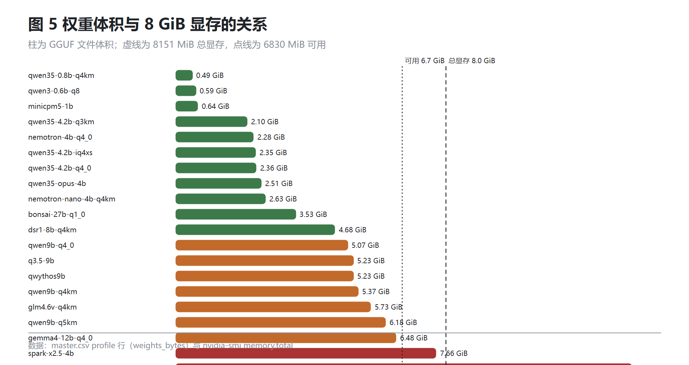
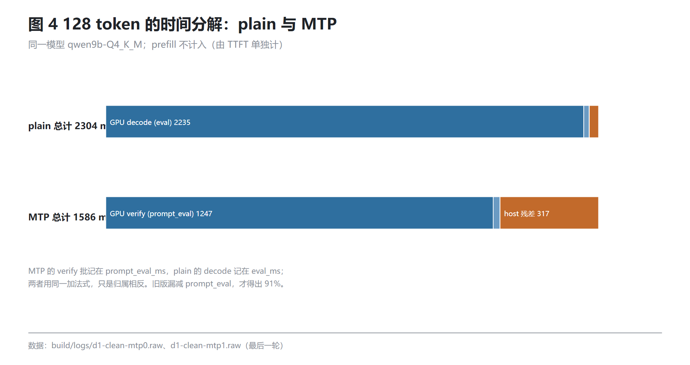

# TIR-A


**在 8GB 显存 + 16GB 内存的物理双墙下，把本地大模型的交互延迟压榨到极限。算物理账，不吹牛；正确性优先于吞吐。**

这不是一个"通用大模型推理引擎"。它是 **8GB 笔记本上跑本地模型的生存指南**：告诉你什么跑得动、什么一定会挂、以及在跑得动的那部分里，怎样才不会在第三轮对话时悄悄给出错字。

<sub>Build 徽章反映本地 P0 门（4 测试 + 2 bench，RC=0）；仓库未配置 CI。</sub>

## 三个数字

- **首字延迟 9260 ms → 265 ms（约 35×）**。521 token 的长 prompt，逐 token 预填充时用户要等九秒，宽批 512 后 0.26 秒出第一个字。这不是调参，是把"以为程序卡死"变成"能用"。
- **9B MTP 77.2 tok/s，宽度 2 可到 84.24**。默认宽度 1；宽度 2 必须单独过 64-token parity，不过就退回——速度可以谈，逐位一致不能谈。
- **20 个本地模型跑成一张边界图**。18 个完整测完；13.43 GiB 的 Gemma-26B 在加载前被拒绝；7.66 GiB 的 Spark 能加载但只有 4.2 tok/s。别人可以少走几百小时的"下载—报错—删模型"。

## 为什么值得看

**默认值就是对的。** 同一个 llama.cpp fork，默认配置下 9B plain 只有 51.8 tok/s 量级、长 prompt 首字要九秒。TIR-A 把默认批、投机宽度、KV 量化、上下文检查都调到了这台机器的稳态，装好即用，不需要用户读十篇 issue 才会配。

**对数值一致性死磕。** 宽批 512 在短 prompt 上会把 `top1−top2` margin 从 0.0549 压到 0.0080，并在第 41 个 token 翻转，随后 86/128 个 token 与逐 token 路径不同。所以这个仓库里有一条硬门：plain 与 MTP 的 64 个 greedy token 必须逐位相同；宽度 2 只有单独过门才允许开启。

**把归因算成账本。** `tir_stats` 有 9 个 append-only 字段，prefill 结束后先 `llama_synchronize` 再复位，让 `eval_ms`、`prompt_eval_ms` 与 `step_us` 覆盖同一段时间。靠这本账，我们发现 MTP 路径的 `eval_ms` 与 `prompt_eval_ms` 语义和 plain 相反，并把一次"host 占 91%"的错误归因更正为 **20.0%**。这个过程完整写进了论文 2.6 节。

**会优雅地说"不行"。** 权重 13.43 GiB、总显存 8,151 MiB，引擎在调用加载器之前就拒绝；12B 模型跑完短档后显存只剩 435 MiB，被标成"边缘降级"并跳过所有长上下文测量。多数引擎会强行加载然后在第三分钟把系统拖进交换，这里选择在第一时间告诉你装不下。

## 和主流引擎比，它站在哪

同一台机器、同一个模型（Qwen3.8-9B Q4_K_M）、同一轮测量：

| 对比维度 | Ollama (默认配置) | 原生 llama.cpp (手调) | **TIR-A（本项目）** |
| :--- | :--- | :--- | :--- |
| **521 token TTFT** | 未实测 | 未实测（同机只测过 8B 的 pp512） | **265 ms**（宽批 512；逐 token 时 9260 ms） |
| **9B 纯解码** | 未实测 | **51.81 tok/s**（同轮同条件） | **53.0 tok/s**（贴住 HBM 墙） |
| **9B MTP 投机** | 不支持 | 需自行改底层代码 | **77.2 tok/s**（宽度 1；宽度 2 为 84.24，需过 parity） |
| **16k 显存峰值** | 未实测 | 未实测 | **6,929 / 8,151 MiB**（余 1,222 MiB） |
| **超限模型处理** | 未实测 | 运行期报错 | **加载前拒绝**（13.43 GiB > 8.0 GiB） |

> Ollama 那一列空着是有意的：本机没有安装，也没有同一轮的测量记录。拿没测过的数字做对比，和这个项目反对的东西是一回事。
>
> 我们不假装"超过 llama.cpp"：同轮隔离复测是 **50.84 对 51.81（−1.9%）**。TIR-A 的价值不在那 2%，而在三件事——默认值不用手调、数值分叉被门禁拦住、装不下的模型不会把系统拖死。

## 核心特性

- **对抗 16GB 内存墙**：本机内存带宽 33.7 GB/s，回退 CPU 的每 token 代价远高于 GPU，具体慢多少没有测——因为没有把它当作可用路径。这个 fork 的盘流式 residency hook 只有 CPU 实现，与 CUDA offload 互斥；层一旦上 GPU，盘流式必须关（`LLAMA_DISK_STREAM_MB=0`）。
- **硬核算账与显存守卫**：总显存 8,151 MiB，扣掉约 **1.1–1.3 GiB 桌面基线**（实测空闲 6,830–7,039 MiB）后按余量判断能否放下。运行脚本在每次加载前核算，空闲低于 **800 MiB** 直接停；引擎在 context 创建失败时返回 `TIR_E_OOM`，不把 OOM 留给运行期。
- **数值正确性门禁**：`qwen35` 是 hybrid SSM，3 行 verify 会走 chunked kernel、logits 偏约 0.13；所以 MTP 验证批在带 nextn 头的模型上限制为 2，默认宽度 1。任何配置变更都要过 **64-token parity**，不过就退回。
- **自动适配的 Kernel 白名单**：`prefill_batch_for_arch` 按架构分配——`llama / qwen3 / qwen35 / nemotron_h` 给 512，带 nextn 头给 2，未知架构回退 1。宁可慢，不冒数值风险。

## 快速上手

### 构建

需要 **CUDA 13.5**（`runtime\cuda-13.5`）、Visual Studio 2022/2026 的 `vcvars64`、CMake + Ninja：

```bat
build\build-tir-api.bat
```

产物在 `build\tir-api\bin\`：`tir.dll`、`llama.dll`、`ggml*.dll`、`tir-bench.exe`、`tir-test-*.exe`。

> **DLL 纪律**：`runtime\llama-b12202\` 是上游预编译包，自带一套同名 ggml/llama DLL。混进 PATH 会出现"能加载、第一次 decode 报 CUDA illegal memory access"。PATH 只留 `runtime\cuda-13.5\bin\x64` 与 `build\tir-api\bin`。

### 最简 Python 调用

完整宿主见 `src/llama.cpp-fork/tests/tir-api/python_host.py`：

```python
import ctypes, os
from ctypes import (CFUNCTYPE, POINTER, Structure, c_char_p, c_float,
                    c_int32, c_uint32, c_void_p)

# 必须在引擎加载模型之前设置：盘流式与 CUDA offload 互斥
os.environ["LLAMA_DISK_STREAM_MB"] = "0"

BIN = os.path.abspath(r"build\tir-api\bin")
os.environ["PATH"] = BIN + os.pathsep + os.environ["PATH"]
lib = ctypes.CDLL(os.path.join(BIN, "tir.dll"), winmode=0)

class Options(Structure):
    _fields_ = [("struct_size", c_uint32), ("version", c_uint32),
                ("model_path", c_char_p), ("n_ctx", c_int32),
                ("n_gpu_layers", c_int32), ("n_threads", c_int32),
                ("kv_q4", c_int32), ("mtp", c_int32)]

class Request(Structure):
    _fields_ = [("struct_size", c_uint32), ("version", c_uint32),
                ("prompt", c_char_p), ("n_predict", c_int32),
                ("greedy", c_int32), ("temperature", c_float),
                ("seed", c_uint32)]

class Token(Structure):
    _fields_ = [("id", c_int32), ("piece", c_char_p),
                ("piece_len", c_uint32), ("index", c_uint32)]

ON_TOKEN = CFUNCTYPE(c_int32, c_void_p, POINTER(Token))

class Callbacks(Structure):
    _fields_ = [("on_token", ON_TOKEN), ("on_event", c_void_p)]

lib.tir_engine_create.restype = c_void_p
lib.tir_engine_create.argtypes = [POINTER(Options)]
lib.tir_engine_load.restype = c_int32
lib.tir_engine_load.argtypes = [c_void_p]
lib.tir_session_create.restype = c_void_p
lib.tir_session_create.argtypes = [c_void_p]
lib.tir_session_generate.restype = c_int32
lib.tir_session_generate.argtypes = [c_void_p, POINTER(Request),
                                     POINTER(Callbacks), c_void_p]
lib.tir_last_error.restype = c_char_p

opt = Options(ctypes.sizeof(Options), 1,
              rb"E:\model\qwen9b-Q4_K_M.gguf", 8192, 99, 8, 1, 0)
eng = lib.tir_engine_create(ctypes.byref(opt))
if not eng:
    raise RuntimeError(lib.tir_last_error().decode())
if lib.tir_engine_load(eng) != 0:          # TIR_OK == 0
    raise RuntimeError(lib.tir_last_error().decode())

sess = lib.tir_session_create(eng)

@ON_TOKEN
def on_token(user, tok):
    piece = tok.contents.piece[:tok.contents.piece_len]
    print(piece.decode("utf-8", "replace"), end="", flush=True)
    return 0                                # 返回非 0 即取消

cb = Callbacks(on_token, None)
req = Request(ctypes.sizeof(Request), 1,
              b"The capital of France is", 64, 1, 0.0, 1234)
rc = lib.tir_session_generate(sess, ctypes.byref(req), ctypes.byref(cb), None)
print("\nrc =", rc)
```

> **排雷**：`LLAMA_DISK_STREAM_MB=0` 必须在加载模型之前设置。16GB 内存下磁盘流式是死路——盘上每 token 顺序读 6GB 权重约 1.1 s，那不叫交互。

## 20 模型极限压测

固定条件：Windows 11、RTX 5060 Laptop（8,151 MiB）、i7-14650HX、15.7 GiB DDR5、115 W；q4 KV、greedy、128 token；ctx 16k。

| 模型 (量化) | 权重 (GiB) | 纯解码 (tok/s) | 峰值显存 (MiB) | 状态判定 |
| :--- | ---: | ---: | ---: | :--- |
| MiniCPM5-1B (Q4) | 0.64 | **313.9** | 1,898 | 跑通 (极速) |
| Qwen3.5-4.2B (Q4) | 2.36 | 96.7 | 4,084 | 跑通 (甜点) |
| DSR1-8B (Q4_K_M) | 4.68 | 59.0 | 6,479 | 跑通 |
| Qwen3.8-9B (Q4_K_M) | 5.37 | 53.0 | 6,929 | 跑通 (主力) |
| Bonsai-27B (Q1_0) | 3.53 | 46.1 | 5,396 | 跑通 (极限量化) |
| Gemma4-12B (Q4_0) | 6.48 | 10.1 | 7,716 | **边缘降级 (余量仅 435 MiB)** |
| Spark-X2.5-4B (BF16) | 7.66 | 4.2 | 7,681 | **叫停 (严重换页)** |
| Gemma4-26B-A4B | 13.43 | - | - | **拒绝加载 (超容量)** |




<details>
<summary>点击查看 20 个模型全量极限压测矩阵</summary>

| 模型 | 权重 GiB | plain tok/s | MTP（接受率） | TTFT S / M / L ms | 峰值 MiB | 判定 |
|---|---:|---:|---:|---|---:|---|
| minicpm5-1b | 0.64 | 313.9 | — | 23.3 / 142.7 / 685.0 | 1,898 | 跑通 |
| qwen35-0.8b-q4km | 0.49 | 274.6 | — | 25.4 / 148.2 / 585.1 | 2,032 | parity 诊断失败 |
| qwen3-0.6b-q8 | 0.59 | 243.6 | — | 20.8 / 131.3 / 692.8 | 2,366 | 跑通 |
| nemotron-4b-q4_0 | 2.28 | 116.1 | — | 83.7 / 522.1 / 2,194.2 | 3,634 | 跑通 |
| qwen35-4.2b-iq4xs | 2.35 | 97.0 | — | 88.1 / 543.9 / 2,201.3 | 4,064 | 跑通 |
| qwen35-4.2b-q4_0 | 2.36 | 96.7 | — | 85.0 / 528.9 / 2,152.9 | 4,084 | 跑通 |
| qwen35-4.2b-q3km | 2.10 | 86.2 | — | 101.0 / 639.5 / 2,564.9 | 3,830 | 跑通 |
| qwen35-opus-4b | 2.51 | 84.9 | — | 96.2 / 593.1 / 2,360.6 | 4,247 | 跑通 |
| dsr1-8b-q4km | 4.68 | 59.0 | — | 153.0 / 951.4 / 4,147.2 | 6,479 | 跑通 |
| qwen9b-q4_0 | 5.07 | 56.8 | 77.3（0.767） | 141.1 / 858.7 / 3,401.7 | 6,605 | 跑通 |
| q3.5-9b | 5.23 | 52.9 | — | 161.6 / 972.2 / 3,768.5 | 6,581 | 跑通 |
| qwythos9b | 5.23 | 52.7 | — | 162.6 / 969.8 / 3,763.5 | 6,581 | 跑通 |
| qwen9b-q4km | 5.37 | 53.0 | 77.2（0.855） | 162.9 / 968.9 / 3,771.7 | 6,929 | 跑通 |
| qwen9b-q5km | 6.18 | 47.2 | 75.8（1.000） | 169.0 / 1,001.5 / 3,878.0 | 7,561 | 跑通 |
| bonsai-27b-q1_0 | 3.53 | 46.1 | — | 424.0 / 2,720.3 / 10,723.9 | 5,396 | 跑通 |
| glm4.6v-q4km | 5.73 | 45.0 | — | 167.2 / 1,051.3 / 4,515.1 | 7,137 | parity 政策分歧 |
| gemma4-12b-q4_0 | 6.48 | 10.1 | — | 5,214.0 / 49,089.4 / 跳过 | 7,716 | 边缘降级 |
| spark-x2.5-4b | 7.66 | 4.2 | — | 4,501.3 / — / — | 7,681 | 能跑不可用 |
| gemma4-26b-a4b | 13.43 | — | — | — | — | 超容量未加载 |

“边缘降级”指能加载、短档能跑，但余量撑不住长上下文——继续测只会测到显存交换，不是算力。

</details>

<details>
<summary>这张表怎么测的（口径与已知坑）</summary>

- 每模型 1 次 warmup + 3 次计时取均值；8 token 短跑不进任何结论。
- 速率走引擎默认批；TTFT 显式 `TIR_PREFILL_BATCH=512`。两者批宽不同，只作同模型内的条件记录。
- 边缘模型的长档与 `test_prefill` 显式跳过，理由写入数据（`vram_edge`），不当作数据缺失。
- GPU 串行、模型间冷却；每步检查空闲显存 ≥800 MiB，低于即停。
- 原始日志、CSV 与驱动在 `test/matrix/full1/` 与 `tools/matrix/run_matrix.py`。

</details>

## 论文与工程报告

这个仓库不只交付代码，也交付判断的依据。

- [**《TIR-A 结项技术论文》**](paper/TIR-A_Technical_Report_Final.md)（42,043 汉字）——上限校准、20 模型矩阵，以及两次关键反转：MTP 的 `eval_ms` 语义与 plain 相反；主机开销先被算成 91%，补上漏项后更正为 20.0%。同目录有 DOCX/PDF。
- [**《上一版工程报告》**](docs/archive/2026-11-10-engineering-report.md)（46,925 汉字）——踩坑、失败与回退、门禁设计。

三个问题的答案在这里：**为什么 8B 到不了 100 tok/s？** 看论文 §3.1 的物理账（5.03 GB/token ÷ 292 GB/s ≈ 17.2 ms，100 tok/s 要求 10 ms）。**为什么 27B 反而能跑？** 因为它是 1-bit 的 3.53 GiB，装得下就赢了一半。**91% 的归因错误怎么纠正的？** 看 §2.6：漏减 `prompt_eval_ms`，加上 prefill 统计越界，两处修完才是 20.0%。

## 许可证与血统

**主体协议：MIT**，见 [LICENSE](LICENSE)。

**许可分流**：`src/llama.cpp-fork` 中源自 `diskinfer-windows`（Apache-2.0）的盘流式与 `diskui` 部分按 Apache-2.0，见 [LICENSE-APACHE-2.0](LICENSE-APACHE-2.0) 与 [NOTICE](NOTICE)；其余原创代码按 MIT。第三方组件清单见 [THIRD_PARTY_NOTICES.md](THIRD_PARTY_NOTICES.md)。

**代码基座（fork 血统）**

- 直接上游：[`Horn-Studio/diskinfer-windows`](https://github.com/Horn-Studio/diskinfer-windows)。本仓库的 `src/llama.cpp-fork/` 在它的 fork 上继续改；同为 `llama.cpp 0.7.0` / `ggml 0.27.0`，保留盘流式钩子（`src/llama-disk.cpp`）与节点驻留回调。
- 间接上游：[`ggml-org/llama.cpp`](https://github.com/ggml-org/llama.cpp)。量化 kernel、KV 布局、CUDA 图、`common_speculative` 来自上游；本仓库新增 `src/tir-api/`（C ABI）、`src/tier-memory` 与 CUDA 节点驻留回调。`vendor/` 依赖（cpp-httplib、nlohmann、stb 等）保持上游原样。

**策略借鉴（只借机制，不搬代码）**

- [`Niko1221/Strata`](https://github.com/Niko1221/Strata)：会话前缀 checkpoint。其论文报告 262K 续问 TTFT 904 s → 0.53 s；本机 16GB 内存跑不了它支持的模型包。
- [`kvcache-ai/ktransformers`](https://github.com/kvcache-ai/ktransformers)：pinned 奇偶双缓冲、`cudaLaunchHostFunc` 欠一拍流水。其 NUMA/AMX 栈在消费级 Windows 上不可用。
- [`leonickson1/Swiftlet`](https://github.com/leonickson1/Swiftlet)：固定 stride 专家块与 LFU+recency 缓存。Swift/Metal 不能在本机编译，只借设计。
- `FMInference/FlexLLMGen`：`Tgen/Tpre` 代价式；`lyogavin/airllm`：super-block 落盘；`Tiiny-AI/PowerInfer` 的 `smallthinker` 子树：ExpertCache LRU。PowerInfer 的神经元稀疏依赖 ReLU，与 Qwen 的 SwiGLU 不匹配，明确不做。

所有第三方库与代码片段均遵循其各自许可证（Apache-2.0 / MIT 等）。本仓库不包含上述项目的源码副本，只包含调研结论与自行实现的调度形状。

## 状态

工程验证版。单用户、单模型常驻，不是并发服务。所有数字来自一台固定机器；换卡、换量化、换上下文都要重测——论文里每个数都带条件，不搬结论。
