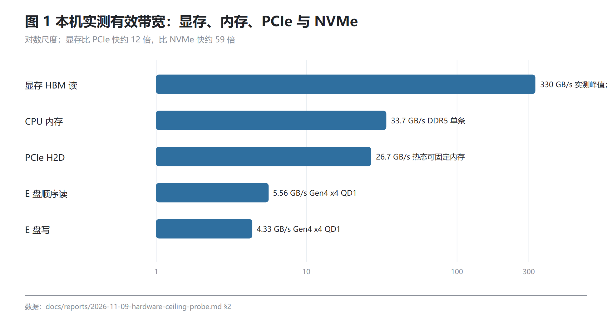
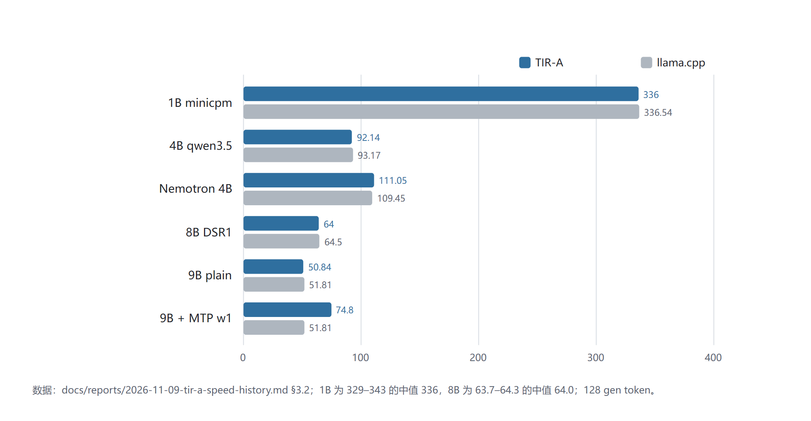
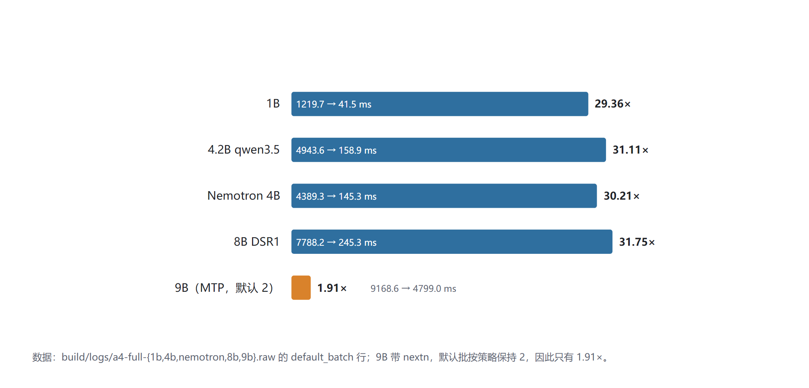
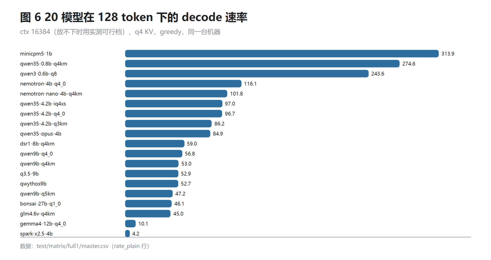
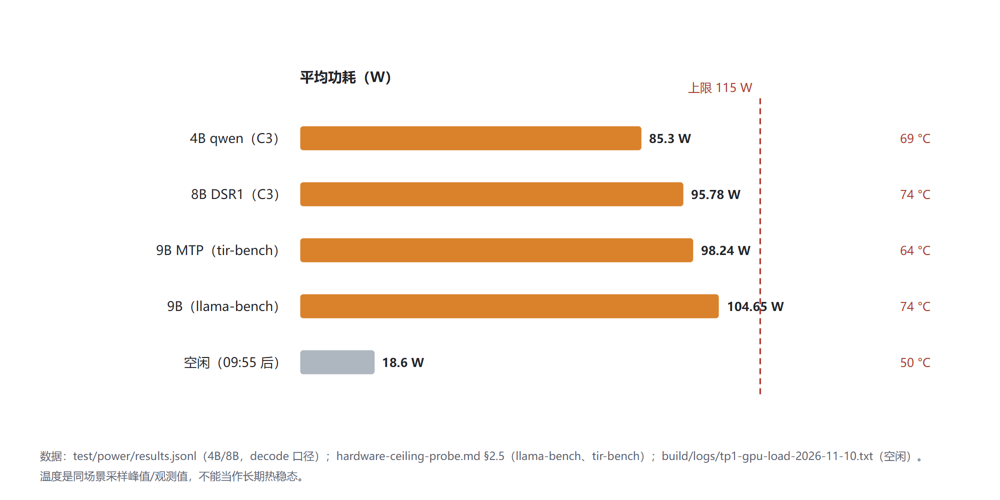
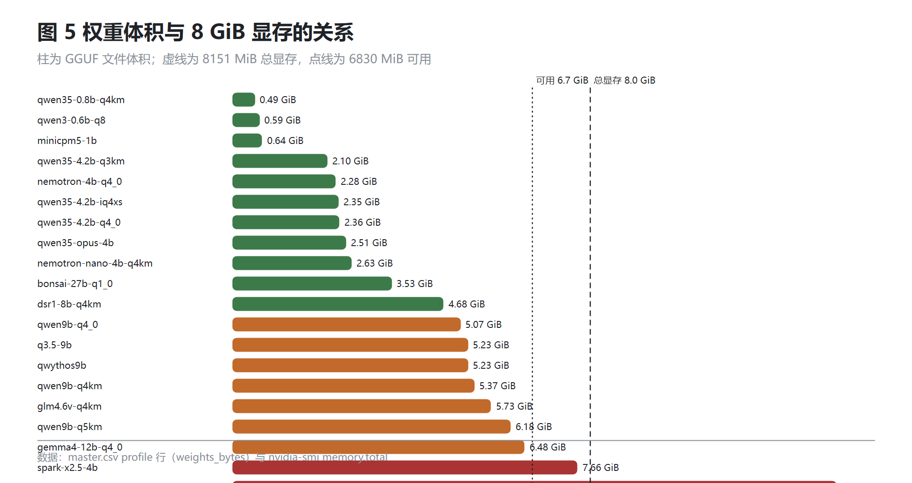
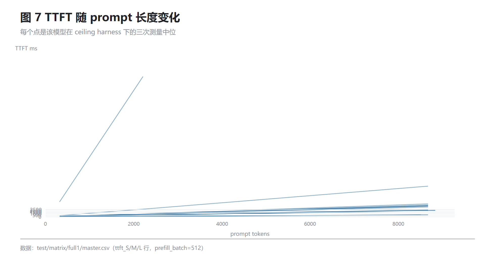
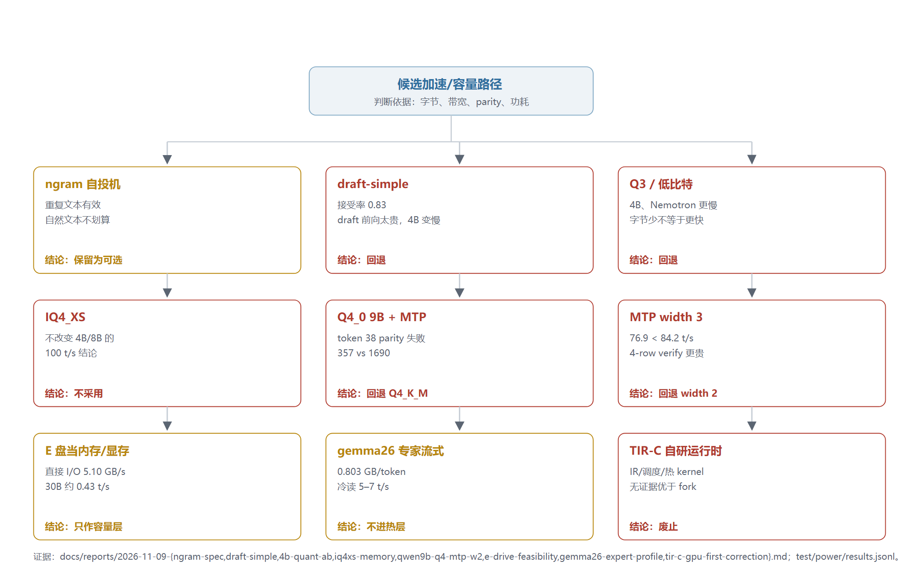

# TIR-A 技术报告：8 GiB 笔记本上的 llama.cpp 引擎实践

## 摘要

8 GiB 显存的 Windows 笔记本，16 GiB 单条内存，约 105–109 W 的功耗墙。在这台机器上，我把 llama.cpp fork 成一个带冻结 C ABI 的引擎，跑完二十个本地模型，记下每一次判断和它后来的结果。可交互的上限是 9B 稠密模型加 16k q4 KV：plain 约 53 tok/s，打开模型自带的投机头到 77–84；4.2B 级 85–97，8B 约 59。521 token 的首字延迟从逐 token 预填的 9260 ms 降到 4852 ms，宽批 265 ms。再往上，12B 开始换页，13.43 GiB 连加载都不做。

第一部分讲约束和开发中读过的九个开源项目，第二部分按问题讲开发与实测，第三部分把经验收成判断与十六个坑。速度结论都带条件：模型、量化、ctx、prompt 长度与构建版本。没测的写未测——前缀复用只到两轮单模型，部分卸载只有规划器预测，投机路径 521 token 的首字延迟仍是 9733.55 ms，比 plain 宽批多 9.47 s。归因那一节保留了完整的事故过程：主机开销先被算成 91%，靠横向对照发现漏项，更正到 20.0%。

**关键词**：本地推理；llama.cpp；C ABI；投机解码；显存带宽；性能归因；可复现性

[TOC]

# 第一部分 环境与资源

**这一部分回答的是同一类问题：这台机器能做什么、不能做什么，从别人的代码里能借什么、不能借什么，判断又是怎么固定下来的。**

后面每一个 `tok/s`、每一毫秒 `TTFT`、每一瓦峰值，都是这里几条上限的函数。数字一律来自本机实测或已落盘的文件；没有测过的写"未测"，不拿规格表顶替。

## 1.1 机器与三堵墙

**开工第一件事是把机器查清楚，代码一行没写。**

一条只读命令给出三行：厂商 LENOVO、型号代码 83LY、系统 Windows 11 家庭中文版 10.0.26200（build 26200）。商品名是 Legion 还是 LOQ 我没有记录，也不按型号去猜。后面所有结论只对这台机器、这个 Windows 安装成立，没有第二台对照机，也没有云端复现。

**硬件数字都不取整。**

- 显卡是 RTX 5060 Laptop，`nvidia-smi` 报可用显存 8151 MiB——后面说"8 GiB 卡"，指的就是这 8151，名义值 8192 不算数。
- CPU 是 i7-14650HX，8 个性能核加 8 个能效核。
- 内存只有一条 16 GB DDR5-5600，系统报可用 15.7 GiB，单 NUMA；这台机器的内存通道就这些，没有"暂时只插一条、以后补齐"的余地。
- 数据盘 `E:` 是 SK Hynix HFS001TFP9X205N，953.9 GiB，GPT 单分区、NTFS、4 KiB 簇，当前链路 Gen4 x4（端口本身支持 Gen5 x4），剩余 776.8 GiB。
- 页面文件在 `D:\pagefile.sys`，上限 13 GB，实测占用 760 MB；它不在 `E:` 上，这一点在讨论"盘能不能当内存"时是决定性的。

**三堵墙按我实际撞到的顺序排列。**

**显存是容量墙，不是速度墙。**

这个项目的生成路径要求权重全驻留：fork 自带的盘流式加载与 CUDA offload 不能同时开，一旦把层放上 GPU，盘流式就必须关掉。于是选模型变成一道加法——权重 + `16k KV` + 激活 + 计算图 + 余量，与 8151 MiB 比。9B Q5 的权重 6.18 GiB，plain（逐 token 解码）峰值 7106 MiB，打开 MTP（模型自带的多 token 预测头）后 7607 MiB，只剩 544 MiB。这 544 MiB 决定了后面很多"不做"：第二个 session 装不下，32k 上下文装不下。也正是在写第一行 kernel 之前，这道加法就把 13.45 GiB 的 gemma-26B 和 7.66 GiB 的 Spark BF16 排除掉了。

**内存墙是通道墙。**

一条 DDR5-5600 在 16 线程读+写下实测 33.7 GB/s，按这个数算，9B 的 5.62 GB 权重如果交给 CPU 独占推理，上限是 167 ms/token、6.0 t/s；4B 是 12.5 t/s，8B 是 6.7 t/s。也就是说任何"显存不够就让 CPU 兜底"的设计，都会把二十几毫秒的 token 变成上百毫秒。插第二条同规格内存能把通道抬到约 67 GB/s，但那条通道只影响 pinned 缓冲、加载和 CPU 回退，不提高 GPU decode，所以我没有加内存。

**功耗墙是最后撞上的，也最容易被误读。**

`nvidia-smi` 报的 115 W 只是 GPU 侧上限，整机墙有多高我不知道，电源适配器的额定功率我没有记录。9B Q5 用 `-p 512 -n 128 -r 10` 重复十轮，活跃段平均 104.65 W、峰值 109.28 W，也就是 105–109 W 这个区间；温度平均 70 °C、峰值 74 °C，SM 平均 2713.9 MHz，利用率 93.3%。74 °C 离笔记本上限还远，没有热降频；卡住的是功耗，温度还有余量：115 W 只比实测峰值高约 5%，再快没有频率空间，只能少做工作。

**把三个数放在一起，得到的是一套按顺序生效的筛选条件。**

- 先按 8151 MiB 做加法决定能不能全驻留。
- 再按 33.7 GB/s 决定 CPU 能承担多少。
- 最后按 115 W 决定"再快一点"还有没有余量。

这也是我选笔记本、放弃台式与云端的理由：台式机绕开了功耗墙，云端 A100 则把三堵墙一起绕开，两者都回答不了 MTP 宽度该给几这种问题。我要回答的是"这一类机器上能不能做交互式单用户推理"，这个问题只在三堵墙都还在的机器上才有意义。

**环境里已有的干扰源要顺带记一笔。**

- LM Studio 的模型目录在 `E:\model\bionic`（8 个主模型加 4 个视觉投影）。
- Ollama 的 blob 在 `E:\model\blobs`（6 个模型，其中 2 个与前者重复）。

我留着它们当对照组：同一个 GGUF、同一张卡，`llama-server` 能跑出的数，TIR-A 不能更差。代价是显存与端口都可能被抢，所以"跑分前确认没有别的推理进程"是前置条件，写进流程而不靠记忆。

## 1.2 四条带宽与延迟实测

**带宽不抄规格表，全部本机实测。**

测法三套：

- 一次性 CUDA 探针（`E:\Deepseek\hardware-probe\probe.cu`，覆盖 HBM 拷贝与纯读、PCIe 四象限扫描、固定内存、空 kernel launch）。
- Rust 探针（内存带宽、NVMe 直接 I/O）。
- `llama-bench` 配 `nvidia-smi` 1 s 采样。

探针是一次性代码，不进产品。

| 层 | 实测 | 条件 |
|---|---|---|
| HBM 拷贝（读+写） | 306.3 GB/s | 1 GiB copy |
| HBM 纯读 kernel | 329.7 GB/s | 1 GiB |
| HBM `cudaMemcpy` D2D | 307.6 GB/s | 1 GiB |
| PCIe pinned H2D / D2H | 26.66 / 27.08 GB/s | 256 MiB，热态 |
| PCIe pageable H2D | 8.28 GB/s | 512 MiB |
| PCIe 冷态首搬 | 12 GB/s | 首次 512 MiB，GPU 刚从 idle 唤醒 |
| CPU 内存，16 线程 | 33.7 GB/s | 读+写 |
| NVMe 直接 I/O / buffered | 5.10 / 3.13 GB/s | 4 GiB 顺序读，`FILE_FLAG_NO_BUFFERING` 对照普通读 |
| `E:` 4 MB 顺序 / 随机 | 5.56 / 4.33 GB/s | QD1，unbuffered；随机 1,031 IOPS |
| `E:` 4 KB 随机 | 44.8 MB/s | 10,943 IOPS，单次 91 µs |
| `cudaHostRegister` / `cudaHostAlloc` | 15.2 / 3.5–3.9 GB/s | 512 MiB |
| 空 kernel launch | 7.51–8.15 µs | 10,000 次 |

**HBM 给了三个数，因为单一测法有偏差。**

- `cudaMemcpy` D2D 307.6、手写拷贝 kernel 306.3，两者几乎相等，说明拷贝路径没有被我的写法拖累。
- 纯读 329.7 更高，说明读+写天然低于纯读上限。

所以我把 306–330 当一个区间用：算 decode 屋顶用 330，因为每 token 只把权重读一遍；跟 PCIe、NVMe 做倍数比较用 306，因为那是读写混合。谁把这两个数混用，屋顶线自己就会漂 7%。

**`llama-bench` 的两行折算值是后面所有优化的出发点。**

`llama-bench` 默认 4k 上下文下，9B plain 46.4 t/s 折合 6.18 GiB ÷ 21.55 ms ≈ 308 GB/s，正好落在区间里；MTP 每步 1.882 token、6.18 GiB/步、26.5 ms，折合约 250 GB/s，是区间的八成。也就是说 plain 已经贴住 HBM，快不了；MTP 还有两成，但那两成在宽度、overhead 和功耗里，不在带宽里。

**PCIe 的 26.7 GB/s 要配尺寸一起用。**

- 4 KiB 只有 0.37 GB/s，由延迟主导（单次 10–14 µs）。
- 1 MiB 爬到 23.11，256 MiB 才稳定在 26.66；pageable 大块只有 8.28。
- 冷态首搬 512 MiB 只有 12 GB/s、热态 26.66，差 2.2 倍。

任何"先搬一块再出首 token"的设计，第一轮都要白等一倍。热身必须做，原因（GPU 唤醒、链路训练还是驱动）我没有定位，只记录了现象。

**固定内存的两个数要分清。**

- `cudaHostRegister`（原地锁页）约 15.2 GB/s。
- `cudaHostAlloc`（新分配）3.5–3.9 GB/s。

所以环形缓冲必须在启动时一次分配或一次注册；热路径里逐层 pin 到底有多贵，1.3 里有一条独立的反面证据。

**NVMe 层直接 I/O 比 buffered 更快，也更可预测。**

用 `FILE_FLAG_NO_BUFFERING` 与普通读各跑一遍同一份 14.4 GB 的 GGUF：直接 I/O 5.10 GB/s，buffered 3.13。buffered 更慢不反常识——4 GiB 工作集远大于页缓存，既要做拷贝又被淘汰拖住，直接 I/O 反而可预测。`E:` 上另一组探针问的是"这块盘能不能当热层"：4 MB 顺序 5.56、4 MB 随机 4.33、4 KB 随机 44.8 MB/s。结论先写在这里：4 MB 是甜点，小块是灾难，专家块和层包必须按 MiB 对齐才有意义。

**空 kernel launch 7.51–8.15 µs，在 14 ms/token 里占 16%。**

按每 token 约 300 次 launch 估，是 2.3 ms。这解释了后面为什么值得做 graph 与融合，也提醒我不要指望它突破 HBM。

**整套数还教会我一件事：只用有效带宽。**

这颗 GPU 是 128-bit GDDR7，按 24/28 Gbps 折出来的名义峰值是 384–448 GB/s，实测 306–330 只有名义的 79–87%。如果我拿 448 去算屋顶，6.63 GB 的 9B plain 会算出约 67 t/s，拿 330 算只有 50 t/s；差出来的 17 t/s 不是隐藏空间，是一个根本不存在的目标。

**四层带宽与三堵墙的位置见图 1。**



**图注：四条横杠差三个数量级，决定哪些路可走。**

## 1.3 参考过的开源项目

**这一节写我读过的代码，以及读完之后决定不抄什么。**

八个快照放在 `E:\Deepseek\low-vram-research\repos\`，全部是 tar.gz 解压，没有 `.git`，所以"版本"只能是下载那一刻的样子；身份与版本的判断依据是三处：

- `low-vram-research\repos.json`：记录六个项目的仓库名、语言、默认分支与体量。
- `repos\strata-meta.json`：Strata 的 GitHub API 元数据，42,701 星、MIT、2026-09-24 创建。
- `docs\swiftlet.md` 开头的记录：Swiftlet，`leonickson1/Swiftlet`，667 星。

星数只用来认人，不当证据；我没有向这些仓库提过 PR 或 issue，正文里也不会出现 PR 号。

### 代码基座

**代码基座只有两个，而且是一个套一个。**

`Horn-Studio/diskinfer-windows` 是我们 fork 的直接上游，本地在 `E:\Deepseek\_source\diskinfer-windows-main`。它的 README 把话说得很直：在 Windows 上跑远大于内存的 GGUF，权重不 mmap、不整体读入，推理时按计算图节点把用到的张量读进固定大小的 arena，用完按 LRU 换出，代价是每生成一个 token 都要把模型顺序读一遍，速度基本等于磁盘顺序读带宽。

**引擎是 `src/llama.cpp-fork/src/llama-disk.cpp`，1573 行。**

文件句柄用定位读（Windows 上是带 OVERLAPPED 偏移的 `ReadFile`），arena 按 4 KiB 对齐切槽，节点执行期间把槽 pin 住不许驱逐。版本与我们完全相同：`llama.cpp` 0.7.0、`ggml` 0.27.0，两个版本号就写在各自的 `CMakeLists.txt` 第 6–8 行。拆解它的七份模块蓝图在 `E:\Deepseek\diskinfer-windows-blueprint\docs\blueprints\`（磁盘引擎、CPU 节点驻留钩子、装载集成、三个命令行前端、图形工作台、构建启动、验证回归），我是在读这些蓝图时确认钩子应该开在 ggml 的节点循环里，模型加载阶段不行。

**它做到的事一句话能说完：一个 llama fork 不重写 kernel 也能被改造成分页器。**

钩子点就在节点执行循环，成本模型残酷且诚实——吞吐约等于盘带宽。

**没能证明的是"这条路能交互"。**

每 token 顺序读一遍 6 GB 权重，在 5.56 GB/s 的盘上就是 1.1 s/token。

**我们的前提与它差一个数量级。**

目标是几十毫秒一个 token，权重必须整份驻留 HBM，盘只能当冷层，而且驻留路径必须是 CUDA。它的驻留钩子只有 CPU 实现，盘流式与 CUDA offload 不被支持。三个宿主都要在第一次 load 之前设 `LLAMA_DISK_STREAM_MB=0`，这条属于 fork 的结构约束，与配置习惯无关。

**整棵树作为上游 fork 保留，改动分三块。**

- CUDA 侧加节点驻留回调（`ggml-cuda.cu` 里的 `ggml_cuda_node_residency_cb`，默认空指针，融合节点会被跳过）。
- 单独一个 `src/tier-memory` 做 T0 VRAM 与 T1 pinned host 的槽分配与 LRU（这一版里 T2 字节数写 0，冷层留到后面）。
- 全新的 `src/tir-api/` C ABI；`tir.h` 目前 14 个导出函数，从 `tir_api_version` 到 `tir_chat_apply_ex`，宿主只认这个头文件。

**`ggml-org/llama.cpp` 是间接继承的。**

diskinfer 本身就是 llama.cpp 的 fork，我们再 fork 它，所以量化 kernel、KV 布局、CUDA 图、`common_speculative` 都是上游的。我们没有 remote，也不向上游提 PR，所以这篇报告里凡说"上游怎么做的"，指的都是这棵树里的代码。

**我们真正加的东西只有三处：C ABI、`tier-memory`、CUDA 驻留回调。**

`llama`、`ggml`、`common` 其余部分只读，唯一例外就是盘流式那一处。

### 借策略，不搬代码

**借策略不搬代码的那一类，读法不一样。**

这一类里只有 PowerInfer 是 2023 年的 llama.cpp fork，Strata 只转写了 llama 的量化 kernel，其余与 llama fork 无关；语言从 Swift 到 Python 都有，直接搬过来既编不过也跑不动。我的做法是每读一个项目先回答三个问题：

- 它证明了什么机制有效？
- 它的前提在我这里为什么不成立？
- 我最后拿走了哪一条？

三个问题答不上来，这个项目就只当读物。

**Swiftlet 是 Apple Silicon 上的 MoE 专家流式运行时，9,673 行 Swift。**

22 个源文件，不含测试。它把 dense 核心常驻，routed expert 打成固定 stride 的 `.qpack` 容器：一个专家是 gate/up/down 加 scales 连续一块、16 KB 对齐，取一个专家就是一次 `pread`。`ExpertCache` 按层独立开槽池、懒分配、容量等于预算除以 stride，命中与未命中都记频率，受害者取 `(frequency, last_use)` 最小的那个，batch 内先把 hit 与 victim 都解析完再一起发 IO。

**decode 拆成 cb1 → IO → cb2 三段。**

读 miss 的同时算 shared expert 把延迟盖住；prefill 按 64–128 token 分块、层主序，每层取该块所有 token 路由到的专家并集，一个唯一专家只读一次，它的笔记里 chunk 32 去重 2.7 倍。公开数字是在 Qwen3.6-35B-A3B 4-bit、18 GB 容器上，峰值 RAM 2.6 GB，M5 上 7–11 tok/s。

**它给出的第一条硬结论是关于布局的。**

专家块怎么切直接决定 I/O 下限，一个专家一次读，比按 tensor 随机取好一个量级；prefill 的并集规划能把重复读消掉。

**它的前提我这里不成立。**

Swift/Metal 在 Windows/CUDA 上编不过，Apple 统一内存的零拷贝语义在 Windows 不存在，本机也没有任何 `.qpack` 模型，而 TIR-A 的白名单是 dense 的 Qwen、Nemotron、gemma，没有 256 专家的路由。

**所以只借三条设计。**

- 固定 stride 专家块。
- LFU+recency 的分层槽池。
- 层主序 prefill 并集。

这三条写进决策文档的专家流式阶段，代码没有落地；`E:` 盘 4 MB 随机 4.33 GB/s 那组数，就是"一个专家多大才值一次读"的旁证。

**KTransformers 给我的第一个信号是 CMake 直接 FATAL——`kt-kernel` 找不到 libnuma。**

内核是 AVX512/AMX 的，本机是 8P+8E 的消费级 CPU，没有 AVX-512，单 NUMA，整套栈在原生 Windows 上不可用。它现在的树由两块拼成：CPU 侧 MoE 专家内核加专家放置层，GPU 侧 attention 与热专家交给 SGLang fork，两边用 CUDA stream host callback 加 pinned 缓冲接成一条流水线。

**三个细节值得记。**

- 专家分桶后按 `local_num/local_pos` 重排 token，再按"专家 × 块"切任务做 work-stealing。
- pinned 槽按 `layer_idx % 2` 轮转，深度 2，于是同层复用不必等同步。
- `cudaLaunchHostFunc` 把"启动 CPU 任务"挂到当前 stream 上，CPU 在前序 kernel 完成后自动开始，不需要 host 轮询，再配 `allow_n_pending=1`，让上一层的 CPU 任务没算完就进下一层。

**代价它也写在代码里。**

deferred 组的结果写进下一个槽，等于把部分专家输出延后一层，文档承认 deferred 到 5–7 个会掉精度。

**这条流水线能在 PCIe 边界上不靠轮询地接起来，双缓冲按层奇偶预分配是最省事的解。**

差别最大的是 T1 里的内容：它只放 token 级张量，专家权重必须整体可寻址（RAM 或 page cache），而我们要解决的恰恰是"装不下也得跑"。

**最终借走的是 pinned 奇偶双缓冲与欠一拍提交这两个形状。**

丢掉 NUMA/TP 切分、AMX 性能叙事和 deferred 近似——后者会改 logits，与 MTP 接受率和逐位 parity 门直接冲突。专家分桶那段留作将来 CPU-MoE 回退的骨架。

**FlexLLMGen 留在我笔记里的是两个代价式。**

decode 是 `Tgen = ctog + max(gtoc, dtoc, ctod, comp)`，prefill 是 `Tpre = max(ctog+dtoc, gtoc+ctod, comp)`。前者说明 decode 时权重上行是串行不可隐藏项，后者说明 prefill 的 I/O 可以与计算并行。这两个式子后来成了我们规划器的骨架判断。

**它是 FlexGen 改名再分发，包名和入口换了，论文、代码结构、`--percent` 语义都没变。**

它把权重、KV、激活按静态比例切到 GPU、CPU、NVMe，核心是 block schedule：一层权重只搬一次，内层 batch 循环复用同一份显存，有效 batch 等于 `gpu_batch_size × num_gpu_batches`，所以吞吐约等于有效 batch 除以每层 I/O 时间。

**它留下的另一个判断是计量单位：每个 token 摊到多少权重字节。**

一次权重读服务的 token 越多越划算。前提不同：它是吞吐导向、请求等长、没有连续批处理也没有投机，内核是 PyTorch eager；我们要的是单流延迟。它的静态 percent 和四个 disk 线程启动时各分配 1 GB pinned（共 4 GB）在 15.7 GiB 上等于先蒸发四分之一内存。

**最后拿走的是 `Tgen/Tpre` 的串行/并行判断，以及把 MTP 的 K 个候选当内部 batch 来摊薄权重读这个思路。**

这是我们后来写 MTP 宽度与 batch 关系的依据；不拿 percent 调度器、不拿 4×1 GB relay、不拿每层一次 `sync()`。KV 按 head 分段也读懂了，但 `16k` 上下文下 KV 只有 0.13–1.15 GiB，收益低于复杂度，暂缓。

**AirLLM 用 meta 设备建模、给每层挂 forward hook。**

执行前把该层权重搬进显存，执行完 `to('meta')` 加 `gc.collect` 加 `empty_cache`；量化只发生在磁盘上，加载时反量化回 fp16 再上卡。

**它的新版里有一条真正值得抄的语义：预量化 checkpoint 走 verbatim 搬运。**

PCIe 只传 packed 字节，到目标端再解压，MXFP4 因此少传四倍。super-block 的落盘布局则来自同族的 AirLLM++：把 K 层拼成一个 `block_NNN.bin`，配一份 `index.json` 记 offset 与字节数。

**搬运算则只有一条：原样搬、对面解。**

这条来自它的预量化 verbatim 路径；super-block 的块布局减少每 token 的 open/seek。

**前提不同有两处。**

- 量化在 AirLLM 里不省显存（上卡即展开），而我们的 GGUF Q4 在 HBM 里保持量化。
- 它的逐层 `gc + empty_cache` 在 Windows 上 `malloc_trim` 直接失败静默，`empty_cache` 只是把下一次 `cudaMalloc` 重新推回驱动，既不省显存又费时间——我们的 arena 就是为了消灭这条路径而存在的。

**借的是 super-block 的"块加索引"形状用于冷层，verbatim 规则约束 T1→T0 不许在 host 端展开量化权重。**

不借它的显存峰值数字（那是"刚好放下"，没有给 MTP draft 和 KV 留余量），也不借 DiskKVCache（每 token 全量重写整层 KV，与低延迟直接冲突）。

**PowerInfer 的主机制在 Qwen 上不成立。**

根部是 2023 年的 llama.cpp fork，在 ggml 图里加稀疏算子与一套异构图调度，可它的主机制依赖 ReLU 族的零激活：每层一个 predictor 给出神经元分数，两端用同一阈值跳过不应算的行。Qwen 这一族是 SwiGLU，没有零激活，predictor 权重和激活统计也不存在，所以这条明确不做。

**真要借的是它 `smallthinker/` 子树里的磁盘专家缓存。**

`ExpertCache` 等于固定大小 LRU 加预分配对齐缓冲，io_uring 深度 512 异步读，`Pipeline::prefetch` 按"预测专家 × 3 个矩阵"抢跑，任务 DAG 加 spin barrier 让 IO 与计算重叠，整套约 1200 行。专家缓存可以是一个小而自足的组件，它的 `ExpertCache` 就是按这个思路写的：对齐预分配加固定 LRU 比动态分配稳。

**前提不同：模型族不匹配。**

它的 GPU kernel 是 DMMV 时代的手写实现，默认架构 `52;61;70`，要跑 RTX 5060 得自己加 120，且没人验证过 Blackwell。结论是稀疏路径记为不做，只把 `ExpertCache` 的形状留作将来专家缓存的参照；它文档里唯一一条 Windows 数据（2080Ti 11G、13B Q4、4.05 tok/s）被我当量级参照，不当目标。

**Strata 读完后的第一条判断是：本机跑不了它支持的任何模型包。**

门槛是 RAM 33–44 GB（Q2_0 要 34 GB 专家加约 10 GB 系统），本机 15.7 GiB。它的体量与定位都特殊：42,701 星、253k 行 C++/CUDA、只支持三个模型族的专用引擎，和 llama.cpp 只有部件级关系（转写了 i-quant 的 GPU 点积与反量化，链接 ggml 后端，没有 libllama API）。

**它有两样东西直接影响了后面的实验设计。**

第一条是会话前缀 checkpoint：在每个 assistant turn 开头和每 16K prompt token 处存一份状态，最多 6 份、每份约 118 MB，只在前缀 token 完全相同时命中；在 Tesla P100 上实测，262K 文档冷读 904 s，文档尾有 turn boundary 时第 2–20 个问题的 TTFT 中位 0.53 s，走 server 而无 boundary 时每次 55.5 s。

**第二条是 `DraftPolicy`。**

每个 lookup 宽度有一张实测成本表，接受率用 0.995 慢衰减、计数用 0.97 衰减，一个新宽度先试 3 次才允许成本否决，首次捕获 CUDA graph 的那一轮成本不计入——它把"投机有时是负收益"变成了一件可在线判定的事，全局开关换成了每宽度的门控。

**精确前缀复用能把 TTFT 压三个数量级而不破坏逐位一致。**

状态是 verbatim 拷贝，这是它给的直接证据；门控则说明一个平均为负的技巧可以在局部为正。

**其余前提我这里同样不成立。**

- 14650HX 没有 AVX-512，它的 Q2_0 VNNI 内核用不上。
- 8 GB 显存扣掉 dense 与 MTP 后只剩 2–3 GB 给专家缓存。
- `E:` 4 KB 随机 44.8 MB/s 决定权重流式只能在个位数 t/s。

**所以一行没跑，只借两个机制。**

- 前缀 checkpoint 作为我们前缀复用探针的证据输入（我们的 dense 模型没有专家驻留这个变量，固定构建下重放确定性只会更强）。
- `DraftPolicy` 的"每宽度实测成本加探索探针"作为 ngram 在自然英文上 −3% 之后的设计回应。

它记录的一串 Windows 坑（WDDM 下 CUDA 报的空闲显存虚高、sysmem fallback 打开后零余量时掉到七分之一、每次显存分配同时计入 commit charge、pin 时保留 640 MiB）后来成了我们遥测字段的清单。

### 反面证据

**最后是反面证据，两条都很短，但都改变了我写代码的方式。**

**RabbitLLM 是 AirLLM 的下游 fork，83 层 72B 在 8 GB 笔记本卡上跑。**

它的 benchmark 历史里，bf16 时 `pin_memory` 每步累计约 190–200 s（83 层 × 每层约 2.4 s），换 4-bit 后整步 56 s。

**两份数据互相印证：1.7 GB ÷ 2.4 s 和 0.43 GB ÷ 0.6 s 都是约 0.7 GB/s。**

这说明"每层 pin 一次"本身就是一堵墙，藏不起来。我们自己的探针把口径分得更细：`cudaHostRegister` 15.2 GB/s、`cudaHostAlloc` 3.5–3.9 GB/s，0.7 是 PyTorch"分配加拷贝"那条路径的数；但结论不变：槽必须在启动时一次分配，热路径里不许出现 pin。

**airllm-plus 的数字一个都没采信。**

它的 compute 是 `time.sleep(30 ms)`，GPU 缓存直接 `NotImplementedError`，benchmark 用 32 个 50 MB 的 dummy 文件，还把 depth=1 定义成"关闭预取"当基线。它得出的结论——"AirLLM 做了很多小随机读"——也是错的，AirLLM 每层是一个连续 safetensors。它唯一有用的东西是块文件的形状：`block_NNN.bin` 加 offset/bytes 索引。

**这一圈读下来，能借的清单很短，而且每一条都是调度决策，没有一条是代码。**

- 块布局。
- 槽的生命周期。
- 代价式的形状。
- 门控的时机。

原因很朴素：三堵墙是硬件的，换语言、换框架都不会移动；能移动的只有"每个 token 要读多少字节、这些字节在哪一层、什么时候读"。

**三类关系与最终去向见图 2。**



**图注：三类关系收敛成四条调度决策，没有一条是代码。**

## 1.4 模型资源

**本机可用的 GGUF 一共 20 个，分三处。**

- `E:\Deepseek\artifacts\` 8 个，是我们自己用 `llama-quantize` 产出的对照组。
- `E:\model\bionic`（LM Studio）8 个主模型。
- `E:\model\blobs`（Ollama）4 个。

另有 4 个 mmproj 视觉投影（1.66 / 1.11 / 0.87 / 0.16 GiB），只在需要图像输入时加载，不单独测。

**口径先说清：这里统一按 GiB 取实际文件大小。**

库存文档按 GB（十进制）记，这里统一按 GiB（1,073,741,824 B）取实际文件大小，所以同一个文件会出现两个数，6.64 GB 就是 6.19 GiB，同一份权重的两种口径。

| 文件 | 来源 | 大小 | 在本项目里的角色 |
|---|---|---:|---|
| Qwen3-0.6B-Q8_0 | artifacts | 0.60 GiB | 加载与 ABI 冒烟，跑得快、出错不掩盖问题 |
| Qwen3.5-0.8B-Q4_K_M | artifacts | 0.50 GiB | 最小 qwen35，模板与流式改动的第一站 |
| nemotron-4b-Q4_0 | artifacts | 2.28 GiB | 与 LM Studio 的 Q4_K_M 做量化 A/B |
| qwen35-4.2b-IQ4_XS | artifacts | 2.36 GiB | 低比特对照 |
| qwen35-4.2b-Q3_K_M | artifacts | 2.11 GiB | 低比特对照 |
| qwen35-4.2b-Q4_0 | artifacts | 2.37 GiB | 4B 上最快的量化，作参考点 |
| qwen9b-Q4_0 | artifacts | 5.08 GiB | 9B 重定量；64-token parity 第 38 token 分叉 |
| qwen9b-Q4_K_M | artifacts | 5.38 GiB | 9B 重定量的主候选 |
| Qwen3.8-9B-Q5_K_M | bionic | 6.19 GiB | 主力；库存里唯一带 nextn 头 |
| Spark-X2.5-4B（BF16） | bionic | 7.66 GiB | 超显存的边界样本，必须先重定量 |
| Bonsai-27B-Q1_0 | bionic | 3.54 GiB | 极限量化，"能跑"不代表质量 |
| DeepSeek-R1-0528-Qwen3-8B-Q4_K_M | bionic | 4.68 GiB | plain 基线，全 attention、无 nextn |
| GLM-4.6V-Flash-Q4_K_M | bionic | 5.74 GiB | 文本可驻留；加视觉投影 1.66 GiB 就超 |
| Nemotron-3-Nano-4B-Q4_K_M | bionic | 2.64 GiB | hybrid SSM 与低功耗对照 |
| gemma-4-12B-QAT-Q4_0 | bionic | 6.50 GiB | 12B 边缘档 |
| gemma-4-26B-A4B-QAT-Q4_0 | bionic | 13.45 GiB | MoE 128 专家用 8，装不下，只量"装不下" |
| minicpm5 1B | Ollama blob | 0.64 GiB | 固定开销探针，host 占比最大 |
| qwen3.5-opus 4B | Ollama blob | 2.52 GiB | 与 artifacts 的 4.2B 跨运行时对照 |
| q3.5-9b-opusglm | Ollama blob | 5.24 GiB | 9B 跨运行时对照 |
| qwythos9b | Ollama blob | 5.24 GiB | 9B 长上下文对照 |

**三处来源的用途不一样。**

`artifacts` 是变量可控的一组：0.6B 只有 0.60 GiB，用来做加载与 ABI 冒烟；0.8B 是最小的 qwen35，模板、思考开关、流式分流这类与架构相关的改动静先在这里验；4.2B 的 Q4_0、Q3_K_M、IQ4_XS 是同一模型的 A/B，用来回答"低比特是不是更快"——答案是逐模型测，4B 上 Q4_0 最快，同一手法用到 Nemotron 上反而把有效带宽从 281 GB/s 拉到 188；9B 的 Q4_0 与 Q4_K_M 是重定量，前者在 64-token parity 的第 38 个 token 分叉，所以低比特只作实验，不作默认。

**LM Studio 那 8 个是"用户真实会装的东西"，也是对照组的来源。**

- Qwen3.8-9B Q5 是主力，理由只有一条：库存里只有它带 nextn 头，MTP 是这台机器上唯一已经被证明能越过 HBM 墙的手段。
- DeepSeek-R1-8B 是全 attention、无 nextn 的干净基线。
- Nemotron-4B 是 hybrid SSM 对照。
- gemma-12B 是 6.50 GiB 的边缘档。
- gemma-26B 13.45 GiB 装不下，只用来量"装不下"这件事本身。
- Bonsai-27B 的 Q1_0 装得下，但质量只能算"能跑"。
- Spark 的 BF16 超过显存，是"必须先重定量"的样本。
- GLM-4.6V 的文本部分可以驻留，加视觉投影就超了。

**Ollama 的 4 个 blob 没有 `.gguf` 后缀，文件本身是 GGUF。**

引擎读 magic 不认扩展名，名字从 `manifests\registry.ollama.ai\library\<name>\latest` 恢复。它们的用处是跨运行时对照：同一个 9B 或 4B，Ollama 与 LM Studio 各有一份，`llama-server`、Ollama、TIR-A 三方在同卡上的差距可以分开归因到引擎与运行时，与模型无关。

**边界写死：库存扫描只解析了 GGUF 元数据，没有逐模型跑生成。**

20 个模型的全量矩阵是第二部分的事，这里只交代"有什么、为什么留"。不下载新模型、不训练、不改量化策略，这条从第一天定到现在没变。

## 1.5 软件栈与构建链

**软件栈是 MSVC / Visual Studio 18 Community、Ninja、CMake、CUDA 13.5、ggml 0.27.0、llama.cpp 0.7.0，系统是 Windows 11 build 26200。**

CUDA 是从官方 redist 解压出来的便携工具链，放在 `runtime\cuda-13.5`，没有做系统级安装，所以没有一条全局 CUDA 路径替我兜底；这也是后面 DLL 搜索要手工排 PATH 的原因。

**构建只有一个入口 `build\build-tir-api.bat`。**

- 先调 `vcvars64.bat`（输出丢进 nul，失败打印 `VCVARS_FAILED`）。
- 把 CUDA 的 `bin`、`bin\x64`、`nvvm\bin\x64` 放到 PATH 最前。
- 再用 Ninja 配一次、编一次。

顺序是硬的：先 vcvars 再 cmake，颠倒之后报错会出现在 CUDA 编译器检测那一步，看起来像 CUDA 装坏了。

**选项每一条都是取舍，没有一条是默认值。**

- `CMAKE_CUDA_ARCHITECTURES=120` 只编 Blackwell 一个架构，构建时间与体积都省，代价是产物只能跑在 `sm_120`。
- `BUILD_SHARED_LIBS=ON` 要的是 `tir.dll`。
- `TIR_BUILD_API=ON` 打开我们的 target。
- `GGML_CUDA=ON` 把算力全放 GPU。
- `LLAMA_BUILD_TESTS`、`LLAMA_BUILD_SERVER`、`LLAMA_CURL` 全关，上游测试、HTTP server、curl 都不进产物。
- `GGML_OPENMP=OFF` 因为 CPU 只做少量 host 工作。
- `GGML_NATIVE=OFF` 让产物能搬到同架构别的机器。
- 并行度默认 `TIR_JOBS=8`。

一次构建产出 `tir`、十一个测试或基准目标和一个 `llama-quantize`，成功时最后一行打印 `BUILD_OK`。

**`BUILD_OK` 的可信边界必须说死：它只证明 configure 成功、十三个目标都编过。**

- 它不证明 DLL 能被宿主找到。
- 不证明环境变量设了。
- 不证明模型 arch 编进来了。
- 不证明 GPU 在位。
- 更不证明测试通过。

目标已是最新时 `cmake --build` 同样返回 0，所以"什么都没编"的增量构建也会打印它。我把它当"编译期没错"，不当"这一版能用"。`llama-quantize` 被故意放进同一批目标：它跟 `tir.dll` 没关系，但它失败会让整条构建失败——量化是 9B Q4 路线的入口，入口编不出来，后面的实验根本开始不了。

**部署上有两个每次都会踩的点。**

- `LLAMA_DISK_STREAM_MB=0` 必须在第一次 load 之前设置，库只读一次并缓存；漏了不会在编译期报错，而是在加载阶段崩掉或映射失败，现象像模型坏了。静态 CRT 的宿主没法在 DLL 内部补设，所以三个宿主都在 load 之前设：Python 第 16 行、Node 第 12 行、C# 第 31 行。
- DLL 搜索要用 `PATH`，不能用 `os.add_dll_directory`：`ctypes.CDLL` 默认的 `LOAD_LIBRARY_SEARCH_DEFAULT_DIRS` 不看 `PATH`，必须 `winmode=0` 走旧式搜索，而 `winmode=0` 又会让 `add_dll_directory` 失效，两条路不能混用。所以三个宿主是三种写法：Python 改 `PATH` 再 `winmode=0`，Node 改 `process.env.PATH`，C# 靠 exe 与 DLL 同目录。

**门禁脚本 `build\run-p0-gate.bat` 的语义我特意分开：测试失败或 JSON 缺失算失败，跑分慢不算失败，数字由控制器裁决。**

`TARGET_TOK_S=45`，均值低于阈值打印 `P0_GATE_BELOW_TARGET`，退出码仍是 0。脚本里有一行值得单独讲：批处理里 `if errorlevel 1` 对负数退出码为假，而访问违例 `0xC0000005` 会变成 `-1073741819`，于是崩溃会被当成通过；所以每个测试与跑分后面都补了 `if not errorlevel 0`。这是我在门禁上踩过最贵的一次教训。另外，ROOT 现在指向 `E:\Deepseek\tir-b`（第 6 行），此前漂到 `tir-b-p0` 的问题已经修掉，上一版报告里"门禁测的是另一棵树"那句可以作废。

## 1.6 蓝图、派发单与变异测试

**这套项目的写法比代码本身更影响结果，所以单独写一节。**

**三份蓝图分三层。**

- L0 定模块与不可谈判项：ABI、生成、规划、分层、后端、宿主与基准，每个模块给职责、写入域、对外契约，并规定跨模块改动必须先改 L0 或 L1 再记录。
- L1 定一个模块的对外接口与状态模型，比如交互运行时的 L1 把 `tir_session` 已有字段与允许追加的字段分开列，并写明 `tir.h` 不得单方修改。
- L2 才是派发的最小单位：一个切片、一份可运行验收、一次回收。

层级不能跳——我在做分块 prefill 那个切片时，想顺手把前缀复用一起做，被自己的 L1 挡住，理由是每个切片独立 L2、独立门禁。

**每次派发要填满七项。**

- 交付物一句话（必须可验收）。
- 六行切片检查表。
- 写域白名单。
- 读域与禁触。
- 设计与接口契约。
- 至少两条可运行验收。
- 停止条件与回收格式。

检查表里有两项最容易被自己绕过：预计不超过 30 分钟、改动不超过 2 个源文件。做 MTP 上下文缓存那次，填出来是 3 个源文件，我按协议记录例外，没有硬压到 2 个——生命周期跨 header、core、mtp 三层，压到 2 个必然引入泄漏或 use-after-free。这张表的价值就在这：它逼我把"为什么可以破例"写下来，省得事后解释。

**派生方贴回来的 `BUILD_OK` 和测试输出，我只当线索。**

每次回收后我在主会话里自己重跑构建与对应门禁，自己读 JSON 里的 `tok_s_avg`，自己看 `git status --porcelain` 有没有越出写域。门禁加固那次就是一个反面样本：当时 GREEN、五模型矩阵、回归三项没有重跑完，蓝图里标的是"未完成"。

**门禁最容易变成永远绿的装饰，所以要先证明它会红。**

做法是只改一行——把默认批从 512 改回 2，或者把最近邻判据的系数改掉——看门禁是否转 RED；不变红就说明这道门根本没测到东西。那次加固的第一次变异把默认批强制成 1 而保留旧断言，9B 跑通，证明旧门禁对"默认值退回逐 token"是瞎的；换成新判据后同一回归失败并打印 `def_err=4507.2 seq_err=1.9 match=FAIL`，复跑一次是 `def_err=4156.4`。两次 RED 的差值不同、结论一致：新判据抓得住，旧判据抓不住。

**日志分三层。**

- 原始输出进 `build\logs\`，文件名带切片、模型、配置，只追加不覆盖。
- 结构化证据进 `test\tir-api\*.json` 等，字段名冻结、只追加。
- 大日志不当正文读，用 `grep` 取关键行（`default_batch|parity|prompt_tokens=`）。

diff 审计是主代理不外包的三件事之一：回收时先看进程与 GPU 状态，再看输出文件，最后读 diff——因为一次中断之后，子代理可能已经写出半份日志、里面也可能已经有 `BUILD_OK`，只看文件会得出"跑完了"的错误结论。

**这套流程对写报告同样适用。**

上一版论文撞过输出上限，文件是空的；处理办法不是重试，而是改写入协议：先落骨架，再按节追加，每次新增有上限，末尾留一个占位标记等下一次替换。也撞过口径错误：回收时报 20,074 字符、4,837 汉字，`len()` 与"汉字"是两回事，验收从此统一按机读的汉字区间计数。

## 1.7 边界与不做的事

**L0 把非目标写成了清单，我逐条给理由，没有照抄。**

**永远不做的有四个：多卡、多机、Linux/macOS、训练。**

- 多卡：HBM 306–330 GB/s 是单卡实测，多卡的收益要先有第二张卡才能测，而第二张卡的钱不如换一张更大的单卡。
- 多机、Linux/macOS、训练：共同点是要求另一台机器或另一套构建链，而我没有。

写不了也测不了的功能在这个项目里不算功能，只会在交接时变成一句"应该能跑"。

**现在不做、换条件再做的有五个。**

- 多人并发：ABI 明确每个 session 同时只能有一个 generate，第二个 session 在 9B 加 MTP 下要再吃 0.4 GB 的 draft 上下文，而余量只有 544 MiB，所以它不是"慢一点"，是装不下。
- 模型插件：允许宿主注入任意模型 C++ 代码，等于把冻结的 `tir.h` 和线程模型一起交出去。
- 第一阶段不做 TIERED、MoE、KV head 分段：8–9B dense 全驻留已经够用，`16k q4 KV` 只有 0.13 GB 量级，分层与分段的复杂度换不回收益。
- 不给 8–9B 做磁盘流式：5 GB 权重换成盘读是 900 ms/token，盘只做容量层。
- 不承诺 70B 交互：70B Q4 每 token 读 32 GB，按 5.10 GB/s 算是 6.3 s/token、约 0.16 t/s，只能离线。

**还有一条要单独说明处理方式：模型没有 nextn 头时，`tir_engine_info().mtp` 报 0。**

不静默降级成一条看起来一样、吞吐却差四成多的 plain 路径（9B 上 plain 51 对 MTP 74.8）。把边界写进返回值比写进文档可靠：返回值宿主一定会读，文档不一定。

**每条非目标我都挂一个可检验的前提，不写成永久禁令。**

- 多卡的前提是第二张卡且能测。
- TIERED 的前提是全驻留装不下。
- 磁盘流式的前提是盘带宽进到 HBM 一个数量级以内。
- 并发的前提是显存余量能再装一个 session。

前提一变，对应条目就该重开。这样写的用处是省掉重复争论：下次再有人（包括我）提"要不要试试多卡"，答案不是"不做"，而是"前提没变"。

## 数据索引

<details>
<summary>点击展开查看完整数据索引</summary>

| 指标 | 数值 | 条件 | 证据 |
|---|---|---|---|
| 机器与系统 | LENOVO 83LY；Windows 11 家庭中文版 10.0.26200（build 26200） | `Win32_ComputerSystem` / `Win32_OperatingSystem` | 本机只读命令输出 |
| GPU | RTX 5060 Laptop，可用 8151 MiB | `nvidia-smi` | docs/reports/2026-11-09-hardware-ceiling-probe.md 机器行 |
| CPU | i7-14650HX，8P+8E | — | 同上 |
| 内存 | 15.7 GiB 可用；单条 16 GB DDR5-5600，单 NUMA | — | docs/reports/2026-11-09-e-drive-feasibility.md §1 |
| 数据盘 | `E:` 953.9 GiB，余 776.8 GiB | GPT / NTFS / 4 KiB 簇 | 同上 §1 |
| 数据盘链路 | 当前 Gen4 x4，端口最大 Gen5 x4 | — | 同上 §1 |
| 页面文件 | `D:\pagefile.sys` 13 GB，占用 760 MB | — | 同上 §1 |
| HBM 拷贝（读+写） | 306.3 GB/s | 1 GiB copy | hardware-ceiling-probe.md §2.1 |
| HBM 纯读 | 329.7 GB/s | 1 GiB 读 kernel | 同上 §2.1 |
| HBM `cudaMemcpy` D2D | 307.6 GB/s | 1 GiB | 同上 §2.1 |
| PCIe pinned H2D / D2H | 26.66 / 27.08 GB/s | 256 MiB，热态 | 同上 §2.2 |
| PCIe pageable H2D | 8.28 GB/s | 512 MiB | 同上 §2.2 |
| PCIe 冷态首搬 | 12 GB/s | 首次 512 MiB | 同上 §2.2 |
| PCIe 4 KiB pinned H2D | 0.37 GB/s | 延迟主导，单次 10–14 µs | 同上 §2.2 |
| CPU 内存带宽 | 33.7 GB/s | 16 线程读+写 | 同上 §2.3 |
| NVMe 直接 / buffered | 5.10 / 3.13 GB/s | 4 GiB 顺序读，`FILE_FLAG_NO_BUFFERING` | 同上 §2.4 |
| `E:` 4 MB 顺序 / 随机 | 5.56 / 4.33 GB/s | QD1 unbuffered；随机 1,031 IOPS | e-drive-feasibility.md §2 |
| `E:` 4 KB 随机 | 44.8 MB/s，10,943 IOPS，91 µs | QD1 unbuffered | 同上 §2 |
| 空 kernel launch | 7.51–8.15 µs | 10,000 次 | hardware-ceiling-probe.md §2.7 |
| `cudaHostRegister` / `cudaHostAlloc` | 15.2 / 3.5–3.9 GB/s | 512 MiB | 同上 §2.6 |
| 功耗 | 平均 104.65 W，峰值 109.28 W；GPU 上限 115 W | qwen9b Q5，`-p 512 -n 128 -r 10` | 同上 §2.5 |
| 温度与时钟 | 平均 70 °C / 峰值 74 °C；SM 2713.9 / 2797 MHz；利用率 93.3% | 同上 | 同上 §2.5 |
| 显存峰值 | plain 7106 MiB；16k q4 + MTP 7607 / 8151 MiB，余 544 MiB | `tir-bench`；A1 缓存 draft context 另加 0.4 GB | hardware-ceiling-probe.md §2.5、§5 |
| 9B plain / MTP width 1 | 51 / 74.8 tok/s | 16k q4，acceptance 0.882，mean_len 1.882 | docs/reports/2026-11-09-key-nodes-roofline.md §1 |
| `llama-bench` 9B plain | 46.4 tok/s | 默认 4k 上下文，`-p 512 -n 128 -r 10` | hardware-ceiling-probe.md §7 |
| 9B CPU 独占上限 | 167 ms/token，6.0 t/s | 5.62 GB ÷ 33.7 GB/s | 同上 §2 |
| plain decode 推算带宽 | 308 GB/s | 6.18 GiB ÷ 21.55 ms | 同上 §1 |
| MTP 均摊带宽 | 253 GB/s（w1）/ 236 GB/s（w2） | 每 token 3.53 / 2.80 GB，对应 71.86 / 84.24 tok/s | 同上 §1；2.x 带宽一节 |
| 上游 fork 版本 | llama.cpp 0.7.0 / ggml 0.27.0 | 与我们的树同版本 | `_source/diskinfer-windows-main/src/llama.cpp-fork/CMakeLists.txt:6-8`、`ggml/CMakeLists.txt:6-8` |
| 磁盘引擎 | `src/llama-disk.cpp`，1573 行 | 定位读 + 4 KiB arena + LRU | `_source/diskinfer-windows-main/src/llama.cpp-fork/src/llama-disk.cpp` |
| 我们的 ABI | `src/tir-api/`，14 个导出函数 | `tir.h` | `tir-b/src/llama.cpp-fork/src/tir-api/tir.h:113-144` |
| CUDA 驻留回调 | `ggml_cuda_node_residency_cb`，默认空指针 | 融合节点被跳过 | `tir-b/src/llama.cpp-fork/ggml/src/ggml-cuda/ggml-cuda.cu:96-100` |
| 构建链 | VS 18 Community + Ninja + CUDA 13.5，arch 120，13 个目标 | Windows x64 | `tir-b/build/build-tir-api.bat:7-47` |
| 门禁阈值 | `TARGET_TOK_S=45`；低于阈值仍 `exit /b 0` | ROOT=`E:\Deepseek\tir-b` | `tir-b/build/run-p0-gate.bat:6,13,85-90` |
| 负退出码陷阱 | `0xC0000005` → `-1073741819` 会被 `errorlevel 1` 漏判 | 补 `if not errorlevel 0` | `run-p0-gate.bat:99-102,114-117` |
| 研究快照 | 8 个仓库目录，均无 `.git` | 身份取自 `repos.json`、`strata-meta.json`、`swiftlet.md` | `low-vram-research/repos/` |
| RabbitLLM 逐层 pin | 约 0.7 GB/s | 83 层 × 约 2.4 s（bf16）；4-bit 仍约 0.7 | low-vram-research/docs/airllm-family.md §6 |
| Strata 前缀 checkpoint | 262K 冷读 904 s → TTFT 中位 0.53 s | Tesla P100，文档尾有 turn boundary | low-vram-research/docs/strata.md §5.4、§12 |
| Strata 本机裁决 | 模型包 RAM 门槛 33–44 GB，本机跑不了 | 15.7 GiB、8 GB VRAM、无 AVX-512 | 同上 §10 |
| 模型清单 | 20 个 GGUF：artifacts 8 + LM Studio 8 + Ollama blob 4 | 另有 4 个 mmproj，不单独测 | `artifacts/` 与 `E:\model` 文件实际字节数 |

</details>

# 第二部分 开发与实测

**第一部分讲的是这台机器允许什么；这一部分讲的是我按什么顺序去解决哪些问题，以及每一步的结果与边界。**

**顺序只按一条标准排：「哪个问题不先解决，后面的工作就会白做」。**

按这条标准排出来的次序：

- 接口先冻结——宿主一旦引用它，改动成本就压过功能缺失；
- prefill 先修——它决定了「点了发送之后多久有反应」；
- 对话入口、上限校准、能耗、归因、数值一致性、前缀复用、稳定性；
- 最后才是二十个模型的全量矩阵，以及那些失败和主动放弃的东西。

每一节讲一个当时真实卡住我的问题，数字是那一次跑出来的数字，不是后来补的。

## 2.1 接口为什么先冻结

**最早的形态是一台机器上跑两类调用方：一个命令行基准工具，以及三个语言绑定的最小宿主。**

- 命令行基准工具；
- Node、Python、C# 三个语言绑定的最小宿主（`tests/tir-api` 下的 `node_host.mjs`、`python_host.py`、`csharp_host.cs`）。

它们都要「加载模型、喂 prompt、收 token」。如果各写一份，就会出现两份不一致的加载参数和两套不一致的取消逻辑，而且改一处忘一处。把它们接到同一个动态库上是最省事的解法，代价是这套 C 接口从此成了别人代码里的依赖。

**这个代价我在动手前先算了一遍：接口冻住，kernel 往后放。**

- 字段顺序一动，宿主就得重新编译；
- 少一个函数、或者改一句错误语义，宿主的调用点和错误处理也得跟着改。

这些成本都落在宿主那一侧，而且常常在我看不到的地方才爆出来。所以我做的第一件事，是先把接口冻住，kernel 往后放。

**冻结的范围刻意压到最小：11 个函数、6 个结构体。**

- 函数分四组：版本与错误查询、引擎生命周期、会话生命周期、统计快照；
- 结构体六种：引擎选项、请求、token、回调、模型信息、统计。

与之配套的是一份同样明确的「不承诺」清单：

- 采样只保证贪心（`greedy`）这一条路，`temperature` 和 `seed` 字段先占位；
- 事件回调 `on_event` 声明了但从不调用；
- 不做 HTTP、不做 SSE、不做多会话、不做工具调用解析。

真正承诺的只有五件事——版本、大小、所有权、取消、错误。这五件必须一次做对，因为它们是宿主踩错就会内存泄漏或读到野指针的那五件。

**`struct_size` 与 `version` 的规则分输入输出两套，这个不对称是刻意的。**

- 输入结构体：`struct_size` 小于库内的 `sizeof` 直接拒绝，等于或大于则接受，`version` 必须恰好为 1；写进来的字段库只读自己认识的那一段，多出来的是宿主自己的。
- 输出结构体：`struct_size` 可以为 0，含义是「只写头」，用来让宿主先问一句「你现在多大」；非零但过小视为调用方错误；写入按调用方给的大小截断，然后回填库内真实的 `sizeof` 与版本号。

**这条规则让「加字段」变成安全操作。**

它第一次真正派上用场，是统计结构体末尾追加九个性能字段的时候：`eval_ms`、`prompt_eval_ms`、`sampler_ms`、`step_us`、`detok_us`、`callback_us`，加上三个 CUDA graph 计数。旧宿主传一个小的 `struct_size`，拿到的仍然是前缀，读到的是它认识的旧字段，不需要重新编译，也不需要知道库变大了。

**代价有两处，都藏在细节里。**

- 回填会把调用方传进去的「我只有这么大」覆盖掉，所以同一个字段不能同时表达「我给了多少」和「库要多少」，后者只能调用方自己记。
- 截断只覆盖调用方声明的字节数，声明之后的字段保持调用方内存里的原值——宿主如果传一个没有清零的栈上结构体，追加的九个字段读到的就是栈垃圾而不是 0。

也就是说，「旧宿主读到旧字段」这句好听的话，只有在文档里把「请清零」写清楚时才成立，否则它会退化成「旧宿主读到随机数」。

**`version` 只接受 1，这一条堵死了「同一结构体在 v2 里改字段语义」的路，所有演进只能新增。**

我当时接受这个限制，因为新增可以叠加，改语义不能：一旦允许同一个字段有两种含义，宿主就得同时处理两套解释，而这类分支错误在 C 边界上极难定位，往往表现为「某个版本下数字突然不对」，而不是崩溃。

**错误与取消的语义也是在这一步定下来的。**

- 围栏：所有 `extern "C"` 入口外面都套了一层 try/catch，异常一律转成内存不足那个错误码，绝不让异常穿过 DLL 边界。
- 状态码：一个八值枚举，`TIR_OK` 为 0，其余七个分别是参数、模型、计划、显存、设备、取消、内部；错误文本是线程局部字符串，用 `tir_last_error()` 读。
- 取消：一个原子布尔量，在每次生成开始时清零，所以被取消过的会话不必重建就能接下一个请求；并且明确允许另一个线程在生成过程中置位。

**这里有两个我自己知道的毛边。**

- 取消标志挂在引擎上而不是会话上，多会话时两个请求会互相踩，单会话前提成立时它不是 bug，但它把后面所有并发设想都限制住了。
- 错误文本是线程局部的，于是「A 线程取消、B 线程读错误」读到的是 B 线程上一次的错误，不是这次取消的原因——这个组合看起来能用，实际只在单线程宿主里能用。

**所有权是文档里一行「copied by the engine」掩盖的六个不同约定，我把它们逐条写清楚。**

踩错的后果从内存泄漏到访问已释放内存不等，所以六条各说各的：

- 引擎：由库分配、必须由对应的销毁函数释放，没有第二条路。
- 会话：同样由库分配、由对应的销毁函数释放。
- 模型路径和 prompt：宿主借出的，库在调用内部拷贝，调用返回后宿主可以立刻释放。
- token 里的文本片段：指向库内缓冲区，只在回调返回前有效，因为那个缓冲区每轮循环都会重新分配，宿主若存下指针想「等生成结束再拼」，读到的是最后一个 token 的碎片。
- 输出结构体：归宿主所有，库按调用方给的大小截断写入。
- 销毁顺序：先会话、后引擎，代码里没有断言，引擎销毁只是释放模型再删对象，它不检查还有没有会话挂着，这条靠文档约束而不是运行时保护。

**整个接口目录里没有一把锁。**

这不是疏忽，是单会话假设的直接后果：

- 一个引擎同一时刻只允许一个生成在跑，引擎不替调用方排队，排队是宿主的事；
- 能跨线程用的只有取消和读错误两个函数；
- 连统计快照都不能与生成并发调用，它做的是整个结构体的拷贝，另一边正在写的时候读到的会是撕裂的快照。

**回头看，这次冻结买到的东西比省下的时间多。**

- 接口从 11 个函数长到 14 个、从 6 个结构体长到 8 个，每一次都是加符号、加结构体，前面那 11 个一个字段没动，版本号一直停在 `0x00010000`。
- 旧宿主在新库上照常工作，新宿主对着旧库会在符号解析时失败，必须自己用 `GetProcAddress` 探测。
- 「暂时不做」被写成清单而不是含糊过去：采样只有贪心、事件回调是占位、多会话没有。

这些空白在后面的每一节里都会再出现一次，有的是被补上，有的是被证明不该补。

## 2.2 重复 prefill 的代价

**第一个让人以为程序坏了的问题不是生成慢，是「发出去之后什么都没有」。**

当时拿一段 521 个 token 的 prompt 去试，从提交到第一个 token 出来是 9260 ms。九秒里调用方收不到任何回调，会以为程序卡死了。

**原因不在算法，在调度。**

第一版生成路径把 prompt 的每个 token 当成一次独立的 decode 调用：521 个 token 就是 521 次完整前向。可 prompt 的 token 之间没有因果依赖，它们本来可以并肩进同一个批。换句话说，我不是缺一个 kernel，我是把已有的批能力放着没用。

**改法只有一处：把 prefill 的 token 按批填进一个 batch，一次喂给上下文。**

批大小从 2 开始，521 个 token 的首次出字时间从 9260.4 ms 降到 4851.9 ms，1.91 倍。另外两档也同向：

- 131 个 token 从 2370.0 ms 到 1252.9 ms；
- 5 个 token 从 107.6 ms 到 79.6 ms。

prompt 越短，这笔收益越小，因为短 prompt 的 prefill 本来就不占主要时间。

**1.91 这个数值得停一下：天花板不在实现里，在「我只敢开 2」。**

两行对一行，理论上限就是 2 倍，实测拿到 1.91，说明这条路本身几乎没有额外开销。为什么只敢开 2：

- 这台机器上跑的是一个混合状态空间（SSM，具体是 gated delta net）架构的 4B 模型，批行数一变，后端选的 kernel 就变；
- 到 3 行及以上会走分块的 delta-net kernel，累加顺序和逐 token 完全不同，末位 logits 相对逐 token 偏移约 0.13。

0.13 已经不是「第七位有效数字」的量级，它足以在 top-2 差距小于 0.13 时直接翻转贪心选择。所以第一批只对验证过的架构开，且只开到 2；别的一律 1。同时留了环境变量 `TIR_PREFILL_BATCH` 作逃生口，范围 `[1,8]`，空值、不可解析、越界一律回落到架构默认，不夹取、不猜。

**真正的问题出在「8」这个上界：它是我随手写的，没有任何测量支撑。**

而上下文自己的参数是 `n_batch=2048`、`n_ubatch=512`——`n_ubatch` 才是一次调用真正能吃的最大行数。也就是说，即使把环境变量设到 4096，内部照样按 512 切。把上界停在 8 只有一个理由：当时保守。所以改法是把上界放到 512，默认值一个不动，先量再改默认。

**先跑失败用例，这一步很关键。**

1B 模型、522 个 token，让 `pb=512` 去撞旧的 `[1,8]` 上界，结果是 `seq_med=1208.3 big_med=1213.7 gain=1.00x`，一致性一项仍然是 OK。`gain=1.00x` 配 OK 正好说明失败点是「批根本没生效」，而不是「批把 token 改坏了」——这两件事如果混在一起，后面很难分清。放开上界之后：1206.8 ms 到 41.2 ms，29.32 倍；9B 交叉验证 9112.8 到 266.7，34.17 倍。

**一个需要用户手动设环境变量才生效的优化，等于没做。**

到这一步我才面对一个更实际的问题：真实宿主不会去读我的蓝图。默认值必须按实测提升，而准入规则只有一条——每个架构都必须在自己的 520 token 档上跑出一致性，才有资格进白名单。白名单最后是四个架构：

- `llama`
- `qwen3`
- `qwen35`
- `nemotron_h`

它们的共同点是同一句话：「本机有模型，且在这个模型上跑出过 520 token 的一致性」。这条标准里没有「我觉得应该支持」的位置。本机没有的架构（比如一些只在计划里出现过的名字）一律返回 1，这条分支至今没有测试覆盖，是已知缺口。

**默认值改成 512 之后，第一轮五个模型全部通过，看上去可以收工。**

接着跑回归，9B 在第 2 个 token 就分叉了[^1]：

```text
test_mtp: mismatch at 2: plain=1061 mtp=198
```

**原因不在投机代码，在两条路径之间的一条隐性等式。**

投机路径是故意逐 token prefill 的，它必须和普通路径从同一组数值出发，否则 verify 的输入与 plain 的输入就不是同一个状态。我把普通路径提到 512，等于单方面撕毁了这条等式：一边一次喂 521 行，一边一次喂 1 行，末位数值就不一样了，第 2 个 token 的近 tie 立刻翻。把 `TIR_PREFILL_BATCH` 设成 2，一致性马上恢复，64 个 token 全对。

**于是白名单里多了一条：带投机头的模型默认 2，不默认 512。**

2 也满足一致性，因为 1–2 行与逐 token 是逐位相同的；而 1 会把 prefill 的收益全丢掉。所以 2 不是妥协值，是「一致性边界上的最大值」。

**同一份产物、默认路径（不设环境变量）、521–522 个 token，五个模型的结果：**

| 模型 | 逐 token | 默认批 | 收益 |
|---|---:|---:|---:|
| MiniCPM5 1B | 1219.7 ms | 41.5 ms | 29.36 倍 |
| qwen3.5 4.2B | 4943.6 ms | 158.9 ms | 31.11 倍 |
| Nemotron 4B | 4389.3 ms | 145.3 ms | 30.21 倍 |
| DeepSeek-R1 8B | 7788.2 ms | 245.3 ms | 31.75 倍 |
| Qwen3.8 9B（含投机） | 9168.6 ms | 4799.0 ms | 1.91 倍 |

**测试里的「profile」比值回答的是「默认到底走到了哪一档」。**

它是默认路径实测 TTFT 与显式指定期望批大小时的 TTFT 之比，五个都在 0.99–1.02。没有这个数，我无法排除某次变快只是碰巧赶上了 GPU 的好状态。

**四个 29–32 倍的收益挤在这么窄的带里，不是巧合。**

逐 token prefill 的代价是「每个 token 一次完整的调用」，这里面有一份与模型大小无关的固定开销：

- kernel 启动；
- 计算图复用判断；
- CPU 侧 batch 填充；
- 采样准备。

512 行一批把这份开销从 521 次摊到 2 次，收益的量级由「固定开销占单 token 时间的比例」决定，而不是由参数量决定。绝对时间是另一回事：1B 41.5 ms、8B 245.3 ms，比值 5.9，而两者的权重是 0.69 GB 对 5.03 GB，比值 7.3——prefill 是带宽受限的，时间大致跟着要读的权重字节走，所以两个比值同量级。

**9B 只有 1.91 倍这件事被问过好几次，答案不是「9B 太慢」。**

它被一致性锁在 2 行，2 对 1 的理论上限是 2，1.91 已经拿到 95.5%。它真正的 512 收益是另一个数：显式设 512 时 521 个 token 从 9178.5 ms 到 266.0 ms，34.51 倍。这个数存在、可复现，但不能当默认，一当默认普通路径与投机路径的 token 就分叉了。同一个模型的两条路径有互斥的最优，我选了正确性那条。

**还有两处细节后来被证明值得写下来。**

- 环境变量的解析用 `strtol` 加「尾巴必须为空」的检查，错误输入回落到架构默认而不是夹到边界。夹取会让用户以为设生效了，实际得到另一个值，而 `"12abc"` 这种输入如果只看 `strtol` 的返回值，会静默变成 12。
- 短 prompt 上的近 tie 翻转确实存在：1B 在 6 个 token 上出现过 `gain=1.28x` 但跨形状一致性失败，8B 在 5 个 token 上是 `gain=2.25x` 同样失败，Nemotron 在 6 个 token 上 `gain=2.93x` 通过。

所以一致性门最后拆成两条：

- 一条问「同一配置多轮是否一致」，所有档位都必须过；
- 一条问「大批与小批是否给出同一串 token」，只在 520 token 档强制。

理由有两层：短 prompt 上批的收益本来就小，ulp 风险却是固定的；用高噪声信号去拦低收益场景，只会让这条门失去意义。而在 520 档，收益 29–34 倍，同样的数值风险被收益彻底压过，这时候要求一致才合理。

**批大小不是越大越好，是在你能证明一致性的长度区间里越大越好。**

图 3 是 9B 在四个阶段的 tok/s 柱高：首版 56.93、加缓存后 74.81、Q4 加宽度 2 时 84.24，最终门禁回落到 71.08。



**图 3　四个阶段的 tok/s：条件各不相同，只作趋势，不作横向比较。**

## 2.3 对话模板、思考开关与流式分流

**动态库已经能对着 `The capital of France is` 这样的裸 prompt 稳定生成，可这不叫对话。**

中间缺三段：

- 渲染：谁把界面传下来的一串消息拼成模型认识的 prompt；
- 思考开关：谁控制模型要不要先「想一段」；
- 流式分流：谁把想的那段和答的那段分开流出去。

这三件事如果不由库提供，每个宿主都会自己写一遍，而且每个都会写错——拼错模板会让输出质量直接崩，用字符串替换硬切 `</think>` 会把换行留下、把工具调用的 JSON 当正文吐给用户。

**第一段是渲染：两个函数，一个读模型元信息，一个套用模型自带的对话模板。**

两者共用一个缓冲区协议：

- 容量传 0：只把所需长度写进输出参数、不碰缓冲区，返回成功，这是「先问多长」；
- 容量大于等于所需长度加一：拷贝并以零结尾，长度不含这个零；
- 容量非零但不够：返回参数错误，同时仍然写回所需长度，让调用方按「长度加一」重试。

这样调用方最多调两次，永远不需要猜缓冲区多大，也不需要「先给 4096，不够再翻倍」那种试探。

**元信息返回的是一段紧凑 JSON。**

内容包含架构、层数、嵌入维度、训练上下文、词表大小、投机头层数、是否有投机头、起止 token、模板原文，以及后面要说的思考标记。我手写了转义函数，没有引 JSON 库——为一个输出只用一次的对象拉一个依赖不值得。有一个小决定后来被用上：`mtp` 输出的是 JSON 布尔而不是 0/1，把「有几个投机层」和「有没有投机头」分成两个字段。早期测试写的是 `"nextn":1`，那指的是层数，拿它判断「有没有投机头」在模型没有投机头时也能碰巧成立，修匹配串时才看清这层区别。qwen9b 上这段元信息是 8195 字节；两条消息（system 加 user）渲染出来是 110 字节；如果不要生成前缀，是 80 字节且末尾不带 assistant 头。

**第二段是思考开关。**

我加了一个选项结构体，里面是「要不要加生成前缀」和「思考开关」两个整数，开关取 1、0、-1，-1 表示用模板默认。原来的函数转调新函数，行为不变。

**这一段我原本有个想当然的假设，被实测推翻了。**

我以为「关掉思考」等于 prompt 更短、不含思考标记。qwen3.8 的模板不是这样：

- 开启时 assistant 头后面跟一个思考开标记加一个换行，110 字节；
- 关闭时跟的是一个立刻闭合的空块——开标记、两个换行、闭标记、两个换行，121 字节。

关掉之后反而长了 11 字节。原因是模板作者不想让下游解析器的分段逻辑为「没有思考段」这个情况再写一条分支，于是干脆永远给一个空段。

**这件事的价值不在那 11 字节，而在于断言必须按真实形状写。**

如果我按原假设写断言，这个测试会永远红，然后我会去「修」一个根本没坏的东西，最后要么改坏模板调用，要么把断言改成永真。所以断言按真实形状写：关闭态必须含预闭合空块、长度是 121；默认态和开启态必须逐字节相等。后来我在别的模型上也核对了同一件事，结论一样——「开关」改的是渲染，不是生成。

**第三段是流式分流：一个不依赖 GPU、不依赖网络的纯 C++ 类。**

输入是增量文本，输出是事件：推理段、正文段、工具调用、停止、结束。它要处理的是流式场景里最烦的那类问题：一个标记被切在两个 chunk 之间。

**四条语义决定了它的实现难度。**

- 安全前缀：有完整匹配就发出匹配之前的文本；没有完整匹配且还没到结尾时，只保留末尾那段「仍然是某个活动标记的真前缀」的部分，其余立刻发出。所以喂进 `abc\n</thi` 会立刻发出推理段的 `abc`，只留 `\n</thi` 悬着。
- 工具调用的开标记在两个段里都算入口：只在推理段认是不够的，模型可能先发闭标记再发开标记，那时候它已经在正文段了，如果正文段不认，后面的 JSON 就会被当回答吐出去。
- 停止串是生成级的：两段都要扫，命中就发停止事件、丢掉剩余内容。
- 闭标记只在推理段有效：切到正文之后模型再发一个闭标记，那只是普通文本，不二次切换——宁可多一个可见的闭标记，也不要因为重复匹配把后面的正文吃掉。

安全前缀这一条，我第一版是整块缓冲、等匹配到再放，结果换行 chunk 被一直扣着，流式感全没了——那是我改掉的那一版。

另外两条细节：标记之后紧跟的连续换行全部吃掉（模板就是用换行关块的），除此之外段首空白一律保留；匹配按字节做，一个 UTF-8 码点允许被 chunk 边界切开，但事件文本拼起来必须等于输入。

**测试一共 14 个用例，没有一个需要模型。**

包括：

- 空 chunk 不产生事件；
- `abc\n</think>\n\nHello` 切出推理段 `abc` 与正文段 `Hello`；
- 闭标记被拆成 `</thi` 和 `nk>` 两段喂进去；
- 推理段里出现工具调用；
- 停止串跨 chunk 且出现在偏移 0；
- 结束时未决前缀要冲刷而不是丢弃；
- 闭标记就在偏移 0 时不产生空的推理事件；
- 正文段里的游离闭标记；
- 停止串在推理段生效；
- UTF-8 两组按字节拆开喂。

结果全绿，同时兼容性 22 项与基础门禁 4 项都没有回归。

**边界的账要记清楚。**

- 思考开关只改渲染，不保证生成侧不再产生推理内容——一个已经被提示去想的模型，你只能改它「要不要被提示」，隐藏和分离是解析器的事。
- 接口版本号没有跟着涨：从 11 个函数加到 14 个，版本仍是 `0x00010000`。旧宿主安全，新宿主对着旧库会在符号解析时失败，要同时支持两种库的宿主得自己探测。
- 分流类放在服务端而不是库里：好处是它完全可离线测，代价是「事件到推理字段与正文字段的映射」目前只有单元测试，没有真实客户端验证过。

## 2.4 上限校准与投机解码的三次尝试

**对话入口做完了，接回速度这条线：prefill 已修好，剩下的账在 decode 上。**

这台机器到底能跑多快，100 token/s 能不能到。上限一旦封死在这里，下一步只能从每步多吐 token 想办法。

**进这一轮之前，我手里有三个被当成「上限」的数字。**

- 4B 约 92；
- 8B 约 64；
- 1B 约 336。

它们确实在文档里被写成上限，我也拿它们做过排期依据。问题在它们的出生条件：不同轮次、不同显存时钟、不同生成长度，有的只生成 8 个 token，有的是单请求串行跑。1B 那个三百多就是这么来的——串行、单请求、生成很短。它证明引擎能跑通、能出正确 token，但它不证明「这台机器在真实上下文里能稳定交付这个吞吐」。

**所以这一轮我先动口径，没碰 kernel。**

四条硬规矩：

- 同一份构建、同一轮次、同一台机器状态内出的数字才允许放在一起，历史短跑数字一律不进新表；
- 上下文按 prompt 加生成量选，prompt 用固定英文段落重复到三百多个 token，4B 另做 2248 与 8668 两档；
- 把每 token 的时间切成 eval、采样、detokenize、回调、host 间隙五段，而不是只看一个总速率；
- 跑前跑后各采一次显卡的时钟、功耗、温度、显存，解码中另做一次 512 token 的手动采样。

**为了让这些字段真的出数，我把上下文和采样器链的 `no_perf` 打开了。**

它们默认是关的，性能计数全是零。这是这一轮唯一与行为相关的改动，它不影响 token 选择，只让 `eval_ms`、`prompt_eval_ms`、图复用计数开始有值。

**四行主表（q4 KV，一次预热加三次测量取中位数）：**

| 模型 | prompt | 生成 | tok/s | eval ms/token | 有效读带宽 |
|---|---:|---:|---:|---:|---:|
| MiniCPM5 1B | 317 | 64 | 308.3 | 3.02 | 226 GB/s |
| qwen3.5 4.2B | 322 | 128 | 81.8–85.9 | 11.70 | 231 GB/s |
| Nemotron 4B | 329 | 128 | 95.1–96.7 | 10.10 | 281 GB/s |
| DeepSeek-R1 8B | 322 | 128 | 57.1 | 17.21 | 292 GB/s |

**有效读带宽的定义是权重字节除以 eval 时间，不含 KV 与激活。**

同轮实测的显存读峰值约 330 GB/s，拷贝约 306 GB/s，这两个数是后面所有「利用率」讨论的分母。

**阶段拆分先排除了两个嫌疑人。**

- 计算图重建：四个模型的重建计数全是 0，复用次数随 token 从 219 长到 4359，CUDA graph 在稳定复用，之前的怀疑不成立。
- 主机侧固定开销：detokenize 全程 0.002–0.003 ms/token，回调小于 0.001，采样 0.09–0.19，host 间隙 0.15–0.37。

把这几项加起来，4B 与 8B 的总固定开销只占 2.5–4.6%，1B 最高，约 7.2%。这意味着主机侧还有活可干，但干完也到不了 100：对 4B，即使把主机侧清零，11.70 ms 的 eval 仍把上限压在 85 附近。

**真正的分岔在显卡侧，而且是两种完全不同的病因。**

**4B（qwen3.5）的缺口在 kernel 利用率。**

它在 512 token 解码中能看到 2782–2790 MHz 的核心时钟、12001 MHz 的显存时钟、93.5–104.4 W、62–64 °C，条件不差，可它只跑到 231 GB/s，按含 KV 与 SSM 的屋顶折算 74%。同轮的 8B 是 292 GB/s、97%；Nemotron 4B 是 281 GB/s、85%。同样的引擎、同样的 KV 类型，一个 74% 一个 97%，差的是模型结构：qwen3.5 是混合架构，层里有不适合大矩阵吞吐的算子，权重读不满显存。Nemotron 同为 4B 却有 93%，进一步说明 4B 慢的根源在结构上。

**8B 的缺口在功耗与显存时钟墙。**

持续负载下显存从 12001 掉到 11001 MHz，约 −8.3%，功耗约 107 W、温度 70 °C，这就是 57.1 的来源。这是这块 8 GiB 笔记本卡长跑时的物理限制，跟引擎退化无关。账很直白：100 token/s 意味着每 token 读权重不超过约 3.06 GB（按 330 GB/s 折算），而 Q4 的 8B 权重是 5.03 GB，文件本身比预算大 64%，任何调度技巧都改变不了这一点。

**顺带确认了两件与优化方向有关的事。**

- KV 类型：4B 上 q4 与 q8 的差异落在噪声里（82.1 对 81.8–85.9，11.63 对 11.70 ms），q4 没有换到速度，只是省显存。
- 上下文长度：2248 token 时 79.7，8668 时 75.4，稳定吃掉 5–8%，这部分来自 attention 与 KV 读，不来自权重。

**上限校准到此收尾：4B 停在 82–86、8B 卡在 57。**

剩下唯一符合「不动权重字节」约束的方向是投机解码：一次权重读，吐出多个 token。我先试了两种现成的路子：

- ngram 自投机：零额外显存，靠前缀匹配猜下一个 token；
- 外挂一个小 draft 模型提议。

两个都跑完了，两个都没成为默认，原因不同。

**ngram 的假设是「它不产生新信息，只复用输入里已经出现过的片段」，所以有效面一定和文本有多重复强相关。**

做法上先踩了一个坑：我按常规配置设了 `size_n=12, size_m=1`，结果一个提议都没有。查实现才看清判空条件——可拷贝长度取「提议上限」与「当前位置之后剩余长度」的较小值，小于最小拷贝长度时直接返回空；`size_m=1` 永远小于 `size_n=12`，每次都被判空。这个模型是混合架构，verify 只能开 2 行，所以正确配置是 `size_n=1, size_m=1`：按二元组查找、只提议 1 个 token。

**结果是两类文本两个结论。**

- 重复文本：跑到 144.3 token/s，平均接受长度 2.000、接受率 1.000，两次跑逐位一致——这是「一次权重读换两个 token」的直接证据，相对同轮普通的 82–86 是 +70%。
- 自然英文段落：只有 78.9–80.8，平均接受长度 1.267、接受率 0.474；而 2 行 verify 的每步时间从 12.3 ms 涨到 16.1 ms，多了 31%，token 只多 26.7%，净下来是 −3%。

所以它是重复文本与模板化输出（代码补全、日志、固定格式）的可选加速模式，不是 4B 的通用方案，默认必须关。

**外挂 draft 的假设是「收益等于接受率乘多出来的 token 数，减去 draft 前向的那一次额外读取」。**

第一关是兼容性，这里就筛掉一个候选：0.6B 的 draft 与 4.2B 的 target 词表比对结果是 0，同家族的 0.8B 是 1。两者都只加载词表、不占显存。

**第二关直接否定了假设。**

同轮、同一 target、322 个 prompt token、64 个生成 token：

- 普通路径 90.5 token/s，每步约 10.9 ms；
- 挂上 0.8B draft 之后是 61.8，平均接受长度 1.829、接受率 0.829，每步反而涨到约 29.6 ms。

draft 确实在显卡上（25 层全部卸载，显存 497.40 MiB），不是悄悄回落到了 CPU。

**根因在成本结构，不在 draft 质量。**

0.8B 在这台机器上不是「三分之一的时间」：它和 1B 一样被固定的启动、图、同步开销主导，而 draft 在 322 token 的 prompt 上光 prefill 就要 2.7–5.3 s。每步实际是 target 的 2 行 verify（约 13 ms）加一到两次 draft 前向（15–20 ms），接受率再高也换不回来。换成 8B 的 target 也不会好：17 ms 的 target 步加同样贵的 draft，按 1.8 的接受长度算约 50 token/s，仍低于普通的 57。结论是：draft 投机适用于「draft 前向足够便宜」的机器，在这块 8 GiB 笔记本上不成立。

**第三种来自模型自带的投机头，也是真正有效的那条。**

9B 的 Qwen 系有原生多 token 预测头，我把它重定量到 Q4_K_M（5501.86 MiB、5.02 BPW，保留投机头张量），然后把投机宽度做成运行时可调：

- 宽度 1：75.43（最好 76.42），接受率 0.855、平均接受长度 1.855；
- 宽度 2：84.24（最好 85.50），接受率掉到 0.685，但平均接受长度涨到 2.370；
- 宽度 3：76.94。

峰值在宽度 2：多提议一行，verify 从 2 行变 3 行，接受长度 +28%，净收益 +12%；再往上，4 行 verify 的成本追上了收益。

**84.24 离 100 还差一截，账可以算到毫秒。**

宽度 2 跑 128 个 token，除以 2.370 是 54 步，decode 1497 ms，即 27.7 ms 一步。要 100 token/s，在 2.370 的接受长度下每步必须不超过 23.7 ms，现在多了 4 ms。这 4 ms 花在 3 行 verify 的额外计算、投机头前向、接受与回滚上；权重本身按 Q4 只占约 16.7 ms。

**同一组实验里还有一次数据正确性失败，值得单独记。**

Q4_0 的宽度 2 平均能到 79.85，但 64 token 一致性在第 38 个 token 分叉（一边 357，一边 1690）。这不是抖动，是两条路径对近 tie 的处理不同，量化误差把排序推过了边界。同一份测试在 Q4_K_M 的各宽度和 Q5_K_M 上都全对。所以 9B 上 Q4_0 直接判死，Q4_K_M 是最佳量化；也提醒我投机路径的验收不能只看速率，必须先过 token 一致。

**默认仍是宽度 1。**

理由是它接受率更高、接受长度更短，在 64 token 一致性上更稳——快慢在这个选择里排第二；宽度 2 的 84.24 是「已知可用但要自己承担风险」的配置，且一致性只在一个 prompt 上验过。4B 再往上只剩 kernel 融合与更低比特量化。

## 2.5 能耗与数据意义上的利用率

**速率有一个副作用：它奖励「把显卡跑热」。**

同一个模型，温度低、时钟高的时候数字更漂亮，而这个状态不可持续。用户要的是一个能连续用两小时的数字，不是一次冷启动的峰值。所以上限校准之后，我又量了一层：每交付一个 token，要付多少焦耳。

**量法：解码过程中每 200 ms 采样，算「平均功耗乘解码秒数除以生成 token 数」。**

采样项是核心时钟、显存时钟、整卡功耗、温度，丢掉功耗低于 20 W 的样本（那是空闲穿插进来的）。这个定义把加载与 prefill 排除在外，只算解码，因为只有解码是稳定的长跑段。

**两个模型的能耗结果，都是解码级口径。**

- 4B：79.3 token/s、平均 85.3 W、每 token 1.08 焦耳，即每焦耳 0.93 个 token；采样 48 次，平均显存时钟 11438 MHz、最低 11001 MHz，最高温度 69 °C。
- 8B：54.9 token/s、95.8 W、每 token 1.74 焦耳，即每焦耳 0.57 个 token；采样 98 次，平均显存时钟 11205 MHz、最低 9001 MHz，最高 74 °C。

两个模型都是 322 个 prompt token、512 个生成 token，上下文分别按 4096 与 8192 分配。

**8B 每个 token 的能耗是 4B 的 1.61 倍，而权重字节是 1.86 倍——能耗涨得比字节慢。**

这两个数放在一起看，能读出一件在速率表里读不出来的事。这个结论和上一节那个 74% 与 97% 的屋顶效率是同一件事的两个侧面，但要先说清口径：带宽数来自上限校准那一轮，能耗数来自这一轮，两轮不是同一次跑，所以这里只当趋势，不当精确对比。4B 每次权重读有近四分之一的时间浪费在「读不满」上，8B 几乎读满，于是它虽然更大，单位字节的代价反而更低。换句话说，4B 的 0.93 不是它的实力，是它结构上的浪费被能耗这个分母放大了。

**算力利用率在这里没有意义，有意义的是「数据意义上的利用率」。**

4B 每 token 读 2.7 GB 权重，只做约 8.4 GFLOP，算术强度约 3.1 FLOP/B，显卡的计算单元大量闲置，它本来就是个搬运问题。有意义的利用率是「实际搬了多少字节」对「峰值能搬多少」：4B 是 231 对 330 GB/s，约七成；8B 是 292 对 330，接近九成。每焦耳多少 token 只是这个比值的另一种写法，多了一层「搬这些字节花了多少电」的换算。

**显存时钟从 12001 掉到 11001 MHz 这件事，在能耗表里比在速率表里更清楚。**

同样一块硅片，显存时钟降 8.3%，每 token 的字节数不变，时间变长，焦耳数就上去了；4B 短跑能看到 12001，长跑与 8B 基本落在 11001 附近，8B 的采样里还出现过 9001 的低点。这就是为什么我不再把「某次跑出 64 token/s」当 8B 的能力：那个数属于一个时钟状态，而不属于这个模型。

**边界的账要说清楚。**

- 采样是 200 ms 一次，不是连续积分，48 与 98 个样本对应约十秒与二十秒的解码窗口；
- 两个模型的上下文分配不同（4096 对 8192），KV 读取量有差异，所以它们的能耗比只能当趋势，不能当精确的架构对比；
- 功耗是整卡读数，没有扣掉空闲基线；
- 全部是单请求串行，没有并发摊薄。

另外进程级的每 token 能耗是 2.36 与 5.33 焦耳，比解码级高得多，差的那部分是模型加载与 prefill，这也是我坚持只报解码级的原因——混在一起会把「加载一次」的成本摊到每个 token 上，得到一个既不能优化也不能比较的数。

> 🎯 **一句话结论：4B 的缺口在 kernel 利用率，8B 的缺口在功耗与时钟墙；100 token/s 对 Q4 的 8B 不成立。**

把这一节和上一节合起来，能拿去用的结论只有这一句：出口只剩投机、更低比特或换卡。同一句话在能耗维度上的说法是：想提高每焦耳 token 数，要么让每次权重读吐出多个 token（投机），要么减少每个 token 要读的字节（量化、稀疏），要么把读不满的那部分补上（kernel）；加一块更快的盘只会增加每 token 的字节与等待，对这两个模型没有任何帮助。

**系统已经能跑，也能给出一个吞吐数字，但我们说不清这些数字是从哪儿来的。**

前面几节讲的是系统怎么搭起来、为什么先冻结接口、重复预填要付多少钱。从这一节开始，问题换了一种。把「能跑」变成「测得清」，中间要补三样东西：

- 账本：每段各自花了多少时间；
- 尺子：数值上还剩多少余量可以动；
- 一次诚实的事故复盘。

这一节按这个顺序展开：先补遥测，补完发现第一次归因是错的；再量数值余量，量出一个必须停手的边界；然后探一条能省掉大半首字延迟的路；最后把检查出来的稳定性缺口按爆炸半径补掉。

## 数据索引

<details>
<summary>点击展开查看完整数据索引</summary>

| 指标 | 数值 | 条件 | 证据 |
|---|---|---|---|
| 冻结的接口规模 | 11 函数 / 6 结构体 | P0 冻结；后续追加到 14 / 8 | `src/llama.cpp-fork/src/tir-api/tir.h:23-129`；`docs/tir-api/ABI.md:1-8` |
| `struct_size` 规则 | 输入拒小、输出可 0 只写头、截断后回填真实大小 | 输入 `version` 必须为 1 | `src/llama.cpp-fork/src/tir-api/tir_core.cpp:11-27` |
| 状态码 | 8 值，`TIR_OK = 0` | 参数/模型/计划/显存/设备/取消/内部 | `tir.h:23-32` |
| 取消语义 | 原子布尔，每次生成开始清零 | 允许跨线程置位，会话可复用 | `docs/tir-api/ABI.md`（取消与回调段） |
| TTFT，521 token | 9260.4 → 4851.9 ms（1.91×） | pb=1 对 pb=2，交错 3 次取中位数 | `2026-11-09-tir-a-speed-history.md` §4 |
| TTFT，131 / 5 token | 2370.0 → 1252.9 ms；107.6 → 79.6 ms | 同上 | `2026-11-09-tir-a-p0-p1-technical-report.md` §4.3 |
| 上界放开前（1B） | seq 1208.3 / big 1213.7，增益 1.00× | 522 token，上界仍为 `[1,8]`，A3 RED | `build/logs/a3-prefill-red.raw:9396` |
| 上界放开后（1B） | 1206.8 → 41.2 ms，29.32× | 522 token，pb=512，A3 GREEN | `build/logs/a3-prefill-green.raw:9396` |
| 上界放开后（9B） | 9112.8 → 266.7 ms，34.17× | 521 token，pb=512，A3 交叉验证 | `build/logs/a3-prefill-9b.raw:8204` |
| 默认批五模型收益 | 29.36 / 31.11 / 30.21 / 31.75 / 1.91 倍 | 不设 env，prompt 521–522，A4 | `a4-full-1b.raw:16445`、`a4-full-4b.raw:14093`、`a4-full-nemotron.raw:14931`、`a4-full-8b.raw:23032`、`a4-full-9b.raw:14357` |
| 9B 显式 512 收益 | 9178.5 → 266.0 ms，34.51× | 显式 `TIR_PREFILL_BATCH=512`，不能作默认 | `a4-full-9b.raw:12306` |
| 普通/投机路径断点 | 第 2 token 分叉：plain 1061 vs mtp 198 | 默认批 512 后回归，pb=2 恢复 | `build/logs/a4-reg-mtp-9b.raw:4688` |
| 短 prompt 跨形状失败 | 1.28×（6 token）/ 2.25×（5 token）/ 2.93×（6 token） | 1B 与 8B 失败，Nemotron 通过 | `a4-full-1b.raw:9396`、`a4-full-8b.raw:13160`、`a4-full-nemotron.raw:8532` |
| 对话渲染长度 | 110 B / 121 B / 80 B；元信息 8195 B | 开启 / 关闭思考 / 不加生成前缀；qwen9b | `2026-11-09-tir-a-s1-small-model-report.md:194`；`2026-11-09-tir-a-speed-history.md` §4 |
| 流式分流用例 | 14 例全绿，`test_stream: OK` | 纯 C++，无 GPU，S2d-1 | `2026-11-09-tir-a-speed-history.md` §4 |
| 上限主表 | 308.3 / 81.8–85.9 / 95.1–96.7 / 57.1 tok/s | 317–329 prompt，64–128 gen，q4 KV | `2026-11-09-ceiling-calibration.md` §2.1 |
| 有效读带宽 | 226 / 231 / 281 / 292 GB/s | 权重字节除 eval；峰值约 330 GB/s | 同上 §2.1 |
| 图复用与固定开销 | 重建计数全 0；固定开销 2.5–4.6%（1B 7.2%） | 四个模型，C0 | 同上 §2.4 |
| 4B 解码中遥测 | 2782–2790 MHz / 12001 MHz / 93.5–104.4 W / 62–64 °C | 512 token 手动采样，C0 | 同上 §2.3 |
| 8B 解码中遥测 | 2782 MHz / 11001 MHz / 107.2 W / 70 °C | 同上 | 同上 §2.3 |
| ngram 重复文本 | 144.3 tok/s，接受长度 2.000，接受率 1.000 | 重复串，64 token 双跑，C2 | `2026-11-09-ngram-spec.md` §3 |
| ngram 自然文本 | 78.9–80.8 tok/s，1.267，0.474；step 12.3 → 16.1 ms | 322 prompt，同轮 plain 81.8–85.9，净 −3% | 同上 §3 |
| draft 兼容性 | 0.6B 词表 0，0.8B 词表 1 | `vocab_only` 加载 | `2026-11-09-draft-simple.md` §1 |
| draft-simple 结果 | 61.8 tok/s，1.829，0.829；显存 497.40 MiB | Q4_0 target，322 prompt / 64 gen；plain 同轮 90.5 | 同上 §3、§6 |
| 投机宽度三点 | 75.43 / 84.24 / 76.94 tok/s | w1/w2/w3，接受率 0.855/0.685/0.574，长度 1.855/2.370/2.723 | `2026-11-09-qwen9b-q4-mtp-w2.md` §3 |
| Q4_K_M 产物 | 5501.86 MiB，5.02 BPW | 保留 `blk.32.nextn`，C2e | 同上 §1 |
| Q4_0 一致性失败 | 第 38 token：357 vs 1690 | 宽度 2，64 token parity | 同上 §6 |
| w2 每步时间 | 27.7 ms（54 步 / 1497 ms） | 100 tok/s 需 ≤23.7 ms | 同上 §4 |
| 4B 能耗 | 79.3 tok/s，85.3 W，1.08 J/token，0.93 token/J | 322 prompt / 512 gen，ctx 4096，48 样本 | `test/power/results.jsonl:1` |
| 8B 能耗 | 54.9 tok/s，95.8 W，1.74 J/token，0.57 token/J | 322 prompt / 512 gen，ctx 8192，98 样本 | `test/power/results.jsonl:2` |
| 显存时钟 | 平均 11438 / 11205 MHz，最低 11001 / 9001 MHz | 解码中 200 ms 采样 | 同上 |
| 算术强度 | 约 3.1 FLOP/B（2.7 GB 对 8.4 GFLOP） | 4B 每 token | `2026-11-09-tir-a-stage-technical-report.md` §6.3 |

</details>

复现口径：prefill 用 `TIR_PREFILL_BATCH`，投机宽度用 `TIR_MTP_N_MAX`，ngram 用 `TIR_SPEC_TYPE=ngram`，外挂 draft 用 `TIR_DRAFT_MODEL=<path>`；功耗用 `test/bench-power.ps1` 采集 `test/power/results.jsonl`。跨报告数字不合并，区间值按同轮中位数采用。

[^1]: build/logs/a4-reg-mtp-9b.raw:4688

## 2.6 遥测补齐与一次归因反转

**投机解码路径能跑出 78.19 tok/s，但你问它时间花在哪儿，它答不出来。**

上午八点半，摆在我面前的是这样一个东西。那九个字段在纯解码路径上早就填满了，在投机路径上一直是零：

- 目标模型的单 token 评估耗时（`eval_ms`）
- 批评估耗时（`prompt_eval_ms`）
- 采样耗时（`sampler_ms`）
- 单步墙钟（`step_us`）
- 去 token 化耗时（`detok_us`）
- 回调耗时（`callback_us`）
- 图复用次数（`graph_reused`）
- 同形状重建次数（`graph_reallocs_same`）
- 异形状重建次数（`graph_reallocs_diff`）

等于说这条路上我们只有五个数：首字延迟、解码总时长、吞吐、接受率、平均接受长度。

**这不是装饰性的缺失。**

当时最扎眼的性能缺口正是投机路径的首字延迟：521 token 的 agent 提示词，投机路径的中位首字延迟 9733.55 ms，纯解码换到宽批之后只要 265.28 ms，差 9.47 s。九秒多的差距，你总得说清它是预填没并行、还是逐步验证迭代太多、还是验证之后回到主机侧做了什么。没有账本，任何回答都是猜。

所以我先做的第一件事是补账本：把九个字段填上，并且配一条能在命令行上跑的门。

**填补阶段的口径是只加测量、不改行为。**

后来为把账算准，又在预填结束处加了同步与复位，这一步会改变测量边界，所以 78.19 与 82.05 的差不能全部记在字段填充上。字段在头文件里早就定义过，这次一个字节都不动头文件，只在对账的地方读性能计数器、在循环里包三段墙钟、在结束时写九个字段，再让基准程序的打印行把新字段接在行尾。

门也简单，三个条件：

- 单步墙钟（`step_us`）除以一千，与解码总时长的相对差不超过 5%；
- 评估耗时（`eval_ms`）要大于零；
- 把所有已知分段减掉之后剩下的主机残差不能为负。

三个条件里，前两个防的是"账本和总时长对不上"，第三个防的是"分段加起来超过了总时间"。听着很稳。后来证明，这三个条件全部通过，账本照样可以是错的。

**为了证明补的不是假数，我做了一次变异：把所有新字段的填充临时跳过，让九个字段保持零。**

结果门返回 1，但 token 流和吞吐一点没变——77.80 tok/s 对 78.19，接受率、平均长度、图形重建次数全部一致。这次变异的价值不在门抓到了零值，而在它顺带证明了另一件事：遥测确实只读不写，填不填字段都不影响解码。第二次变异更刁钻，把单步墙钟和回调耗时对调打印，于是单步墙钟变成 19 µs、和回调耗时一模一样，门同样返回 1。两次变异做完按 sha256 逐位恢复，恢复后二进制与变异前完全一致，复跑门返回 0。

**然后就是那次错误的归因。**

**九个字段一上，我按设计好的分解式算：一次请求（128 token）的累计墙钟等于评估、采样、去 token 化、回调四段之和再加主机残差。**

1665.381 ms 减去 123.93、21.81、0.306、0.040，剩下的 1519.3 ms 全记到主机头上，占这次请求累计的 91%。这个数字被写进了两份文档，还配了一句解释：四比特模型的 50 GB/s 级差距不在评估内，落在主机与调度段。

**它错得很有说服力，因为它自我一致：公式是预先写好的，残差非负，门也过了。**

发现它不对靠的不是公式，是常识。

- 128 个 token 花掉 1.5 s 的非 GPU 时间，等于每个 token 11.9 ms 的纯主机开销；这条循环里主机侧只做去 token 化、一次回调、几次内存序列裁剪，11.9 ms 没有任何机制能解释。
- 第二个不对劲的地方是横向对照：同样跑四比特的小模型，主机残差是每 token 0.87–0.89 ms。9B 比 4B 的主机开销大 13 倍，除非有结构性原因，而当时找不到任何结构性原因。
- 第三个数最刺眼——同一棵树上纯解码路径的主机残差很小，按当时的写法，两条路径的主机效率差了一个数量级，可它们跑的是同一段主机代码。

三个信号指向同一件事：公式本身有问题。

**于是回头查账，先抓到一个漏项——批评估耗时那一千多毫秒（1314.48），根本没进公式。**

为什么它会被漏掉？因为两条路径的记账语义是反的。实现里凡是排队 token 数大于一的批，时间都记进批评估；投机路径的验证批至少两行，于是整段验证解码被记成"预填评估"，而单 token 评估那一栏只剩下预填的尾巴。纯解码路径一步一个 token，语义正好相反。

把漏项减掉，同一份旧日志上的主机残差从 1519.3 ms 降到 204.8 ms，占比 12.3%。

**12.3% 仍然不对。**

一份账本补上一个漏项就从 91% 掉到 12%，说明它不是账本，是草稿。继续查，第二个缺陷浮出来：投机路径的评估耗时是 123.93 ms，可这条路上根本不该有单 token 批——预填之后每次评估都是多行批。这 124 ms 是预填的统计漏到了复位之后。源码里对这个行为有明确的注释：多次单 token 评估如果没同步，统计会被累加到预填那一栏。也就是说，只要在预填排队之后、复位之前没有同步，预填的尾巴就会越过复位线，混进循环内。

**修法是把边界钉死。**

- 预填结束先 `llama_synchronize`；
- 再 `llama_perf_context_reset`；
- 然后才进解码循环；
- 两条路径都这么改。

重测之后账本终于左右对称——纯解码路径的批评估耗时归零，投机路径的单 token 评估耗时归零，各自只剩下真正属于自己的那一段。

**顺带说一句旧判据的命运："评估耗时要大于零"这一条是按错误语义写下来的。**

它在旧跑次上成立（123.93 大于零），在纠正后的投机路径上必然不成立，因为那里本来就不该有单 token 批。所以判据必须跟着语义重写，否则门会开始拒绝正确的跑次——一个只会喊"通过"的门，和被它保护的系统一样需要被检查。

**干净的数字是这样（图 4 是同一跑次的两栏分解，看批评估与 host 两块的比例）。**

纯解码路径单步 2304.08 ms，其中单 token 评估 2234.53、采样 25.51、去 token 化 0.591、回调 0.040，主机 43.4 ms，占 1.9%。

**投机路径单步 1586.24 ms，其中单 token 评估 0、批评估 1246.95、采样 21.67、去 token 化 0.296、回调 0.031，主机 317.3 ms，占 20.0%。**

同一跑次吞吐 82.05 tok/s，接受率 0.925。[^b1]

**这两个数放在一起才说明问题。**

主机开销确实存在：投机路径每 token 约 2.5 ms，128 token 累计 317.3 ms，这部分值得去动；但它排不到第一位。按旧账本的读法，方向就完全跑偏了——我会去翻主机侧的序列裁剪和回调路径，而那些代码再优化也吐不出 1.5 s。真正的成本结构在步数上：128 个 token 走了 67 步，每步都要提交一个多行验证批并等它回来，批评估那 1246.95 ms 是这么来的。所以下一个该动的是"能不能少走几步"和"预填能不能并行"，主机侧排在这两件之后。归因错误最贵的地方不在数字，在它决定了下一步做什么。

**复盘这次反转，值得记下来的有两条。**

- **第一条关于门的形状。** 我设计的三个判据里，残差非负是个下限判据，只要漏减的项足够大，残差一定非负，反而更容易通过。用下限去守一个语义问题，等于没守。现在读账不再只看残差：单 token 评估、批评估、主机残差三栏一起看，一眼就能看出哪一栏归零才是对的。判据可以被满足，对称性不能。
- **第二条关于发布的顺序。** 91% 在核对第二条路径之前就写进了两份文档，代价是一整天的方向。同一天更晚的复核把两份文档都加了更正块，原文保留不删，理由是"曾经这么错过"本身就是这份报告要交付的东西。顺带一个副作用：小模型横向对照那组主机残差是用同一个有缺陷的式子算的，数值同样偏高，此后只能当"两条路径的相对差"用，不能再当绝对值引用。



**图注｜同一跑次的两栏时间分解：批评估那块与 host 那块的比例一眼可辨，MTP 的主机段虽宽，却不是第一位的成本。**

## 2.7 数值一致性预算

**前一个问题解决的是"时间花在哪儿"，这个问题是"数值上还能动多少"。**

**起因是一个硬约束：纯解码和投机解码必须逐 token 一致。**

这条约束来自产品承诺——同一个提示词，开不开投机，用户应该看到同一段文字。之前有一条实测撑着它：验证批三行以上时，底层会切到分块算子，logits 相对逐 token 解码会整体位移约 0.13，足以把接近平局的 token 翻掉；一到两行则与逐 token 完全逐位一致。这条实测解释了为什么默认只带一个草稿 token，也顺手给了我们一个可以借用的标尺：0.13。

**但 0.13 只说"扰动有多大"，没说"真实提示词的余量有多大"。**

如果某一步第一名和第二名只差 0.002，0.13 的扰动必然翻车；如果最紧的一步也差 1.4，那扰动再大十倍也没事。所以真正缺的是一把量余量的尺子。

我做的就是这个：在贪心采样的每一步，取全词表的 logits，算第一名减第二名，逐 token 打出来，末尾再打一行最小值以及它相对 0.13 的倍数。开关走环境变量，关掉时循环体零新增工作、零输出，不碰 ABI，不写统计结构。

**判据是事先写死的，不许事后解释。**

- 最小值要达到 0.26（也就是 0.13 的两倍）；
- 并且所有真实翻转点的余量都要小于 0.13。

为什么要留两倍：预算和扰动等量的时候，翻转概率就是掷硬币，多留一倍才谈得上安全边际。

**这里有个容易被含糊过去的地方，必须先说清。**

`flip=1` 只是"余量小于 0.13"的候选，不是真的翻了。真实翻转要靠两次运行的第一名 token id 序列做差来定位。这两个数差别很大——这一轮里候选有 4 个，真实翻转只有 1 个。按候选数报损失会把影响放大四倍。

**工具第一次跑就暴露了设计缺陷。**

蓝图规定的输出格式里没有第一名 token 的 id，只有序号、余量和候选标记。没有 id，跨运行就没法判断"这一步到底翻没翻"，因为余量本身会随批宽变化，两边都小于 0.13 不等于翻了。于是当场给输出加了一个 `id=` 字段。这不算改需求，是把仪器修到能读数；仍然只走诊断输出、仍然由环境变量门控，不改 token 选择。

**短提示词的成绩很难看。**

默认那句 8 token 的提示词，逐 token 预填时最小值只有 0.0549，是 0.13 的 0.42 倍；换到 512 的宽批，最小值掉到 0.0080，只剩 0.06 倍。第一个分歧出现在 idx=41：窄批这边第一名是 58737，余量 0.0549，候选标记为 1；宽批这边第一名变成 9357，余量 0.6136。

**从这一步之后两条轨迹彻底分开，128 个 token 里有 86 个不同。[^b2]**

注意分歧之后的那 85 个差异属于同一岔路口之后的路径分离，不能记成 85 次翻转——真正需要解释的只有 idx=41 那一次，而它的参照侧余量 0.0549 小于 0.13，与扰动预算完全吻合。

**长提示词的成绩相反。**

521 token 的 agent 场景提示词，窄批最小值 1.4155（10.89 倍），宽批 1.5411（11.85 倍），候选 0 个，两边第一名 id 零差异。批宽确实在动数值：128 步里有 127 步的余量在小数点后第四位起不同，第一步从 1.9983 变成 2.1703，第七步从 7.8684 变成 7.5051。但每一步的第一名都活下来了，最紧的一步还剩 10.9 倍余量。换来的收益是首字延迟从 4224.97 ms 降到 252.49 ms，16.7 倍。

**这个过程中还抓了一次假阳性，值得单独写。**

宽批第一次跑短提示词，结果和窄批逐位相同：最小值一样是 0.0549，id 零差异。如果我没读过长提示词那组数据，很可能就把"批宽对短提示词没影响"当结论了。破绽在别处：长提示词那组里批宽一动，128 步的余量全部在小数点后第四位开始变；短提示词这组却连一位都没动。批宽换了、数值一动不动，只能说明批宽根本没换——环境变量没进进程。

**日志里保留了那次错误的跑法，加了一个更正块说明原因，然后让环境变量在同一条命令行里生效、并把"余量是否变化"当作变量确实生效的内证，重跑两次。**

这件事最后变成一条方法论：任何靠环境变量开的实验，都要在同一个命令行里带一个"变量确实进来了"的观测证据，否则跑出来的漂亮结论一文不值。

**按事先定好的规则裁决，结果是一半通过、一半必须停手。**

- **长提示词那一档两条腿都过**——最小余量 10.89 倍、零真实翻转，说明 0.13 的位移预算在那个语境下是可行的；
- **默认短提示词那一档第一条腿就不过**（0.42 倍、0.06 倍），而且宽批确实产生了真实翻转。

规则触发停止条件，于是这一轮没有改动任何生产默认值。

**这个决定当时是有点不甘心的：短提示词在真实使用里占多数，而 16.7 倍的首字延迟收益就摆在那儿。**

但预注册的规则如果在数据不利的时候被绕过去，它就不再是规则。最后落到纸面上的支持范围是两条：

- 批宽变更只能限定在长提示词语境；
- 或者必须带一道 parity 门，拿默认短提示词跑 64 token，逐位对齐才允许继续。

后者的代价要说清——这个门自己要做一次参照预填，而预填正是我们要省的东西，所以它只能是一道 64 token 的轻门，角色是安全网，够不上证明。

**这节的收获不只是一堆数字，还有那个 0.0549 变成了一个永久回归点。**

此后任何声称逐位一致的改动，都要先回答一件事：idx=41 翻不翻。它也顺手纠正了一个直觉：真正的数值风险在短提示词里那种尖锐的平局上，而不在长上下文。之前我们一直以为长历史才是危险区，实测正好相反——长提示词的每一步余量都在十倍以上，反而宽批怎么排都稳。

## 2.8 前缀复用的可行性探针

**多轮对话里有一个几乎白给的机会：第二轮的开头就是第一轮的全文。**

如果每轮都从零预填，等于把同一段前缀算了两遍。这笔账前面已经量过——同一档 521 token 提示词，两条路径的首字延迟差 9.47 s，其中预填占了绝对大头。把已经算过的前缀留下，理论上能拿回大部分，这是当时账面上最大的一笔未兑现收益。

**理论的拦路虎有两个。**

- **模型结构。** 这是带门控 delta 网络的混合模型，前缀状态远比键值缓存复杂，续算能不能接得上，没人能拍胸脯。
- **分词，这个更具体。** 第一轮的提示词单独分词，第二轮的全文单独分词，两次结果在拼接处未必对得上；如果对不上，就得把公共前缀裁到一个安全边界再续算。我们当时的假设是"拼接处必然错位"，因此设计里预留了一条有界裁剪的路线，只是还没决定裁多少。

**按惯例，先写一个独立探针：不碰引擎，直接调底层接口，两轮对话，比较复用与重新预填的输出是否一致。**

结果四次全部在第一次解码时崩掉，报 CUDA 非法内存访问，落在一个内核选择函数上。四次崩法一致，但根因没定位出来。到第五次之前我叫停了。

**叫停有具体理由。**

- **环境不复现。** 独立探针自己造上下文，参数与引擎里的不一样：引擎用四比特键值缓存、给回滚留若干槽位、开着图捕获，探针一个都没复现。也就是说，就算把探针修好，修好的是探针，不是引擎；一个在一次性代码里解释不了的崩溃，也不能拿来当引擎的证据。
- **更要紧的是时间成本。** 在一条和生产无关的代码路径上调试底层内存错误，是典型的越走越远。

**改法是把探针搬进引擎，用环境变量开一个两轮模式。**

第一轮正常生成，结束时记下 token 序列与公共前缀长度，第二轮用同一份状态续算，同时另起一次全新预填做对照，两边逐 token 比对。这条路径和生产跑的是同一段代码，上下文参数一模一样。第一次跑就通了。用完立刻删掉，改动量回到原来的行数，每次运行前重新构建二进制。

**结果分成两半，一半打消顾虑，一半打脸假设。**

- **agent 场景那一组**：第一轮提示词 163 token、生成 64 个，第二轮全文 243 token。公共前缀 227 token，续算只需要补 16 个。复用走了两条路：第一条续算首字 131.13 ms，全新预填 1951.45 ms，14.88 倍，64 token 逐位一致[^b3]；第二次跑次结论相同（数字见数据索引）。
- **短提示词那一组更极端**：29 token 接着生成 8 个，第二轮 41 token，公共前缀 37，续算 38.76 ms 对全新 315.50 ms，8.14 倍，8 个 token 零差异。

**关键在公共前缀长度上。**

两次探针里，"两条序列真正共享的前缀长度"减去"第一轮结束时的总长度"（163 个 prompt token 加 64 个生成 token，共 227），差值都是 0；第二组是 29 加 8 得 37，同样为 0。差值为零意味着拼接处没有发生重新分词——第一轮的 token 边界在第二轮里一个没变，可以直接接上去。那条"必然错位、必须裁剪"的假设，被两次独立的零差值推翻了。

**这件事的价值不在省了多少毫秒，而在砍掉了一个分支。**

原来设计里有一整套有界裁剪逻辑：怎么找安全边界、裁到哪、裁完要不要回退、回滚槽位够不够。探针说不需要，至少在这两类提示词上不需要。于是路线从"先做有界裁剪"改成"先做零裁剪，裁剪留作兜底"，工作量差一个数量级。当然，零差值只在这两类输入上验证过两轮，兜底不能删，只能降级。

**另一半结果是反的，而且很容易读错。**

把批宽提到 512 之后再比：复用首字 22.04 ms、全新 39.98 ms，看着只有 1.8 倍——因为全新那侧自己也变快了；更要紧的是输出，64 个 token 里有 41 个不同。看到这个数，第一反应必然是"续算算错了"。这个读法是错的。全新那一侧跑在宽批上，而前面已经量过：批宽本身会让 logits 位移，宽批的全新预填与窄批的逐步预填本来就不是同一条数值轨迹。所以这 41 个差异不能算在续算头上，它算的是"跨批宽比较"的账。唯一成立的逐位结论，是在引擎默认批宽下得到的那个 0/64。

**这个教训和数值余量那一节是同一个：比较必须同参照系。**

宽批下"复用对不对"这个问题本身不成立，因为参照侧已经不是一个确定的对象。

**还有一个必须写进设计的陷阱，是这次探针顺手踩出来的。**

采样循环的形状是"算一步、采一个、交给回调、再算下一步"，循环退出时，最后一个 token 已经被采出来、也交出去了，但它自己没有被送进模型算过一次。这在单轮里完全没问题，因为生成到此结束。可一旦要在这个状态上续算，问题就来了：模型的状态停在了倒数第二个 token 上，最后那个已经交给用户的 token 不在里面。直接续算，等于从错误的位置往前推。

**当时的记录是 64 token 里 54 个不一致（仅现场记录，探针日志未留）——错得还不彻底，因为很多情况下下一个 token 恰好只依赖很近的上下文，错位被稀释了。**

这种错误最难查：用户看到的前半段完全正确，分叉发生在看不见的地方。

**边界得说清。**

- 这一轮只做了两轮、单模型、纯解码路径；投机路径的前缀复用没测；三轮以上、上千 token 的长历史累积也没测。
- 差值为零这件事只出现过，从没出现过正值，所以"有界裁剪"那条兜底路线至今没有一次实测校验，回滚槽位要不要加也仍是开放问题。
- 接口层面没有改 ABI，复用是会话内的隐式行为——宿主必须跨轮复用一个会话才有收益，这是一条使用约定，不是一调用就生效的开关。

## 2.9 六处缺口与一条守卫测试

**结论是两句话：没有运行时崩溃，也没有测试失败；但静态读出来六个缺口，其中两个只在多会话并发下才暴露。**

检查是只读的：把 8 个功能测试全跑一遍，跑一次性能门，然后把源码里所有权的归属、输入校验的覆盖、错误路径的测试逐条对着看。六处缺口如下：

- 取消标志挂错作用域：挂在引擎上，取消一个会话会连坐同一引擎下的其它会话
- 上下文长度只校验下限，没有和模型自己的训练长度对照
- 训练长度为零时，那条守卫会把所有加载都拒掉，比不校验还糟
- 上下文越界那条分支两条路径都有，却一条测试都没有
- 一个声明了却从没被读写的成员
- 统计快照挂在引擎上，两个并发生成会互相覆盖对方的数字

**先说影响最坏的那个：取消标志原来是挂在引擎上的。**

于是取消某个会话的请求，实际取消的是这个引擎下所有正在生成的会话。单会话顺序使用的宿主永远碰不到——它只有一个会话，而生成入口会把这个标志清零，下一次请求照常。问题在于这不是唯一合理的用法：模型加载一次就要占住大半显存，重加载在八 GiB 的机器上是很贵的动作，所以一个宿主完全可能建两个会话轮流用来避免重载。这种时候，取消一个会话会连坐另一个。

**改法是把标志从引擎搬到会话。**

一共 7 处读写：

- 两处写：进入生成时清零、取消接口置位；
- 五处读：两条生成路径的循环里。

清零这一处是照着接口文档写的——文档早就承诺"被取消的会话可以接着服务下一个请求，不需要重建"，而这条承诺只有在入口清零时才成立。

**这里必须坦白一件事：这个改动我构造不出红灯。**

受支持的用法下，单线程顺序调用，第二个会话进入生成时标志会被清零，跨会话串扰根本发生不了；接口文档也写明引擎是单线程、不可重入的，所以"并发下取消串扰"这个场景本身不在契约内。要造红灯只有一个办法——绕过公共接口直接调用内部函数，把标志置脏再去生成。我没有那么做，因为那样测的是我伪造的场景，不是真实的缺陷。

**最后交付的是一条守卫测试：同一个引擎上开两个会话，A 在回调里自我取消，返回取消错误，随后 B 必须完整生成 8 个 token。**

它过了（B 得到 8 个 token）。这条测试今天不会失败，我能给它的全部意义是"将来的某次改动别把隔离性弄坏"。反向变异也没做——在一个通过构造就无法变红的测试上做变异，只会得到一条无意义的红灯。这话写在交付记录里，没有当作"修好了一个缺陷"来报。

**真正拿到红灯的是另一条：上下文长度只校验了下限（不得小于 512），没有和模型自己的训练长度对照。**

接口允许传任意不小于 512 的上下文长度，而超过训练长度的配置不在支持范围内——在八 GiB 显存上它可能直接分配失败，也可能进入某种未定义行为。先写测试：加载时把上下文长度设成超过模型训练长度，断言加载必须被拒绝。红灯如期而至——断言在测试文件里炸掉，因为加载干净地返回了成功。

**实现很短。**

加载成功后读模型的训练长度，若请求长度更大就拒绝，错误信息里把两个数都写上，让人一眼知道超了多少。修完复跑，拒绝生效，错误信息是 `n_ctx exceeds the model training length: 300000 > 262144`。这是这一轮唯一一次教科书式的先红后绿。

**测试本身还返工过一次。**

第一版把越界值写死成 300000，那是照着单个模型的元数据凑出来的常数；换一个模型，这个测试要么误报要么漏报。第二版改成先加载一次读元数据，再把请求长度设成训练长度加一，于是换任何模型都成立。代价是同一个进程里要加载两次——所以两次加载背靠背，中间立刻销毁前一个，避免两份权重同时常驻，八 GiB 显存不允许别的写法。

**返工过程中又发现一个隐患：如果某个模型的元数据里训练长度是 0，那么"请求长度大于训练长度"永远成立，这个守卫会把所有加载都拒掉，比不校验还糟。**

补了一个前置条件——训练长度必须大于零才做比较。这一条没有样本：手头二十个模型没有一个是 0，这属于对外部输入的防御，没实跑复现过，如实记为未验证。

**剩下三件事都是覆盖缺口。**

- **越界那条分支没有测试。** 上下文越界那条分支（提示词加上生成上限超过上下文）代码里两条路径都有，但一条测试都没有；补的方式是两级：先断言拒绝，拒绝之后还要让同一个会话正常生成 8 个 token——因为一条会污染会话的拒绝路径比崩溃更麻烦，宿主不会重建会话，它会继续用。
- **一个声明了却从没被读写的成员。** 删掉了。
- **统计快照，这一条我选择不改。** 它挂在引擎上，两个并发生成会互相覆盖对方的数字。要改就得动快照的签名——它现在是引擎作用域的，而统计其实是会话产生的，改签名就是动已冻结的 ABI。接口文档里已经写了"同一引擎同时最多跑一个生成，否则接受统计有竞态"，于是决定是：不改代码，把文档当契约。这是一个明确的不修，不是漏掉。

**硬化之后跑了三轮性能门，三次门都返回 0。**

投机路径 71.86、71.77、71.08 tok/s，纯解码 47.00、47.27、46.80。差异在跑间噪声内，逐位一致性门仍然是 64 对 64，取消后会话复用从 2 个 token 恢复到 8 个。需要说清这套验证的天花板：全部是 128 token 的短跑，它对长历史、大上下文的行为一个字都没说。

**回归矩阵里还有一条异常，我没有把它解释掉。**

小模型里的那个 Nemotron，默认短提示词在第一个 token 就判了结束符，生成数为零；同一个模型换一条长提示词，正常生成 128 个 token。这一轮的改动只碰了取消归属、加载期校验、错误文案和一个死字段，没有一处参与 token 选择，所以判它是模型与提示词的交互行为，不是这次改动引入的。但历史基线用的是另一套跑法，没有同提示词的逐位对照，这个判断建立在机理和同模型对照上，不是比对出来的。留着当待办，比编一个解释好。

## 数据索引

<details>
<summary>点击展开查看完整数据索引</summary>

| 指标 | 数值 | 条件 | 证据 |
|---|---|---|---|
| 投机路径遥测 | 补齐后 9 字段全部非零；78.19 tok/s | 9B Q4_K_M，ctx 16384，mtp=1 | `build/logs/k2-final-9b.raw:7920` |
| 旧账本主机残差（已作废） | 1519.3 ms（91%） | 漏减批评估耗时的旧式 | `build/logs/k2-gate.raw:1` |
| 纯解码主机残差（修正后） | 43.4 ms（1.9%） | 单步 2304.08 ms，预填后同步复位 | `build/logs/d1-clean-mtp0.raw:2052` |
| 投机主机残差（修正后） | 317.3 ms（20.0%） | 单步 1586.24 ms，批评估 1246.95 | `build/logs/d1-clean-mtp1.raw:2635` |
| 投机吞吐与接受率（修正后） | 82.05 tok/s，0.925 | 128 token 单跑 | `build/logs/d1-clean-mtp1.raw:2636` |
| 变异一：九字段置零 | 门 RC=1，token 流不变（77.80 tok/s） | 只改遥测填充 | `build/logs/k2-mutant-noeval-9b.raw:2635` |
| 变异二：单步与回调互换 | 单步 19 µs = 回调 19 µs，门 RC=1 | 只改打印 | `build/logs/k2-mutant-swap-9b.raw:2635` |
| agent 提示词首字延迟差 | 9733.55 ms（投机）对 265.28 ms（纯解码宽批） | 521 token | `docs/reports/2026-11-11-stage-technical-report.md:116` |
| 短提示词最小余量 | 0.0549（0.42×）/ 0.0080（0.06×） | 8 token，窄批 / 宽批 | `build/logs/k3-summary-9b.raw:58` |
| 短提示词真实翻转 | idx=41，58737 对 9357，其后 86/128 不同 | 同上 | `build/logs/k3-summary-9b.raw:61` |
| 长提示词最小余量 | 1.4155（10.89×）/ 1.5411（11.85×） | 521 token，窄批 / 宽批 | `build/logs/k3-summary-9b.raw:71` |
| 长提示词首字延迟 | 4224.97 → 252.49 ms（16.7×） | 只换批宽 | `build/logs/k3-summary-9b.raw:29` |
| 复用与重算首字延迟 | 131.13 对 1951.45 ms，0/64 | 163→243 token，64 生成，默认批宽 | `build/logs/s0-prefix-probe.raw:10` |
| 公共前缀差值 | delta=0（两次探针均为 0） | 同上；短提示词 29→41 token | `build/logs/s0-prefix-probe.raw:9` |
| 宽批下复用与重算 | 22.04 对 39.98 ms，41/64 不同 | 同上，批宽 512 | `build/logs/s0-prefix-probe.raw:27` |
| 独立探针失败 | 4 次 CUDA 非法内存访问 | 独立两轮探针 | `build/logs/s0-prefix-probe.raw:49` |
| 跨会话取消守卫 | b_tokens=8 | 同引擎两会话 | `build/logs/s3-green.raw:4973` |
| 训练长度校验（绿） | 300000 > 262144，rc=1 | 9B Q5_K_M 加载期 | `build/logs/s3-green.raw:4974` |
| 训练长度校验（红） | 断言失败，测试第 45 行 | 校验实现之前 | `build/logs/s3-red.raw:4965` |
| 越界拒绝后复用 | tokens_after_reject=8（两条路径各一） | 生成上限 20000 | `build/logs/s3b-generate.raw:4971`、`build/logs/s3b-mtp.raw:12592` |
| 硬化后性能门 | 投机 71.08 / 纯解码 46.80 tok/s | 9B Q5_K_M，128 token | `build/logs/s3b-p0-gate.raw:18771`、`:18773` |
| 取消后会话复用 | 2 → 8 token | 单会话取消 | `build/logs/s3-tir-test-mtp.raw:9955-9956` |
| 硬化后逐位一致性 | plain=64，mtp=64，parity=64 | 9B Q5_K_M | `build/logs/s3-tir-test-mtp.raw:4688` |
| 开关关闭的负向控制 | 0 条诊断输出，RC=0 | 不设环境变量 | `build/logs/k3-negative-9b.txt` |

</details>

[^b1]: 证据：`build/logs/d1-clean-mtp1.raw:2635`。

[^b2]: 证据：`build/logs/k3-summary-9b.raw:61`。

[^b3]: 证据：`build/logs/s0-prefix-probe.raw:11`。

## 2.10 20 模型全量矩阵

**8,151 MiB 的显存到底买得到什么，在方案阶段只能靠算术回答。**

这轮矩阵要回答的问题，比"哪个模型最快"更靠前。写第一行代码之前我做过一次加法——权重、KV、计算缓冲、图、余量——估出来的答案只有三类：装得下、装不下、不知道。这张卡上"不知道"很贵，一次加载失败要重新排队，一次进入交换会把整台机器拖慢几分钟。所以接口冻结、稳定性硬化做完之后，我把本地二十个 GGUF 全部排进同一个跑法，让机器自己回答。

**跑法固定：上下文 16384，KV 量化到 q4，128 个生成 token，一热三测取均值。**

首字延迟用 ceiling harness，目标 128、2048、8192 token，实际 token 数从 JSON 读回，多数落在 317–329、2207–2291、8507–8831 三段；prefill 批固定 512；能耗 200 ms 轮询，只统计 20 W 以上的样本。每个模型另外跑一次 8 token 探针、一次 4096 上下文的对照、一次加载剖析、一次 prefill parity，对带 `nextn` 层的模型再跑投机一致性。最后落成 201 行记录。

**十八个跑完，只有二十行写了二进制哈希，值都是 `286cb71b14f0d5ce`。**

二十个模型里十八个跑完，其中 `gemma4-12b-q4_0` 的长档与 prefill parity 两处显式跳过；`spark-x2.5-4b` 在首字延迟之后被叫停；`gemma4-26b-a4b` 一次都没有加载。记录本身有一处不整齐：这二十行的 DLL 短哈希都是同一个值，没有第二种。下面的数字全部来自这份记录和由它生成的数据包，没有手工誊写第二遍。

### 先看装不装得下

**把权重和显存峰值放在一起看，二十个模型自然分成四块。**

- **第一块，权重 3 GiB 以下的九个**：三个 1B 级及以下的小模型、四个 4B 级、两个 Nemotron。峰值离 8,151 MiB 还有 3.8–6.1 GiB，这一块不存在容量问题，问题只在速率和能耗。Bonsai-27B 介于两块之间：1-bit 权重压到 3.53 GiB，峰值却已经越过 4B 级那一层。
- **第二块，权重 4.7–6.5 GiB 的八个**：六款 8B/9B、一款 GLM4.6V、一款 Gemma4-12B。余量从 1,672 MiB 一路收到 435 MiB，是整张矩阵里最先碰到天花板的一段；同样是 9B，Q5_K_M 和 Q4_0 只差一档量化，余量就差 2.6 倍。
- **第三块，Spark-X2.5-4B**：权重 7.66 GiB，峰值 7,681 MiB，只剩 470 MiB。
- **第四块，Gemma4-26B-A4B**：权重 13.43 GiB，比整张卡还多 5.6 GiB，根本没有进入加载。



**图 5 权重体积与 8 GiB 显存**

**真正决定能不能装下的是权重字节加 KV 再加这块模型自己的计算图，三者缺一不可。**

图 5 能提前排除一类误判：参数量不是显存占用的代理。27B 的 Bonsai 用 1-bit 权重，峰值反而比 4B 级的 Opus 更高，因为它层数多、计算缓冲大；12B 的 Gemma 权重只比 9B Q4_K_M 多两成，峰值却高出 787 MiB。

### 速率分成几层，断层在哪里

**倍数本身没有信息，分布的形状有：1B 级、4B 级、8B/9B 各成一层。**

plain 速率从 4.2 到 313.9 tok/s，相差 74.7 倍；只算跑完的十八个，是 10.1 到 313.9，相差 31 倍。层内差距不大，层与层之间一跳就是几十 tok/s。中间有两个值得注意的位置：

- **Bonsai-27B 和 9B 挤在同一层**：1-bit 权重每步只读 3.53 GiB，解码又恰好是带宽瓶颈，27B 的参数量在这里被权重字节抵消掉了。
- **10.1 与 45.0 之间是一段空档**：二十个模型没有一个落进去，可用与不可用的分界正好画在这 4.5 倍的空档上，跟参数量没有关系。

**下表把这二十行摊开。三个口径先说清，速率不作跨架构归因。**

- 速率列走引擎默认批：三个 nextn 模型默认 2，白名单四架构无 nextn 时 512，`gemma4`、`glm4`、`spark2_5` 默认 1；首字三列显式设 `TIR_PREFILL_BATCH=512`。
- 批宽不是同一个值，所以速率只作同模型内的条件记录，不作跨架构归因。
- 首字延迟三列对应短、中、长三档提示词，实际 token 数逐模型略有出入；显存峰值取该模型所有步骤的最大值，含投机步。

**正文先留五行，其余折叠在下方。**

| 模型 | 权重 GiB | 纯解码 tok/s | 峰值 MiB | 判定 |
|---|---|---|---|---|
| MiniCPM5-1B | 0.64 | 313.9 | 1,898 | 跑通 |
| Qwen3.5-4.2B | 2.36 | 96.7 | 4,084 | 跑通 |
| DSR1-8B | 4.68 | 59.0 | 6,479 | 跑通 |
| Qwen3.8-9B | 5.37 | 53.0 | 6,929 | 跑通 |
| Bonsai-27B | 3.53 | 46.1 | 5,396 | 跑通 |

<details>
<summary>点击展开查看 20 个模型全量矩阵</summary>

| 模型 | 权重 GiB | plain tok/s | MTP tok/s（接受率） | 首字 S/M/L ms | 峰值 MiB | 判定 |
|---|---|---|---|---|---|---|
| minicpm5-1b | 0.64 | 313.9 | - | 23.3 / 142.7 / 685.0 | 1,898 | 跑通 |
| qwen35-0.8b-q4km | 0.49 | 274.6 | - | 25.4 / 148.2 / 585.1 | 2,032 | parity 诊断失败 |
| qwen3-0.6b-q8 | 0.59 | 243.6 | - | 20.8 / 131.3 / 692.8 | 2,366 | 跑通 |
| nemotron-4b-q4_0 | 2.28 | 116.1 | - | 83.7 / 522.1 / 2,194.2 | 3,634 | 跑通 |
| nemotron-nano-4b-q4km | 2.63 | 101.8 | - | 90.0 / 553.9 / 2,271.5 | 3,962 | 跑通 |
| qwen35-4.2b-iq4xs | 2.35 | 97.0 | - | 88.1 / 543.9 / 2,201.3 | 4,064 | 跑通 |
| qwen35-4.2b-q4_0 | 2.36 | 96.7 | - | 85.0 / 528.9 / 2,152.9 | 4,084 | 跑通 |
| qwen35-4.2b-q3km | 2.10 | 86.2 | - | 101.0 / 639.5 / 2,564.9 | 3,830 | 跑通 |
| qwen35-opus-4b | 2.51 | 84.9 | - | 96.2 / 593.1 / 2,360.6 | 4,247 | 跑通 |
| dsr1-8b-q4km | 4.68 | 59.0 | - | 153.0 / 951.4 / 4,147.2 | 6,479 | 跑通 |
| qwen9b-q4_0 | 5.07 | 56.8 | 77.3（0.767） | 141.1 / 858.7 / 3,401.7 | 6,605 | 跑通 |
| q3.5-9b | 5.23 | 52.9 | - | 161.6 / 972.2 / 3,768.5 | 6,581 | 跑通 |
| qwythos9b | 5.23 | 52.7 | - | 162.6 / 969.8 / 3,763.5 | 6,581 | 跑通 |
| qwen9b-q4km | 5.37 | 53.0 | 77.2（0.855） | 162.9 / 968.9 / 3,771.7 | 6,929 | 跑通 |
| qwen9b-q5km | 6.18 | 47.2 | 75.8（1.000） | 169.0 / 1,001.5 / 3,878.0 | 7,561 | 跑通 |
| bonsai-27b-q1_0 | 3.53 | 46.1 | - | 424.0 / 2,720.3 / 10,723.9 | 5,396 | 跑通 |
| glm4.6v-q4km | 5.73 | 45.0 | - | 167.2 / 1,051.3 / 4,515.1 | 7,137 | parity 政策分歧 |
| gemma4-12b-q4_0 | 6.48 | 10.1 | - | 5,214.0 / 49,089.4 / 跳过 | 7,716 | 边缘降级 |
| spark-x2.5-4b | 7.66 | 4.2 | - | 4,501.3 / 停止 | 7,681 | 停止 |
| gemma4-26b-a4b | 13.43 | - | - | - | - | 未运行 |

</details>

**最划算的一行是 9B 的 Q4_K_M，三项都在甜点上，余量还留着 1,222 MiB。**

读表的姿势不是从下往上排速度，而是竖着看三件事：权重、速率、余量。4.2B 那一行是拿余量换首字；再往上走到 Q5_K_M，多出来的权重只换来更高的接受率，纯解码反而更慢。这个交换值不值，取决于你要首字还是要点吞吐。图 6 把这些速率按权重排成全景，10.1 到 45.0 之间那段空白在图上一眼可见。



**图 6 20 模型 decode 速率**

### 投机只在一处生效

**投机解码在这一轮只是一个局部开关：只有三个 Qwen9B 带 `nextn` 层，也就是模型自带的投机头。**

三个都跑出了结果，加速 1.36、1.46、1.61 倍，平均每个投机步产出 1.75–2.00 个 token。

**投机的天花板不在接受率，而在验证一步的固定成本。**

三个绝对值挤在 76 附近，这件事比加速倍数更有意思：接受率满格的那个绝对速率最低，接受率最低的那个反而最高。只看"加速比"，会得出"量化越低、投机越划算"的结论；看绝对值就知道，权重越大，验证越贵，接受率再高也补不回来。纯解码越慢的配置，加速比越好看，因为分母小。

**MTP 数字不能和 plain 数字混在一列比较。**

plain 是"一步一个 token"的速率，MTP 是"一步一束 token"的速率，两者的时间结构不同；两者相除得到的 1.36 只能说明这一束草稿的净收益，不能说明引擎快了 36%。

### 首字延迟随长度基本是一条直线

**短、中、长三档提示词的实际 token 数跨度约 27 倍，首字延迟的跨度都在 24–29 倍之间。**

9B 的 Q4_0 是 token 增 26.9 倍、延迟增 24.1 倍；4B 的 Q4_0 是 26.9 倍对 25.3 倍；1B 的 MiniCPM 略超线性，29.4 倍。整批数据里没有出现"长度翻倍、延迟翻四倍"的拐点，说明 16k 以内 prefill 还是按 token 数线性计价，注意力随长度增长的那部分在这个尺度上还没有成为主项。

**每 token 的斜率基本跟着权重走，差的那一点是各自 kernel 与层结构的开销。**

换成每 token 的斜率更好比较：1B 级 0.07–0.08 ms，4B 级 0.25 ms，8B 的 DSR1 0.48 ms，9B 0.39–0.45 ms，GLM4.6V 0.52 ms，27B 的 Bonsai 1.24 ms。

**都能用，但没有一个能称得上"即时"。**

可用性上，健康模型的长档首字都在秒级：9B 三秒多，4B 两秒上下，1B 也在半秒以上。

**Bonsai 慢在层数，跟长度的非线性无关。**

长档最难看的是 Bonsai：它的权重只有 3.53 GiB，慢在层数——64 层每层都要走一遍，固定开销被乘了 64 次。短档它已经是 4B 的 5 倍，长档对 4B 仍是 5 倍，前后一致。GLM4.6V 和 DSR1 的长档落在"等得起但会烦"的区间。图 7 把三档首字延迟画在一起，几条线的斜率差就是各自的每 token prefill 成本。



**图 7 TTFT 随 prompt 长度**

### 能耗差 83 倍，功耗墙一次都没碰到

**在这台机器上，功耗还碰不到限制项；限制项是时间。**

平均功耗从 MiniCPM 的 26.92 W 到 GLM4.6V 的 96.25 W，二十个模型没有一个越过 105–109 W 的功耗墙，满载的 9B Q5_K_M 也只到 95.21 W。

**按 token 折算，差距被时间放大到 83 倍。**

MiniCPM 每 token 0.0910 J、每焦耳 10.986 个 token；Gemma4-12B 每 token 7.5516 J、每焦耳 0.132 个 token。中间的层次很清楚：0.6B/0.8B 是 5.8–6.1 token/J，4B 是 0.98–1.85，9B 是 0.49–0.62。Gemma 的平均功耗只有 46.42 W，看着比 9B 省电，能耗却最贵，因为它每秒只出 10.1 个 token；省下来的瓦数全被时间吃掉了。

**J/token 回答的是"连续生成时每个 token 的代价"，不回答"一次请求的总能耗"。**

这里要防止一个误读：J/token 是 decode 窗口内折算的，不含 prefill，也不含加载。长提示词的请求里，prefill 占比会把这张表整个改写，这一轮没有测。

### 带宽上限把口径错误挡在外面

**330 这条线的作用不是评分，是报警。**

roofline 用权重字节乘速率折算有效带宽，全表落在 34.6–321.6 GB/s，没有一条超过 330 GB/s。最贴近上限的是 Qwen9B-Q5_K_M 的 320.3 GB/s（16k）和 321.6 GB/s（4k），Q4_0 是 316.8，DSR1 是 300.0，roofline 效率 0.998。任何一个 plain 数字如果推出来的带宽超过它，先怀疑口径——少算了权重、用了 8 token 短跑、或者把投机速率当成了 plain。

**小模型离这条线很远，它们不是带宽瓶颈。**

0.8B 是 164.4 GB/s、0.6B 是 126.1、MiniCPM 是 232.1，效率 0.47–0.79。差的那部分是每步固定开销和 kernel 启动，把权重读得再快也追不回来。4B 级 201.3–293.2 GB/s，效率 0.62–0.89，正好在中间。9B 的 300–320 GB/s 配 0.92–0.97 的效率，说明这一层已经把带宽用尽，想再快只能减字节或加投机；DSR1 是 300.0 GB/s、效率 0.998，已经顶在 roofline 上。

**两个反面样本也在这条线上：它们没有在算，在等内存。**

Gemma4-12B 只有 70.0 GB/s、效率 0.217，Spark-X2.5 是 34.6 GB/s、效率 0.112。

### 边缘降级的长上下文数字测的是交换

**边缘降级：能加载、短档能跑，但余量撑不住长上下文。**

Gemma4-12B 是这张矩阵里唯一一个落在这个位置、又"跑完了但不能按字面读"的模型。余量账是这样塌下来的：

- 权重 6.48 GiB 折 6,636 MiB，加 144 MiB 的 KV，离 8,151 MiB 还剩 1,371 MiB；
- 实际峰值 7,716 MiB，也就是说计算缓冲、图和 CUDA 上下文又吃掉约 937 MiB，最后只剩 435 MiB；
- 这个余量在 8 token 的探针上就已经出现——它一开始就贴着天花板。

**同一次中档运行里，提示词处理完之后的 decode 只剩短档稳定速率的 22%。**

短档和中档放在一起看，斜率就露出来了：短档折 16.4 ms/token，中档折 22.2 ms/token，而健康 4B 是 0.25 ms/token，Gemma 是它的 65–89 倍。更直接的是解码：中档的 2.199 tok/s 对短提示的稳定速率 10.07 tok/s[^ev-gemma-ttft]。把上下文从 16k 降到 4k，速率从 10.07 回到 11.63，涨了 15%，峰值仍是 7,689 MiB——权重和计算图已经把卡占满，KV 只是压垮它的最后一小段。

**边缘降级模型的长上下文数字测的是交换。**

所以长档和 prefill parity 我显式跳过了，跳过理由是 `vram_edge`。这两处空缺不是数据缺失，是结论。把它和健康模型的 L 列并排放，会得出"12B 长上下文比 9B 慢一个数量级"的错误结论；真实情况是这张卡上 12B 从一开始就在缺页边缘，任何超过短提示的负载都在测分页。这个判断也决定了我后面不再尝试 32k：在 435 MiB 的余量上抬上下文，只会把交换测得更充分。

**Spark 是同一个现象的更极端版本：连短档都不可用。**

loader 把 7.66 GiB 的权重拆成 CUDA0 的 7,843.53 MiB 与 CPU 常驻的 640.00 MiB；再叠加 KV 648 MiB 与 compute 308.55 MiB，总量超过 8,151 MiB，Windows 把超出部分换到系统内存。它的 4.2 tok/s 和 13.9 ms/token 的首字斜率，测的是显存溢出后的换页。区别在于 Gemma 的短档还能交互。

## 2.11 失败、回退与放弃

**"没通过"分四种，混在一起写会把方法学结论写坏。**

2.10 已经逐个交代了谁卡在哪一步，这一节只做归类，再补上各自的处理和边界。四种是：

- **容量拒绝**：算术不允许，加载器一次都没被调用。
- **用户叫停**：模型能跑，但跑出来的数没有使用价值。
- **判定失败**：进程正常退出，模型也没有坏，是测试预期与引擎行为对不上。
- **边缘降级**：余量账在 2.10 最后一节已经算过。

**四种都不产生崩溃签名，判定失败连错误码都没有——所以"没有报错"从来不等于"通过"。**

下面按这个顺序讲，最后讲这一轮明确放弃的东西。

### 装不下的那个

**Gemma4-26B-A4B 的权重 13.43 GiB，比 8,151 MiB 的可用显存多出 5,601 MiB，超出 69%。**

它折 13,752 MiB，只留下 GGUF 元数据解析与预算估算两行记录（纯 Python，不调用加载器），探针那一行是显式跳过，所有后续步骤标记为 `user_stopped_oversize`。记录里没有崩溃签名、没有错误码、没有显存峰值——因为加载器一次都没有被调用。

**这不是一次 OOM：OOM 至少证明加载器试过，而这次是先算后判。**

这个运行时要求权重全驻留，盘流式与 CUDA offload 不兼容，也没有专家缓存；在 8 GiB 的卡上放 13.43 GiB 的权重，任何加载尝试都只会得到同一个结果，区别只是浪费多少分钟。所以我把它记为"未运行"，不记为"失败"，也不打算用"再试一次"来改变结论。要让它跑，得先有分层或专家流式的路径，那是另一条工程线，不在这一轮。

### 装得下但不可用的那个

**Spark-X2.5-4B 走得更远，然后被我停了。**

加载剖析正常，8 token 探针 4.86 tok/s，纯解码掉到 4.2 tok/s，325 token 的短提示首字要等 4.5 秒，余量只剩 470 MiB。剩下的中档、长档、4k 对照、能耗、加载剖析测试、prefill parity 六个步骤全部标记 `user_stopped_oversize`。

**停的依据不是"慢一点"。**

- 这个速率意味着生成 128 个 token 要 30 秒，首字 4.5 秒意味着按下一个回车要等四次呼吸；
- 同尺寸的 Nemotron-4B 是 116.1 tok/s、83.7 ms 首字，两者差 27 倍和 54 倍；
- 它也不存在"再调调就好"的空间：权重 7.66 GiB 本身就把 8,151 MiB 用到 96%，峰值比权重还低 162 MiB，说明加载器一直在缺页；KV、计算缓冲、图都还没有余量可分。

**停这一步的收益，是把预算从"证明它能跑"转到"证明它不该跑"。**

后者只需要两个数，前者要跑完十个步骤。

### 两种 parity 失败，一种不是模型的错

**GLM4.6V 的 `test_prefill` 退出码 1，签名 `None`，峰值 7,137 MiB。**

看日志，5、130、520 三档的常规 token parity 都是 OK，失败发生在"引擎默认批"这一段：测试期望默认批是 512，日志里 `default_batch expect=512` 之后是 `match=FAIL parity=FAIL profile_match=FAIL`，同一行还留着 `profile=35.42`。数据包的"预期判定"列写得很清楚：`FAIL(policy_mismatch)`。

**这是测试预期与引擎白名单的分歧，不是 GLM 的数值坏了。**

白名单里没有 `glm4` 这个架构，引擎对它就退回窄批；测试却假定所有模型默认批都是 512，于是"默认批与显式 512 一致"这条断言必然失败。同一份日志里 520 token 的大批诊断段也确实对不上，但那是窄批与宽批两条路径的差异，不是默认值本身错了。处理方式：矩阵里把它记成政策分歧，不记成模型故障；要消掉这条，要么把 `glm4` 加进白名单，要么让 harness 对非白名单架构显式传 512。两个动作都在引擎侧，模型侧无事可做。

**真正把这条分歧暴露出来的只有 GLM 一个。**

非白名单架构还有 `gemma4` 与 `spark2_5`。Gemma 的 parity 因为边缘降级被跳过，Spark 因为叫停被跳过，所以数据包的"预期判定"列只有它写着 `FAIL(policy_mismatch)`：另外两个不是通过，是没测。

**Qwen3.5-0.8B 也是退出码 1、签名 `None`，峰值 2,032 MiB，但性质不同：不一致的是"整批"与"逐个"两条路径。**

它的 5、130、520 三档常规 parity 也是 OK，失败在诊断段：512 宽的整批 prefill 与逐 token prefill 产出的 token 序列对不上，三档全部 `cross=FAIL`，随后 `pb=512 token parity failed`、`default batch token parity failed`[^ev-qwen-parity]。注意这里的一致性结构：同一批宽内部是逐位一致的（`det=OK`），默认批与显式 512 也一致（`match=OK`）。

**一个会话内不要混用两种 prefill 路径。**

这和 2.7 的批宽数值结论同源：宽批会改变 logits 的低位，9B 上那个差值是小数点后第四位量级，到了 0.8B 被放大成序列差。操作含义有两条：

- 引擎生产路径固定走批处理，所以单模式使用是自洽的；
- 这条失败不能外推成"0.8B 不可用"——它的速率、首字、能耗、显存四组数都是在单模式下测的，和这条断言不冲突。

**它是一条真实的边界，不在待修清单里。**

我把它留在表里；要不要修，取决于以后是否会出现逐 token 预填的调用方式。

### 投机门与旧结论的边界

**这一条必须和旧账分开写。**

三个 Qwen9B（Q4_0、Q4_K_M、Q5_K_M）都通过了 64-token parity，退出码 0。历史上 Q4_0 确实在 64-token 门里于第 38 个 token 分叉过，但那是投机宽度 2 的配置[^ev-mtp-width]；本轮默认宽度是 1，分叉没有出现。把旧结论直接搬到这张表上，会得出"Q4_0 投机不可用"，而矩阵里的 77.3 tok/s 和 64-token 通过又明明摆着。

**parity 的结论依赖宽度。**

同一份模型、同一份权重，宽度 1 通过、宽度 2 分叉，说明投机路径的数值边界是被验证批的行数推过去的，跟模型本身的属性无关。以后引用任何一个 parity 数字，都得带配置；不带配置的"通过"和"失败"都不可复核。这一轮三个模型都用默认宽度，所以三行可以直接比；跨轮比较必须先对齐宽度。

### 回退只发生在选型上

**回退在这轮不是一个运行期动作：生产默认值一个都没改。**

批宽、投机宽度、上下文都保持原样，所以没有"改坏了再退回去"的故事；能称为回退的只有选型上的两次后退：

- 把 9B 的候选从 Q5_K_M 退到 Q4_K_M：余量翻了一倍，纯解码快了一档，代价是接受率往下掉，投机绝对值几乎不动。
- Gemma 从 16k 退到 4k 做对照：速率只回来 15%，证明退上下文救不了它。

**前者是选型，后者是诊断；两次都没有动运行时。**

### 这一轮放弃的东西

**放弃清单要写全，否则下一轮会重复劳动。**

- **边缘降级的 Gemma4-12B**：放弃长档和 prefill parity，理由是 435 MiB 余量下的长上下文只能测到交换；它的短档和中档数字保留，只当边缘降级的样本看，不参与横排比较。
- **Spark**：放弃首字之后的全部步骤。
- **Gemma4-26B**：放弃加载。
- **矩阵本身**：放弃 16k 以上的上下文——所有模型的主速率都在 16k 下测，没有上 32k，因为 9B Q5 在 16k 时余量只剩 590 MiB，再抬一档就是拿交换换数字。
- **并发、多会话、质量评测、MoE 专家流式**：也都不在这一轮，前三个需要新的 harness，最后一个需要新的运行时。

**参数被夹的只有一处：Gemma 的长档与 parity。**

其余十九个模型（含 Spark 的短档）都在 16k 下跑，没有把主速率降到 8k 或 4k。记录里的 4k 那一组是主动对照，用途是看同一模型在 KV 减半后速率怎么变。Gemma 因此从 10.07 回到 11.63；Qwen3-0.6B 也从 243.6 涨到 275.3，因为它 16k 的 KV 要 448 MiB，相对 0.59 GiB 的权重不算小；GLM4.6V 涨 5.8%；其余多在 ±2% 以内。方向不一致，恰好说明 16k KV 对健康模型不是主要成本，只有 KV 占比高的模型和边缘降级模型对它敏感。

**"不该用"清单和"失败"分开：这三条都不是"跑挂了"，是"跑出来了，但不该用"。**

- Gemma4-12B 的长上下文按边缘降级处理；
- Spark-X2.5 任何交互用途都别碰；
- Bonsai-27B 只证明了 1-bit 能跑，质量没测，不构成质量结论。

> 🎯 **决定"可用"的不是参数量，是权重能不能全驻留、每一步要不要等缺页。**

矩阵最终给出的是一张边界图：8,151 MiB 买到的最优组合是 9B 稠密模型加 16k q4 KV 加默认宽度 1 的投机，峰值 6,605–7,561 MiB，余量 590–1,546 MiB；再往上，12B 进入交换，13.43 GiB 连加载都不做。图 8 把容量拒绝、叫停、判定失败和边缘降级这四条路径画成一张决策图，入口只有一个判断：权重先放得下，再谈其它。



**图 8 失败与回退决策**

## 数据索引

**所有结论都能回指到下面这几行记录。**

<details>
<summary>点击展开查看数据索引</summary>

| 指标 | 数值 | 条件 | 证据 |
|---|---|---|---|
| plain 最快 | 313.9 tok/s | minicpm5-1B, 16k, 128 token | `master.csv` rate_plain |
| 9B plain 区间 | 47.2–56.8 tok/s | qwen9b 三档, 16k | `master.csv` rate_plain |
| 9B 投机区间 | 75.8–77.3 tok/s | nextn, 宽度 1, 16k | `master.csv` rate_mtp |
| 4B 级区间 | 84.9–116.1 tok/s | qwen35-4.2B 与 Nemotron-4B | `master.csv` rate_plain |
| 8B | 59.0 tok/s | DeepSeek-R1-8B Q4_K_M, 16k | `master.csv` rate_plain |
| 边缘降级掉速 | 10.07 → 11.63 tok/s | gemma4-12B 16k → 4k | `master.csv` rate_plain/ctx_low |
| 边缘降级 TTFT 抖动 | 5.2 s → 49.1 s | gemma4-12B S 档 → M 档 | `master.csv` ttft_S/ttft_M |
| 超容量未运行 | 13.43 GiB 权重 | gemma4-26B > 8.0 GiB 总显存 | `profiles/gemma4-26b-a4b` |
| 能跑不可用 | 4.2 tok/s | spark-X2.5-4B, 16k | `master.csv` rate_plain |
| 9B 峰值余量 | 590–1,546 MiB | 6,605–7,561 MiB / 8,151 MiB | `master.csv` vram_peak_mib |

</details>

[^ev-gemma-ttft]: 证据：`test/matrix/full1/raw/gemma4-12b-q4_0/ttft_M.stdout.log`

[^ev-qwen-parity]: 证据：`test/matrix/full1/raw/qwen35-0.8b-q4km/test_prefill.stdout.log`

[^ev-mtp-width]: 证据：`docs/reports/2026-11-10-tir-a-technical-paper/02b-1.md`

# 第三部分 同类方案与路线

**前两部分是记录：这台机器上做了什么、测到了什么、哪些判断被数字推翻。**

这一部分换一个问题——如果今天有人要在这台 8 GiB 的 Windows 笔记本上做一个同类的本地推理产品，我会怎么选，为什么这么选，哪些地方必须提前认输。每一个"应该"都回指前两部分的事实；回指不到的地方我写"未测"，不拿通用经验补。

## 3.1 先算物理账

**方案的第一页只有三个除法，没有架构图。**

2026-11-09 晚上，我盯着 9B plain 的 46.4 tok/s 和 6.18 GiB 权重，第一次把这两个数除了一下：46.4 × 6.18 ≈ 287 GiB/s，换算成 308 GB/s。同一天探针测到的 HBM 拷贝是 306.3 GB/s、纯读是 329.7 GB/s。三个数字对上了，"引擎慢"这个方向的追查也就到头：调度没写坏，代价来自每个 token 都必须把权重读一遍，而这张卡的读带宽只有这么多。

**decode 每生成一个 token，至少要把参与计算的权重读一遍，所以 `tok/s ≈ 有效带宽 ÷ 每 token 字节`——这是第一堵墙，HBM。**

9B plain 的 308 GB/s 落在 306–330 之间，8B 的 57.1 tok/s 配 17.2 ms/token、5.03 GB/token，折 292 GB/s，是含 KV 屋顶线的 97%。这两个模型都已经贴住墙，继续调 kernel 最多买到几个百分点，买不到一倍。1B 是另一种情形：屋顶 421 tok/s，实测 308，效率 73%，它的 token 时间只有 2.9 ms，kernel launch、图复用判断、采样准备这些与模型大小无关的固定开销占了更大比例——它卡在每步的起步价上，离带宽墙还远。

**MTP 能越过这堵墙，靠的是一次读服务多个 token；它读得并没有更快。**

width 1 的 `mean_len` 是 1.882，6.635 GB 的权重摊到 1.882 个 token，每 token 均摊 3.53 GB；71.86 tok/s 对应约 253 GB/s，是 330 的 77%。width 2 的 `mean_len` 是 2.370，每 token 均摊 2.80 GB，84.24 tok/s 对应约 236 GB/s，是 330 的 72%：吞吐高了 17%，带宽反而少用 7%。这两个数说明 MTP 的余量不在 HBM，而在"一次读能验几行"以及 verify 那一圈的固定成本。所以 9B 想上 100，账落在一处：step 从 27.7 ms 压到 23.7 ms；其中 Q4 权重读取占 16.7 ms，剩下 11 ms 是 3 行 verify 的额外计算、draft 前向、接受与回滚。

**搬运这一侧是第二堵墙——PCIe：pinned 热态 26.7 GB/s，冷态只有 12 GB/s，pageable 大块 8.3 GB/s。**

它在权重全驻留时不参与 decode，只影响加载与 tier；一旦让 9B 从盘或内存流式读，账立刻变两个数量级：6.64 GB ÷ 26.7 GB/s ≈ 249 ms/token，也就是 4.0 tok/s，比全驻留慢一个数量级还多；换成 NVMe 直接 I/O 的 5.10 GB/s，是 1.3 s/token。这也是我在第一部分把"盘当显存"划进非目标的原因：它能跑，但跑出来的东西不叫交互。

**功耗这一侧的上限是 115 W，这是第三堵墙。**

9B Q5 负载实测平均 104.65 W、峰值 109.28 W，温度平均 70 °C、峰值 74 °C，没有热降频，SM 时钟 2.71–2.79 GHz。9B 的峰值已经用掉约 95% 的功率预算，靠提频换速度没有空间；温度还有余地，功率没有。8B 的持续负载是 95.78 W，4B 是 85.3 W，两个都还有余量，但 8B 的余量买不到吞吐——它的屋顶线效率已经 97%，提频只会把每 token 的 17.2 ms 压一点点，压不到 100 tok/s 需要的 10 ms。

**把四个模型放在同一张账上，各自的瓶颈是不一样的。**

- 1B 卡固定开销。
- 4B 卡 kernel 利用率：qwen35 的有效带宽只有 231 GB/s，是 330 的 74%，因为 hybrid 的 SSM 段喂不满大矩阵；同一颗 4.2B 在 8192 上下文、Q4_0 下有一轮跑到 101.51 tok/s，在 16k、q4 KV 下是 81.8–85.9 tok/s，跨度 24%。这个跨度的来源是口径差异——上下文、量化、prompt 长度任一变了，账就不能直接比。
- 8B 卡在带宽与功耗两头：292 GB/s 已经贴住含 KV 的屋顶（97%），100 tok/s 要求 503 GB/s，物理上不成立。
- 9B plain 卡在 HBM，唯一能越过的是 MTP；而 MTP 的上限又回到 step 成本。

这条链子在第一部分测出来，在第二部分被反复验证，第三部分的每个设计选择都从它出发。

**这套账有三个前提：单用户、单序列、权重全驻留。**

- 两个请求并发，带宽在两条流之间分，tok/s 不会相加。
- 权重不驻留，分母里要多算一份盘读，答案掉两个数量级。
- 换一张卡，306–330 这一项要重测。

前提一变，三个除法全部重写，所以下面的路线都只在这个前提下成立。

## 3.2 选基座

**第一条岔路是"基座怎么办"。**

我实际走过两条，也认真评估过第三条，结论写在前面：在这台机器上，唯一算得过来的方案是把一个已经跑通的推理栈 fork 下来，把产品面收成一个薄层，对外只露一个 C 头文件。包一层 server 和 clean-room 重写都试过或设计过，最后都否掉了。

**包 server 的成本在进程边界。**

直接跑 `llama-server`、宿主通过 HTTP 或本地 socket 调它，好处是零内核工作、上游更新白拿；代价是产品边界落在进程外：宿主拿不到同进程的逐 token 回调，取消要靠断连，流式要靠 SSE，显存与生命周期不由宿主控制，发布时还要带一个常驻进程。对一个要嵌进桌面应用、单用户、8 GiB 的 DLL 来说，这一层边界换不来任何隔离收益，只多一次序列化、一次拷贝和一套端口生命周期。同进程 C ABI 少一次拷贝、少一个端口，取消是一个原子标志，这些是实打实的延迟与故障面差异。

**clean-room 重写的成本在"能跑通"这件事上。**

我设想过自研 IR、调度、KV 与热 kernel，图纸核完账后整条运行时废止。核账的理由很硬：`llama_context`、`llama_model` 与 ggml 的图执行本来就在 GPU 上，TIR 只包在图外；自研 IR 与调度和"沿用 llama"直接冲突，收益没有证据，而重写一遍 GGUF 解析、量化 kernel、CUDA 图、MTP、tokenizer、模板与采样，任何一项出错都会让"能跑通"重新变成风险。重写不会让 HBM 变宽，只会把已经解决的问题再解决一次。最后只保留了一件东西：自研那条路留下的 GGUF 解析器，作为 planner 与 profile 的交叉校验工具——它独立解析过 DSR1 的 399 个 tensor、5,021,827,072 字节，验证 10 项全过。这个解析器有长期价值，因为它不依赖 llama 的 loader；但它不是运行时。

**fork 的裁决只有三条。**

- 第一，已经跑通：初始冻结的 11 个函数、plain 与 MTP 双路径、64-token parity，都在这份 fork 上验过，换基座等于把这些证据清零。
- 第二，ABI 边界清楚：`tir.h` 冻结，`struct_size` 与 `version` 校验，`tir_stats` 只追加，宿主只依赖头文件里的符号，内部怎么改都传不出去。
- 第三，上游只读：`common/speculative.cpp` 里有一处 `pending_h` 残留，我知道它在那儿，但它属于红线之外，只记录、不修改。

三条合起来的意思是：fork 的维护成本被压在"跟随上游 rebase"这一件事上，产品面的自由度却保住了。

**这份 fork 的家底是：本地 `llama.cpp` 分支 `master` 727fa5c，没有配置 remote，ggml 0.27.0，CUDA 13.5，VS 18 加 Ninja。**

产品代码只放在 `src/llama.cpp-fork/src/tir-api/`，测试只放在 `tests/tir-api/`，`llama.cpp`、`ggml`、`common` 保持只读。它白送的东西比自研多得多：量化 kernel、CUDA 图复用、hybrid memory 的回滚槽、`common/speculative` 的 MTP 循环，都是上游写好、我们只包一层的。profile 测试里 `graph=63/0/0`，早先四个模型的 `graph_reused` 从 219 长到 4359、realloc 全为 0，说明图一直在复用；这些不是我们的功劳，但它们决定了产品能做到什么。

**代价也要写清。**

没有 remote，上游修复不会自动进来，每次 rebase 都要重跑 门禁、五模型矩阵与 parity，否则"跟随上游"就是一句空话。目录只读意味着有些问题只能绕过不能修，例如 MTP 宽度 3 的 chunked kernel 偏移、`pending_h` 不清零。这两条是硬约束，不因为某次性能实验临时破例；遇到必须改核心的需求，先回到设计层重新评估，而不是在 fork 里打补丁。

## 3.3 C ABI 设计

**C ABI 是这类产品唯一真正冻结的东西。**

宿主可能是 Python、Node、C#、Rust，每个绑定的错误最后都会算到 DLL 头上，所以我按"几年后还得能编"的标准设计它：初始冻结 11 个函数，后来追加 3 个到 14 个，`tir_api_version()` 始终是 `0x00010000`。

**先说为什么冻结排在功能前面。**

第二部分讲过接口先冻结的时间线，这里只补设计上的理由：plain 与 MTP 双路径的 parity 需要一个稳定的调用面，门禁、测试、四个语言的宿主绑定都钉在同一组符号上，签名一改，所有历史证据同时失效。更实际的是，冻结让"追加"成为一种纪律——新需求只能加函数、加字段，不能改旧签名，于是每一次扩展都被迫回答"旧宿主怎么办"。

**最初那 11 个是：版本与错误、引擎四件、会话四件、统计一件。**

- 版本与错误：`tir_api_version`、`tir_last_error`。
- 引擎四件：create/load/info/destroy。
- 会话四件：create/generate/cancel/destroy。
- 统计一件：`tir_stats_snapshot`。

后来追加的三件是 `tir_model_meta`、`tir_chat_apply`、`tir_chat_apply_ex`：

- meta 返回一段紧凑 JSON，`nextn`、`mtp`、`thinking_end_tags` 都从模型读出来，宿主不该自己写死 `<think>`。
- `tir_chat_apply_ex` 只多一个 `enable_thinking`，`opt == NULL` 时逐字节等价于 `tir_chat_apply`。

三次追加都没有 bump 版本号。

**`struct_size` 与 `version` 是一对不对称的闸门。**

- 输入结构体要求 `struct_size >= sizeof` 且 `version == 1`，小了直接拒绝。
- 输出结构体允许 `struct_size == 0`，这时只写头并回填库内真实大小；非零但过小则视为调用方错误。

这个不对称是刻意的：输入拒绝旧前缀，防止字段错位；输出按调用方大小截断，再回填库内 `sizeof`，让旧宿主能问出"库那边现在多大"。后果也写进文档：截断之后的字段保持调用方内存原值，宿主传一个没清零的栈结构，读到的就是栈垃圾。

**所有权按"谁分配谁释放"分六类。**

- 引擎与会话由 `_create` 分配、宿主调 `_destroy` 释放。
- `model_path` 与 `prompt` 在调用内被拷贝，返回即可释放。
- `tir_token.piece` 只在 `on_token` 内有效，DLL 每轮重分配缓冲，宿主若存下指针"等生成结束再拼"，读到的是最后一个 token 的片段。
- 错误字符串是 thread-local，同一线程下一次调用前有效。
- 输出结构体归宿主，库只按 `struct_size` 截断写入。

`piece` 那条最容易踩，因为它不会立刻崩，只会让输出少一大段。

**错误与取消是两条不同的恢复路径。**

- `TIR_OK` 为 0，其余七个是参数、模型、计划、显存、设备、取消、内部。
- 所有 `extern "C"` 入口有 try/catch 围栏，异常一律转 `TIR_E_OOM`；除 `tir_api_version` 与 `tir_last_error` 外，每个入口进入时清空错误槽，所以要在失败调用后立刻读，隔一次调用就没了。
- `TIR_E_INTERNAL`、`TIR_E_MODEL`、`TIR_E_OOM`、`TIR_E_DEVICE` 之后 session 状态未定义，必须销毁重建；`TIR_E_CANCELLED` 之后可以直接复用，下一次 generate 会清 memory、重置标志。
- `on_token` 返回非 0 即取消，调用返回 `TIR_E_CANCELLED`，错误槽写 `cancelled by callback`。

**取消标志现在挂在 session 上，是 `std::atomic<bool>`，也是唯一允许跨线程写的入口；每个 generate 开头清零，所以取消过的 session 不必重建。**

这条是改过的：早先标志挂在 engine 上，`tir_session_cancel` 会把同引擎的所有 session 一起停掉，多 session 时是串扰；后来迁到 session，并补了跨 session 的守卫测试。统计仍是 engine 级的 `last_stats`，两个 session 交替生成时后一个覆盖前一个，所以 ABI 文档只能写"最近一次完成的请求"。这也是产品形态定为单 engine、单 session 的一个直接原因。

**销毁顺序里只有一条硬约束：session 先于 engine。**

- `tir_engine_destroy` 只做 `llama_model_free` 加 `delete`，不检查有没有 session 挂着；反过来就是访问已释放的模型，而且只有"开过 MTP 的 session 被销毁"时才稳定复现。
- 回调在调用 generate 的线程、同一栈上执行，所以不能在 `on_token` 里回调引擎：嵌套 generate、销毁 session 都会把 decode 循环脚下的 context 抽掉。
- 一个 engine 同一时刻只允许一个 generate 在跑，引擎不替调用方排队；`tir_stats_snapshot` 做整结构 `memcpy`，与生成并发会读到撕裂快照。

**追加的代价是新宿主对旧 DLL 会在符号解析时失败。**

要同时支持两版，宿主只能自己用 `GetProcAddress` 探测；这是 append-only 换旧宿主安全的对价。另一条路是 bump 版本、让旧宿主直接拒绝加载，但那等于每加一个函数就断一次兼容。我选前者，因为桌面应用的宿主升级通常比 DLL 慢，慢的那一侧不该被迫重编。

## 3.4 内存、KV 与上下文

**8 GiB 这个数字是所有取舍的起点。**

可用额度是 8151 MiB，不是 8192；桌面基线还要先扣掉约 1.1 GiB——09:55 进程退出后的空闲样本是 1100–1190 MiB、17.8–19.8 W，这些占用来自 Windows 桌面、NVIDIA Overlay、Qoder 与浏览器壳，与模型无关。任何"把 ctx 抬到 32k"的提议，都要先从这个 1.1 GiB 里挤出空间。

**显存不止"权重 + KV"两项，loader 日志能把它拆成六项。**

以 9B Q5、8192 上下文、q4 KV 的一次加载为例：

- CPU_Mapped model buffer 666.88 MiB。
- CUDA0 model buffer 5491.00 MiB。
- KV 72.00 MiB。
- recurrent state（RS）50.25 MiB。
- 输出缓冲 0.95 MiB。
- compute buffer 525.29 MiB。

另有 CUDA_Host compute 40.29 MiB。开 MTP 后，CUDA0 model buffer 变成 5657.49 MiB（多出 nextn 头），RS 变成 100.50 MiB，`n_rs_seq` 从 0 变 1。这些数字加起来约 6.0 GiB；再加上约 1.1 GiB 桌面基线，与实测峰值 7106 MiB（plain）和 7607 MiB（MTP）相差在 2% 以内。

**那 666.88 MiB 是 token_embd，它被 loader 主动留在了 CPU。**

日志写得很直白：`token_embd.weight`（q5_K）无法使用首选的 CUDA_Host 缓冲类型，改用 CPU。所以 9B 的 6.18 GiB 文件里，约 0.65 GiB 的 embedding 表不进显存，CUDA0 的模型缓冲只有 5.36 GiB。代价是每 token 要把一个 4096 维 f32 向量送进图——日志里的输入张量 `inp_mixed_embd` 是 `f32, ne = {4096, 1, 1, 1}`，即 16 KiB；按 pinned 26.7 GB/s 算不到 1 µs，可以忽略。这是一笔很划算的交易：用一次可忽略的 H2D，换掉显存里最大的一张单表。对照 1B：CPU_Mapped 107.58 MiB、CUDA0 543.71 MiB、4096 上下文 KV 27.01 MiB、compute 271.09 MiB——compute 是 9B 的一半，而权重只有约十分之一，说明计算缓冲里有一大块是与模型大小无关的图与调度开销，小模型摊到的固定成本更重。

**q4 KV 是一笔纯省显存的交易。**

9B 在 8192 上下文下 KV 是 72.00 MiB（8 个 full-attention 层，K/V 各 36.00 MiB），按线性推到 16k 是 144 MiB；早先预算表写的是 133 MiB，差 8%，我以 loader 的 72.00 为采用值。q8 大约是两倍。速度上 q4 没有付出代价：4B 在 322 token 下 q4 是 81.8–85.9 tok/s、11.70 ms/token，q8 是 82.1 tok/s、11.63 ms/token，差异落在噪声里。所以默认 q4，理由与精度无关：这 72–144 MiB 在这张卡上恰好是"能不能开 MTP"的差别。

**`n_ctx` 与 `n_ctx_train` 是两回事。**

- loader 每次都会打印一行 `n_ctx_seq (8192) < n_ctx_train (262144) -- the full capacity of the model will not be utilized`：模型训练到 256k，我们只给它 8k。
- 早先这个关系只是提示，现在 `tir_engine_load` 会拒绝 `n_ctx > n_ctx_train`，错误信息里带两个数值——实测 `300000 > 262144` 被拒。
- 同时加了 `n_ctx_train > 0` 的守卫，防病态 GGUF 报 0 时把所有请求都拒掉。
- 默认 16k 不是拍出来的：4B 从 322 token 拉到 2248 是 79.7 tok/s、拉到 8668 是 75.4 tok/s，长上下文吃掉 5–8%，这部分来自 attention 与 KV 读，不来自权重；而 32k 的 KV 加 MTP 会直接越过 8151。
- 8B 在 32k 上的账同样早就出界：Q4 权重 5.03 GB 加 32k q4 KV 已接近 8 GiB，还没算计算缓冲。

**`n_rs_seq` 是给 hybrid 模型留的回滚槽。**

qwen35 是 gated delta net 混合结构，被拒绝的 draft 不能像纯 attention 那样任意裁剪，要从 recurrent state 里 trim 掉，所以 target context 的 `n_rs_seq` 必须按投机宽度分配：`n_rs_seq = mtp ? tir_mtp_n_max() : 0`，默认 1，宽度 2 时是 2。日志里 RS 从 50.25 MiB 涨到 100.50 MiB，多出来的那 50.25 MiB 就是这一个槽。我试过给 MTP 的 draft context 也设 `n_rs_seq = n_max`，想走 trim 省掉 checkpoint，结果 width 2 从 84.2 掉到 80.3 tok/s，已回退。结论是：回滚槽是正确性设施，不是性能旋钮，不能拿它做优化。

**多 session 装不下，这一点与快慢无关。**

9B 加 MTP 常驻 7607 MiB，8 GiB 卡只剩约 544 MiB；第二个 session 至少要自己的一份 KV、一份 draft context（约 0.4 GB）与计算缓冲，三项相加已经超过 544，还没算 graph 的固定分配。再叠上 ABI 层的两个单例——engine 级的 `last_stats` 与（早先也在 engine 上的）取消标志——即使显存够，统计与取消也会互相污染。所以产品形态只能是"单 engine、单 session、一次对话"，并发留到换卡再说。还有一条现状要记住：每次 generate 开头都会 `llama_memory_clear`，多轮对话目前把整段历史重新 prefill，前缀复用还没接上，这是路线图里的第二项。

## 3.5 prefill 与 decode 策略

**prefill 与 decode 是两种完全不同的负载。**

prefill 是"一大段 token 一起过"，受固定开销支配；decode 是"一次一个 token"，受带宽支配。把两者当同一件事，就会写出"prefill 也逐 token"的代码，521 token 白等 9.2 s。下面几条规则的账前面都量过，这里只写为什么这么定。

**分块循环只有十几行，顺序是固定的。**

- 先 tokenize 两次，第一次只为拿长度（负返回值就是所需 token 数），第二次才写缓冲。
- 在碰显存之前检查 `n_prompt + n_predict > n_ctx`，超了直接返回 `TIR_E_INVALID`，不让超长请求先污染 memory 再报错。
- `batch_guard` 按批大小一次性 `llama_batch_init`，所有 chunk 复用同一块。
- 每个 chunk 先读取消标志，再算 `n = min(pb, n_prompt - i)`，位置用绝对量 `i + j`。
- 只有 `pos == n_prompt - 1` 那一行置 `logits = 1`。
- `llama_decode` 成功则 `n_past = i + n`。

最后一条既是对齐要求也是性能要求：采样用 `llama_sampler_sample(smpl, ctx, -1)`，只取最后一行，前面 511 行的 logits 全不需要；全置 1 会让 512 行乘词表的输出缓冲把显存吃穿，而这些 logits 一个都不会被采样。

**decode 是对称的取舍：一次一行，KV 是 q4，批大了收益小、回滚复杂；最后一个 token 不再算 logits，因为它后面没有采样。**

prefill 与 decode 是两套节奏，不能因为 prefill 用了 512 就让 decode 也批量。

**批上限是 512，因为 `n_ubatch` 是 512。**

context 参数里 `n_batch = 2048`、`n_ubatch = 512`，4096 设进去内部照样切 512，不会更快；设到 8 只是自己多切几刀。这条账 2.2 量过，结论就一句：默认批取 512，恰好等于内部上界。

**默认批按架构给，三条规则各有来路。**

- `llama`、`qwen3`、`qwen35`、`nemotron_h` 给 512：512 来自五模型 521–522 token 的 `det=OK cross=OK`。
- 带 nextn 头的模型给 2：2 来自一次失败——plain 提到 512 之后 `tir-test-mtp` 在第二个 token 就分叉（plain 1061、MTP 198），因为 MTP 路径为了数值一致，prompt 是逐 token 喂的，target 的数值起点必须与 plain 相同。
- 未知架构给 1：返回 1 是因为没有模型、没有证据，这一支至今零覆盖。

`TIR_PREFILL_BATCH` 是逃生口，取 `[1, 512]`，用 `strtol` 加 `*end != '\0'` 检查；空串、`"12abc"`、`"0"`、`"513"` 全部回落白名单，不 clamp。回落而不是夹取的理由是可预测：夹取会让错误输入看起来生效。

**批宽会移动 logits，量级分两档。**

- 行数一变，CUDA 后端会在 MMVQ 与 MMQ、不同的 flash-attention kernel 之间换实现，末 token 的 logits 动几个 ulp，通常不改 argmax。
- qwen35 是另一回事，3 行及以上走 chunked delta-net kernel，累加顺序与逐 token 不同，logits 偏移约 0.13。

这两档必须分开写，否则会把一个确定性的数值路径变化当成随机抖动。实测的边界很具体：8-token 短 prompt 上，pb=2 的 top1-top2 最小 margin 是 0.0549，pb=512 只有 0.0080，从第 41 个位置起 86/128 个 id 变了；521-token 长 prompt 上，两个 margin 是 1.4155 与 1.5411，0/128 变化。所以批变更只在长 prompt 上设门，短 prompt 只做诊断。

**这也解释了 parity 为什么拆成两条。**

- `det` 是同一配置多轮一致，任何档位坏了都是真 bug。
- `cross` 是 pb=512 与 pb=1 跨形状一致，只在实测过的约 520 token 档强制。
- 短 prompt 上 `cross` 只打印不拦，因为那里批的收益小、ulp 风险不变，翻转概率反而更高。

收益本身是量级性的：1B 29.36×、4.2B 31.11×、Nemotron 30.21×、8B 31.75×，9B 只有 1.91×（521 token 从 9260.4 ms 降到 4851.9 ms，pb=1 到 pb=2）；plain pb=512 时 521 token 的 TTFT 是 265 ms。

**"先测再默认"的顺序不能反。**

- 先只放开上界，默认值一个不动，用环境变量验证收益存在。
- 再对每个候选架构跑 521 token 的 `det` 与 `cross`，两个都过才进白名单。
- 然后改默认值，同时写一条"默认值等于期望档"的 profile 用例。
- 再跑 MTP 回归，确认 plain 路径的改动没有撕裂双路径。
- 最后做人造回归，把默认值退回逐 token，确认新门会红。

这套顺序在第二部分走过一遍，代价是"2 行的改动"变成"五次模型矩阵"，换来的是 9B 默认 2、其余四个架构默认 512 这个可以写进产品的配置。

## 3.6 投机解码的适用边界

**投机解码是这台机器上唯一能在"权重字节不变"的前提下提速的手段，也是被误解最深的一类优化。**

它不产生新信息，只是把一次权重读摊到多个候选 token 上；所以收益不取决于"接受率有多高"，取决于"多出来的 token 值不值多出来的前向"。

**MTP 的最佳点是 width 2，默认却只能是 width 1。**

只有 9B 带 nextn 头。

- width 1 在 Q5_K_M 上是 71.86 tok/s、acceptance 0.882、`mean_len` 1.882（2026-11-09 另一轮是 74.8，2026-11-11 的 Q4_K_M 是 76.57，差异来自量化与跑间状态，采用值按各自条件写）。
- width 2（Q4_K_M）是 84.24 tok/s、acceptance 0.685、`mean_len` 2.370。
- width 3 是 76.94、`mean_len` 2.723。

三点连起来的形状很清楚：多提议一行，verify 从 2 行变 3 行，`mean_len` 涨 28%，相对 2026-11-09 那轮 74.8 是 +12%；再加一行，4 行 verify 的成本追上收益，掉 9%。把 `mean_len` 摊到 verify 行数是 0.94、0.79、0.68 token/行，两条斜率一交叉，最佳点落在 width 2。

**这笔收益的代价是 parity 与默认值的分离。**

- 3 行 verify 在 qwen35 上走 chunked kernel，logits 偏 0.13，plain 与 MTP 会从第二个 token 起分叉。
- Q4_0 的 9B 在 64-token parity 的第 38 个 token 分叉（plain 357、MTP 1690），平均值 79.85 tok/s 看着能用，一致性没过。
- 所以默认宽度只能是 1，width 2 通过 `TIR_MTP_N_MAX=2` 手动开，且必须跑 64-token parity；width 3 不作为推荐。
- MTP 还带来一个统计口径问题：verify 的多行批记在 `prompt_eval_ms`，`eval_ms` 只剩 prefill 残量，和 plain 的语义相反，归因必须用完整式子，否则会得出"host 占 91%"这种错结论。

**ngram 只在重复文本上成立。**

它零额外显存，靠前缀匹配复用输入里出现过的片段，所以有效面与"文本有多重复"强相关。

- `Hello world` 反复时 144.3 tok/s、acceptance 1.000、`mean_len` 2.000，相对同轮 plain 的 82–86 是 +70%。
- 自然英文段落只有 78.9–80.8 tok/s、acceptance 0.474、`mean_len` 1.267，2 行 verify 的 step 从 12.3 ms 涨到 16.1 ms（+31%），token 只多 26.7%，净下来 −3%。

同一个开关，+70% 与 −3% 的差别全在命中率。默认必须关；把它当"通用加速"开，等于让所有自然文本付 verify 成本。

**外挂 draft 更慢，问题不在接受率。**

0.8B 提议的接受率是 0.829，看起来很高；但 draft 前向要十几到二十毫秒，target 一步只要 10.9 ms，结果 61.8 tok/s 对 plain 的 90.5 tok/s。根因是成本结构：0.8B 在这台机器上同样被 launch、graph、sync 的固定开销主导，不是"四分之一的时间"。前置条件可以写成一句判据：draft 前向必须远低于 target 一步，否则接受率再高也算不平。

**短 prompt 的 near-tie 风险是所有投机共有的。**

8-token prompt 上 top1 与 top2 的最小 margin 是 0.0549，批一宽就掉到 0.0080，第 41 个位置起 86/128 个 id 翻转；而 logits 只要动 0.13 就足以翻过这个 margin。这意味着任何"改批宽、改量化、改 kernel"的动作，在短 prompt 上都可能改 token，而这些 prompt 恰恰是交互式对话最常见的形状。处理方式不是"接受近似"，而是把 parity 门放在 64 token 与长 prompt 上，短 prompt 只做诊断；同时把 `TIR_MARGIN_DEBUG` 留在引擎里，需要时打印每步 margin（`tir-margin: idx=... m=... flip=...`）到 stderr。

**9B 到 100 的差距可以算到 4 ms，落在 kernel 账上。**

width 2 跑 128 token 是 54 个 step、decode 1497 ms，即 27.7 ms/step；100 tok/s 在 `mean_len` 2.370 下要求 step 不超过 23.7 ms，差 4 ms。step 里 Q4 权重约占 16.7 ms，剩下约 11 ms 是 3 行 verify 的额外计算、draft 前向、接受与回滚。这笔账 2.4 算过，这里只补一句：把宽度加到 3 会让成本先涨；把 accept 从 0.685 提到 0.75 才能把 `mean_len` 推过 2.44，或者把 3 行 verify 的 step 降 15%。所以 100 tok/s 在这台机器上是 kernel 工程目标，不是"再调调"。

**多请求批与连续批处理我没有测，也没有实现。**

原因很直接：显存先否掉了这条路——单 session 的 9B 加 MTP 已经 7607 MiB，两个请求要两份 KV 与两份 draft context，放不下；把两个请求塞进同一个 session，`n_past` 与统计都是单例，语义先崩。所以"批"在这台机器上只用在 prefill，不用在 decode，这个边界写在 ABI 的限制里，不留给宿主猜。

## 3.7 构建与部署

**Windows 上的构建只有一条主路径：`build\build-tir-api.bat`。**

它做三件事：

- 进 VS 18 的 `vcvars64`。
- 用 CMake + Ninja 配置。
- 再构建 `tir` 与测试目标。

配置里有几个不能省的参数：

- `-DGGML_CUDA=ON`
- `-DCMAKE_CUDA_ARCHITECTURES=120`
- `-DLLAMA_BUILD_TESTS=OFF`
- `-DLLAMA_BUILD_SERVER=OFF`
- `-DLLAMA_CURL=OFF`
- `-DGGML_OPENMP=OFF`
- `-DGGML_NATIVE=OFF`

前两个决定能不能用上这张卡；`LLAMA_BUILD_TESTS` 与 `LLAMA_BUILD_SERVER` 把上游的测试与 server 排除掉，构建面不失控；`LLAMA_CURL` 去掉网络依赖；`GGML_OPENMP` 与 `GGML_NATIVE` 让二进制不绑定本机指令集、不引入 OpenMP 运行库，换一台机器仍能加载。CUDA 13.5 的路径固定在 `runtime\cuda-13.5`，`CUDACXX`、`CUDAToolkit_ROOT` 与 PATH 都指向它；arch 写 `120`，如果工具链或驱动与这一档不匹配，编译期报 unknown architecture，运行期报 no kernel image，两种错都指向同一项。

**产物是一组文件，不止一个 DLL。**

- `tir.dll`、`llama.dll`、`ggml.dll`、`ggml-base.dll`、`ggml-cpu.dll`、`ggml-cuda.dll`、`llama-common.dll`。
- `llama-quantize.exe` 与测试可执行文件。

`tir.dll` 只导出 `tir.h` 里的 14 个符号；它依赖的 llama/ggml 符号在加载期解析，所以发布目录必须让这些 DLL 与 `tir.dll` 同目录，或者把目录放进 PATH。CUDA 运行库（`cublas64_13`、`cublasLt64_13`、`cudart64_13`）不在构建输出里，它们来自 `runtime\cuda-13.5\bin\x64`，同样要进 PATH。把 `tir.dll` 单独拷到别处，最常见的失败不是"找不到 tir.dll"，而是"找不到 ggml-cuda.dll"或"cublas64_13.dll"。

**`LLAMA_DISK_STREAM_MB=0` 是正确性开关，不是性能开关。**

这个 fork 的磁盘流式常驻钩子只支持 CPU，和 CUDA offload 一起用会走到未实现的路径，所以启动前必须清零。构建脚本与门禁脚本都设了它；宿主自己启动时也要设，否则模型可能加载失败或静默退回 CPU。这一条不写在"调优建议"里，写在"不设就错"里。

**PATH 纪律比参数更重要。**

这台机器上同时存在三套同名 DLL：

- `build\tir-api\bin` 下是本次构建的 llama/ggml。
- `runtime\cuda-13.5\bin\x64` 下是 CUDA 运行库。
- `runtime\llama-b12202` 下是上游一套完整的 llama-server 发行版，里面同样有 `ggml-base.dll`、`cublas64_13.dll`、`cudart64_13.dll`。

PATH 里只要混进第三套，加载器会按顺序解析到不同版本的实现，症状不是"找不到符号"，而是加载成功、第一次 decode 报 CUDA illegal memory access，或者输出莫名其妙地错位。我看过这个签名：2026-11-11 的独立探针 4 次都在首次 decode 崩在同一类错误上，根因没有定位，所以不能把它当成"必然是 DLL 混用"的证据；但三套同名 DLL 是事实，混用会出这类错也是事实。发布的 PATH 只应包含 `runtime\cuda-13.5\bin\x64` 与 `build\tir-api\bin`，且顺序固定。

**Python 宿主还有一条坑。**

`ctypes.CDLL(..., winmode=0)` 会退回旧的默认搜索，让之前调用的 `os.add_dll_directory` 失效。要么统一走 `os.add_dll_directory`，要么统一走 PATH，不要一半一半。这一条与 DLL 闭包是两类问题：前者是"找得到但版本错"，后者是"根本找不到"，定位成本差一个数量级。

**`BUILD_OK` 只证明编译与链接通过，不证明 DLL 能被加载、模型能被打开、CUDA 后端能初始化。**

后者要靠这几支测试逐个证明：

- `tir-test-abi`（不加载模型）
- `tir-test-abi-load`（加载指定模型并读 info）
- `tir-test-generate`
- `tir-test-mtp`

发布前的顺序固定为：构建 → 无模型 ABI → 带模型加载 → 生成 → 门禁；跳过任何一步，问题都会在更晚、更贵的地方出现。

**构建可复现的前提是版本可追溯。**

- 每次发布记录五项：VS 版本、CUDA 版本、CMake/Ninja 版本、ggml commit、`tir_api_version()`。CMake 配置日志里会打印 ggml 的 commit，构建脚本要把它留下来；否则半年后拿到一个 `tir.dll`，无法判断它对应哪份源码。
- 改过编译选项后先删构建目录再配置，增量构建不会重新计算 arch 与后端开关，旧的 `.obj` 会混进新产物。
- 发布包按清单打包，不靠"把 bin 目录整个拷走"——bin 里通常还留着上一轮的测试 exe、`.pdb`、`CMakeCache.txt`，它们不该进发布包。
- 最后做一次"干净机"验证：把发布目录拷到没有 VS、没有 CUDA Toolkit、只有显卡驱动的机器上，用 Python 或 C# 宿主跑一遍加载与一次生成；构建机能跑、干净机不能跑，说明发布包少了 DLL 或 PATH 约定没写清。

## 3.8 测试与门禁

**四层证据链加一张矩阵，构成这里的门禁：构建、P0、切片、变异，最后才是五模型矩阵。**

光跑一遍测试远远不够。每一层只回答一个问题，任何一层失败都停在原地，不往下走。

**门禁是 4 个测试加 2 条 bench。**

四个测试：

- `tir-test-abi`：不加载模型，只验 14 个符号与结构体协议。
- `tir-test-abi-load`：加载指定 GGUF 并读 `n_layer`、`n_embd`、`n_ctx_train`。
- `tir-test-generate`：生成非空 token。
- `tir-test-mtp`：plain 与 MTP 的 64 个 greedy id 完全一致。

两条 bench 是同一模型 MTP 开与关各一次，输出 JSON。门禁的输出不是"测试通过"，而是"4/4 测试 + 两份 JSON + 一个可复核的吞吐数"。门限写的是 45 tok/s，但脚本在低于门限时只打印 `P0_GATE_BELOW_TARGET` 并退出 0，由人裁决。这不是偷懒：绝对 t/s 门限会被机器状态误报，串行跑七个模型那次的"慢 5–10%"就是例子，隔离复测后差距落在 ±2% 以内。正确性用退出码，性能用数字加条件，两者不混在一个布尔值里。

**64-token parity 是投机的硬门，8 token 不够。**

8 token 只证明开头没崩；Q4_0 的 9B 在 token 38 才分叉（357 对 1690），8 token 的测试碰不到。所以 `tir-test-mtp` 要求 64 个 id 完全一致，且这条门同时覆盖"取消后 session 复用"与 plain/MTP 双路径。

**切片门看三件事：token parity、收益、默认值画像。**

prefill 切片的门里，`default_batch expect=512` 要求 `gain ≥ 4`、`0.5 < profile < 2.0`、parity OK；`expect=2` 的 9B 没有 gain 门，只有 profile 与 parity。这套判据有一个洞：默认 2 被改回 1 时，`profile=1.91` 仍落在 0.5–2.0 里，parity 也一样，门全绿。后来补的判据是最近邻：`def_err = |def_med - exp_med|`、`seq_err = |def_med - seq_med|`，要求 `def_err < 0.5 * seq_err`。通过时 `def_err/seq_err` 约 0.0004；回归时 `seq_err` 趋近 0，必然失败。这条判据比"落在窗口里"强，因为它要求默认值离期望档比离逐 token 更近。

**变异测试要先证明测试会失败，再谈跑一次。**

把默认路径改成 `TIR_PREFILL_BATCH=1`，保留旧断言，9B 仍然 `test_prefill: OK`；换成新断言，9B 打印 `default batch matches per-token profile, not pb=2`，RC=1。两次日志都留档。一个门禁如果没有对应的 RED 证据，就不知道它到底在守什么；这次变异恰好证明旧断言守不住默认值。

**矩阵是五个断面，多跑几个模型不算矩阵。**

- 1B 看 host 占比与最高吞吐。
- 4.2B 看 kernel 利用率。
- Nemotron 4B 看接近 100 的边界。
- 8B 看功耗与显存墙。
- 9B 看 MTP 与 nextn 例外。

五个模型都跑约 520 token，指标固定为 `cross`、`det`、`profile`。少一个模型，某一类回归就看不见。完整回归跑的是 9 个二进制：abi、abi-load、generate、mtp、prefill、chat、profile、spec、draft-compat；其中 spec 在 `TIR_SPEC_TYPE=ngram` 下真实执行（64 token、102.11 tok/s、acceptance 1.000），draft-compat 返回 3 是设计语义（词表不兼容对），不是失败。

**脚本层有三个 Windows 特有的坑。**

- 第一，`errorlevel` 对负返回码失效：`0xC0000005` 在批处理里是负数，`if errorlevel 1` 判不出来，进程崩了也会被当成成功；门禁因此加了 `if not errorlevel 0` 的二次判断。
- 第二，路径漂移：`run-p0-gate.bat` 的 `ROOT` 曾经写的是 `tir-b-p0`，脚本能跑、也能打印 `P0_GATE_OK`，但它测的是另一棵树；现在写死 `tir-b`，但每次跑门禁前仍要核对 `ROOT` 与 `tir.dll` 的哈希。
- 第三，JSON 解析回退：PowerShell 不可用时脚本按字段序号取 `tok_s_avg`，字段顺序一变就会取错数；回退路径必须打印 WARNING，不能静默。

**还有一条策略层的不一致要写进维护手册。**

引擎的默认批先看架构白名单，测试的期望值却只看 meta 里的 `mtp`，`mtp=false` 就期望 512。今天矩阵里的模型都在白名单内，两边恰好一致；换一个未知架构，引擎给 1、测试期望 512，测试会红，但红的原因在两处策略各写了一份，引擎本身没坏。代码注释里自己写着 "a policy change has to move both"，这就是把策略收进 ModelTraits 的理由。

**证据落盘也有规矩。**

- 原始输出写 `.raw`，不覆盖；汇总写 JSON。
- 每个门禁保留命令、时间、模型路径、环境变量与退出码。
- 测试文件被临时改动时，先记 `sha256sum` 与 `git status --porcelain` 基线，回收后对照。

改注释、改文档、改构建脚本同样要跑 门禁与至少一个切片门，因为测试的 oracle 改错与生产策略改错一样危险。

## 3.9 可观测性

**只报一个 tok/s 的引擎，出问题只能猜。**

`tir_stats` 的设计目标是把"一次请求"拆成可归因的段，统计结构在第二版末尾追加了 9 个字段：

- `eval_ms`：GPU 前向。
- `prompt_eval_ms`：prefill 与多行批。
- `sampler_ms`：采样。
- `step_us`：decode 循环墙钟。
- `detok_us`：token_to_piece。
- `callback_us`：宿主回调。
- `graph_reused`。
- `graph_reallocs_same`。
- `graph_reallocs_diff`。

旧调用者按 `struct_size` 只拿前缀，不会被破坏。

**这 9 个字段有一个总开关。**

context 与 sampler chain 的 `no_perf` 必须设成 `false`；默认是 `true`，不打开时所有 perf 计数为 0，日志上看起来像"引擎没在计时"。这一条在 `tir_session_create` 里显式设置，不靠默认值。

> 💡 **归因必须用完整式子，不能用两项相减：`host` 是残差，不是某一项。**

一次请求的时间是 `step = eval + prompt_eval + sampler + detok + callback + host`；`host` 是残差，不是某一项。MTP 路径的 `eval_ms` 与 `prompt_eval_ms` 语义与 plain 相反：verify 的多行批记在 `prompt_eval_ms`，`eval_ms` 只剩 prefill 残量。早先我只减了 `eval_ms`，算出 host 占一次 128 token 请求累计的 91%，据此判断"宿主侧是瓶颈"；补上 `prompt_eval_ms`、并在 prefill 后加 `llama_synchronize` 与 `llama_perf_context_reset` 重测后，plain 的 host 是 43.4 ms（1.9%），MTP 是 317.3 ms（20.0%）。91% 作废，20% 才是量级。这次反转的教训不是"算错了一个数"，而是"两项相减会把没算的那一项算进残差"。

**`host` 占比本身是一个有用的派生指标，且与模型大小反相关。**

旧口径下 1B 约 7.2%、4B 4.6%、8B 2.5%——旧口径指只减 `eval_ms` 的那一版，这三个数没有按修正后的完整式子重测，只能用来排相对大小，不能当绝对占比读。小模型每 token 时间短，同样的宿主开销占比就高，所以 lazy detokenize、固定 piece 缓冲这类"省固定开销"的改动应该先在小模型上验证。

**roofline 要分路径算。**

plain 的屋顶是 `(权重 + KV + SSM) ÷ 330 GB/s`，效率 = 实测 ÷ 屋顶；MTP 的屋顶要把 `mean_len` 乘回去，所以效率超过 100% 是正常的——投机本来就在"一次权重读"之外多拿了 token。把 MTP 的效率与 plain 放同一张表比，会得出"9B 超过物理上限"的荒唐结论。按路径分开后，这些数才有意义：

- 8B 97%。
- 9B plain 100%。
- Nemotron 85%。
- 4B 74%。
- 1B 73%。

4B 的 74% 是 kernel 问题（有效带宽 231 GB/s），不是测量问题；1B 的 73% 是固定开销问题；两者不能用同一套优化。

**能效指标要写清口径。**

`tokens_per_j_decode` 只算生成段，`j_per_token_process` 含加载与 prefill；4B 的 decode 是 0.9295 tokens/J，process 是 2.3648 J/token，两个数不能互换。报告能效时必须写是哪一个，否则"0.93"会被读成"整机每焦耳 0.93 个 token"。

**机器侧另外一组指标来自 `nvidia-smi`：SM 与显存时钟、`power.draw`、`temperature.gpu`、`memory.used`。**

活跃段 1 s 采样，短跑 200 ms；采样器本身不进模型路径。规则是同轮、同构建、同机器状态内比较，跨轮数字只作趋势：同一份代码在 12001 MHz 与 11001 MHz 下能差 8%，在 70 °C 与 74 °C 下功耗能差 10 W，脱离时钟与温度谈 tok/s 没有意义。

**调试输出走 stderr，且默认关闭。**

- margin 只在 `TIR_MARGIN_DEBUG` 存在时打印 `tir-margin: idx=... id=... m=... flip=...`。
- 投机账本只在 `TIR_SPEC_DEBUG` 存在时打印 `tir-spec: drafted=... accepted=... steps=...` 与 draft context 的 `eval_ms/p_eval_ms`。

这两组输出不污染 stdout，也不进发布日志；需要定位时打开，定位完关掉。一行典型日志应该能独立解释一次请求：模型、ctx、批、生成长度、tok/s、TTFT、每步 eval、采样、graph 复用、功率与温度；字段顺序固定，单位写进字段名，缺字段写 `NA`，不要省略，否则解析脚本会错位。屏幕上的最小仪表盘只留九项：tok/s、TTFT、prompt_tokens、gen_tokens、eval_ms、sampler_ms、graph_reused、power/temp、tokens/J。数字越少，出问题时越容易一眼看出哪一项变了。

## 3.10 坑清单

**下面十六条都来自这台机器上的日志，按因果分成六组，同一组里的坑同源。**

**最早的坑全在进程边界上，跟模型无关。**

- 现象：一次加载成功、第一次 decode 报 CUDA illegal memory access，错误里没有缺符号提示。
- 根因：PATH 里同时存在本次构建的 llama/ggml、CUDA 运行库和 `runtime\llama-b12202` 那套上游发行版，加载器按顺序解析，`ggml-base.dll` 与 `cublas64_13.dll` 可能来自不同版本。
- 处理：把 PATH 收窄到 `runtime\cuda-13.5\bin` 与 `build\tir-api\bin` 并固定顺序后消失。

同一组里还有两个：

- 现象：测试进程返回 `0xC0000005` 时批处理仍往下走。
- 根因：`if errorlevel 1` 对负返回码失效。
- 处理：补 `if not errorlevel 0` 并单独记退出码。

- 现象：中文输出在 GBK 控制台变成问号，解析脚本抓不到关键字。
- 处理：结果一律写 UTF-8 文件再读，控制台只留 ASCII 与数字。

还有一条边界：2026-11-11 那四次独立探针崩溃的根因没有定位，不能全推给 DLL 混用；三套同名 DLL 是事实，排除它是第一步。

**第二类坑更麻烦：测试全过，账是错的。**

- 现象：`decode_ms` 与 `step_us` 差 1.73%。
- 根因：差的那截被记到了下一次调用——上游 `llama-context.cpp` 的 FIXME 写着，未同步的 eval 计时会累加到下一次，prefill 的统计也会越过复位线。
- 处理：在 prefill 结束后先 `llama_synchronize` 再 `llama_perf_context_reset`，两条路径都加。

更贵的一次：

- 现象：MTP 的 host 被算成 91%。
- 根因：verify 的多行批记在 `prompt_eval_ms`，只减 `eval_ms` 等于把整段验证解码算成主机时间。
- 处理：补上漏项并同步复位后，plain 是 1.9%、MTP 是 20.0%。

完整的事故过程留在 2.6，这里只记结论：两项相减会把没算的那一项算进残差。

**批宽一改，数值就可能变，这件事在三个地方咬过我。**

- 现象：短 prompt 在 pb=512 与 pb=2 下 greedy id 不同、长 prompt 却一致。
- 根因：行数一多就换 matmul 与 flash-attention kernel，qwen35 在 3 行以上还走 chunked delta-net，logits 偏约 0.13；短 prompt 的 top1-top2 margin 只有 0.0549 与 0.0080，一偏就翻。

- 现象：Q4_0 的 9B 更隐蔽——加宽度 2 后在 64-token parity 的第 38 个 token 出现 357 对 1690，平均 79.85 tok/s 看着完全正常。
- 根因：那是量化和批宽叠加后的确定性分叉。

- 现象：第三次是假阳性——pb=512 的日志与 pb=2 逐位相同。
- 根因：环境变量在另一层 shell 被吞掉，引擎一直走默认值。
- 处理：现在脚本启动前打印生效变量，日志头写清 `pb=`，假阳性发现后保留 CORRECTION 块，不重写历史。

这三件事指向同一条纪律：任何批变更都要跑长 prompt 的 `cross` 门，且先确认 env 真的进了进程。

**投机路径的坑集中在"状态"两个字上。**

- 现象：前缀探针里续算结果只有前几个 token 对，后面大面积错位。
- 根因：采样循环的最后一个 token 被采出、交给回调，却没有送进模型算过一次，`n_past` 比真实上下文少一行。
- 处理：续算前补 decode 最后一行即可。

宽度的坑在回滚：

- 现象：3 行 verify 只接受 1–2 行时，hybrid memory 只能靠 `n_rs_seq` 个槽裁掉被拒的 draft，槽不够就整段回 checkpoint 重放。
- 根因：给 draft context 也设槽会多出 trim 开销，吞吐从 84.2 掉到 80.3。
- 处理：target 的 `n_rs_seq = mtp ? n_max : 0`，draft context 不额外设槽；回滚槽是正确性设施，不是性能旋钮。

**有几处是策略被写了两份，一份在引擎里，一份在测试里。**

- 现象：新架构模型慢 30 倍而测试全绿。
- 根因：`prefill_batch_for_arch` 对未知架构返回 1，这一支零覆盖。

- 现象：默认批从 2 改回 1 时门禁也全绿。
- 根因：测试的期望值只看 meta 的 `mtp`，引擎却先看架构白名单，而 `profile=1.91` 恰好落在窗口内。
- 处理：加最近邻判据 `def_err < 0.5 * seq_err`，再把策略收进 ModelTraits 由两边共用。

同一类还有取消：

- 现象：标志挂在 engine 上时，取消 A 会连带取消 B，统计也会互相覆盖。
- 处理：迁到 session 是七处读写，统计因公共 ABI 签名约束没改。
- 边界：单会话顺序用法下入口会重置标志，构造不出 RED，所以它算加固，谈不上缺陷复现。

Nemotron 的"一个 token 就结束"也归这组：默认短 prompt 触发句末 EOG，`gen_tokens=0`，换 522-token prompt 就正常，所以矩阵统一钉住一个不含句号的 prompt，并把它记成已知行为。

**最后一类坑来自测量设计本身。**

- 现象：8 个 token 短跑报出 119 tok/s，128 token 复测只有 95–97。
- 根因：短跑正好落在缓存与时钟最有利的窗口。

- 现象：七个模型串行跑全线低 5–10%，看起来像引擎回归。
- 根因：顺序加载、热与功耗逐轮变化、没有同轮基线、没有时钟记录，外加 8 token 与 128 token 混用。
- 处理：隔离复测后差距落在 ±2%，9B 的 +44.4% 来自 MTP，不来自调度。

这两条合起来说明：短跑只能证明"能跑"，不能证明"稳定"；跨轮数字必须带时钟、温度与同轮基线，否则会得出一个很有说服力的错误结论。

## 3.11 路线图

**路线不按功能排，按"能省多少毫秒、要冒多大风险"排。**

下面五项的顺序是：先修最大的时间缺口，再做已经有实测支撑的复用，然后收策略、补文档，最后才是那个昂贵且不确定的吞吐目标。

- **第一项：MTP 的首字延迟缺口（数字见 2.6）。**
  - 缺口：521-token prompt 下两者相差 9.47 s，差在结构上——MTP 路径为了 target 数值与 plain 一致，prompt 是逐 token 喂的，代码注释写得很清楚——多 token 的 ubatch 会走 chunked delta-net kernel，logits 会移；521 个 token 就是 520 次 decode，TTFT 自然是秒级。
  - 修法：把 target 的 prefill 改成分块，同时保住 plain/MTP 的逐位一致。
  - 门：风险正好落在 0.13 的 logits 偏移上，所以门必须是默认短 prompt 的 64-token parity 加长 prompt 的 `cross`，两条都过才改默认，任一条失败就退回逐 token。
  - 目标：把它拉到 plain 同一量级（265 ms 起），具体数未测，不写承诺。
  - 排序理由：这一项排第一，因为这笔钱用户每次开长 prompt 新会话都得付一遍，而 9B 的 100 tok/s 只差 15.8%。

- **第二项：前缀复用。**
  - 现状：多轮对话现在每轮都 `llama_memory_clear`，整段历史重新 prefill；520 token 上是 0.15–0.25 s，到 4k 就是秒级。
  - 已有证据：探针已经证明这条路可行——Agent 前缀 163→243 token、64 gen，复用 TTFT 131 ms 对全量 1951 ms，δ=0、0/64 逐位一致；短前缀 29→41 token 是 39 ms 对 316 ms、δ=0、0/8 一致。
  - 两个结论要一起带走：BPE 拼接处必然错位的假设被推翻，零裁剪可能就够；pb=512 下 41/64 分叉不能归因于续算，而是批宽本身移动 logits，参照系必须是引擎默认的 fresh。
  - 实现三个必须写进设计的点：续算前补 decode 最后一个 token（否则 54/64 分叉）；hybrid 的回滚槽要够；接口不改 `tir.h`，复用做在 session 内，宿主必须跨轮复用同一个 session。
  - 未测：MTP 路径的前缀复用、3 轮以上累积、上千 token 长历史都未测，先补探针再立规范。

- **第三项：ModelTraits。**
  - 现状：现在有三份策略各写各的——引擎的 `prefill_batch_for_arch` 白名单、测试的 `expected_default_batch`、以及 `n_rs_seq` 与 nextn 的隐式规则。
  - 后果：三份里任何一份改了、另一份没改，就会出现"引擎对、测试红"或"测试绿、默认值错"的场面。
  - 做法：把架构白名单、nextn 是否存在、`n_ctx` 与 `n_ctx_train` 的钳制、`n_rs_seq`、ngram 与 MTP 参数收进一个从 GGUF metadata 读出来的内部结构，引擎与测试共用。
  - 收益与风险：它不直接省毫秒，但它是防止前两项在半年后悄悄回退的基础设施；风险是碰了核心路径，必须带完整矩阵。

- **第四项：ABI 文档澄清。**
  - 缺口：`tir_stats_snapshot` 是"最近一次完成的请求"，不是"当前请求"，因为 `last_stats` 还在 engine 上。
  - 定性：并发场景会互相覆盖，但 ABI 明确不可重入，所以这是文档缺口，不是代码缺陷。
  - 代价与收益：零代码风险，写清楚就少一类宿主误用。

- **第五项：9B 的 100 tok/s。**
  - 缺口：width 2 是 84.24，离目标差 15.8%，缺口在每步成本（推导见 2.4）。
  - 三条路：3 行 verify 的 step 降 15%（kernel、attention、回滚）；acceptance 提到约 0.75 让 `mean_len` 过 2.44；或换更快的 3 行 verify 实现。
  - 取舍：第一条最实，第三条依赖上游。
  - 排序：它排在最后，因为它比第一项贵得多、确定性低得多，重要性并不是排序依据；顺序上先把每次会话都付的这笔首字延迟拿掉，再谈 decode 的 15.8%。

**明确不做的事，每条都有数。**

- 多 session 与连续批处理不做：9B 加 MTP 只剩 544 MiB，第二个 session 的 KV、draft context 与计算缓冲放不下，统计还是 engine 级单例。
- 8–9B 的磁盘流式不做：盘上热层实测 2.1 / 1.1 tok/s，NVMe 5.10 GB/s 也救不了每 token 6.64 GB 的读。
- gemma26 的专家缓存不做：14.42 GB 权重、全驻留屋顶 23 tok/s，盘上投影 5.4–18 tok/s，只有投影没有端到端实现。
- clean-room 运行时不做：TIR-C 的运行时已废止，只留 GGUF 解析。
- PowerInfer 式稀疏不做：依赖 ReLU，Qwen 的 SwiGLU 不匹配。
- 外挂 draft 不做：接受率 0.829，但 61.8 对 90.5 tok/s，前向太贵。
- ngram 不默认开：重复文本 +70%，自然文本 −3%。
- 8B 的 100 tok/s 不做：5.03 GB/token 与 292 GB/s 决定 17.2 ms/token，100 需要 503 GB/s。
- 9B 的 32k 上下文不做：32k KV 加 MTP 越过 8151 MiB；8B 的 32k 未测，不承诺。

**验收指标写成可执行的数，每个都带条件。**

- 520 token 的 TTFT 在白名单非 MTP 模型上不超过 300 ms。
- 9B MTP width 2 不低于 84 tok/s（Q4_K_M、16k、128 token）。
- 4B 在 16k 上不低于 82 tok/s。
- 8B 不低于 57 tok/s。
- `tir-test-mtp` 的 `parity=64`。
- 五模型矩阵全 RC=0。
- tokens/J 在 4B 上不低于 0.90、8B 上不低于 0.55。

每个数都要带上下文、量化、KV 类型、生成长度与采样口径，否则下一个人没法复现。

**维护边界只有三条。**

- fork 只改 `src/tir-api` 与 `tests/tir-api`，`llama.cpp`、`ggml`、`common` 保持只读。
- 公共 ABI 只在末尾追加，不改字段顺序、不改函数签名。
- 所有新数字先落日志再进报告，报告里的每个数都能回指到文件。

做到这三条，下一轮的人不需要重建整套测量体系。

## 数据索引

<details>
<summary>点击展开查看完整数据索引</summary>

| 指标 | 数值 | 条件 | 证据 |
|---|---:|---|---|
| 1B decode | 308.3 tok/s | C0，317 prompt，64 gen | `docs/reports/2026-11-09-ceiling-calibration.md` §2.1 |
| 4.2B decode（16k） | 81.8–85.9 tok/s | C0，322 prompt，128 gen，q4 KV | 同上 §2.1 |
| 4.2B decode（8192） | 101.51 tok/s | Q4_0，2026-11-11 10:52 | `tir-b/docs/reports/2026-11-11-stage-technical-report.md` §3 |
| 8B decode | 57.1 tok/s，292 GB/s | C0，322 prompt，128 gen | `docs/reports/2026-11-09-ceiling-calibration.md` §2.1 |
| 9B plain | 46.4 tok/s ≈ 308 GB/s | `llama-bench` pp512/tg128，4k 默认 ctx | `docs/reports/2026-11-09-hardware-ceiling-probe.md` §1 |
| HBM 拷贝/纯读 | 306.3 / 329.7 GB/s | 1 GiB 探针 | 同上 §2.1 |
| PCIe pinned H2D | 26.7 GB/s（冷态 12） | 256 MiB，热态 | 同上 §2.2 |
| 功耗与温度 | 104.65 W 平均 / 109.28 W 峰值，74 °C | 9B Q5，`-p 512 -n 128 -r 10` | 同上 §2.5 |
| 9B Q5 MTP w1 | 71.86 tok/s，acc 0.882，mean_len 1.882 | 16k q4，128 token | `tir-b/docs/reports/2026-11-11-engine-perf-stability-check.md` §2.1 |
| 9B Q4 MTP w1 | 76.57 tok/s，acc 0.925 | 16k q4，128 token，10:53 | `tir-b/docs/reports/2026-11-11-stage-technical-report.md` §3 |
| 9B Q4 MTP w2 | 84.24 tok/s，acc 0.685，mean_len 2.370 | Q4_K_M，16k q4，128 token | `docs/reports/2026-11-10-tir-a-technical-paper/02b-1.md`:75 |
| 9B Q4_0 MTP w2 | 79.85 tok/s，token 38 分叉（357 对 1690） | Q4_0，64-token parity | 同上:77、:85 |
| 9B MTP 100 缺口 | 27.7 ms/step，需 ≤23.7 ms | Q4_K_M，w2，128 token | 同上:87、:126 |
| 521-token TTFT | 9733.55 ms（MTP p50）对 265.28 ms（plain pb=512） | 9B，521 token | `tir-b/docs/reports/2026-11-11-engine-perf-stability-check.md` §2.3 |
| 521-token pb=1→pb=2 | 9260.4 → 4851.9 ms（1.91×） | 9B，交错 3 次取中位数 | `docs/reports/2026-11-10-tir-a-technical-paper/02a-stages-p0-s2.md`:189 |
| 9B 显式 pb=512 | 9178.5 → 266.0 ms（34.51×） | 只作参照，不能当默认 | 同上:294 |
| 默认批收益（1B/4.2B/Nemotron/8B） | 29.36× / 31.11× / 30.21× / 31.75× | 521–522 token，expect=512 | 同上:284–288 |
| 9B 显存拆分（plain） | CPU_Mapped 666.88，CUDA0 5491.00，KV 72.00，RS 50.25，compute 525.29 MiB | Q5_K_M，8192，q4 KV | `tir-b/build/logs/a3-9b-tir-test-mtp.log`:1183–1184、1236、1272、2046 |
| 9B 显存拆分（MTP） | CUDA0 5657.49，RS 100.50 MiB，n_rs_seq=1 | 同上，开 MTP | 同上:3233、3246、3321 |
| token_embd 留 CPU | 666.88 MiB（q5_K 无法用 CUDA_Host） | 9B Q5 加载 | 同上:1179、1183 |
| `n_ctx` 与训练长度 | n_ctx 8192 < n_ctx_train 262144 | loader 提示行 | 同上:1200 |
| 显存峰值 | 7106 MiB（plain）/ 7607 MiB（MTP） | 9B Q5，16k q4 | `docs/reports/2026-11-09-hardware-ceiling-probe.md` §2.5 |
| 桌面基线 | 1100–1190 MiB，17.8–19.8 W | 进程退出后的空闲样本 | `docs/reports/2026-11-10-tir-a-technical-paper/02b-2.md` §2.14 |
| 前缀复用探针 | 131 ms 对 1951 ms，δ=0，0/64；39 ms 对 316 ms，δ=0，0/8 | 163→243 tok / 29→41 tok | `tir-b/docs/reports/2026-11-11-stage-technical-report.md` §2.3 |
| ngram 重复/自然 | 144.3 / 78.9–80.8 tok/s，acc 1.000 / 0.474 | 64 token / 322 prompt | `docs/reports/2026-11-10-tir-a-technical-paper/02b-1.md`:46 |
| draft-simple | 61.8 tok/s，acc 0.829；plain 90.5 tok/s | Q4_0 target，322 prompt/64 gen | 同上:56 |
| 能效 | 4B 85.3 W、0.9295 tokens/J；8B 95.78 W、0.5736 tokens/J | decode 口径，200 ms 采样 | `docs/reports/2026-11-09-technical-practice-report.md` §3.5 |
| E0 GGUF 解析 | DSR1 399 tensors / 5,021,827,072 B，10/10 | 独立解析器 | `docs/reports/2026-11-09-tir-a2-integrated-decision.md` §8 |
| 同名 DLL 三套 | build bin / cuda-13.5 / llama-b12202 | 目录清单 | `tir-b/build/tir-api/bin`、`tir-b/runtime/cuda-13.5/bin/x64`、`tir-b/runtime/llama-b12202` |

</details>

# 附录

## 附录 A 术语表

- **TIR-A**：本项目交付的推理引擎，`tir.dll` 提供冻结的 C ABI。
- **MTP**：多 token 预测（Multi-Token Prediction），模型自带 nextn 头，一次前向可提出多个候选，再由目标模型一次 verify。
- **plain / MTP 路径**：前者逐 token 解码，后者走投机解码。两条路径的 token 必须逐位一致。
- **acceptance / mean_len**：投机解码的接受率与每次 verify 平均产出的 token 数。
- **prefill / decode**：把 prompt 灌进 KV 的阶段与逐 token 生成的阶段。
- **KV cache**：注意力键值缓存；本项目默认 q4_0 量化。
- **hybrid 内存**：注意力层与循环状态（gated delta net）共存的模型结构，本项目的 9B 属于这一类。
- **n_rs_seq**：循环状态的回滚快照槽数；部分裁剪的粒度由它决定。
- **TTFT**：首 token 时间（Time To First Token）。
- **tok/s**：decode 阶段的每秒 token 数。
- **tokens/J**：每焦耳电量产出多少 token。
- **roofline**：以显存带宽为上限的理论速率线；本项目用 330 GB/s 作为实测峰值。
- **margin**：greedy 采样中 top1 与 top2 的 logit 差；用于判断近 tie 是否会被数值扰动翻转。
- **parity**：两条路径或两种配置下 token 序列逐位相同。
- **变异测试**：故意改坏实现，确认测试会红；取证后按 sha256 恢复。
- **Better Harness**：以"变更信心、爆炸半径、回滚方式"收口的验收习惯。

## 附录 B 图表索引

| 图 | 内容 | 数据来源 |
|---|---|---|
| 图 1 | 本机有效带宽 | `2026-11-09-hardware-ceiling-probe.md` §2 |
| 图 2 | 开源项目三类关系 | `2026-11-09-tir-a2-integrated-decision.md` §2/§5；`low-vram-research/docs/` |
| 图 3 | 9B 速率演进 | P0/A1/C2e 报告与 `build/logs/s3b-p0-gate.raw` |
| 图 6 | 20 模型 decode 速率 | `test/matrix/full1/master.csv` |
| 图 7 | TTFT 随 prompt 长度 | 同上（ttft_S/M/L 行） |
| 图 5 | 权重体积与显存 | 同上（profile 行） |
| 图 4 | plain/MTP 时间分解 | `build/logs/d1-clean-mtp*.raw` |
| 图 8 | 失败与回退 | 多份报告与日志 |

## 附录 C 证据文件清单

| 类别 | 路径 |
|---|---|
| 矩阵驱动 | `tir-b/tools/matrix/run_matrix.py`、`models.json` |
| 矩阵结果 | `tir-b/test/matrix/full1/`（`master.csv`、`run.json`、`raw/`、`gpu/`） |
| 兼容门 | `tir-b/test/compat/results.json` |
| 上限校准 | `tir-b/test/ceiling/results.jsonl`、`power/results.jsonl` |
| 归因更正 | `tir-b/build/logs/d1-clean-mtp0.raw`、`d1-clean-mtp1.raw` |
| 数值预算 | `tir-b/build/logs/k3-summary-9b.raw` |
| 前缀探针 | `tir-b/build/logs/s0-prefix-probe.raw` |
| 稳定性 | `tir-b/build/logs/s3-*.raw`、`s3b-*.raw`、`d2-red-nemotron.raw` |
| 门禁 | `tir-b/build/run-p0-gate.bat`、`build/logs/s3b-p0-gate.raw` |
| 论文契约 | `docs/reports/2026-11-11-tir-a-final/00-contract-v2.md` |

## 附录 D 阶段时间线

| 时间 | 事件 |
|---|---|
| 2026-11-09 | P0 冻结 ABI；A1 上下文缓存；A2/A3 分块 prefill；S1 兼容门；S2/S2c/S2d 交互运行时 |
| 2026-11-10 | A4 默认批 512；A5 门禁加固；C0 上限校准；C2e 9B Q4+MTP；C3 能耗；第一版论文定稿 |
| 2026-11-11 08:29–08:57 | 遥测补齐（9 个 perf 字段）；margin oracle 与停止条件；两份阶段记录 |
| 2026-11-11 09:00–09:34 | 前缀复用可行性探针（引擎内两轮模式） |
| 2026-11-11 10:16–10:56 | 性能与稳定性检查；6 项风险；S3/S3-b 硬化；完整回归 |
| 2026-11-11 11:00 | 阶段技术报告 |
| 2026-11-11 13:00– | 最终报告：修正归因口径（91%→20.0%）、修 ctx_train 守卫、20 模型全量矩阵、重写论文 |

## 附录 E 未完成与未测

- 部分 offload：现有 bench 硬编码 `n_gpu_layers=99`，无法实测"只放一部分层"的曲线；报告中只给 `tier_plan` 的预测值与失败取证。
- MTP 路径的 logits margin：现有 oracle 只接在 plain 路径，需要动 `common/` 才能覆盖。
- 视觉输入：`tir.dll` 没有多模态路径，4 个 `mmproj` 只登记不测。
- 前缀复用只验证了 2 轮、单模型、plain 路径；多轮累积与 MTP 路径未测。
- 并发：ABI 明确引擎单线程不可重入，多 session 并发不在本轮范围。
- 长时间稳定性：未做数小时连续跑；现有证据是单次 128–512 token 与短时能耗采样。

## 附录 F 复现命令

```bat
rem 构建
build\build-tir-api.bat

rem P0 门
build\run-p0-gate.bat

rem 全量矩阵（先 dry-run，确认 20 个模型与路径）
python tools\matrix\run_matrix.py --dry-run
python tools\matrix\run_matrix.py --run-id full1 --max-wall-hours 4

rem 单模型试点
python tools\matrix\run_matrix.py --models minicpm5-1b

rem 出图与拼稿（在论文目录）
python figures\gen_figures.py
python assemble.py
python build_docx.py
powershell -File update_toc.ps1
```

运行注意：`tir-bench.exe` 需要 `runtime\cuda-13.5\bin\x64` 在 PATH；`runtime\llama-b12202` 自带一套同名 ggml/llama DLL，绝不能混入 PATH，否则会出现 CUDA illegal memory access。矩阵驱动已把该目录从 PATH 中剔除。
