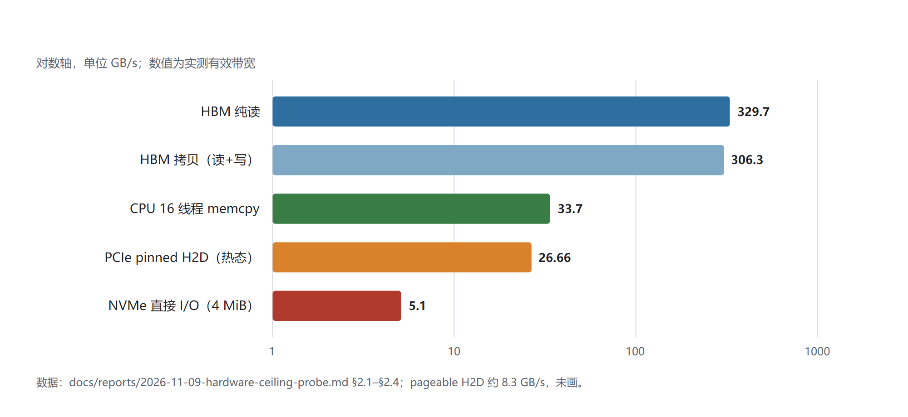
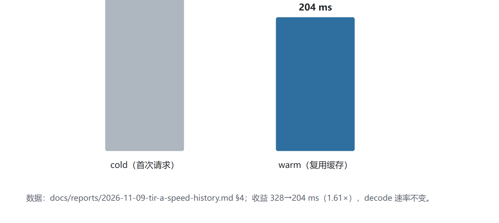
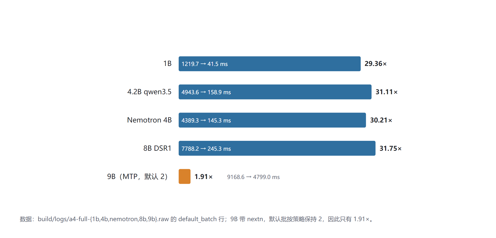
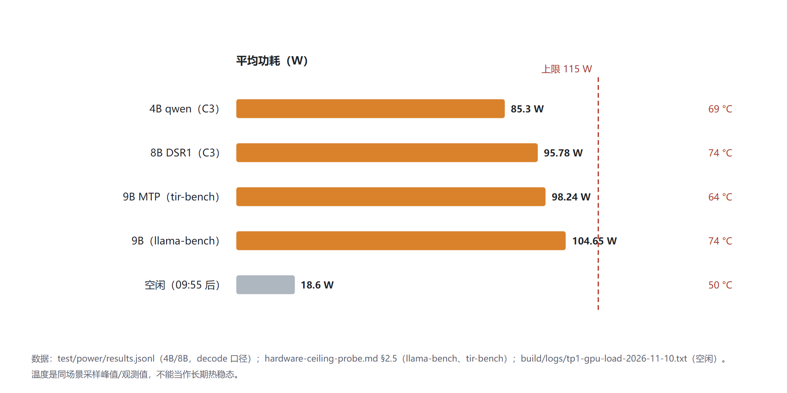
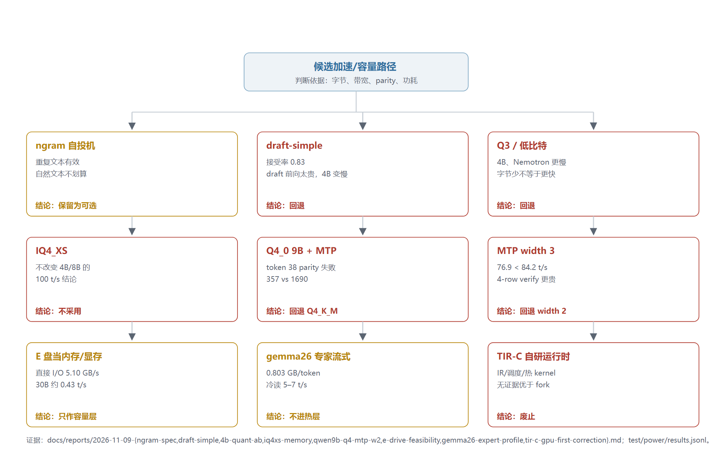
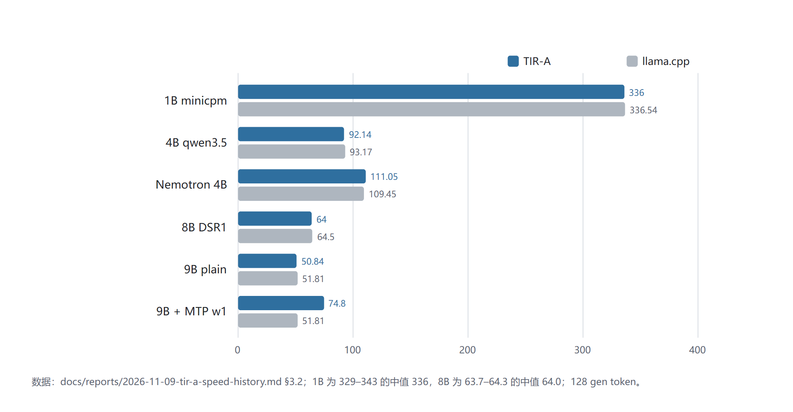
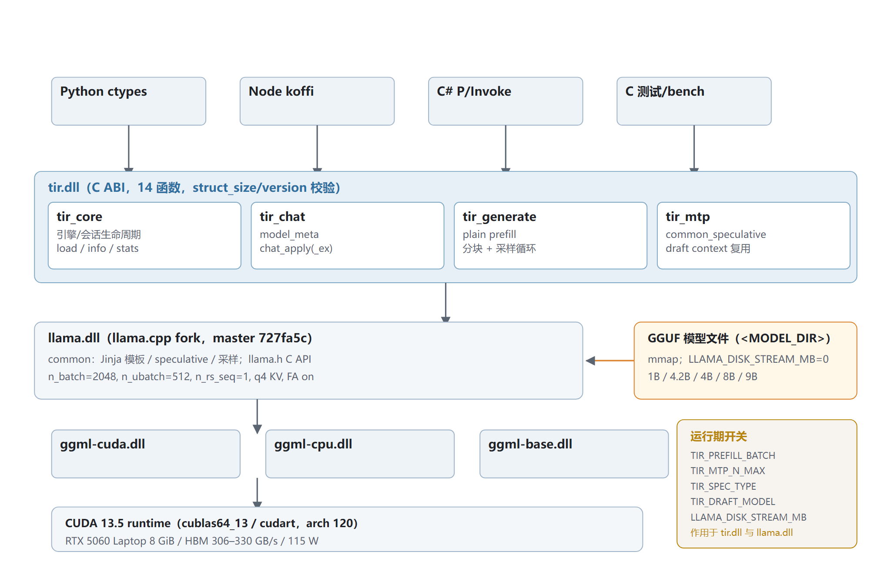
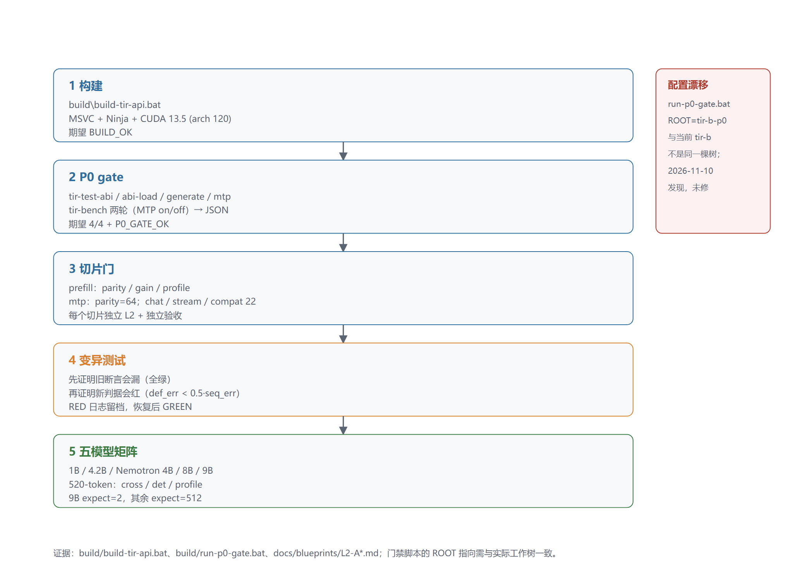

# TIR-A 阶段性技术研究论文：在 8 GiB 笔记本上把 llama.cpp 做成可用的 C ABI 引擎

## 摘要

这台机器是联想 83LY，RTX 5060 Laptop 8 GiB，i7-14650HX，15.7 GiB 单条内存，115 W 电源。我要在这上面做一个可以被任意宿主进程内接入的本地推理引擎：一个 14 函数的 C ABI，`tir.dll`，支持 1B–9B 的 GGUF 模型，先正确，再快，再省。

做法不是 clean-room 重写，而是在已跑通的 llama.cpp fork 上做整合：保留 `llama.h` 与 ggml/CUDA 后端，把生命周期、会话、生成、MTP、chat template 收进一个稳定的 ABI。P0 先证明机制：9B 16k q4 加 MTP，56.93 tok/s 平均、60.33 最好，acceptance 0.882，plain 与 MTP 的 greedy token 一致。随后按交互延迟切片推进：A1 缓存 MTP 上下文，同一 session 的重复请求 TTFT 从 328 ms 降到 204 ms；A2/A3 把 prompt 从逐 token prefill 改为分块，521 token 的 TTFT 从 9260 ms 降到 4852 ms；A4 把白名单模型的默认批提升到 512，1B、4.2B、Nemotron 4B、8B 在 520 token 上得到 29.4–31.8 倍的 prefill 收益，9B 因为带 nextn 头保持默认 2，收益 1.91 倍，但 MTP 路径的 token parity 保持 64/64。

真正的上限由 C0 校准：同轮、真实上下文、带 GPU 遥测。1B 308 tok/s、4B qwen 82–86、Nemotron 4B 95–97、8B 57。4B 的缺口在 kernel 利用率（231 GB/s，约 76%），8B 已经在功耗/显存墙上（292 GB/s、11001 MHz、约 107 W），100 tok/s 对 8B 不成立。C2e 用 Q4_K_M 加 MTP width 2 把 9B 推到 84.24 tok/s，代价是 acceptance 降到 0.685、每步 27.7 ms，100 仍未达到。C3 把能效写进指标：4B 85.3 W、0.93 tokens/J；8B 95.78 W、0.57 tokens/J。

失败与回退同样进入正文：ngram 只在重复文本有效；draft-simple 接受率 0.83 但 draft 前向太贵；Q3、IQ4_XS 没有带来吞吐；Q4_0 在 9B MTP 上 token 38 parity 失败；width 3 比 width 2 慢；E 盘 5.10 GB/s 只够做容量层；gemma26 专家流式 0.803 GB/token、冷读 5–7 tok/s；TIR-C 自研运行时废止。

这篇论文把这套工程拆成三部分：环境与资源、分阶段开发过程、以及一份在 Windows 上做同类产品的技术方案。所有性能数字都带证据路径；未测的写未测，失败的写失败。

## 关键词

本地推理；llama.cpp；C ABI；MTP；分块 prefill；CUDA；8 GiB 显存；功耗墙；tokens/J；Windows

## 目录

[TOC]

# 第一部分 环境与资源

这一部分只回答一个问题：我是在什么机器、什么资源、什么软件栈上把 TIR-A 做出来的。后面第二、三部分的每一个 tok/s、每一毫秒 TTFT、每一次显存吃满，都是这张资源表的函数。我先把上限算清，再谈优化；算不清的地方写“未记录”。

## 1.1 机器与系统

先给结论：全部实验在**一台**联想消费级笔记本上完成，型号代码 `83LY`，系统是 Windows 11 家庭中文版 build 26200。没有第二台对照机，也没有云端复现。这意味着论文里所有性能数字只对这一台机器、这一个 Windows 安装成立。

机器身份是我用一条只读命令现查的：

```powershell
powershell -NoProfile "Get-CimInstance Win32_ComputerSystem | Select Manufacturer,Model; Get-CimInstance Win32_OperatingSystem | Select Caption,Version,BuildNumber"
```

输出是 `Manufacturer LENOVO`、`Model 83LY`，操作系统 `Microsoft Windows 11 家庭中文版`、`Version 10.0.26200`、`BuildNumber 26200`。商品名（Legion 还是 LOQ、15 寸还是 16 寸）在所有报告里都没有记录，我不按型号代码去猜。

计算与内存（证据：docs/reports/2026-11-09-hardware-ceiling-probe.md 开头的机器行）：

- CPU：`i7-14650HX`，8 个性能核 + 8 个能效核，型号里的 14 是代数。
- GPU：`RTX 5060 Laptop`，`nvidia-smi` 报可用显存 `8151 MiB`。后面所有“8 GiB 显存”的说法，实际可用额度是 8151 MiB，不是我按 8192 MiB 折算的名义值。
- 内存：`15.7 GiB` 可用，物理是一条 16 GB DDR5-5600，单 NUMA。（证据：docs/reports/2026-11-09-e-drive-feasibility.md §1）

存储（证据：docs/reports/2026-11-09-e-drive-feasibility.md §1）：

- 系统盘 `UMIS RPJYJ512MML1QWY`，512 GB。
- 数据盘 `E:`，`SKHynix_HFS001TFP9X205N`，1,024,209,543,168 B（953.9 GiB），GPT 单分区、NTFS、簇 4096 B，当前链路 Gen4 x4（端口最大 Gen5 x4），剩余 776.8 GiB。
- 页面文件在 `<PAGEFILE>`，13 GB 上限，实测占用 760 MB。它不在 `E:` 上，这一点在后面讨论“盘能不能当内存”时是关键。

功耗与散热：

- GPU 侧功耗上限 `115 W`，这是 `nvidia-smi` 的读数口径，不是整机墙。（证据：docs/reports/2026-11-09-hardware-ceiling-probe.md §2.5）
- Windows 电源计划、是否插电、风扇曲线：未记录。我没有把这些当受控变量，也没有据此做过对照实验。
- 30 min 热稳态：未测。硬件报告只做了 1 s 间隔采样，`74 °C` 是 10 次重复的峰值。（证据：docs/reports/2026-11-09-hardware-ceiling-probe.md §6）

我为什么先把这些写死：这台机器的形态直接决定了项目的形态。单卡，所以不做多卡；单条内存，所以 CPU 回退没有第二条通道；笔记本功耗墙只有 115 W，所以“再快一点”很快会撞到电，而不是撞到代码。后面每一个优化动作，我都要先问它动的是显存、带宽、功耗里的哪一堵墙。

还有一件事必须写进环境：这台机器上同时装着两套现成的推理栈。LM Studio 的模型目录是 `<MODEL_DIR>\bionic`（8 个主模型 + 4 个 mmproj，55 GB），Ollama 的是 `<MODEL_DIR>\blobs`（6 个模型，28 GB），其中 Qwen3.8 与 Spark 两个模型两边各有一份。（证据：docs/reports/2026-11-09-local-model-inventory.md §1、§3）我留着它们，因为它们是现成的对照组：同一个 GGUF、同一张卡，`llama-server` 能跑出什么数，TIR-A 就必须能跑出什么数，不能更差。代价是显存和端口都可能被抢，所以“测 tok/s 前确认没有别的推理进程在跑”是前置条件，不是靠记忆。

为什么是笔记本而不是台式或云：因为我做的不是“大模型推理能不能更快”，而是“这一类机器上能不能做交互式单用户推理”。云端 A100 上 9B 跑 300 tok/s 不构成新问题，也回答不了 8 GiB 显存下 MTP 宽度该给几的问题；台式机则绕开了 115 W 这道墙，而这道墙恰好是最难绕的。选这台机器，等于把约束条件一起选进来了。

把 8151 MiB、15.7 GiB、115 W 这三个数放在一起看，能看出它们不是配置清单，而是一套按顺序生效的筛选条件。

第一道是 8151 MiB。这个项目的所有生成路径都要求权重全驻留：fork 的盘流式加载与 CUDA offload 不兼容，一开 `n_gpu_layers > 0` 就必须把盘流式关掉（证据：tir-b/src/llama.cpp-fork/docs/tir-api/ABI.md 的 Runtime prerequisites）。所以选模型的第一个动作是加法：权重 + 16k KV + 激活 + graph + 余量，和 8151 MiB 比。9B Q5 的权重 6.18 GiB，plain 跑起来显存峰值 7106 MiB，MTP 打开 7607 MiB（证据：docs/reports/2026-11-09-hardware-ceiling-probe.md §2.5）；最紧的时候只剩 544 MiB。这个加法在写第一行 kernel 之前就把 14.44 GB 的 gemma-26B 和 8.23 GB 的 BF16 Spark 排除了，6.98 GB 的 12B QAT 只算“边缘”。我没有先试再判断，是先判断再试——试错的成本在这张卡上是一条条 OOM 和一次次重新加载。

第二道是单条 15.7 GiB。它限制的不是 decode，而是“把一部分工作推回 CPU”这个念头的上限。9B 的 5.62 GB 权重按 33.7 GB/s 算，CPU-only 上限是 167 ms/token、6.0 t/s；4B 是 12.5 t/s，8B 是 6.7 t/s（证据：docs/reports/2026-11-09-key-nodes-roofline.md §2）。也就是说任何“显存不够就让 CPU 兜底”的设计，都会把二十几毫秒的 token 变成 80–167 ms。加第二条同规格内存能把通道抬到约 67 GB/s，但它只影响 pinned 缓冲、CPU 回退和加载，不提高 GPU decode（证据：同上 §2）。页面文件不在 `E:` 而在 `D:`，上限 13 GB、实测占用 760 MB（证据：docs/reports/2026-11-09-e-drive-feasibility.md §1），它是防崩溃的缓冲，不是容量方案。并发模型同样是显存算出来的：MTP 峰值 7607 MiB、余量 544 MiB，而 A1 的 draft context 常驻要再加 0.4 GB（证据：docs/reports/2026-11-09-hardware-ceiling-probe.md §5 第 6 条），所以第二个 session 不是“慢一点”，是装不下。1.7 里那条“不做多人并发”的理由就落在这里。

第三道是系统。Windows 11 build 26200 对这套东西的影响不在于“能不能跑”，在于 DLL 谁先被找到。`tir.dll` 打开时，加载器要同时找到同目录的 `llama.dll`、`llama-common.dll`、`ggml*.dll`，以及 CUDA 侧的 runtime 与 cuBLAS。cuBLAS 不在模型目录里，在 `<TIR_ROOT>\runtime\cuda-13.5\bin\x64`；这份 CUDA 是从官方 redist 解压出来的便携工具链，不是系统级安装，所以没有一条全局的 CUDA 路径替我兜底（证据：tir-b/build/build-tir-api.bat:7-18；tir-b/src/llama.cpp-fork/docs/tir-api/ABI.md 的 Runtime prerequisites）。26200 上我确认到的两个语义决定了宿主的写法：`ctypes.CDLL` 默认的 `LOAD_LIBRARY_SEARCH_DEFAULT_DIRS` 不看 `PATH`，必须 `winmode=0` 才会走旧式搜索；而 `winmode=0` 又会让 `os.add_dll_directory` 加进去的目录失效，两条路不能混用（证据：同上）。这就是为什么三个宿主是三种写法：Python 改 `PATH` 再 `winmode=0`，Node 改 `process.env.PATH`，C# 靠 exe 与 DLL 同目录。至于“26200 与更早的 Windows 在加载器上有没有差异”，我没有第二台机器做对照，未测；这篇论文里与系统版本有关的结论只对 26200 成立。

115 W 这个数字要按它的口径用：它是 `nvidia-smi` 的 GPU 侧功耗上限，不是整机墙，电源适配器的额定功率我没有记录（证据：docs/reports/2026-11-09-hardware-ceiling-probe.md §2.5）。影响有两层。第一层是余量：模型负载的峰值 109.28 W 已经用掉上限的 95%，SM 峰值 2797 MHz、温度峰值 74 °C，没有热降频（证据：同上）。这意味着“再快一点”没有频率空间，只剩减少每 token 字节或减少每 token 步数两条路。第二层是可复现性：电源计划、是否插电、风扇曲线都没有记录，30 min 热稳态也没有测，1 s 采样得到的 74 °C 是 10 次重复的峰值而不是稳态（证据：同上 §6）。所以本论文里所有 tok/s 都是短跑口径；凡是超过几分钟的稳定性判断，我一律写“未测”，不拿短跑去外推长跑。这不是保守：C0 里 8B 在持续负载下显存时钟从 12001 掉到 11001 MHz、约 −8.3%，功率 107 W、温度 70 °C（证据：docs/reports/2026-11-09-ceiling-calibration.md §2.3），时钟会随供电与温度状态漂移，读数也就跟着漂。

## 1.2 硬件实测包线

我不从规格表抄带宽，全部本机实测。测法分三类：一次性 CUDA 探针（`<WORKSPACE>\hardware-probe\probe.cu`，覆盖 HBM 拷贝与纯读、PCIe 四象限、固定内存、空 kernel launch）、Rust 内存与磁盘探针（`mem_bw.rs`、`mem_bw_mt.rs`、`nvme_direct.rs`）、`llama-bench` 加 `nvidia-smi` 1 s 采样的负载测量。探针是一次性代码，不进产品。（证据：docs/reports/2026-11-09-hardware-ceiling-probe.md §7）

| 层 | 实测 | 条件 |
|---|---:|---|
| HBM 拷贝（读+写） | 306.3 GB/s | 1 GiB copy |
| HBM 纯读 kernel | 329.7 GB/s | 1 GiB |
| HBM `cudaMemcpy` D2D | 307.6 GB/s | 1 GiB |
| PCIe pinned H2D | 26.66 GB/s | 256 MiB |
| PCIe pinned D2H | 27.08 GB/s | 256 MiB |
| PCIe pageable H2D | 8.28 GB/s | 512 MiB |
| CPU 内存，1 线程 | 16.1 GB/s | 读+写 |
| CPU 内存，16 线程 | 33.7 GB/s | 读+写 |
| NVMe 直接 I/O | 5.10 GB/s | 4 GiB 顺序读，`FILE_FLAG_NO_BUFFERING` |
| NVMe buffered | 3.13 GB/s | 同文件 |
| `E:` 顺序 4 MB | 5.56 GB/s | QD1 unbuffered |
| `E:` 随机 4 MB | 4.33 GB/s | 1,031 IOPS |
| `E:` 随机 4 KB | 44.8 MB/s | 10,943 IOPS，91 µs |
| kernel launch | 7.51–8.15 µs | 10,000 次空 kernel |

（证据：docs/reports/2026-11-09-hardware-ceiling-probe.md §2.1–§2.7；docs/reports/2026-11-09-e-drive-feasibility.md §2）

三堵墙，按我实际撞到的顺序写：

1. **8 GiB 显存**。可用 8151 MiB。qwen9b Q5、16k q4 KV、MTP 打开时显存峰值 7607 MiB，余量 544 MiB。（证据：docs/reports/2026-11-09-hardware-ceiling-probe.md §2.5）到这一层已不是优化问题而是取舍问题：再加一个 session、或把 ctx 抬到 32k，就直接出界。
2. **单条 15.7 GiB 内存**。CPU 侧 16 线程读+写 33.7 GB/s。加第二条同规格内存能到约 67 GB/s，但那条通道只影响 pinned 缓冲、CPU 回退和加载，不提高 GPU decode。（证据：docs/reports/2026-11-09-key-nodes-roofline.md §2）所以我没加内存，省下的钱留给换卡。
3. **115 W 功耗墙**。qwen9b Q5 跑 `-p 512 -n 128 -r 10`，平均 104.65 W、峰值 109.28 W；温度平均 70 °C、峰值 74 °C；SM 时钟平均 2713.9 MHz、峰值 2797 MHz；显存时钟平均 11116 MHz；利用率 93.3%。（证据：docs/reports/2026-11-09-hardware-ceiling-probe.md §2.5）这是功耗墙不是温度墙：74 °C 离笔记本上限还很远，115 W 只比实测峰值高约 5%。

这组数怎么用，决定了后面所有判断：

- qwen9b plain `46.4 t/s` 折合 6.18 GiB ÷ 21.55 ms ≈ 308 GB/s，正好等于 HBM 拷贝实测值。所以 plain 慢不是 kernel 写错，是已经贴住带宽；要快只能减每 token 字节（Q4）或让一次权重读换多个 token（MTP）。（证据：docs/reports/2026-11-09-hardware-ceiling-probe.md §1）
- MTP 每步 1.882 token、6.18 GiB/步、26.5 ms，折合约 250 GB/s，约 HBM 的 80%。剩下 20% 在宽度、overhead 和功耗，不在带宽。
- 单位要盯住：报告里的 6.18 GiB 与 6.63/6.64 GB 是同一份权重文件的两种写法（6.18 GiB = 6.64 GB）。我算时间一律先换成字节。
- 冷热差是真的：pinned 首次搬 512 MiB 只有 12 GB/s，热态 26.66 GB/s。任何“首 token 前先搬一块”的设计都必须先热身，否则第一轮白等一倍。（证据：docs/reports/2026-11-09-hardware-ceiling-probe.md §2.2）
- 小块不要走这两条路：PCIe 4 KiB 只有 0.37 GB/s，盘上 4 KB 随机只有 44.8 MB/s。专家块、层包必须按 MiB 对齐才有意义。

测法本身也是结论的一部分，所以我要说清每一层是怎么量出来的，以及为什么这个量法只在这台机器上成立。

HBM 那一行给了三个数，因为单一测法有偏差：`cudaMemcpy` D2D 走驱动里最成熟的路径，307.6 GB/s；手写拷贝 kernel 读一遍写一遍，306.3 GB/s；纯读 kernel 只读不写，329.7 GB/s。前两个几乎相等，说明拷贝路径没有被我的 kernel 写法拖累；第三个比它们高，说明读+写的实测值天然低于纯读上限（证据：docs/reports/2026-11-09-hardware-ceiling-probe.md §2.1）。所以我把 306–330 GB/s 当一个区间用，不给单一“带宽值”：算 decode 屋顶时用 330，因为 decode 每 token 只把权重读一次；跟 PCIe、NVMe 做倍数对比时用 306，因为那是读+写混合。谁把这两个数混用，屋顶线自己就会漂 7%。

PCIe 测的是四象限加尺寸扫描，不是一个数。四象限是 H2D/D2H × pinned/pageable：同一块内存在页锁定与非页锁定下走两条完全不同的路径，pinned 热态 26.66/27.08 GB/s，pageable 大块只有 8.28/8.61（证据：同上 §2.2）。尺寸扫描是因为 4 KiB 的 0.37 GB/s 由延迟主导，单次约 10–14 µs，跟带宽无关；到 1 MiB 才爬到 23.11 GB/s，256 MiB 才稳定在 26.66。只报一句“PCIe 26.7 GB/s”，会让人以为搬 4 KiB 也是这个速度，实际差着七十倍。

CPU 层用两个探针分清线程数：单线程读+写 16.1 GB/s，16 线程 33.7 GB/s，中间 8 线程 30.4、12 线程 32.2（证据：同上 §2.3）。这条曲线说明单条 DDR5-5600 在十几个线程时已经饱和，再往上加线程不会更快，只会增加调度开销。这也是我在 1.7 里不把“多开线程做 CPU 推理”当成一条路的原因。

NVMe 层用 `FILE_FLAG_NO_BUFFERING` 与普通读各跑一遍同一份 14.4 GB 的 GGUF：直接 I/O 5.10 GB/s，buffered 3.13 GB/s（证据：同上 §2.4）。buffered 更慢不反常识：4 GiB 的工作集远大于页缓存，buffered 路径既要做拷贝又被缓存淘汰拖住，直接 I/O 反而可预测。`E:` 上的 4 MB 顺序 5.56 GB/s、随机 4 KB 44.8 MB/s（证据：docs/reports/2026-11-09-e-drive-feasibility.md §2）是另一个探针，问的是“这块盘能不能当热层”，答案写在 1.7。

功耗与时钟是 1 s 采样，这一条要单独标出来：1 s 相对 21.55 ms/token 太粗，看不到单 token 的尖峰，只能给活跃段的均值与峰值，利用率 93.3%、SM 平均 2713.9 MHz 都是这个窗口里的统计量（证据：同上 §2.5）。它能回答“有没有撞 115 W”“有没有热降频”，不能回答“第 300 个 token 那一刻发生了什么”。所以后面凡是要逐 token 归因的地方，我另配遥测，不拿这组 1 s 数据顶替。

为什么全文用“有效带宽”而不是理论峰值：这颗 GPU 是 128-bit GDDR7，报告记的理论口径取决于 24/28 Gbps（证据：docs/reports/2026-11-09-hardware-ceiling-probe.md §2.1），折成字节是 384–448 GB/s 的名义峰值，实测 306–330 只有名义的 79–87%。差值不是厂商虚标，是访问模式、kernel 占用率、刷新与地址跳变一起吃掉的。如果我拿 448 去算屋顶，6.63 GB 的 9B plain 会算出约 67 t/s，拿 330 算只有 50 t/s（证据：docs/reports/2026-11-09-key-nodes-roofline.md §1 的 maxShort=50）；差出来的那 17 t/s 不是隐藏空间，是一个根本不存在的目标。所以我的规矩是：屋顶线只用实测有效值，理论值只在解释“为什么有效值低于名义值”时出现。

三堵墙的推导过程是三个除法，不是三个形容词。

1. **显存墙 = 容量减峰值**：8151 − 7607 = 544 MiB（证据：docs/reports/2026-11-09-hardware-ceiling-probe.md §2.5）。这个减法里没有留“也许能省出来”的项目，权重、KV、计算缓冲、graph 全在 7607 里面。要越过它只能改配置（ctx、KV 类型、MTP 宽度）或换模型，不能靠清理。
2. **内存墙 = 权重除带宽**：9B 的 5.62 GB ÷ 33.7 GB/s = 167 ms，即 6.0 t/s（证据：docs/reports/2026-11-09-key-nodes-roofline.md §2）。这个除法说明 CPU 侧无论怎么优化调度都不可能把 9B 拉到交互速度；它只能做 tokenize、采样、detok 与拷贝协调，C0 实测 host 占比 2.5–4.6%，1B 是 7.2%（证据：docs/reports/2026-11-09-ceiling-calibration.md §2.4）。
3. **功耗墙 = 峰值除上限**：109.28 ÷ 115 = 95%，剩 5%（证据：docs/reports/2026-11-09-hardware-ceiling-probe.md §2.5）。这个除法的意义在排除：温度只有 74 °C、SM 没有降频，所以它不是热墙。热墙可以靠改善散热拿回性能，功耗墙只能靠少做事。

H2D 冷热差是这组数里最容易被忽略、又最容易在工程上吃亏的一条。冷态首搬 512 MiB 只有 12 GB/s，热态 26.66，差 2.2 倍（证据：同上 §2.2）。它意味着任何“先搬一块再出首 token”的设计，第一轮都要白等一倍；而一次几毫秒的热身拷贝能把这一倍拿回来。差在哪一层我没有定位，报告里记的是“GPU 唤醒、链路训练、驱动，三者之一，未定位”（证据：同上 §6），但这不影响用法：热身必须做，原因可以以后再查。同一条线上还有固定内存的坑：`cudaHostRegister` 约 15.2 GB/s，`cudaHostAlloc` 只有 3.5–3.9 GB/s（证据：同上 §2.6），所以环形缓冲必须在启动时一次分配或一次注册，不能在热路径里逐层 pin。旧报告里那个 0.7 GB/s 是 PyTorch `pin_memory` 的“分配+拷贝”路径，不是寄存器 pin，拿它做预算会低估二十倍。

四层带宽与三堵墙的位置见图 1。



## 1.3 模型资源

模型全部在 `<MODEL_DIR>`，总量约 101 GB，其中 LLM 权重约 76 GB（bionic 55 GB + Ollama blobs 28 GB），剩下是三维/训练代码与数据。（证据：docs/reports/2026-11-09-local-model-inventory.md §1）我不下载新模型，只在已有库存里挑：8 GiB 显存下能全驻留的才是候选。

| 模型 | 路径 | 架构 | 层/embd | 文件 | 量化 | nextn/MTP | 16k KV q8 |
|---|---|---|---:|---:|---|---|---:|
| minicpm5-thinking 1.1B | `<MODEL_DIR>\blobs\sha256-b1c3bf29…` | llama | 24/1536 | 0.69 GB | Q4_K_M | 无 | 192 MB |
| qwen3.5-opus 4.2B | `<MODEL_DIR>\blobs\sha256-de8cf245…` | qwen35 | 32/2560 | 2.71 GB | Q4_K_M | 无 | 256 MB |
| Nemotron-3-Nano-4B | `<MODEL_DIR>\bionic\…\…Q4_K_M.gguf` | nemotron_h | 42/3136 | 2.84 GB | Q4_K_M | 无 | 128 MB |
| DeepSeek-R1-0528-Qwen3-8B | `<MODEL_DIR>\bionic\…\…Q4_K_M.gguf` | qwen3 | 36/4096 | 5.03 GB | Q4_K_M | 无 | 1152 MB |
| Qwen3.8-9B-Distill | `<MODEL_DIR>\bionic\Qwen\Qwen3.8-9B-Distill-GGUF\Qwen3.8-9B-Q5_K_M.gguf` | qwen35 | 33/4096 | 6.64 GB | Q5_K_M | **有（nextn）** | 256 MB |
| gemma-4-12B QAT | `<MODEL_DIR>\bionic\…\…Q4_0.gguf` | gemma4 | 48/3840 | 6.98 GB | Q4_0 | 无 | 288 MB |
| gemma-4-26B-A4B QAT | `<MODEL_DIR>\bionic\…\…Q4_0.gguf` | gemma4 | 30/2816 | 14.44 GB | Q4_0 | 无（128 专家/用 8） | 260 MB |
| Spark-X2.5-4B | `<MODEL_DIR>\bionic\Spark-X2.5-4B.gguf` | spark2_5 | 36/2560 | 8.23 GB | BF16 | 无 | 1152 MB |
| Bonsai-27B | `<MODEL_DIR>\bionic\Bonsai-27B-Q1_0.gguf` | qwen35 | 64/5120 | 3.80 GB | Q1_0 | 无 | ≈537 MB + SSM 156 MB |

（证据：docs/reports/2026-11-09-local-model-inventory.md §2、§3；9B 的完整路径另见 docs/reports/2026-11-09-tir-a-100-plan.md §7 与 tir-b/build/run-p0-gate.bat:11）

两处口径要交代：

- Ollama 的 blob 没有 `.gguf` 后缀，文件本身是 GGUF，`llama_model_load_from_file` 读 magic 不认扩展名，所以 `<MODEL_DIR>\blobs\sha256-*` 可以直接喂给引擎；模型名靠 `<MODEL_DIR>\manifests\registry.ollama.ai\library\<name>\latest` 恢复。（证据：docs/reports/2026-11-09-local-model-inventory.md §3）
- 上表的 16k KV 是 q8 估算；屋顶线报告里的 KV 是 q4。所以同一个 9B，库存表写 256 MB，屋顶线表写 0.13 GB，两者不矛盾，是两种 KV 类型。（证据：docs/reports/2026-11-09-key-nodes-roofline.md §1）
- 表里写成 `<MODEL_DIR>\bionic\…\…Q4_K_M.gguf` 的四行，是我没有记全子目录：库存文档只记到文件名 `...Q4_K_M.gguf` / `...Q4_0.gguf`，根目录是 `<MODEL_DIR>\bionic`。子目录未记录，我不补。（证据：docs/reports/2026-11-09-local-model-inventory.md §2）

按显存算，八个 bionic 模型里只有四个能干净地全驻留：9B Q5、DSR1 8B、Nemotron 4B、12B QAT（边缘）。Spark-X2.5 的 BF16 是 8.23 GB，已经超过 8151 MiB，必须先重定量；gemma-26B-A4B 14.44 GB 不可能全驻留，要专家缓存才有意义；Bonsai-27B 的 Q1_0 能把 27B 塞进 4 GB 量级，但质量只能算“能跑”。（证据：docs/reports/2026-11-09-local-model-inventory.md §4）

再看屋顶线，也就是“如果带宽是唯一瓶颈，这个模型最多能跑多少”：1.1B 屋顶 421 t/s、实测 308（73%）；4.2B 屋顶 114、实测 85（74%）；Nemotron 4B 屋顶 114、实测 97（85%）；DSR1 8B 屋顶 59、实测 57（97%）；qwen9b Q5 屋顶 48、plain 实测 51（105%，短上下文与 330 GB/s 峰值口径造成的超 100%）、MTP width 1 实测 74.8。（证据：docs/reports/2026-11-09-key-nodes-roofline.md §1）

这张表直接决定了我的选型：

- **主力是 Qwen3.8-9B Q5**，因为库存里只有它带 nextn 头。MTP 是这台机器上唯一已经证明能越过 HBM 墙的手段（一次权重读 verify 两行），不用它就没有别的加速来源。
- **plain 基线选 DSR1 8B**：qwen3 全 attention、无 nextn，屋顶 59、实测 57，已经 97% 贴墙，用它做对照最干净。
- **4.2B qwen35 是 kernel 利用率的探针**：74% 说明它离屋顶还有 26%，4B 冲 100 t/s 要 88% 的效率，这是 kernel 问题不是带宽问题。
- **Nemotron 4B 用来测 hybrid SSM + 功耗**：85%，只差 3% 就到 100 所需的效率，卡在功耗/热而不是算法。

必须说清的边界：库存扫描只解析了 GGUF 元数据，没有逐模型跑生成；`tir_engine_load` 与生成的完整验证只做了 qwen9b，其他模型的 CUDA 兼容性与 tok/s 是在后面的阶段逐个补的。（证据：docs/reports/2026-11-09-local-model-inventory.md §7）

逐个数“为什么留下、为什么只作对照”，比再列一张库存表有用：库存表回答有什么，选型回答为什么是它。

1B 是我唯一用来测“固定开销占比”的模型。屋顶 421 t/s、实测 308、73%，看起来最差，但差的地方不在带宽：24 层、embd 1536，每 token 的 kernel 数量与同步次数摊在 0.68 GB 权重上，固定开销被放大；C0 实测 1B 的 host 占比 7.2%，4B 是 4.6%，8B 只有 2.5%（证据：docs/reports/2026-11-09-ceiling-calibration.md §2.4）。所以它的价值是反方向的：跑不出速度上限，但能把引擎自己的开销放大给人看。它还有两个具体用途，S1 兼容矩阵的最小模型，以及 `tir-test-abi-load` 的真实模型；后者是 A5 才补上的，此前两次都是 `SKIP (TIR_TEST_MODEL not set)`，RC=0 来自跳过（证据：tir-b/docs/blueprints/L2-A5-a4-gate-hardening.md:20）。它的屋顶就是 421，kernel 再完美也只有这个数，所以我不拿它当 100 t/s 的目标。

4.2B 是 kernel 利用率的探针，理由在数字里：屋顶 114、实测 85、74%，有效带宽只有 231–235 GB/s（证据：docs/reports/2026-11-09-key-nodes-roofline.md §3、§5.2）。同样的 qwen35 架构，9B plain 能到 308 GB/s（证据：docs/reports/2026-11-09-hardware-ceiling-probe.md §2.1），4B 只有 231，说明小矩阵与 SSM 段让 kernel 占不满；3 行以上的 verify 还会移动 logits。留它的现实原因是共代码：它和 9B 走同一套 arch 实现，分块 prefill、模板、思考开关这类改动先在 2.71 GB 的 4.2B 上试，加载快、出错代价小，验完再上 9B。

Nemotron 4B 是 hybrid SSM 与功耗的对照。85%、97 t/s，100 t/s 需要 88%，只差三点，报告的原话是“卡在功耗/热而不是算法”（证据：docs/reports/2026-11-09-key-nodes-roofline.md §1）。它同时是一个教训：历史上的 119 t/s 是 8-token 短跑，同口径复测只有 96–111，128-token 是 97–99（证据：同上 §4 的 Nemotron 119 行）。“8-token 峰值不能当稳定吞吐”这条口径纪律就是它教出来的。它还有对句号敏感的结束符问题，做流式验收时容易误判“生成完了”。

8B 是 plain 基线，也是功耗墙最清楚的样本：屋顶 59、实测 57、97%；C0 里 292 GB/s、显存时钟 11001 MHz、107 W、70 °C（证据：docs/reports/2026-11-09-ceiling-calibration.md §2.3）。它没有 nextn，任何加速都只能来自外部投机或更低量化。我留它做对照，正因为“完全没有投机可用”时引擎该是什么样，需要一个干净样本；用 9B 关掉 MTP 去模拟，等于假设关掉 MTP 之后它还是一样干净，这个假设我没有验证过。

9B 是主力，理由只有一条：库存里只有它带 nextn 头。6.64 GB、33 层；`n_layer` 不把 nextn 计入，nextn 单独报（证据：tir-b/src/llama.cpp-fork/docs/tir-api/ABI.md 的 `tir_model_meta` 字段表）。16k q4 KV 0.13 GB，plain 51 已经是屋顶的 105%，MTP width 1 到 74.8，acceptance 0.882、mean_len 1.882（证据：docs/reports/2026-11-09-tir-a-100-plan.md §1.1；docs/reports/2026-11-09-key-nodes-roofline.md §1）。MTP 的代价是每步多一次 draft 前向、外加一份常驻的 draft context；A1 把它缓存下来之后显存多 0.4 GB（证据：docs/reports/2026-11-09-hardware-ceiling-probe.md §5 第 6 条），换来 decode 上的净收益，这是这台机器上唯一算得过来的交换。宽度 2 更有价值——理论 mean_len 2.66、估算 106–110 t/s——但卡在 3 行 verify 的 chunked kernel 上：hybrid 模型 3 行以上会把 logits 移动约 0.13，破坏 plain/MTP 的 token 一致（证据：tir-b/src/llama.cpp-fork/docs/tir-api/ABI.md 的 P0 limitations）。所以 `TIR_MTP_N_MAX` 定在 1，不是保守，是 parity 门排在吞吐前面。

量化的取舍也要写清。4B 上 Q4_0 是所有量化里最快的 87.7 t/s，比 Q4_K_M 快 3–6%；但同一手法用在 Nemotron 上反而从 281 GB/s 掉到 188（证据：docs/reports/2026-11-09-4b-quant-ab.md 摘要、§3）。所以“量化越低越快”不成立，只能逐模型测。9B 的 Q4 重定量我估算过 5.0–5.4 GiB、width 1 约 79、width 2 约 106–110（证据：docs/reports/2026-11-09-tir-a-100-plan.md §1.2），但从未执行；它是 100 计划里唯一没跑的主路径，我把它记成未验证节点，不写成结果（证据：docs/reports/2026-11-09-key-nodes-roofline.md §6、§7）。

显存账要按 KV 类型分开记，否则同一张表会自相矛盾：9B 的 16k KV 在 q8 下 256 MB、q4 下 0.13 GB；DSR1 8B 的 q8 KV 是 1152 MB，和 Spark 并列表里最大的一档（证据：docs/reports/2026-11-09-local-model-inventory.md §2；docs/reports/2026-11-09-key-nodes-roofline.md §1）。我默认 q4 KV，不是因为有精度证据说它够，而是 q8 在 8B 上要多占近 1 GB，而 1 GB 在这张卡上就是“能不能开 MTP”的差别。Spark 的 BF16 8.23 GB、gemma-26B 的 14.44 GB、Bonsai 的 Q1_0 3.80 GB 留在库存里只作对照：前两个装不下，第三个装得下但质量只能算“能跑”（证据：docs/reports/2026-11-09-local-model-inventory.md §4）。我不删它们，因为“装不下”和“装得下但慢”都需要实物对照，删掉之后这些判断就只剩我一句话。

## 1.4 软件栈与构建链

版本口径先摆清：MSVC / Visual Studio 18 Community、Ninja、CMake、CUDA 13.5、ggml 0.27.0，代码基线是 `tir-b` 的 `master`，HEAD `727fa5c`。CUDA 与 VS 的版本是我从构建脚本里读出来的；ggml 0.27.0 与 HEAD 来自项目基线记录，不是这一轮现读的文件。

构建只有一个入口 `tir-b/build/build-tir-api.bat`，它做的事很清楚：

```bat
set "CUDA_PATH=<TIR_ROOT>\runtime\cuda-13.5"
set "CUDACXX=%CUDA_PATH%\bin\nvcc.exe"
set "CUDAToolkit_ROOT=%CUDA_PATH%"
set "CMAKE=<VS_CMAKE>"
call "...\VC\Auxiliary\Build\vcvars64.bat"
set "PATH=%CUDA_PATH%\bin;%CUDA_PATH%\bin\x64;%CUDA_PATH%\nvvm\bin\x64;%PATH%"
```

（证据：tir-b/build/build-tir-api.bat:7-18）

关键配置项与我的取舍：

| 配置 | 值 | 为什么 |
|---|---|---|
| 生成器 | Ninja | 比 VS 生成器快，且不需要 `.sln` |
| `CMAKE_CUDA_ARCHITECTURES` | `120` | 只给 RTX 50 系（Blackwell，sm_120）编一个 arch，构建时间和体积都省 |
| `BUILD_SHARED_LIBS` | `ON` | 要的是 `tir.dll`，宿主用 `ctypes`/koffi/P-Invoke 加载 |
| `TIR_BUILD_API` | `ON` | 打开 `src/tir-api` 的 target |
| `GGML_CUDA` | `ON` | 全部算力在 GPU 上 |
| `LLAMA_BUILD_TESTS` / `LLAMA_BUILD_SERVER` / `LLAMA_CURL` | `OFF` | 上游测试、HTTP server、curl 都不进产物；我不需要网络，也不需要多编几百个 target |
| `GGML_OPENMP` | `OFF` | CPU 只在 host 侧做少量工作，OpenMP 是额外依赖 |
| `GGML_NATIVE` | `OFF` | 不按本机 CPU 指令集特化，产物可搬到同架构别的机器 |

（证据：tir-b/build/build-tir-api.bat:21-36）

一次构建产出 `tir`、十一个测试/基准目标（`tir-test-abi`、`tir-test-abi-load`、`tir-test-generate`、`tir-test-profile`、`tir-test-spec`、`tir-test-draft-compat`、`tir-test-mtp`、`tir-test-chat`、`tir-test-prefill`、`tir-bench`、`tir-bench-ceiling`）以及 `llama-quantize`，并行度默认 8（`TIR_JOBS`）。（证据：tir-b/build/build-tir-api.bat:19、:42）成功时最后一行打印 `BUILD_OK`。

部署上有两个不写在代码里、但每次都会踩的点：

1. **`LLAMA_DISK_STREAM_MB=0` 是硬性前置**。这个 fork 默认从盘流式加载权重，而它的驻留钩子只有 CPU 实现，盘流式加 CUDA offload 不被支持，加载时会崩或映射失败。库只读一次这个环境变量并缓存结果，所以必须在第一次 load 前设置。（证据：tir-b/src/llama.cpp-fork/docs/tir-api/ABI.md §Runtime prerequisites）三个宿主都照做了：`python_host.py:16`、`node_host.mjs:12`、`csharp_host.cs:31`。静态 CRT 的宿主无法在 DLL 内部设置，所以这件事只能由宿主做。
2. **DLL 搜索路径要用 `PATH`，不是 `os.add_dll_directory`**。`tir.dll` 依赖同目录的 `llama.dll`、`llama-common.dll`、`ggml*.dll`，以及 CUDA runtime 与 cuBLAS（在 `runtime\cuda-13.5\bin\x64`）。`ctypes.CDLL` 默认 `LOAD_LIBRARY_SEARCH_DEFAULT_DIRS`，这个模式忽略 `PATH`，所以 `python_host.py` 先把 DLL 目录塞进 `PATH`，再用 `winmode=0` 走旧式搜索；Node 改 `process.env.PATH`；C# 靠 exe 与 DLL 同目录。（证据：tir-b/src/llama.cpp-fork/docs/tir-api/ABI.md §Runtime prerequisites、§Host smoke tests）

门禁脚本是 `tir-b/build/run-p0-gate.bat`，它的语义我特意分开写：测试失败或 JSON 缺失算失败，跑分慢不算失败，数字由控制器裁决。（证据：tir-b/build/run-p0-gate.bat:2-4）目标阈值 `TARGET_TOK_S=45`，`tir_stats.tok_s` 的均值低于阈值时打印 `P0_GATE_BELOW_TARGET`，退出码仍是 0。（证据：tir-b/build/run-p0-gate.bat:13、:85-89）

这个脚本里有一条值得单独讲的坑：批处理里 `if errorlevel 1` 对负数退出码为假，而访问违例 `0xC0000005` 转成 `-1073741819`，于是“崩溃”会被当成“通过”。所以每个测试和跑分后面都补了一行 `if not errorlevel 0`。（证据：tir-b/build/run-p0-gate.bat:99-103、:114-118）这是我在门禁上踩过的最贵的一次教训，后面第三部分还会提到。

构建链的坑不在命令本身，在顺序和隐含状态。

`CMAKE_CUDA_ARCHITECTURES=120` 是一个选择，不是默认值。RTX 5060 是 Blackwell、compute capability 12.0；只编 120 就把其余 arch 全部排除，构建时间与产物体积省下来，代价是产物只能跑在 sm_120 上。这里有一个容易混的地方：一次性硬件探针是用 `-arch=sm_120a` 编的（证据：hardware-probe/build.bat:5），主构建用 `120`，两者在本机都能跑。120a 是带该架构特有指令的编译目标，120 是兼容基线；我没有在同一 kernel 上做过两者的性能对比，未测，所以产品侧沿用 `120`，理由是一致与可搬，不是因为它更快。

VS 18 + Ninja 的顺序是硬的：先 `vcvars64.bat`，再 cmake。脚本把 vcvars 的输出丢进 `nul`，只留一个 errorlevel 检查，失败时打印 `VCVARS_FAILED`（证据：tir-b/build/build-tir-api.bat:12-16）。顺序一旦颠倒，报错会出现在 CUDA 编译器检测那一步：CMake 找不到 `cl`，而 nvcc 又要求 host 编译器是 `cl`（脚本显式设了 `CMAKE_CUDA_HOST_COMPILER=cl`，证据：:25），于是错误看起来像 CUDA 装坏了。Ninja 还会把编译器绝对路径写进 `build.ninja`，所以在没跑过 vcvars 的 shell 里调 `cmake --build`，通常先撞到“找不到 cl”，而不是自动重新配置。

DLL 闭包是第二个坑，而且它不在构建期暴露。`tir` 编对了、`BUILD_OK` 也打出来了，运行时仍然可能起不来，因为 `tir.dll` 还要在同一次搜索里找到 `llama.dll`、`llama-common.dll`、`ggml*.dll` 以及 CUDA 的 runtime 与 cuBLAS，而这四类文件分属两个目录：`build\tir-api\bin` 与 `runtime\cuda-13.5\bin\x64`（证据：tir-b/src/llama.cpp-fork/docs/tir-api/ABI.md 的 Runtime prerequisites）。Windows 按名字搜索、先命中先用，PATH 里如果有第二份 cuBLAS（另一套 CUDA，或某个 Python 环境自带的），加载的就是那一份；我没有在本机验证混装的结果，未测，但这就是我把 CUDA 两个目录放在 PATH 最前面的原因——顺序本身是配置的一部分。

第三个坑是环境变量的读取时机。`LLAMA_DISK_STREAM_MB=0` 必须在第一次 load 之前设好，库只读一次并缓存；漏了不会在编译期报错，而是在加载阶段崩掉或映射失败，现象很像模型坏了或 CUDA 不可用（证据：同上）。静态 CRT 的宿主没法在 DLL 内部补设，所以只能由宿主做，三个宿主都在 load 之前设（证据：tir-b/src/llama.cpp-fork/tests/tir-api/python_host.py:16、node_host.mjs:12、csharp_host.cs:31）。

`BUILD_OK` 的可信边界要说死：它只证明 configure 成功、十三个目标（`tir`、十一个测试/基准目标加 `llama-quantize`）全部构建成功（证据：tir-b/build/build-tir-api.bat:42、:47）。它不证明 DLL 能被宿主找到，不证明环境变量设了，不证明模型 arch 编进来了，不证明 GPU 在位，更不证明测试通过。`cmake --build` 在目标已是最新时同样返回 0，所以一次“什么都没编”的增量构建也会打印 `BUILD_OK`。我把它当“编译期没错”，不当“这一版能用”；这条边界在 1.6 里还会出现，因为子代理贴回来的第一个东西就是它。

还有一个耦合：十三个目标里包含 `llama-quantize`。它跟 `tir.dll` 没关系，但它失败会让整条构建失败、`BUILD_OK` 不打印。这不是缺陷，是我故意的：量化工具是 9B Q4 路线的入口，它编不出来，后面的实验根本开始不了。

构建耗时、增量构建命中率：未记录。这一轮我只读脚本，没有重跑构建。

## 1.5 GitHub 项目血统

血统可以一句话说完：TIR-A 是 `llama.cpp` 的**本地 fork**，不是重写。仓库在 `<TIR_ROOT>`，fork 本体是 `src/llama.cpp-fork`，分支 `master`，HEAD `727fa5c`，`git remote -v` 输出为空——没有 remote，没有上游同步，也没有向上游提交过任何东西。

“没有 remote”不是省事，是一个明确的约束：

- 我不能 `git pull` 跟进上游；上游修了 bug，我只能手工挑。这个代价在后面每次动 `ggml-cuda` 附近代码时都会出现。
- 我没有向 llama.cpp 提过 PR，也没有开过 issue，所以这篇论文里不会出现任何上游 PR 号或 issue 号。凡是我说“上游怎么做的”，指的都是这份 fork 里的代码，不是某个合并请求。
- 本地提交是真的：P0 在 `tir-a-p0` 分支到 `9a70d1d`（`c9a5043..9a70d1d`），P1 到 `b3d1f28`；后续切片各有提交，A1 是 `8ff0181`、A2 是 `8c963b9`、S1 是 `57490bf`、S2 是 `4434fd2`、S2c 是 `63b8213`、S2d-0 是 `b969f9f`、S2d-1 是 `857c622`。（证据：docs/reports/2026-11-09-tir-a-adoption-plan.md §1；tir-b/docs/blueprints/L1-interactive-runtime.md §8）

我判断“这确实是 llama.cpp 的 fork”靠的是三条可核对的痕迹，不是自我声明：

1. **构建选项用的全是上游名字**：`GGML_CUDA`、`GGML_OPENMP`、`GGML_NATIVE`、`LLAMA_BUILD_TESTS`、`LLAMA_BUILD_SERVER`、`LLAMA_CURL`。（证据：tir-b/build/build-tir-api.bat:21-36）自己写的引擎不会长这样。
2. **产物闭包是上游的闭包**：`tir.dll` 依赖 `llama.dll`、`llama-common.dll`、`ggml*.dll`，CUDA 侧依赖 runtime 与 cuBLAS。（证据：tir-b/src/llama.cpp-fork/docs/tir-api/ABI.md §Runtime prerequisites）
3. **fork 自己动了加载路径**：ABI 文档写明“这个 fork 默认从盘流式加载权重，其驻留钩子只有 CPU 实现”，所以必须设 `LLAMA_DISK_STREAM_MB=0` 才能上 CUDA。（证据：tir-b/src/llama.cpp-fork/docs/tir-api/ABI.md §Runtime prerequisites）这是 fork 加的东西，不是上游行为。

血统里还有两处不一致，我照实写：

- **树的漂移**。构建脚本用 `%~dp0..` 自解析根目录，所以在哪棵树里都能跑；但门禁脚本把 `ROOT` 写死成 `<TIR_ROOT>-p0`，三个宿主的默认 DLL 路径也都指向 `tir-b-p0\build\tir-api\bin\tir.dll`。（证据：tir-b/build/build-tir-api.bat:4；tir-b/build/run-p0-gate.bat:6；tir-b/src/llama.cpp-fork/tests/tir-api/python_host.py:11）也就是说 `tir-b` 与 `tir-b-p0` 两棵树同时在用，靠 `TIR_DLL` 覆盖才不打架。
- **工作区不干净是常态**。A5 切片开工时的记录是“工作树含 A1–C2 未提交改动”，所以不能用 `git status` 判断基线，只能用派发前的 `git status --porcelain` 加目标文件 `sha256sum` 做对照。（证据：tir-b/docs/blueprints/L2-A5-a4-gate-hardening.md:72）

没有 remote 这件事，落到日常维护上是三件具体的事。

第一是升级上游时的冲突面。“不 pull”不等于“永不看上游”，而是把合并变成手工挑拣：上游改了 `common/speculative.h` 或 `llama.h`，我要先读 diff，再判断这份 fork 里同一段有没有被我动过。冲突面可以估：本项目自己的代码基本在 `src/llama.cpp-fork/src/tir-api/` 的七个文件（`tir.h`、`tir_internal.h`、`tir_core.cpp`、`tir_generate.cpp`、`tir_mtp.cpp`、`tir_chat.cpp`、`CMakeLists.txt`）加 `tests/tir-api/` 与 `docs/tir-api/`（证据：tir-b/src/llama.cpp-fork/src/tir-api/ 目录列表）。这些上游没有，冲突概率接近零。真正会撞的是 fork 对加载路径的改动：ABI 文档写明“这个 fork 默认从盘流式加载权重，其驻留钩子只有 CPU 实现”（证据：tir-b/src/llama.cpp-fork/docs/tir-api/ABI.md 的 Runtime prerequisites）。这一处落在 `llama` 侧的加载流程里，上游一旦重排那段，我的补丁就得重放。

第二是什么属于我、什么只读。写入域是我自己划的：`src/tir-api/**` 可以改，`tir.h` 在切片期间冻结；`llama.cpp`、`ggml`、`common` 只读，唯一例外是那处盘流式改动；`runtime/`、模型文件、`master` 分支一律不碰（证据：tir-b/docs/blueprints/L2-A1-mtp-context-cache.md 的“涉及文件”节）。这条边界的实际收益是回归可归因：如果 tok/s 掉了而 `llama`/`ggml` 一行没动，问题一定在我这一层，或者在这台机器的热状态上。

第三是为什么不 clean-room 重写。这笔账算得出来：重写意味着量化 kernel、KV 布局、CUDA 图复用、以及 MTP 用的 `common_speculative` 全部自己来一遍，而带宽墙不会因为我换语言或换架构就移动——306–330 GB/s 是硬件的，不是我代码的。fork 让我把力气放在上层策略：分块 prefill、MTP 上下文、模板、流式分流，这些才是这台机器上还有余量的地方（证据：docs/reports/2026-11-09-tir-a2-integrated-decision.md §0、§7）。许可证也支持这个选择：核心 Apache-2.0、llama.cpp 侧 MIT 署名，改与分发都不需要额外授权（证据：docs/reports/2026-11-09-tir-a-adoption-plan.md §6）。

代价也写下来：没有 remote，就没有“上游已经修好了”这种运气。每次要动加载或 KV 附近，我都得先假设一年后的自己会忘记当时为什么这么改，所以注释和蓝图必须写到能重建判断的程度。这条要求比“写文档”更硬：它决定了哪些改动我现在就敢做，哪些必须等有对照实验再说。

升级流程也就只能是这个形状：先读上游 diff，看它有没有碰 `common/speculative.h`、模型加载路径或 `ggml` 的类型表；碰了就停下评估，没碰就挑进来重编。重编之后必须重跑 P0 gate 和五模型矩阵，因为这套 fork 没有 CI，门禁就是那几条批处理脚本。这意味着一次升级要占掉一个 GPU 独占窗口，而窗口在这台机器上是稀缺资源——笔记本只有一张卡，跑矩阵时不能做别的实验。所以我对“跟进上游”的态度是：只在它解决了我正在撞的问题时才跟，不为了版本新而跟。

许可口径：核心按 Apache-2.0，llama.cpp 侧按 MIT 署名。（证据：docs/reports/2026-11-09-tir-a-adoption-plan.md §6）

我为什么在意血统这件事：如果 TIR-A 是 clean-room 重写，那 8 GiB 显存上的量化 kernel、KV 布局、CUDA 图复用都要我自己写一遍，而这台机器的带宽墙不会因为我换语言或换架构就移动。相反，fork 让我把力气集中在上层策略——分块 prefill、MTP、功耗——这也是 TIR-A2 决策里“不做自研运行时”的依据。（证据：docs/reports/2026-11-09-tir-a2-integrated-decision.md §0、§7）

## 1.6 Qoder harness

这一节写我怎么用这套工作方式，不写工具介绍。核心只有一句：**先把切片写清楚，再动手；写不清楚就不动手。**

### 三份蓝图的层级

- **L0** 定模块与不可谈判项：M1 ABI/Core、M2 Generation、M3 Planner、M4 Tier、M5 Backend、M6 Hosts/Bench，每个模块给职责、写入域、对外契约。（证据：tir-b/docs/blueprints/L0-system.md §2）它同时定了目录结构和“跨模块改动必须先改 L0/L1 并记录”。
- **L1** 定一个模块的对外接口与状态模型。交互运行时（M2）的 L1 把 `tir_session` 的已有字段（`ctx`、`smpl`、`n_past`、`failed`）和 P1 允许追加的字段（`mtp`、`prompt_tokens`、`prefill_policy`）分开列，并明确 `tir.h` 不得单方修改。（证据：tir-b/docs/blueprints/L1-interactive-runtime.md §2、§3）
- **L2** 是派发的最小单位：一个切片、一份可运行验收、一次回收。A1 到 A5、S1 到 S2d、C0 到 C3 都是 L2。

层级不能跳。我在 A2 想顺手把 A3 的前缀复用一起做，被自己的 L1 挡住——L1 写明“每个切片独立 L2、独立 gate；A1 不依赖 A2–A4”。（证据：tir-b/docs/blueprints/L1-interactive-runtime.md §4）

### 七项派发单

每次派发，我要求派生方（或我自己）填满七项：

1. **交付物一句话**，必须可验收，例如“同一 session 连续两次 MTP generate，第二次不重建上下文，两次 greedy token 完全一致”。
2. **切片检查表**，六行：预计 ≤30 分钟、改动 ≤2 个源文件（测试不计）、是垂直切片（接口→逻辑→测试走通一条链路）、不按横向阶段切分、有独立可运行验收、写域与其他并行任务不重叠。
3. **写域**，逐文件列白名单。
4. **读域与禁触**，例如“读 `tir.h`、`common/speculative.h`；禁止碰公共 ABI、`llama.cpp` 核心、`runtime/`、模型文件、`master` 分支”。
5. **设计与接口契约**，写清内部函数签名与生命周期。
6. **可运行验收**，命令加期望输出，至少两条。
7. **停止条件与回收格式**。

（证据：tir-b/docs/blueprints/L2-A1-mtp-context-cache.md §切片检查表、§涉及文件、§验收标准、§停止条件；tir-b/docs/blueprints/L2-C0-ceiling-calibration.md §写入域、§读取域、§禁止、§回收方式）

检查表不是形式。A1 那一次我填出来是“3 个源文件”，超过 2 的限，我按协议**记录例外**而不是硬压到 2 个——因为生命周期跨 header/core/mtp 三层，压到 2 个必然引入泄漏或 use-after-free。（证据：tir-b/docs/blueprints/L2-A1-mtp-context-cache.md §切片检查表第二行）这张表的价值就在这：它逼我把“这次为什么可以破例”写下来，而不是事后解释。

### 我亲自重跑验收

派生方贴回来的 `BUILD_OK` 和测试输出，我只当线索，不当结论。每次回收后我在主会话里自己重跑 `build\build-tir-api.bat` 与对应 gate，自己读 JSON 的 `tok_s_avg`，自己看 `git status --porcelain` 是否越出写域。A5 切片就是一个反面样本：GREEN、模型矩阵、回归三项当时没有重跑完，我在蓝图里标的是“未完成”，不是“已通过”。（证据：tir-b/docs/blueprints/L2-A5-a4-gate-hardening.md:72 附近的检查表）

### 变异测试

门禁最容易变成“永远绿的装饰”。我的做法是先证明它会红：把默认批从 512 改回 2、或把最近邻判据的系数改掉，只改一行，看门禁是否转 RED；不变红就说明这道门根本没测到东西。这件事比多写十个测试更有价值，因为它检验的是“门禁能不能抓到回归”，而不是“代码此刻对不对”。（证据：tir-b/docs/blueprints/L2-A5-a4-gate-hardening.md 的变异测试条目）

### 日志规范

三条固定下来：

- 原始输出进 `build/logs/`，文件名带切片、模型、配置，例如 `a4-full-9b.raw`、`a4-reg-mtp-9b-final.raw`；只追加不覆盖。
- 结构化证据进 `test/tir-api/*.json`、`test/compat/results.json`、`test/ceiling/results.jsonl`，字段名冻结、只追加。
- 大日志不当正文读，用 `grep` 取关键行（`default_batch|high_batch|parity|test_prefill|prompt_tokens=`）。

（证据：tir-b/docs/blueprints/L1-interactive-runtime.md §8；docs/reports/2026-11-10-tir-a-technical-paper/00-contract.md §5.2）

### SearchWorkspace 与子代理的边界

- `SearchWorkspace` 我只用来**定位**：找某个符号在哪个文件、某段契约写在哪个蓝图。它不产出结论，结论必须回到具体文件的行。
- 子代理只做“一份写域内的工作”，不派孙代理；写域按文件列白名单，越界即停止条件。
- 主代理（也就是我）负责三件事：做 diff 审计、重跑验收、裁决数字。这三件不外派。

这一轮写这篇论文时，契约明确禁止派子代理，所以上面这套流程退化成单人版：只读证据、按节分块写入、最后自己跑字数与禁词检查。（证据：docs/reports/2026-11-10-tir-a-technical-paper/00-contract.md §1、§8）

### 一次切片的实际生命周期

拿 A5 走一遍全流程，比抽象描述清楚。

A5 的 L2 写在 09:37，交付物一句话是“让 `tir-test-prefill` 的默认批用例真正拦住默认值退回逐 token”。七项里最要紧的是写域与停止条件：写 `test_prefill.c` 与 `build/logs/a5-*.raw`；`tir.h`、`tir_core.cpp`、`tir_mtp.cpp`、`llama`/`ggml`/`common` 全部禁止触碰（证据：tir-b/docs/blueprints/L2-A5-a4-gate-hardening.md 的“涉及文件”节）。蓝图里还记了基线：工作树含 A1–C2 未提交改动，所以“工作区干净”这一项不成立，改用派发前的 `git status --porcelain` 加目标文件 `sha256sum` 对照（证据：同文件:72）。这一步防的是把别人没提交的改动算进我这次的 diff。

09:40 派发 A5a 到后台，A5b 阻塞等回收。09:45 第一次变异是把默认批强制成 `"1"`、保留旧断言，9B 跑通——这条很关键：它证明旧门禁对“默认值退回逐 token”是瞎的，不是碰巧能过，是压根没测到。09:50 换成新判据、同一回归，9B 失败并打印 `def_err=4507.2 seq_err=1.9 match=FAIL`；09:54 复跑一次拿到 `def_err=4156.4 seq_err=91.3`（证据：同文件:88-90）。两次 RED 的具体差值不同，结论一致：新判据抓得住这次回归，旧判据抓不住。这就是我把“先证明门会红”排在“多写测试”前面的原因。

回收时的动作顺序是固定的：先看进程与 GPU 状态，再看输出文件，最后读 diff。因为一次中断之后，子代理可能已经写出了半份日志、里面也可能已经有 `BUILD_OK`，只看文件会得出“跑完了”的错误结论。

### 一次失败如何改变流程

09:55 出了一次真实失败：A5a 被宿主中断，理由是 `SessionTranscriptWriter is closed`，不是测试失败；9B 进程退出，GPU 回到 49–50 °C、1.1 GB，`nvidia-smi` 里没有 tir 计算进程（证据：tir-b/docs/blueprints/L2-A5-a4-gate-hardening.md:91）。处理方式不是原样重派，而是我自己接手，并且改了一处设计：变异施加在“默认路径的环境变量”上，而不是原先写的“改 oracle 返回值”，因为改 oracle 会先触发既有的 `profile<0.5` 分支，新判据被旧分支挡住，测不出东西（证据：同文件:92）。这是执行中的设计偏差，我在蓝图里写清原因，而不是事后把它说成原计划。

09:57 在没有 GPU 的前提下做 CPU 侧复建：只增量编译 `test_prefill.c`，链接通过，无模型测试通过，`BUILD_OK`（证据：同文件:93）。这一步把“代码能编”和“逻辑对不对”分开：中断之后先确认编译面没坏，再等 GPU 空闲去跑矩阵。回收时 GREEN、五模型矩阵、回归三项仍未重跑完，所以状态写“未完成”。

这次中断改了两条流程：派发单里必须写“被中断时的回收点”，以及回收先看进程与 GPU 状态、再看文件。写这篇论文时又遇到另一种失败：一次要求整章输出会撞上输出上限，文件是空的；处理办法不是重试，而是改写入协议——先落骨架、再按节追加、每次新增有上限（证据：docs/reports/2026-11-10-tir-a-technical-paper/00-contract.md §8；tir-b/docs/blueprints/L2-TP1-technical-paper.md:99-100）。第二次仍然撞上限且零文件之后，才按停止条件把一章拆成 `02b-1` 与 `02b-2` 两个文件（证据：同文件:101）。同一天还纠正了一个口径错误：回收时报 20,074 字符 / 4,837 汉字，`len()` 与“汉字”不是一回事，验收从此统一按汉字计数（证据：同文件:102-103）。这三处修正都不是我事先想到的，是失败逼出来的。

## 1.7 边界与不做的事

L0 把非目标写成了清单：训练/微调、多 GPU、多机、Linux/macOS、移动/Web、多人并发服务、任意模型代码插件，以及“P1 阶段不做 TIERED/MoE/KV head 分段”。（证据：tir-b/docs/blueprints/L0-system.md §6）我逐条给理由，而不是照抄：

- **多卡**。这台机器只有一张 8151 MiB 的卡，也没有第二条链路。多卡代码我可以写，但一行都测不了；测不了的功能在这个项目里等于不存在。而且 HBM 306–330 GB/s 是单卡实测，多卡的钱应该先花在换一张更大的单卡上。
- **多人并发**。ABI 明确“每个 session 同时只能有一个 generate”，同一个 engine 上并发调用会破坏 `n_past`、KV 和 sampler，`tir_stats_snapshot` 读的是一个没有加锁的字段。（证据：tir-b/src/llama.cpp-fork/docs/tir-api/ABI.md §Threading and reentrancy）与其做并发，不如把单流的 TTFT 和 tok/s 做扎实；8 GiB 上开第二个 session 本来就会撞显存——MTP 峰值已到 7607 MiB，余量 544 MiB。
- **Linux/macOS**。构建链是 MSVC 18 + Ninja + CUDA 13.5 + `vcvars64.bat`；部署链靠 Windows 的 `PATH` 搜索语义与 DLL 闭包。换平台要重做宿主加载层和整个 gate 脚本，与本项目的“Windows 交互式单用户”前提无关。
- **训练/微调**。8 GiB 显存加 115 W 功耗墙，连 1B 的 LoRA 都要精打细算；而这个项目的指标是首 token 延迟与 decode 吞吐，不是 loss。
- **模型插件**。允许宿主注入任意模型 C++ 代码，等于把 `tir.h` 的冻结契约和线程模型一起交给外部；模型支持走 fork 内置 arch 加 GGUF 元数据这条路，代价是“没编进去的 arch 就是不支持”，我用 `mtp=false` 明确告诉宿主，而不是静默降级。
- **P1 不做 TIERED/MoE/KV 分段**。8–9B dense 全驻留已经够用，MTP 峰值 7607/8151 MiB 说明“再塞一个 session”比“分层”更早成为瓶颈；KV 分段在这个上下文规模下收益低于复杂度，16k q4 KV 只有 0.13 GB 量级。（证据：docs/reports/2026-11-09-tir-a2-integrated-decision.md §7）TIERED 与专家流式留到 R4/R5。
- **不给 8–9B 做磁盘流式**。`E:` 顺序 4 MB 只有 5.56 GB/s，把 5 GB 权重换成 900 ms/token，等于用 1.1 t/s 换“装得下”。盘只做容量层：冷权重、冷专家、多模型仓库。（证据：docs/reports/2026-11-09-e-drive-feasibility.md §4.1、§4.4）
- **不做 PowerInfer 式的神经元稀疏**。它依赖 ReLU 的零激活，Qwen 这一族是 SwiGLU，前提不成立。（证据：docs/reports/2026-11-09-tir-a2-integrated-decision.md §5）
- **不承诺 70B 交互**。70B Q4 每 token 读 32 GB，按 5.10 GB/s 算是 6.3 s/token、约 0.16 t/s，只能离线。

把这份清单再分一层，能看出它们不是同一类东西：哪些是这台机器上永远不做，哪些是现在不做、换了条件再做。

永远不做的有四个：多卡、多机、Linux/macOS、训练。共同点是要求另一台机器或另一套构建链，而我没有。写不了也测不了的功能在这个项目里不算功能，它只会在交接时变成一句“应该能跑”。多卡还有一个更硬的理由：HBM 306–330 GB/s 是单卡实测，多卡的收益要先有第二张卡才能测，而第二张卡的钱不如换一张更大的单卡。

现在不做的有三个：多人并发、模型插件、TIERED/MoE/KV 分段。共同点是在这台机器上收益为零或为负：并发撞的是 544 MiB 余量；插件要把已经冻结的 `tir.h` 和单线程模型一起交出去；TIERED 的前提是“全驻留装不下”，而 8–9B dense 装得下。它们不是被否定，是被排到了换卡之后或 R4/R5。

还有一条不是“不做”，是“做但要明说”：模型没有 nextn 头时，`tir_engine_info().mtp` 报 0，不静默降级成一条看起来一样、吞吐却差四成多的 plain 路径（9B 上 plain 51 对 MTP 74.8，证据：docs/reports/2026-11-09-key-nodes-roofline.md §1）。把边界写进返回值比写进文档可靠：返回值宿主一定会读，文档不一定。

我给每条非目标都挂一个可检验的前提，而不是一条永久禁令：多卡的前提是第二张卡且能测；TIERED 的前提是全驻留装不下；磁盘流式的前提是盘带宽进到 HBM 的一个数量级以内；并发的前提是显存余量能再装一个 session。前提一变，对应的条目就该重开。这样写的用处是省掉重复争论：下次再有人（包括我）提“要不要试试多卡”，答案不是“不做”，而是“前提没变”。

这些“不做”不是谦让，是算过账的结论。它们的共同点：每一条都要求我先有一台不同的机器，或者要求我放弃“单用户交互”这个前提。只要前提不变，这些方向的投入产出比就一直不成立。

## 数据索引

| 指标 | 数值 | 条件 | 证据 |
|---|---|---|---|
| 机器型号 | LENOVO 83LY | `Win32_ComputerSystem` | 本机只读命令输出 |
| 操作系统 | Windows 11 家庭中文版 10.0.26200，build 26200 | `Win32_OperatingSystem` | 本机只读命令输出 |
| CPU | i7-14650HX，8P+8E | — | docs/reports/2026-11-09-hardware-ceiling-probe.md 机器行 |
| GPU | RTX 5060 Laptop，可用 8151 MiB | `nvidia-smi` | 同上 |
| 内存 | 15.7 GiB 可用，单条 16 GB DDR5-5600 | 单 NUMA | docs/reports/2026-11-09-e-drive-feasibility.md §1 |
| 数据盘 | `E:` 953.9 GiB，余 776.8 GiB | GPT / NTFS / 4096 B 簇 | 同上 |
| 数据盘链路 | 当前 Gen4 x4，端口最大 Gen5 x4 | — | 同上 |
| 页面文件 | `<PAGEFILE>` 13 GB，占用 760 MB | — | 同上 |
| HBM 拷贝（读+写） | 306.3 GB/s | 1 GiB copy | docs/reports/2026-11-09-hardware-ceiling-probe.md §2.1 |
| HBM 纯读 | 329.7 GB/s | 1 GiB read kernel | 同上 |
| PCIe pinned H2D | 26.66 GB/s | 256 MiB | 同上 §2.2 |
| PCIe pageable H2D | 8.28 GB/s | 512 MiB | 同上 §2.2 |
| PCIe 冷态首搬 | 12 GB/s | 首次 512 MiB，GPU 刚从 idle 唤醒 | 同上 §2.2 |
| CPU 内存带宽 | 33.7 GB/s | 16 线程读+写 | 同上 §2.3 |
| NVMe 直接 I/O | 5.10 GB/s | 4 GiB 顺序读，`FILE_FLAG_NO_BUFFERING` | 同上 §2.4 |
| NVMe buffered | 3.13 GB/s | 同文件 | 同上 §2.4 |
| `E:` 顺序 4 MB | 5.56 GB/s | QD1 unbuffered | docs/reports/2026-11-09-e-drive-feasibility.md §2 |
| `E:` 随机 4 KB | 44.8 MB/s，10,943 IOPS，91 µs | QD1 | 同上 §2 |
| kernel launch | 7.51–8.15 µs | 10,000 次空 kernel | hardware-ceiling-probe.md §2.7 |
| `cudaHostRegister` | 约 15.2 GB/s | 512 MiB，5 次 register/unregister | 同上 §2.6 |
| `cudaHostAlloc` | 3.5–3.9 GB/s | 512 MiB | 同上 §2.6 |
| 功耗 | 平均 104.65 W，峰值 109.28 W，上限 115 W | qwen9b Q5，`-p 512 -n 128 -r 10` | 同上 §2.5 |
| 温度 | 平均 70 °C，峰值 74 °C | 同上 | 同上 §2.5 |
| SM 时钟 | 平均 2713.9 MHz，峰值 2797 MHz | 同上 | 同上 §2.5 |
| 显存峰值 | 7607 MiB / 8151 MiB | 16k q4 + MTP，`tir-bench` | 同上 §2.5 |
| qwen9b plain decode 推算带宽 | 308 GB/s | 6.18 GiB ÷ 21.55 ms | 同上 §2.1 |
| qwen9b MTP decode 推算带宽 | 250 GB/s | 6.18 GiB ÷ 26.5 ms | 同上 §2.1 |
| 主力模型 | `Qwen3.8-9B-Q5_K_M.gguf`，6.64 GB，qwen35 + nextn | 16k q4 KV | docs/reports/2026-11-09-local-model-inventory.md §2 |
| plain 基线模型 | `DeepSeek-R1-0528-Qwen3-8B` Q4_K_M，5.03 GB | qwen3，无 nextn | 同上 §2 |
| 4B 探针模型 | qwen3.5-opus 4.2B Q4_K_M，2.71 GB | qwen35，无 nextn | 同上 §3 |
| 1B 模型 | minicpm5-thinking 1.1B Q4_K_M，0.69 GB | llama，无 nextn | 同上 §3 |
| 屋顶线（9B Q5） | 16k 屋顶 48 t/s，plain 51，MTP width 1 74.8 | 330 GB/s 峰值口径 | docs/reports/2026-11-09-key-nodes-roofline.md §1 |
| 构建链 | MSVC/VS 18 + Ninja + CMake，CUDA 13.5，arch 120 | Windows x64 | tir-b/build/build-tir-api.bat:7-36 |
| 代码基线 | `master` HEAD `727fa5c`，`git remote -v` 为空 | 本地 fork | docs/reports/2026-11-09-tir-a2-integrated-decision.md 开头 |
| ggml 版本 | 0.27.0 | 同批构建 | 项目基线记录（HEAD `727fa5c`） |
| CUDA offload 前置 | `LLAMA_DISK_STREAM_MB=0` | 必须在首次 load 前设置 | tir-b/src/llama.cpp-fork/docs/tir-api/ABI.md §Runtime prerequisites |
| P0 gate 阈值 | `TARGET_TOK_S=45` | 低于阈值不判失败 | tir-b/build/run-p0-gate.bat:13、:85-89 |

# 第二部分（上）从 ABI 到交互运行时

这一部分写 `tir.dll` 从一纸接口变成一个能对话的运行时的过程：P0 定下 11 个函数和 6 个结构体，A1 省掉同一 session 第二次请求重建投机上下文的开销，A2/A3/A4 把 prompt prefill 从逐 token 改成 512 行一批、再把这个默认值推进生产，A5 去补门禁（没补完），S1 把“哪些小模型能跑”变成可复现的判定，S2 系列补上模板、思考开关和流式分流。每节都按同一顺序写：当时的判断、做法、结果、代价与边界。数字一律带证据，没测的就写“未测”。

## 2.1 路线与起点

我先定的是形态，不是速度。TIR-A 的接入方式是进程内 DLL 加一套稳定 C ABI，宿主可以是 C、Python、Node 或 C#，DLL 里不做 HTTP、不做策略、不做 JSON。这个选择决定了后面所有切片的样子：凡是宿主能做的事都不塞进热路径；凡是 DLL 必须保证的事（版本、大小、所有权、取消、错误）都写进接口而不是文档口头约定。

分支起点是本地 llama.cpp fork，master `727fa5c`。P0 在 `tir-a-p0`（c9a5043..9a70d1d），P1 在 `tir-a-p1`（9a70d1d..b3d1f28），后续 A1/A2/S1/S2 都在这条线上顺序落地（证据：docs/reports/2026-11-09-tir-a-p0-p1-technical-report.md §1、§4）。我没有另写运行时，也没有换基座；TIR-C 的 clean-room 路线在同一时期被判为运行时废止，只留 GGUF 解析当规划器（证据：docs/reports/2026-11-09-technical-practice-report.md §2.1）。

阶段顺序不是按“哪个看起来快”排的，而是按“错了能不能退”排：

1. P0 只做正确性——接口、RESIDENT 加载、plain greedy、MTP 宽度 1、可复现 gate；
2. A1/A2 只做交互延迟——第二次请求的上下文复用、prompt 分块；
3. A3/A4/A5 把 A2 的口子变成默认值，并把门禁补到能拦住回退；
4. S1 把“能加载”变成“判定为可加载”，S2 系列把“能生成”变成“能对话”。

这样排的理由很直接：A1/A2 改的是执行路径，改错了 token 会变，所以必须先有 P0 的 parity 与 gate；A4 改的是默认值，改错了所有宿主都受影响，所以必须先有 A3 的量表和 A5 的门禁。反过来，S1/S2 只动工具、测试和新增符号，blast radius 小，放在后面不阻塞性能线。

从这里开始，我把性能数字分成三种口径，全文不混用：

- **decode 速率**（`tok/s`）：首 token 之后到结束的生成速率，除以生成 token 数和这段墙钟时间；
- **TTFT**（`ttft_ms`）：从进入 `tir_session_generate` 到第一个 token 被采样出来的时间，主要被 prefill 决定；
- **prefill 批**（`TIR_PREFILL_BATCH`）：一次 `llama_decode` 吃多少 prompt token，直接改 TTFT，不改 decode。

混用这三种口径是我早期犯过的最大的一类错误。P0 提交证据里 MTP 是 `56.93 tok/s`、plain 是 `48.74`（证据：test/tir-api/p0-gate.json、p0-gate-plain.json），我一度把它当稳定下限讲；后来同一份 P0 代码复测到 `69.42–71.95`，A1 后的 gate 又在 `65–71` 波动（证据：docs/reports/2026-11-09-tir-a-p0-p1-technical-report.md §5.1）。`56.93` 是一次慢态，不是代码差异。所以本部分后面每一条收益都要求同轮对照：同一模型、同一 prompt、同一 ctx、同一 KV、同一次构建，A/B 交错跑、取中位数。跨阶段的绝对值只用于看趋势。

起点处还有三条明确的非目标，后面没有再动摇过：TIERED/MoE 是 P2+；自研 CUDA kernel 不在本阶段（qwen35 的 kernel 利用率问题只做到“知道它受限”）；多 session 并发不做，所有上下文预算按单 session 算。

**为什么不是进程内 C++。** 最开始摆在我面前的是三种形态：进程内 C++ 库、进程内 C ABI、独立的 HTTP 服务。第一种看起来最省事——不用设计 ABI，宿主直接 include 头文件、传 `std::string`、拿 `llama_context*`。它的问题是把可接入面从四门语言收窄到一门：“进程内 C++”实际等价于“进程内 C++ 且宿主也是 C++”，而且要求宿主与 DLL 用同一套 MSVC 运行库、同一套 STL 布局、同一个异常模型。Python 的 `ctypes` 只能按 C 调用约定压栈，构造不出 `std::string`；Node 要接就得写一层 C++ 桥，桥本身又变成要维护的第二个 ABI；C# 的 `P/Invoke` 只能处理可 blittable 的结构。我当时的判断很直接：如果接入形态要求宿主重写成 C++，那这个引擎就只能服务我自己，探索“任意 harness 接入”的意义就没了。

**为什么不是 HTTP 服务。** 第二条路是把引擎做成 `localhost` 上的服务，宿主说 HTTP。它天然解决进程隔离，但把三样与推理无关的东西塞进了热路径：JSON 编解码、SSE 分帧、TCP 缓冲。它们都不在 GPU 上，却让每个 token 多一次用户态拷贝和一次 flush 决策。更麻烦的是取消语义：DLL 里取消是一个 `std::atomic<bool>`，任意线程置位，生成循环在 token 或批边界读到就退出；跨 HTTP 之后，“取消”退化成一个需要 server 轮询才能发现的事件，粒度从 step 变成 chunk，断连检测还要依赖操作系统的 socket 状态。还有一个更隐蔽的代价：一旦有 HTTP 层，模型目录、端口、鉴权、限流这些产品策略就得和内核对齐生命周期，而它们本来不该由推理内核决定。

**C ABI 的代价我也认了。** 进程内 DLL 无法隔离访问违例，模型文件只能当受信任输入；`tir_session_generate` 是同步阻塞的，Node 直接调用会卡住事件循环；取消标志挂在 engine 上，同一 engine 的两个 session 会互相影响。这三条在 P0 就写进了“代价与边界”，后来也确实把落地形态推向 sidecar——日常使用走 `tir-server.exe`，DLL 留给愿意承担进程内风险的宿主（证据：docs/reports/2026-11-09-tir-a-adoption-plan.md §2）。这不是把 ABI 推翻，而是把“谁愿意承担进程内风险”交给宿主自己选，引擎侧不做这个决定。

**P0 的目标函数。** 我没有把 tok/s 当目标函数，写进验收的是顺序：接口不可回退、数值可复现、慢态可判别。可回退指的是任何新行为都要有一个环境变量或白名单能退回旧行为；可复现指的是同一份产物重跑要给出同样的 token；慢态可判别指的是数字掉了要能分清是代码还是 GPU 状态，所以 gate 里既保留了 3 次测量的 avg 与 best，也保留了“低于目标只打印不失败”的分支。45 t/s 这个目标从一开始就是软线，理由是同一台机器上 38.76–73.21 t/s 的瞬态都出现过（证据：docs/reports/2026-11-09-tir-a-p0-p1-technical-report.md §5.4）。

**对宿主的约束。** 把接口交出去的同时，我列了六条宿主必须遵守的事，它们不是建议，违反就会崩或读出脏数据：

1. 必须是 Windows x64、MSVC 运行库一致的进程，并按 CUDA 闭包配好 `PATH`；
2. 必须在 `tir_engine_load` 之前设 `LLAMA_DISK_STREAM_MB=0`，这个 fork 的盘流式驻留钩子是 CPU-only 的，GPU offload 下不关会 CUDA illegal access（证据：docs/reports/2026-11-09-tir-a-p0-p1-technical-report.md §2.3）；
3. 不得调用 `cudaDeviceReset`，DLL 用的是 primary CUDA context（证据：同上 §3.3）；
4. `model_path` 与 `prompt` 由 DLL 在调用内拷贝，调用返回后宿主可以释放；但 `tir_token.piece` 只在 `on_token` 期间有效；
5. 回调不得重入 DLL，包括不得在回调里再调 `tir_session_generate`；
6. 错误字符串是 thread-local 的，必须在发起调用的同一线程读 `tir_last_error()`。

这六条我写进了 `docs/tir-api/ABI.md`，因为它决定了“宿主接得上”和“宿主接上后不炸”是两件事——前者靠符号表，后者靠这些约定。

## 2.2 P0：11 函数 ABI 与 plain/MTP 双路径

**判断。** 接口一旦被宿主引用就冻结，改动成本远高于功能缺失。所以 P0 只做“最小但不可回退”的那一层：不许诺采样、不许诺 SSE、不许诺多 session，但版本、大小、所有权、取消、错误这五件事必须一次做对。

**做法。** 冻结 11 个函数、6 个结构体（证据：src/llama.cpp-fork/src/tir-api/tir.h:113-129、:34-97）：

```text
tir_api_version / tir_last_error
tir_engine_create / load / info / destroy
tir_session_create / generate / cancel / destroy
tir_stats_snapshot
```

结构体是 `tir_engine_options`、`tir_request`、`tir_token`、`tir_callbacks`、`tir_model_info`、`tir_stats`。全部带 `struct_size` 与 `version`，规则分输入输出两套：

- 输入结构体：`struct_size` 小于库内 `sizeof` 直接拒绝，大于等于则接受（向前兼容更大的结构体）；`version` 必须为 1；
- 输出结构体：`struct_size` 可以为 0（只写头），非零但过小视为调用方错误；写入按调用方给的 `struct_size` 截断，再回填真实 `sizeof` 与 `version`（证据：src/llama.cpp-fork/src/tir-api/tir_core.cpp:12-27）。

这条规则让“加字段”变成安全操作。C0 阶段 `tir_stats` 末尾追加了 9 个字段——`eval_ms`、`prompt_eval_ms`、`sampler_ms`、`step_us`、`detok_us`、`callback_us`、`graph_reused`、`graph_reallocs_same`、`graph_reallocs_diff`（证据：tir.h:87-96）。旧宿主传小的 `struct_size` 仍然拿到前缀，读到的是旧字段，不需要重编。这是 append-only 唯一一次真正被用上，也是我后来坚持所有新增都走这条路的原因。

所有 `extern "C"` 入口都有 try/catch 围栏，异常一律转成 `TIR_E_OOM`；错误是 thread-local 字符串，用 `tir_last_error()` 读；`TIR_OK` 为 0，其余 7 个错误码分别是参数、模型、计划、显存、设备、取消、内部（证据：tir.h:23-32）。取消是一个 `std::atomic<bool>`，每次 `tir_session_generate` 开头清零，所以被取消的 session 不必重建（证据：tir_core.cpp:313、:325-328）。

**双路径。** 生成分派只有一处：

```cpp
if (e->mtp != 0 && req->n_predict > 1) {
    return tir_generate_mtp(session, req, cb, user);
}
return tir_generate_plain(session, req, cb, user);
```

（证据：tir_core.cpp:315-318）

plain 路径是逐 token prefill 加 `llama_sampler_sample`；MTP 路径走 `common_speculative`，目标模型复用，只额外建一个 draft context。`n_predict == 1` 时即使开了 MTP 也走 plain——投机没有第二个 token 可省，走 MTP 只会多一次上下文准备。

MTP 宽度在 P0 被钉死为 1，`TIR_MTP_N_MAX` 默认 1（证据：tir_internal.h:12-20）。原因写在注释里：qwen3.8-9B 是 gated delta net 混合结构，target verify 批到 3 行及以上会走 chunked kernel，logits 相对逐 token 偏移约 0.13，足以翻转近 tie；1–2 行与逐 token 是逐位一致的。代价是 `mean_len` 上限 2.0，实测 1.882。为了让被拒绝的 draft 能从 hybrid memory 里裁掉，target context 的 `n_rs_seq` 按 `tir_mtp_n_max()` 分配（证据：tir_core.cpp:245-247）。

**结果。** P0 gate 的四项测试（`tir-test-abi`、`tir-test-abi-load`、`tir-test-generate`、`tir-test-mtp`）在 16k ctx、q4 KV、128 token、1 次 warmup 加 3 次测量的口径下：

| 配置 | tok/s avg | tok/s best | TTFT | acceptance | mean_len |
|---|---:|---:|---:|---:|---:|
| qwen9b Q5_K_M + MTP | 56.93 | 60.33 | 224.29 ms | 0.882 | 1.882 |
| qwen9b Q5_K_M plain | 48.74 | 49.90 | 161.96 ms | — | — |

（证据：test/tir-api/p0-gate.json、test/tir-api/p0-gate-plain.json）

三个口径必须说清：`avg` 和 `best` 是同一次 gate 里 3 次测量的均值与最好值，不是两个不同配置；`acceptance` 与 `mean_len` 只有 MTP 有定义，plain 的 JSON 里记 0.000，那是“没有 draft”，不是“接受率 0%”；TTFT 是 MTP 比 plain 高 62 ms，因为 MTP 要先建 draft context，这笔钱在第一次请求里付掉，A1 就是去省它。

plain 与 MTP 的 greedy token 一致，8/8。这条比速率重要：它证明双路径的数值路径对齐，后面所有“批大小”“投机宽度”的讨论才有意义。

gate 本身有个刻意的设计：目标 45 t/s，低于目标只打印 `P0_GATE_BELOW_TARGET`，退出码仍是 0。理由是同机 38.76–73.21 t/s 的瞬态都出现过，硬门会把 GPU 慢态误判成代码回归；判定权交给控制器，人看日志。这个决定在 A5 被反过来质疑了一次——门太软会放过真回归，那是另一个方向的错。

**代价与边界。** 四件事在 P0 结束时是空的，我没有假装它们完成：

1. `tir_request` 里有 `temperature`、`seed`，代码里只用了 `greedy`，其余字段不生效；采样统一推到 C0 之后；
2. `tir_callbacks.on_event` 声明了但从不调用，属于占位；
3. 进程内 DLL 无法隔离访问违例，模型文件被当作受信任输入；
4. 取消标志挂在 engine 上而不是 session 上，多 session 时会互相影响——单 session 前提成立时这不是 bug，但它限制了后面所有并发设想。

**所有权逐项。** ABI 文档里一行字“copied by the engine”背后是六个不同的所有权约定，我把它们逐条固定下来，因为宿主踩错的后果从内存泄漏到 use-after-free 不等：

| 对象 | 谁分配 | 谁释放 | 生命周期 |
|---|---|---|---|
| `tir_engine` | `tir_engine_create` | 宿主调 `tir_engine_destroy` | 进程内长期 |
| `tir_session` | `tir_session_create` | 宿主调 `tir_session_destroy` | 通常等于一次对话 |
| `model_path` | 宿主 | DLL 在 create 内拷贝 | 调用返回即可释放 |
| `prompt` | 宿主 | DLL 在 generate 内拷贝 | 调用返回即可释放 |
| `tir_token.piece` | DLL | DLL | 只在 `on_token` 返回前有效 |
| `tir_stats` 等输出结构 | 宿主 | 宿主 | 按调用方 `struct_size` 截断写入 |

`tir_session_destroy` 必须由宿主在 `tir_engine_destroy` 之前调用，反过来就是访问已释放的模型。这条顺序在代码里没有断言——`tir_engine_destroy` 只是 `llama_model_free` 加 `delete`，它不检查还有没有 session 挂着（证据：src/llama.cpp-fork/src/tir-api/tir_core.cpp:202-214）。这是 P0 的一个空白，靠文档约束而不是靠运行时保护。`piece` 那条更微妙：DLL 用 `llama_token_to_piece` 把 token 写成字节，缓冲区在每次循环里重新分配，回调返回后下一次迭代就覆盖它；宿主如果偷懒存下指针想“等生成结束再拼”，读到的是最后一个 token 的片段。

**线程规则。** 整个 `tir-api` 目录里没有一把锁。这不是疏忽，是单 session 假设的直接后果：一个 engine 同一时刻只允许一个 `tir_session_generate` 在跑，引擎不替调用方排这个队。能跨线程用的只有两个函数：`tir_session_cancel` 和 `tir_last_error`。前者写的是 `std::atomic<bool>`，任何线程置位都安全；后者读的是 `thread_local` 字符串，所以“A 线程取消、B 线程读错误”读到的是 B 线程上一次的错误，不是取消原因。`tir_stats_snapshot` 也不能与生成并发调用：它做的是整结构 `memcpy`，另一个线程正在写 `last_stats` 时读到的是撕裂的快照——这个函数没有版本号校验以外的保护。

**`struct_size`/`version` 的兼容策略。** 输入与输出是不对称的，这个不对称是刻意的：

- 输入：`struct_size < sizeof` 直接拒绝，`>= sizeof` 接受，`version` 必须恰好为 1；
- 输出：`struct_size` 可以为 0，含义是“只写头”，用来探测；非零但小于期望值是调用方错误；写入按调用方给的大小截断，然后**回填库内真实的 `sizeof` 与 `version`**（证据：tir_core.cpp:12-27）。

回填这一步值得单独说：`write_versioned` 先按 `min(caller_size, sizeof(T))` 做 `memcpy`，紧接着把 `out->struct_size` 改写成库的 `sizeof(T)`。也就是说调用方传进去的“我只有这么大”这个信息，返回时被库的真实大小覆盖了。这样做的好处是旧宿主能问出“库那边现在多大”，坏处是调用方不能用同一个字段同时表达“我给了多少”和“库要多少”，第二个信息只能靠自己保存。另一个后果更实际：截断只覆盖调用方声明的字节数，声明之后的字段保持调用方内存里的原值。宿主如果传一个未清零的栈上结构、并且 `struct_size` 写的是旧大小，那么追加的 9 个字段读到的是栈垃圾而不是 0。这条约定必须写进文档，否则“旧宿主读到旧字段”会变成“旧宿主读到随机数”。

`version` 只接受 1 也有代价：它堵死了“同一结构体在 v2 里改字段语义”这条路，所有演进只能新增。我当时接受这个限制，因为新增可以叠加，改语义不能——一旦允许 v2 改语义，宿主就必须同时处理两套字段含义，而这类分支错误在 FFI 边界上极难定位。

**append-only 的调用方风险。** `tir_stats` 在 C0 追加 9 个字段之后，出现了两处我没有事先想清楚的坑：

1. **MTP 路径不填这些字段。** plain 路径把 `eval_ms`、`prompt_eval_ms`、`sampler_ms`、`step_us`、`detok_us`、`callback_us` 和三个 graph 计数都写上（证据：src/llama.cpp-fork/src/tir-api/tir_generate.cpp:227-235）；MTP 路径在开头把 `last_stats` 清零，结束时只填 `prompt_tokens`、`gen_tokens`、`ttft_ms`、`decode_ms`、`tok_s`、`acceptance`、`mean_len` 这 7 个基础字段（证据：src/llama.cpp-fork/src/tir-api/tir_mtp.cpp:475-482）。所以宿主在 MTP 请求之后去读 `eval_ms`，拿到的是 0.0——它无法区分“没有数据”和“真的是 0”。这是我至今没解决的语义缺口，正确做法应该是加一个 `perf_valid` 位或按路径分结构，但那要改公共 ABI。
2. **`last_stats` 是 engine 级单例。** 快照函数叫 `tir_stats_snapshot(engine, out)`，读的是 `engine->last_stats`，也就是“这个 engine 上最近一次完成的生成”。两个 session 交替生成时，后一个覆盖前一个；宿主想统计“这一轮请求”的性能，必须在生成返回后立刻取，中间不能插入别的 session 的调用。

**plain 与 MTP 的数值一致性要求。** 这两条路径不是同一份代码的两个分支，而是两套独立的数值装置：plain 用 `llama_sampler_sample` 从 target context 的最后一行 logits 采样，MTP 用 `common_sampler` 加 `common_speculative` 驱动 draft 与 verify；plain 的 prefill 按批喂，MTP 的 prefill 刻意逐 token（证据：tir_mtp.cpp:250-253）。它们只在 greedy 下才可能给出同一个答案，而这个“同一个答案”不是设计推出来的，是测出来的：8/8 一致。我能保证它成立的条件只有三条——同一个模型、同一个 prompt、同一条 prefill 数值路径。所以后来 A4 把 plain 的批改成 512，MTP 立刻在第二个 token 分叉，这不是巧合，是这套等式被单方面改动后的必然结果。这条一致性要求还决定了 MTP 的宽度上限：verify 批到 3 行就走 chunked kernel，logits 偏移约 0.13，等式失效，所以 `TIR_MTP_N_MAX` 钉在 1（证据：src/llama.cpp-fork/src/tir-api/tir_internal.h:12-20）。

## 2.3 A1：MTP 上下文缓存

**判断。** P0 的 MTP 路径每个请求都重建一次投机驱动和 draft context。这件事的语义是“把同样的东西再装一遍”，跟 prompt、跟历史都没有关系。用户连续追问时，第一次和第二次的差别只应该是 prefill 的内容，不该是上下文构造。所以我判断：同一 session 内复用是安全的，风险不在“要不要复用”，在“复用什么会把什么带过去”。

**复用了什么。** 一个 `tir_mtp_state` 持有三样东西：`common_params`（含采样配置、`n_outputs_max`、draft 的 KV 类型）、`common_speculative_init_result_ptr`（拥有 draft context）、`common_speculative*`（投机驱动）。`tir_session` 只挂一个 `std::unique_ptr<tir_mtp_state>`，类型前置声明放在 `tir_internal.h`，定义藏在 `tir_mtp.cpp`（证据：tir_internal.h:38-54、tir_mtp.cpp:40-52）。这么切是因为 `tir_core.cpp` 不该 include `common/speculative.h`：核心只管生命周期，不懂投机。

创建是惰性的：`ensure_mtp_state()` 第一次被调用时构造 `common_params`、`common_speculative_init_from_params`、`common_speculative_init`，之后直接返回缓存指针（证据：tir_mtp.cpp:114-117、:212）。第一次调用之所以贵，就贵在这三步：要按 target 的 `n_ctx`/`n_ubatch` 建一个 draft context，还要算 `n_outputs_max = n_max + 1` 的输出行数（证据：tir_mtp.cpp:60-111）。

**每请求仍然重置。** 复用不等于继承状态。每个请求开头仍然做三件事：清 target 的 memory、清 draft context 的 memory、重置 draft 的 perf 计数；然后 `common_speculative_begin(spec, 0, prompt_tgt)` 重设序列（证据：tir_mtp.cpp:234-238、:284）。这三步是“把容器洗干净再用”，不是“重建容器”。

**生命周期。** 顺序是被 VRAM 逼出来的：draft context 由 `init` 拥有，`spec` 又指向 draft context，而 `common_params.speculative.draft.ctx_tgt` 指向 target context。所以析构必须先 `common_speculative_free`，再让 `init` 释放 draft context，最后才轮到 target context 和 sampler。`tir_session_destroy` 因此先把 `smpl` 和 `ctx` 两个指针挪到栈上、置空、`delete session`（触发 MTP 状态析构），再 `llama_sampler_free` / `llama_free`（证据：tir_core.cpp:330-350）。反过来写就是 use-after-free，而且只在“开过 MTP 的 session 被销毁”时炸，很难在短测里发现。

**结果。** 测试是同 session 连续两次 MTP generate，同 prompt、8 token、greedy，用 `GetTickCount64` 量墙钟，断言 `warm + 15 < cold` 且两次 token ID 完全一致。实测 cold/warm = `328/204 ms`，省 124 ms，约 38%（证据：docs/reports/2026-11-09-tir-a-speed-history.md §4）。多轮样本是 `343/219`、`328/203`、`312/203`、`282/218`、`328/234`，差值 64–125 ms（证据：docs/reports/2026-11-09-tir-a-p0-p1-technical-report.md §5.2）。token 8/8 一致。

这里我特意没有把 A1 的收益写成 decode 提升。A1 之后的 gate 是 `71.13/73.21`，A2 之后是 `69.68/70.71`，两次都在 P0 复测的 `69.42–71.95` 区间里——A1 不动 decode，gate 的变化是 GPU 状态，不是缓存。

**代价与边界。** 三笔账：

1. **draft context 常驻 +0.4 GB。** MTP 运行时已经到 7619/8151 MiB，余量不到 0.5 GB；A1 把这 0.4 GB 从“每请求临时”变成“session 期间常驻”，单 session 没差别，多 session 就是 ×N，未验证。
2. **复用残留是真的存在。** `common_speculative_impl_draft_mtp` 的 `pending_h`（每个序列一行隐状态）只在构造时 `assign` 置零（证据：src/llama.cpp-fork/common/speculative.cpp:1593），`begin()` 不重置它。所以第二次请求的第一个 draft 是拿上一请求最后一行的隐状态当输入。它不改变 target 的采样路径，只让第一个 draft 的接受率略降；实测 8 token 一致，只能说明这个降幅没大到翻转 token，不能说明它不存在。
3. **复用的前提是“同 session、同模型、同 ctx”。** 换 session 就要重建；换模型就更不用说。所以 A1 的收益只在“一个 session 服务多轮”这个形态上成立，恰好多轮对话就是这个形态。

**这个缓存其实是个两态机。** 严格说它只有两个状态：`s->mtp == nullptr`（未建）和 `s->mtp != nullptr`（已建且可用）。`ensure_mtp_state()` 开头判空，非空就直接返回缓存的 `spec`；为空就走完整构造（证据：src/llama.cpp-fork/src/tir-api/tir_mtp.cpp:114-147）。我没有加“构造失败”这个终态，所以第一次构造失败时 `s->mtp` 仍是空，下一次请求会把整套构造再走一遍：再分配一次 draft context、再解析一次模板参数、再失败一次。对“模型根本没有 nextn 头”这种情况，正确行为应该是在 `tir_engine_load` 阶段就把 `mtp` 清零——代码里确实有这一条（证据：tir_core.cpp:157-159），所以走到构造这一步的模型都该有头；但如果构造失败的原因是显存不够，这个设计就变成了每次请求都去撞一次 8 GiB 的天花板，而且每次都要先申请再失败。这是 A1 的一个次优选择：缓存省的是成功路径的钱，失败路径反而被它放大了。

**首次创建贵在哪。** `mtp_params()` 先把 engine 侧的参数抄进一份 `common_params`：`n_ctx`、`n_batch=2048`、`n_ubatch=512`、`n_parallel=1`、GPU 层数、FA、KV 量化类型，以及一份只为投机服务的采样配置（`temp=0`、`top_k=1`、`top_p=1`，并且显式把 sampler 链命名成 `TOP_K`，注释说明空链会落到 `dist()`）（证据：tir_mtp.cpp:60-100）。然后是三段构造：`common_speculative_init_from_params` 在 target 模型上建 draft context；把 `init->context()` 回填进 `cp.speculative.draft.ctx_dft`；最后 `common_speculative_init` 建驱动。这个两段式不是为了好看——驱动构造需要 draft context 指针，而指针是第一个调用产生的，所以参数必须先在栈上存在、再被回填、再传下去。最后还算一次 `common_speculative_get_output_limits(n_batch, n_parallel, n_max)`，把 `n_outputs_max` 设成每条序列 `n_max + 1` 行的总量（证据：tir_mtp.cpp:104-108）。钱主要花在第一段：draft context 要按 target 的 `n_ctx` 和 `n_ubatch` 真实分配 KV 与计算缓冲，实测常驻约 +0.4 GB。

**三个指针的从属关系。** 这是 A1 里最容易写错的部分，也是我在销毁顺序上花了最多时间的地方。`s->ctx`（target context）归 session 所有；draft context 归 `common_speculative_init_result_ptr` 所有；`common_speculative*` 既不拥有 target 也不拥有 draft，它只是持有指向两者的引用，而 `common_params.speculative.draft.ctx_tgt` 又直接指向 `s->ctx`。所以依赖是单向的：驱动 → draft context → 无；驱动 → target context → 无；target 与 draft 之间没有所有权关系，只有 draft 在构造时读过 target 的模型。这个图决定了释放必须从叶子往根走：先 `common_speculative_free(spec)`，再让 `init` 析构掉 draft context，最后才是 target context 和 sampler。`tir_session` 的析构里只做第一件事（`~tir_mtp_state` 里 free 驱动），把另外两件留给 `tir_session_destroy` 在 `delete session` 之后做（证据：tir_mtp.cpp:40-52、tir_core.cpp:330-350）。

**复用带过去的是什么。** 每个请求开头重置的三样东西是“容器里的内容”，不是“容器”：清 target memory、清 draft memory、重置 draft 的 perf 计数，然后 `common_speculative_begin(spec, 0, prompt_tgt)` 重设序列（证据：tir_mtp.cpp:234-239、:284）。采样器反而是每请求重建的——`common_sampler_ptr smpl(common_sampler_init(...))`（证据：tir_mtp.cpp:241），只有它的配置参数来自缓存。所以“复用了什么”可以精确到字段：复用的是 draft context 的显存、`common_params` 的值、驱动的内部缓冲；不复用的是 KV、序列位置、perf 计数、采样器对象。

真正会漏过去的是驱动内部那份 `pending_h`：每个序列一行隐状态，只在构造时 `assign` 成 0（证据：src/llama.cpp-fork/common/speculative.cpp:1593），`begin()` 不碰它。后果是第二次请求的第一个 draft 拿上一请求最后一行的隐状态当输入。规避手段我当时只有两条：一是断言 8 token 完全一致，用端到端结果反推“这个残留没有翻转 token”；二是在文档里把“同 session、同模型、同 ctx”写成前提，换任何一个就重建。更彻底的做法是在 `begin()` 之后显式把 `pending_h` 清零，但那要改 `common/` 目录，属于我给自己划的红线之外，所以它一直留在遗留问题表里（证据：docs/reports/2026-11-09-tir-a-p0-p1-technical-report.md §8）。

图 4 就是这条曲线的形状：同一 session 的第一次与第二次，差在“要不要建 draft context”这一项。



## 2.4 A2/A3：分块 prefill 与批上限

**判断。** 交互体验里最刺眼的不是 decode 慢，是“点了发送之后什么都不发生”。P0 的 plain 路径把 prompt 的每个 token 当成一次独立的 decode，521 个 token 就是 521 次完整前向。这不是算法问题，是调度问题：prompt 之间没有因果依赖，本来可以并肩进同一个 ubatch。所以 A2 要做的不是新 kernel，而是把已有的批能力用起来。

同时我给自己划了一条线：批大小不能“顺手改大”。qwen35 是混合 SSM（gated delta net）结构，批行数一变，后端选的 kernel 就变，末 token 的 logits 会动几个 ulp；top-2 接近时 greedy 会翻。这条线决定了 A2 只能从 2 开始，且只对验证过的架构开。

**A2 的做法。** 加一个 `prefill_batch_for_arch()`：`general.architecture == "qwen35"` 返回 2，其它和未知返回 1（证据：docs/reports/2026-11-09-tir-a-p0-p1-technical-report.md §4.3）。`TIR_PREFILL_BATCH` 作为逃生口覆盖，范围 `[1,8]`；空、不可解析、越界一律回退白名单，不猜。prefill 循环按批填 `token/pos/n_seq_id/seq_id`，只在本批最后一个 token 置 `logits=1`，逐批检查取消，`llama_decode` 失败返回 `TIR_E_INTERNAL`；batch 用 RAII 保证所有出口都释放。`TIR_PREFILL_BATCH=1` 必须逐位复现 P0 行为，这条是回退路径，必须一直可用。

**A2 的结果。** warmup 一次、pb=1 与 pb=2 交错各 3 次、取中位数：

| prompt tokens | 逐 token TTFT | 批 TTFT | 比例 |
|---:|---:|---:|---:|
| 5 | 107.6 ms | 79.6 ms | 1.35x |
| 131 | 2370.0 ms | 1252.9 ms | 1.89x |
| 521 | 9260.4 ms | 4851.9 ms | 1.91x |

（证据：docs/reports/2026-11-09-tir-a-speed-history.md §4）

三个 prompt 的 greedy token 全一致。注意 1.91x 这个数：2 行对 1 行，理论上限就是 2 倍，实测 1.91，说明这条路上几乎没有额外开销——这也预告了 A3 的天花板不在实现里，在“只敢开 2”。

**A3 的判断。** A2 的 8 是个凭空的数，不是测出来的数。真正的上限是 `n_ubatch`，而这个 fork 的 session 参数是 `n_batch=2048 / n_ubatch=512`（证据：tir_core.cpp:238-239）。也就是说，即使我把 prefill 批设到 4096，上下文内部也只会按 512 切。那我为什么要把上界停在 8？没有理由，只有“当时保守”。A3 就把上界放到 512，默认值一个不动——先量，再改默认。

代码改动是 2 行：越界判定 `[1,8]` 改成 `[1,512]`，加注释（证据：docs/blueprints/L2-A3-prefill-batch-ceiling.md §审计）。测试同步改：新增 `run_high_batch_case`，520 token 的 prompt，pb=1 与 pb=512 交错 3 轮；越界用例从 `"99"` 改成 `"513"`，因为 99 在新上界内已经合法了——这条很容易漏，漏了就等于越界用例静默失效。

**RED 到 GREEN。** 先跑 RED：1B、522 token，`pb=512` 被旧的 `[1,8]` 吞掉，实际仍走 8

```text
high_batch prompt_tokens=522 seq_med=1208.3 big_med=1213.7 gain=1.00x parity=OK
test_prefill: pb=512 ttft gain below 4x
```

（证据：build/logs/a3-prefill-red.raw:9396，:11754 `test_prefill: FAILED`）

`parity=OK` 而 `gain=1.00x`，正好证明失败点是“批没生效”而不是“批改坏了 token”。放开上界后 GREEN：`seq_med=1206.8` → `big_med=41.2`，`gain=29.32x`，parity OK（证据：build/logs/a3-prefill-green.raw:9396）。9B 交叉验证：`9112.8` → `266.7`，`gain=34.17x`（证据：build/logs/a3-prefill-9b.raw:8204）。

**parity 门要拆成两条。** 这是 A3 之后被 A4 逼出来的认识：单一“跨形状一致”的断言在短 prompt 上会假失败。最后拆成：

- `det`：同一配置多轮输出一致，所有档位必须 OK。这是强不变量，任何档位坏了都是真 bug；
- `cross`：pb=512 与 pb=1 跨形状一致，只在已实测的 ~520 token 档强制；5/130 token 档只打印不拦。

理由是 kernel 切换的代价是固定的几 ulp，与 prompt 长度无关；短 prompt 上 prefill 只占 TTFT 的一小部分，批带来的收益被这个 ulp 风险压过，翻转概率反而更高。实测残留：1B 在 6 token 上 `gain=1.28x cross=FAIL`（证据：build/logs/a4-full-1b.raw:9396），8B 在 5 token 上 `gain=2.25x cross=FAIL`（证据：build/logs/a4-full-8b.raw:13160），Nemotron 在 6 token 上通过，`gain=2.93x`（证据：build/logs/a4-full-nemotron.raw:8532）。而在 521–522 档，五个白名单架构 5/5 通过。

这段经验可以压成一句：**批大小不是越大越好，是“在你能证明 parity 的长度区间里越大越好”。**

**代价与边界。** A3 自己的审计里写着“只测了 1B（llama）与 9B（qwen35）；4B/Nemotron/8B 与 VRAM 峰值未测”。这是真的，我当时就放开了上界，因为默认值没变、行为零变化，风险被关在环境变量后面。真正的暴露发生在 A4：一旦把 512 写成默认，未测的两个架构就必须补测，8B 的峰值显存也必须落在 7.4 GB 停止线以下。这个顺序是对的，但它把一个“2 行的改动”变成了“必须跑五次模型矩阵”的改动，成本被我低估了一次。

**循环本身。** 分块 prefill 的循环只有十来行，但每一行都在还前面欠的债（证据：src/llama.cpp-fork/src/tir-api/tir_generate.cpp:140-158）：

1. 先做两次 tokenize，第一次只为了拿长度（返回负值就是所需 token 数），第二次才真正写缓冲；
2. 在碰显存之前检查 `n_prompt + n_predict > n_ctx`，超了直接 `TIR_E_INVALID`——注释写得很直白：超长请求不该先污染 memory 再报错；
3. `batch_guard guard(pb, 1)` 按批大小一次性 `llama_batch_init`，之后所有 chunk 复用同一块，不重新分配；析构释放，异常路径也释放；
4. 每进入一个 chunk 先读取消标志，再算 `n = min(pb, n_prompt - i)`，把 `token/pos/n_seq_id/seq_id` 填满，`pos` 用的是绝对位置 `i + j` 而不是块内偏移；
5. 只有 `pos == n_prompt - 1` 那一行置 `logits = 1`，其余为 0；
6. `llama_decode` 失败返回 `TIR_E_INTERNAL`，成功则 `s->n_past = i + n`。

**logits 只留一行。** 这一条既是对齐要求也是性能要求。采样用的是 `llama_sampler_sample(smpl, ctx, -1)`，`-1` 表示“最后一行 logits”，所以只要保证最后一行是 prompt 的最后一个 token，前面 511 行的 logits 全部不需要算。反过来，如果为了省事把 `logits` 全置 1，512 行 × 词表大小的输出缓冲会直接把显存吃穿，而且这些 logits 一个都不会被采样。decode 循环里同样的取舍：`decode_one(..., logits)` 的第五个参数是 `i + 1 < req->n_predict`，最后一个 token 不再算 logits，因为它后面没有采样（证据：tir_generate.cpp:211）。

**为什么上界是 512 而不是 8，也不是 4096。** 8 是我随手写的，没有任何测量支撑。真正的天花板在 context 参数里：`n_batch=2048`、`n_ubatch=512`（证据：tir_core.cpp:238-239）。`n_ubatch` 是上下文内部一次 `llama_decode` 真正能吃的最大行数，所以把 `TIR_PREFILL_BATCH` 设到 4096 也不会真的按 4096 走，内部照样切。512 恰好等于这个上限，比它大没有收益，比它小就是自己给自己多切几刀。这是“上界”的选择；默认值仍然不动，因为上界只影响愿意设环境变量的人。

**kernel 切换是怎么把 logits 弄偏的。** 这个问题有两种量级，我在不同地方分别撞到过：

- **ulp 级。** 批行数超过 2，CUDA 后端会换一组 matmul 与 flash-attention kernel（实现上是 MMVQ 与 MMQ 之间的选择），末 token 的 logits 差几个 ulp（证据：docs/blueprints/L2-A4-prefill-default-512.md §设计 5）。几个 ulp 在 float32 里约等于第 7 位有效数字，绝大多数情况不会改变 argmax；
- **0.1 级。** qwen35 是混合 SSM（gated delta net），verify 或 prefill 的批到 3 行及以上会走 chunked delta-net kernel，它的累加顺序与逐 token 完全不同，logits 相对逐 token 偏移约 0.13（证据：tir_internal.h:15-18）。这个量级已经不是“第 7 位”，它足以在 top-2 差距小于 0.13 时直接翻转 greedy 的选择。

所以“批会改 token”这句话对两类架构是两件不同的事：对 llama/qwen3/nemotron_h，它是小概率的近 tie 翻转；对 qwen35，它是确定性的数值路径变化，只要 top-2 够近就会翻。这也是为什么 qwen35 的 MTP 宽度只能到 1、而普通架构的 MTP 上限问题根本不存在。

**parity 门为什么必须拆成两条。** 一条断言做不到这件事，因为它要同时回答两个不同的问题：

- `det`（同一配置多轮一致）回答“这段代码是不是确定性的”。它是一条强不变量：任何档位、任何架构坏了都是真 bug，没有解释空间。kernel 选择、graph 复用、内存对齐只要有一处引入了不确定，它就会红；
- `cross`（pb=512 与 pb=1 跨形状一致）回答“批有没有改语义”。它天然带一个前提：只在我实测过的长度上成立。所以它只在 ~520 token 档强制，5 与 130 token 档只打印不拦。

拆开的理由不是“短 prompt 不重要”，而是短 prompt 上这个判据的信息量太低。批带来的收益在 5 token 上只有 1.35x，prefill 占 TTFT 的比例很小，而 ulp 风险是固定的——收益小、风险不变，翻转概率反而更高。把它写成硬门，等于用一个高噪声信号去拦一个低收益场景。反过来在 520 档，收益 29–34x，prefill 占了 TTFT 的绝大部分，同样的 ulp 风险被收益彻底压过，这时候要求一致才是合理的。

**测试怎么跑。** 每个 prompt 先 warmup 一次，然后 pb=1 与 pb=512 交错各跑 3 次取中位数，所有 run 的 token id 都与第一个 pb=1 的 run 比较（证据：docs/reports/2026-11-09-tir-a-p0-p1-technical-report.md §5.3）。交错这一点很关键：如果先跑完 3 次 pb=1 再跑 3 次 pb=512，两组的 GPU 温度与时钟状态不同，测出来的比值里混进了热漂移。交错之后，两组共享同一段状态，中位数之比才近似纯粹的形状差异。

## 2.5 A4：默认批 512

**判断。** A3 只开了口子：不设 `TIR_PREFILL_BATCH`，宿主拿到的还是 2（qwen35）或 1（其它）。一个需要用户手动设环境变量才生效的优化，等于没做——真实宿主不会去读我的蓝图。所以默认值必须按实测提升，而不是按“应该能行”提升。这也是我给白名单定的唯一准入规则：**每个架构都必须在自己的 521-token 档上跑出 parity，才有资格进表。**

**做法。** `prefill_batch_for_arch` 改成三段（证据：src/llama.cpp-fork/src/tir-api/tir_generate.cpp:26-35）：

```cpp
if (a != "llama" && a != "qwen3" && a != "qwen35" && a != "nemotron_h") return 1;
if (llama_model_n_layer_nextn(s->engine->model) > 0) return 2;
return 512;
```

三条各有各的来路：

- 白名单四个架构：来自 E1 量表的五模型实测，521–522 token 档 `cross=OK det=OK`；
- `nextn > 0 → 2`：来自一次失败，下面单独写；
- 其它返回 1：没测过的架构不给批。gemma4、glm4、spark2_5 都在这一类里，本机也没有对应模型，所以这条分支至今没有测试覆盖——这是已知缺口，不是遗漏。

**MTP 例外是怎么发现的。** 第一轮五模型在默认 512 下全 RC=0，9B 也拿到 34x，看上去可以直接收工。接着跑回归 `tir-test-mtp`，9B 在默认路径上 RED：

```text
test_mtp: mismatch at 2: plain=1061 mtp=198
```

（证据：build/logs/a4-reg-mtp-9b.raw:4688）

第 2 个 token 就分叉了。原因不在 MTP 代码，在两条路径的对齐契约：`tir_generate_mtp` 故意逐 token prefill，注释写得很直白——一次多 token 的 ubatch 会走 chunked delta-net kernel，logits 会偏，而它需要与 plain 路径从同一组 target 数值出发（证据：tir_mtp.cpp:250-253）。我把 plain 提到 512，等于单方面撕毁了这条等式。设 `TIR_PREFILL_BATCH=2` 立刻恢复：`parity=64`（证据：build/logs/a4-reg-mtp-9b-pb2.raw）。

于是加第三条规则。测试先行：先写 `expect=2` 的用例，此时生产还是 512，必然 RED——`expect=2 profile=0.06 profile_match=FAIL`（证据：build/logs/a4-red-9b-default.raw:14357），`profile=0.06` 的意思是“默认 TTFT 只有期望值的 6%”，因为 266 ms 对 4785 ms。实现后 GREEN：`def_med=4769.2 exp_med=4764.1 profile=1.00 parity=OK`（证据：build/logs/a4-green-9b-default.raw:14357）。

**结果。** 同一产物、默认路径（不设 env）、521–522 token：

| 模型 | arch | 逐 token | 默认批 | 收益 | expect | profile |
|---|---|---:|---:|---:|---:|---:|
| MiniCPM5 1B | llama | 1219.7 ms | 41.5 ms | 29.36x | 512 | 0.99 |
| qwen3.5 4.2B | qwen35 | 4943.6 ms | 158.9 ms | 31.11x | 512 | 1.02 |
| Nemotron 4B | nemotron_h | 4389.3 ms | 145.3 ms | 30.21x | 512 | 1.01 |
| DeepSeek-R1 8B | qwen3 | 7788.2 ms | 245.3 ms | 31.75x | 512 | 1.01 |
| Qwen3.8 9B | qwen35+MTP | 9168.6 ms | 4799.0 ms | 1.91x | 2 | 1.00 |

（证据：build/logs/a4-full-1b.raw:16445、a4-full-4b.raw:14093、a4-full-nemotron.raw:14931、a4-full-8b.raw:23032、a4-full-9b.raw:14357）

`profile` 是默认 TTFT 与显式期望值 TTFT 的比值，五个都在 0.99–1.02，说明默认路径确实走到了“它该走的那一档”，不是碰巧变快。

**为什么 9B 只有 1.91x。** 这个问题我被问过，答案不是“9B 太慢”。9B 的 plain 路径被 MTP parity 锁在 2 行，2 对 1 的理论上限就是 2，实测 1.91 已经把这条路的 95% 拿到了。它真正的 512 收益是另一个数：显式 `TIR_PREFILL_BATCH=512` 下 521 token 从 `9178.5` 到 `266.0`，`gain=34.51x`（证据：build/logs/a4-full-9b.raw:12306）。这个数存在，但不能当默认——一当默认，MTP 的 plain/MTP token 一致性就没了。换句话说：**同一个模型的两条路径有互斥的最优，我选了正确性那条。**

**为什么 MTP 模型默认 2 而不是 1。** 2 也满足 parity（1–2 行与逐 token 逐位一致，见 tir_internal.h:12-19 的注释），而 1 会把 prefill 收益全部丢掉。521 token 上 2 行给的是 4769 ms，逐 token 是 9168 ms，白拿 1.91x。所以 2 是“parity 边界上的最大值”，不是妥协值。

**env 解析。** `[1,512]`，用 `strtol` 加 `*end != '\0'` 检查，空串、`"12abc"`、`"0"`、`"513"` 全部回落白名单，不 clamp、不猜（证据：tir_generate.cpp:44-51）。我选择“回落”而不是“夹到边界”，因为夹到边界会让 `"0"` 变成 1、`"9999"` 变成 512，用户以为设生效了，实际是另一个值；回落至少行为可预测——你设错了，得到的是这个模型该有的默认值。

**代价与边界。** 三条：

1. **显存。** 默认 512 之后峰值上来了：4B `4357 MiB`、Nemotron `4029 MiB`、8B `6475 MiB`，都低于 7.4 GB 停止线（证据：docs/blueprints/L2-A4-prefill-default-512.md §E1 实测）。8B 的 6475 MiB 离 8151 MiB 只剩 1.6 GB，双 session 就别想了。
2. **短 prompt 的 near-tie 翻转是残留风险**，已写进审计：非 MTP 白名单架构在短 prompt 上偶发 greedy 翻转（1B 5/7、8B 4/7、Nemotron 1/6 的短档样本），≥520 token 档 5/5 通过。这个风险的形状很特别：它只在“批很大而 prompt 很短”时出现，恰恰是批最没有收益的场景。
3. **注释与代码不一致。** 注释说“带 MTP 头的模型默认 2”，但白名单外的架构先 `return 1`，所以“未知架构 + MTP 头”实得 1。行为没错（未知架构本来就不该开批），注释错了。A5 只改注释，不改代码。

**白名单为什么是这四个。** `llama`、`qwen3`、`qwen35`、`nemotron_h` 不是“我认为应该支持”的架构，而是“我本机有模型、并且在这个模型上跑出过 520-token parity”的架构。这两件事差得很远：S1 的兼容表管的是“能不能加载并生成”，A4 的白名单管的是“默认敢不敢按 512 行喂”。前者只要 GGUF 解析和 loader 认，后者要求数值路径在批形状下可复现。所以白名单天然比兼容表窄——本地库存里只有这四类架构有 GGUF 副本，白名单就只有四项。gemma4、glm4、spark2_5 在 S1 的计划里出现过，但本机没有模型，等于没有证据，于是它们走 `return 1`。这条分支的测试覆盖率是零，我在 A5 的“不解决”里写了原因：策略函数是 static 的、依赖已加载的模型，为它去改公共 ABI 加一个注入点，代价大于收益。

**`nextn > 0` 那条为什么排在白名单之后。** 顺序决定了语义。代码是先判架构、再判 MTP 头（证据：src/llama.cpp-fork/src/tir-api/tir_generate.cpp:32-34），所以“白名单外 + 有 MTP 头”实际得到的是 1，而不是 2。这个行为是对的——没测过的架构本来就不该开批，2 行也是批——但注释当时写的是“带 MTP 头的模型默认 2”，读起来像是全局规则。A5 只改了注释，没有改代码，因为改代码会让未知架构也吃到 2，那是拿未测的东西换一点速度。

**五个模型的收益为什么几乎一样。** 1B 29.36x、4.2B 31.11x、Nemotron 30.21x、8B 31.75x，四个数落在 29–32 这个窄带里，不是巧合。逐 token prefill 的代价是“每个 token 一次完整的 decode 调用”，这里面有一份与模型大小无关的固定开销：kernel launch、graph 构建与复用判断、CPU 侧 batch 填充、采样准备。512 行一批把这份固定开销从 521 次摊到 2 次，所以收益的量级由“固定开销占单 token 时间的比例”决定，而不是由参数量决定。模型越大，单 token 的计算时间越长，固定开销占比越小，理论上收益应该更低——实测 8B 反而略高于 1B，说明在这个尺寸区间里固定开销仍不是主导，主导的是 kernel 在 M=512 时的效率。Nemotron 的 30.21x 略低于同尺寸的 4.2B，我把它归到混合 SSM 结构上：它的循环状态更新在批形状下要走另一条路径，每块的额外开销比纯 attention 架构高。

绝对 TTFT 的差别才是参数量：1B 41.5 ms、8B 245.3 ms，比值 5.9，而两者权重是 0.69 GB 对 5.03 GB，比值 7.3。prefill 是带宽受限的，时间大致跟着要读的权重字节走，所以这两个比值同量级；差的那一截是 1B 的固定开销占比更高。这也解释了为什么 9B 的显式 512 是 266.0 ms 而不是 245.3 的等比例放大——它的权重 6.64 GB，比 8B 的 5.03 GB 多 32%，TTFT 只多 8%，因为 prefill 里有相当一部分时间不随权重线性增长。

**1.91x 的算术。** 9B 默认 2 行，2 行对 1 行的理论上限是 2.0x，实测 1.91x，也就是拿到了上限的 95.5%。少的 4.5% 有两个来源：第二行是真实的第二个 token，它的计算不是免费的；以及每批仍有一次固定的调用开销。这两个来源都无法通过“再加大批”消除——加大批会把 MTP 的一致性弄丢。所以 1.91x 不是“9B 慢”，而是“9B 的 plain 路径被正确性锁在了 2 行”。真正的 512 收益在显式设 `TIR_PREFILL_BATCH=512` 时是 34.51x，这个数字存在、可复现，但它只能作为“如果不要 MTP 会怎样”的参照，不能当默认。

**env 解析的边界。** 解析用 `strtol` 加 `*end != '\0'`（证据：tir_generate.cpp:44-51），这个组合能挡住三类输入：不是数字的（`end == v`）、数字后面拖尾巴的（`"12abc"`，`*end` 指向 `a`）、超出 `[1,512]` 的（`"0"`、`"513"`）。三类都回落到白名单，不 clamp。`"12abc"` 这一条值得单独说：如果只用 `strtol` 不查 `end`，它会解析成 12 并“成功”，用户以为设了 12，实际是个谁也想不到的中间值。回落而不是夹取的理由前面写过——夹取会让错误输入看起来生效。

这里还有一个版本间的行为差异：A4 之前“回落”的目标是 1，A4 之后是白名单默认值（512 或 2）。同一句 `set TIR_PREFILL_BATCH=0`，在 A3 上得到逐 token，在 A4 上得到 512。所以 A4 的 env 用例不能断言“等于 1”，只能断言“与不设 env 的默认路径逐 token 一致”——它验的是“回落到了默认”，不是“回落到了某个常数”。这个改动我在测试里显式写了进去，否则升级之后那条用例会突然变红而原因不在代码。

图 3 是这张表的展开：五个模型在逐 token 与批 512 两种 prefill 下的 TTFT 对比，横轴是 prompt 长度档，纵轴是对数刻度的毫秒。



## 2.6 A5：把门禁补硬（含中断）

**判断。** A4 之后我做了一次两轴审查（Standards / Spec），最重要的发现不是代码，是门禁本身失效了：把默认值从 2 退回 1，`tir-test-prefill` 依然全绿。一个拦不住回退的门，等于没有门；它还会给出“已验证”的错觉，比没有更糟。

**为什么全绿。** 三个条件叠在一起：

1. `expect == 2` 时没有 gain 门。`gain >= 4` 只对 `expect == 512` 的模型生效，9B 是 `expect == 2`，它的 gain 从来不参与判定（证据：docs/blueprints/L2-A5-a4-gate-hardening.md §审查输入）；
2. profile 窗口是 `0.5 < profile < 2.0`，只有上界没有下界。9B 的 1.91 几乎顶到上界，退回逐 token 后 profile 变成 1.00，仍在窗口内；
3. `parity` 判据只看 token 是否一致，逐 token 与批 2 的 token 本来就应该一致，所以它永远是 OK。

实测就是这个形状：

```text
default_batch expect=2 ... seq_med=8551.2 def_med=8557.4 exp_med=4487.9 gain=1.00x profile=1.91 parity=OK profile_match=OK
```

（证据：build/logs/a5-mutant-old-9b.raw:14357，:16415 `test_prefill: OK`）

`gain=1.00x`、`def_med` 与 `seq_med` 只差 6 ms——这就是“默认值退回逐 token”的指纹，旧判据全放过了。同时暴露出第二个缺陷：oracle 用字符串匹配 `"nextn":1`，而生产判定是 `nextn > 0`，两者只在 nextn 恰为 1 时同义；meta 里本来就有 `"mtp":true` 这个更贴近语义的字段。

**做法一：最近邻判据。** 不去调阈值，改判“默认值更像谁”。测试里已经有三个量：`seq_med`（pb=1）、`def_med`（不设 env）、`exp_med`（显式期望值）。新增两个误差：

```text
def_err = |def_med - exp_med|
seq_err = |def_med - seq_med|
要求 def_err < 0.5 * seq_err
```

为什么这样判而不是绝对阈值：TTFT 受 GPU 状态影响能漂几十毫秒，绝对值门会随手一跑就红；但“默认值离哪一端更近”是个形状判断，两端差几秒，漂移几十毫秒改不了结论。通过时 `def_err/seq_err` 的实测比约 0.0004（1B 是 0.5 ms 对 1178 ms，9B 是 0.2 ms 对 4369 ms），阈值取 0.5 有上千倍余量；默认退回 1 时 `seq_err → 0`，比值发散，必然失败。

**做法二：oracle 换字段。** `expected_default_batch` 改为读 `"mtp":true`，与生产 `n_layer_nextn > 0` 同义。4.2B 仍 `expect=512`，9B 仍 `expect=2`。

**做法三：变异取证。** 这一步是关键。判据写完之后如果只跑一次 GREEN，我无法证明它抓得住东西——A4 的教训正是“全绿可能是门太软”。所以我要人造一次回归：让默认路径退回逐 token，看新判据是否红。

这里有个设计选择：变异施加在哪里。最自然的做法是把 oracle 的返回值改成 1，但那样会先撞上既有的 `profile < 0.5` 分支——profile 会从 1.00 掉到 0.06，旧分支就把它拦住了，新判据根本没被触发。这不能证明新判据有效。所以变异施加在默认路径的环境变量上（等价于“策略被改回逐 token”），把旧分支绕开，只留新判据在场上。这个偏差我记在蓝图里，因为它决定了这组 RED 到底证明了什么。

**变异 RED 的两组实测。** 同一变异、跑两次，两次都 RC=1：

```text
seq_med=9473.4 def_med=9471.5 exp_med=4964.3 gain=1.00x profile=1.91 def_err=4507.2 seq_err=1.9 match=FAIL
seq_med=9016.6 def_med=8925.3 exp_med=4768.9 gain=1.01x profile=1.87 def_err=4156.4 seq_err=91.3 match=FAIL
```

（证据：build/logs/a5-mutant-new-9b.raw:14357、a5-mutant-new2-9b.raw:14357）

两次都打印 `test_prefill: default batch matches per-token profile, not pb=2`。第二组里 `seq_err=91.3` 而不是 1.9，是 GPU 漂移造成的——`def_med` 与 `seq_med` 是同一配置的两条路径，本该几乎相等，差 91 ms 属于同轮噪声。这恰好说明判据的余量是必要的：`def_err` 在 4000 以上，`seq_err` 在 100 以下，比值 45，远离 0.5。

**中断。** 09:55，A5a 在跑 9B 时被宿主中断，报 `SessionTranscriptWriter is closed`，不是测试失败。9B 进程退出，GPU 从 09:54 的 61 °C / 6833 MiB 回落到 49–51 °C / 约 1.1 GiB（证据：build/logs/tp1-gpu-load-2026-11-10.txt:4-5、:14；09:54:23 那行记录的 pid 24156 就是 `tir-test-prefill.exe`）。这类中断对 GPU 侧没有残留，但对“矩阵跑到第几个模型”没有记录——这是日志规范的漏洞，我当时只留了 .raw，没有留进度标记。

**恢复后做了什么。** 09:56 恢复变异施加方式，oracle 改 `"mtp":true`；09:57 只做 CPU 侧重建：增量编译 `test_prefill.c`、链接通过（`BUILD_OK`）、`tir-test-abi` RC=0、无 `TIR_TEST_MODEL` 时 prefill `SKIP` RC=0。所有需要 GPU 的验证都没有重跑（证据：docs/blueprints/L2-A5-a4-gate-hardening.md §执行记录 09:57）。

**状态：已完成。** 09:55 中断之后，12:45 起在同一台机器上补跑。顺序是 1B、4.2B、Nemotron 4B、8B、9B：五个模型全 RC=0，`expect` 分别是 512、512、512、512、2；9B 的 `def_err=34.2`、`seq_err=4505.1`、`match=OK`、`parity=OK`，1B 的 `gain=30.95×`、`def_err=1.0`、`seq_err=1209.4`。回归也全部补上：9B `tir-test-mtp` 输出 `plain=64 mtp=64 parity=64`，9B `tir-test-chat`、1B `tir-test-generate`、无模型 `tir-test-abi` 全 RC=0，1B `tir-test-abi-load` 打印 `layers=24 embd=1536 ctx_train=131072 vocab=130560 mtp=0`，不再是 SKIP。由此 A5 可以写到“门禁已加固完成”，而不是只写到 RED。唯一没单跑的是 1B 变异 RED：把默认路径改成 1 时，1B 会先被既有的 `profile < 0.5` 分支拦住，无法隔离新判据；能隔离 `expect==2` 漏洞的只有 9B，RED 已由两次复跑覆盖。注释对齐也在 12:55 完成，`tir_generate.cpp` 的哈希从 `9b2588…` 变为 `d67f37…`，只改注释，不改行为。

**顺带修掉的证据问题。** 审查还发现 A4 的记录里有两处引用站不住：`a4-full-*.raw` 被最终复跑覆盖过，首轮数字已不可复现；`abi-load` 两次都是 `SKIP (TIR_TEST_MODEL not set)`，RC=0 来自跳过而不是通过（证据：build/logs/a4-reg2-abi-load.raw）。第二条是这一类门禁的通用陷阱：**脚本退出码为 0 不等于测试跑过**，中间夹一个 SKIP 就能让整条链看起来是绿的。

**这三条为什么会同时失效。** 它们是各自独立写下的，失效的原因却是同一个：每条判据问的都是“默认值像不像它该像的那个”，而不是“默认值更像谁”。`profile` 窗口 `0.5 < profile < 2.0` 的初衷是抓“默认路径根本没生效”——比如默认值读成了 1 而期望是 512，比值会掉到 0.06 这种量级（A4 的测试先行 RED 就是这个形状）。它从来没打算区分“默认值等于 2”和“默认值等于 1”，因为 9B 上这两个值的比值恰好是 1.91，正好落在窗口内。`gain >= 4` 只对 `expect == 512` 生效，这一条本身没错：2 行对 1 行的理论上限就是 2，要求 4 倍等于要求不可能。`parity` 恒真也是设计使然——逐 token 与批 2 本来就该一致，它是防“批改坏了 token”的，不是防“批没生效”的。三条判据各自都在回答自己该回答的问题，合起来却漏掉了“默认值退了一档”这个最现实的回归。

**最近邻判据的推导。** 袋里已经有三个量：`seq_med`（显式 pb=1）、`def_med`（不设 env）、`exp_med`（显式期望值）。把默认值看成一个点，另外两个是参照点，问题就变成“这个点离谁近”：

```text
def_err = |def_med - exp_med|     默认值离“该在的位置”有多远
seq_err = |def_med - seq_med|     默认值离“退回逐 token 的位置”有多远
要求 def_err < 0.5 * seq_err
```

纯最近邻应该是 `def_err < seq_err`，我取了一半，多要一倍余量，理由是把“两端几乎等距”的情形直接判为失败——那种情形说明测出来的东西没有区分力，不该给绿灯。

余量是这么算的。通过时比值约 0.0004：1B 是 0.5 ms 对 1178 ms，9B 是 0.2 ms 对 4369 ms；离阈值 0.5 有 1250 倍。退回逐 token 时比值是 2372（4507.2 / 1.9）和 45.5（4156.4 / 91.3），离阈值有 91 倍。也就是说，从“该通过”到“该失败”之间隔了四个数量级，阈值落在任何位置都能分开，0.5 只是把这条分界线画在了一个有物理含义的地方（近一倍）。

判据还有一个附带好处：它不依赖绝对时间。TTFT 受 GPU 状态影响能漂几十毫秒，第二组变异里 `seq_err` 就是 91.3 ms 的漂移造成的（同一配置的两条路径本该几乎相等）。漂移会让 `seq_err` 变大，从而让判据更松——方向是安全的：噪声只会让门更宽容，不会让它误报。

**两次变异 RED 的数值怎么读。** 第一组 `def_err=4507.2`、`seq_err=1.9`，几乎完美地呈现了“默认值贴在逐 token 上”；第二组 `def_err=4156.4`、`seq_err=91.3`，同一个变异、同一份代码，`seq_err` 从 1.9 涨到 91.3。这 89 ms 的差不是判据不稳，是 GPU 状态漂移——`def_med` 与 `seq_med` 是同配置的两条路径，它们之间本来只该差一次测量噪声。两次都 RC=1，都打印 `test_prefill: default batch matches per-token profile, not pb=2`，说明判据在两种噪声水平下都给出了同一个结论。

**09:55 那次中断与后来的补跑。** 中断发生在 A5a 跑 9B 的时候，报错是宿主的 `SessionTranscriptWriter is closed`，测试进程本身没有失败。恢复后我先做了 CPU 侧的重建：增量编译 `test_prefill.c`、链接通过、`tir-test-abi` RC=0、没有 `TIR_TEST_MODEL` 时 prefill 走 `SKIP` 且 RC=0。12:45 起补跑 GPU 侧：五个模型全 RC=0（9B `expect=2 def_err=34.2 seq_err=4505.1 match=OK`，其余 `expect=512 gain 30.95–32.49×`），9B `tir-test-mtp` 为 `parity=64`，chat/generate/abi-load 全 RC=0，abi-load 打印 `layers=24 ... mtp=0`。中断时差的不是判断，是跑一次机器；这一次补上了。

**代价与边界。** 三件事我明确不解决，写在这里而不是藏起来：

1. 白名单外架构 `→1` 没有测试：本机没有 gemma4/glm4/spark2_5，策略函数是 static 且依赖已加载模型，为它改公共 ABI 不值得；
2. env 回落用例区分力不足：它跑在 5-token prompt 上，4B/9B 在这么短的 prompt 上 pb=1 与 pb=512 的输出 token 相同，用例过与不过都不说明问题；
3. 两个测试函数骨架重复、`512` 这个魔数散在 4 处、`prompt_tokens` 的 parity 检查恒真。都是重构债，不是本切片范围。

## 2.7 S1：小模型兼容门禁

**判断。** 到 S1 之前，`tir.dll` 已经能让 7 个本地模型 load 并生成 8 个 token，但那是“我手动跑过”，不是“系统判定能跑”。这两件事的差别在于：前者不能复现，也不能在别人机器上复用。我判断权重格式不需要新造——GGUF 加 llama.cpp 的 loader 已经把 tensor 命名、量化、架构都解决了——缺的是三样东西：参数归一化、能力声明、以及一个在加载前就说“不”的判定。最后一条最重要：一个 8 GiB 的卡上，**先加载再 OOM** 和 **加载前 REFUSE** 的体验差一个数量级。

**做法。** 切成三层，每层都能单独验：

1. **权重层**：`tier_gguf.py` 补 `TYPE_SIZE[41] = (128, 18)`（Q1_0，之前解析器直接报 unsupported type 41），输出每个 tensor 的 `type`、顶层 `tensor_types`、`chat_template`、`tied_output`、`file_type`，并打上 `tir.compat/v1` 标记。已有字段语义不变；
2. **参数层**：把 GGUF metadata 归一化成 `ModelProfile`（`n_ctx` clamp 到 `ctx_train`、`n_rs_seq` 只看 `nextn.layers`、`n_head_kv` 兼容 scalar 与 list、tied embedding 不重复分配）；
3. **能力层**：`compat_check.check_compat()` 是纯函数，不读文件，返回 `PASS / WARN / REFUSE`：

| 规则 | 结果 |
|---|---|
| 架构不在支持表 | REFUSE `unsupported_arch` |
| tensor 类型不在白名单 | REFUSE `unsupported_quant` |
| 权重 + KV + 512 > VRAM | REFUSE `weights_exceed_vram`（可标 `tiered_required`） |
| 请求 ctx > ctx_train | REFUSE `ctx_exceeds_train` |
| 请求 MTP 但无 nextn | WARN `mtp_fallback` |
| 无 chat_template | WARN `no_chat_template` |
| 有 vision/mmproj 但运行时无 | WARN `vision_unsupported` |
| 其余 | PASS |

（证据：docs/reports/2026-11-09-tir-a-s1-small-model-report.md §4）

分成 REFUSE 与 WARN 的判据是“能不能补救”：架构/量化/显存/上下文错了，跑起来就是崩或垃圾输出，必须拒；没有模板、没有 MTP，只是能力少一块，能给就给，但要在结果里留痕。

**结果。** 7 模型、16k ctx、q4 KV、99 层、FA on、128 token、1 warmup + 3 measured：

| 模型 | 架构 | 权重 | 128-token tok/s | 状态 |
|---|---|---:|---:|---|
| minicpm5 1.1B Q4_K_M | llama | 0.69 GB | 318.51 | OK |
| qwen3.5-opus 4.2B Q4_K_M | qwen35 | 2.71 GB | 84.86 | OK |
| Nemotron-3-Nano-4B Q4_K_M | nemotron_h | 2.84 GB | 100.49 | OK |
| DeepSeek-R1-8B Q4_K_M | qwen3 | 5.03 GB | 58.38 | OK |
| q3.5-9b-opusglm Q4_K_M | qwen35 | 5.63 GB | 52.23 | OK |
| qwythos9b Q4_K_M | qwen35 | 5.63 GB | 51.95 | OK |
| Qwen3.8-9B Q5_K_M + MTP | qwen35 | 6.64 GB | 74.81 | OK |

（证据：test/compat/results.json，`gate: S1_GATE_OK`，明细 `qwen9b tok_s_avg 74.81 >= 65`）

门只有一条硬指标：MTP 模型的 128-token 速率不低于 65 t/s。其余六项只要求 `bench_status=OK`，因为它们的绝对速率取决于模型大小和量化，设统一阈值没有物理含义。

**Q5_0 为什么能进白名单。** 这是 S1 里唯一一次我修改“支持范围”。Nemotron 的文件名写着 Q4_K_M，实际 263 个 tensor 的分布是：F32 169、**Q5_0 49**、Q4_K 33、Q6_K 9、Q8_0 3。Q5_0 覆盖 `token_embd`、每层 `ssm_in`、`ffn_up` 和部分 attention——它在主路径上，不是边角。既然这个模型 128-token 实测 100.49 t/s，那 Q5_0 就有实测证据，可以进白名单（证据：docs/reports/2026-11-09-tir-a-s1-small-model-report.md §6.1）。

反过来，`Q4_1 / Q5_1 / Q2_K / Q3_K / Q8_K / IQ4_NL / IQ4_XS` 一律不进：本地 7 个模型里没有它们的张量样本，也没有对应的 128-token 实测。这条规矩我写进了蓝图正文——**白名单只按实测证据扩，不按“看起来应该支持”扩**。它后来救了我一次：C2b 的量化实验里 IQ4_XS 在 4B 上跑到 90.3，与 Q4_0 同速，于是被否决（证据：docs/reports/2026-11-09-technical-practice-report.md §3.4），如果当初按“看起来能支持”把它放进白名单，就会多一个没人验证过的量化类型。

**测试数从 11 到 22。** 蓝图要求“至少 8 个用例”。我先落了 11 个，然后做了一次空转检查：把 `check_compat` 换成一个永远 PASS 的 stub，跑这 11 个测试，得到 8 failures + 3 errors——证明测试不是空转（证据：docs/reports/2026-11-09-tir-a-s1-small-model-report.md §5.1）。补到 22 个之后 GREEN。这 22 个里有几个是后来加的负面样本：Spark BF16 8.23 GB 必须 REFUSE 而不是 OOM、gemma26 13.7 GiB 必须标 `tiered_required`、`requested_ctx > ctx_train` 必须拒、`REFUSE > WARN` 的优先级。

RED 的第一条其实是 `ModuleNotFoundError: No module named 'compat_check'`——模块还没写。这条 RED 很浅，但它保证了“测试先于实现”这个顺序没被跳过。

**blast radius。** S1 只动工具、测试和 bench 的 5 行 prompt 覆盖（`TIR_BENCH_PROMPT`），不碰 `tir.h`、`tir_core.cpp`、`tir_generate.cpp`、`tir_mtp.cpp` 和 llama.cpp/ggml/common。回滚就是 revert `b5e1d08..471225e`，运行时不受影响。

**代价与边界。** 五条，每条都在后面咬过我：

1. **128 token 不是 30 min。** 7/7 是兼容门，不是稳定性门。稳定的口径要等到 C0 用 p50/p95 做上限校准。
2. **Nemotron 的 EOG。** 旧 ocean prompt 句末带句号，首 token 直接 EOG，0 token；换中性 prompt 正常。门禁改用中性 prompt，并把 `known_issues: ["eog_on_sentence_final_period"]` 写进 `results.json`。这是模型/参考实现的行为，不是加载失败，但真实用户输入句号很常见。
3. **Q4_0/Q1_0/BF16 只做了 profile，没有全部生成。** 白名单里这三项的证据强度低于 Q5_0。
4. **WARN 被当失败。** 当前 gate 把 WARN 也算不过，所以没有 chat template 的模型会被挡住——这个口子留给 S2。
5. **串行数字被后来的隔离复测否定。** 这张表的 318.51/84.86/100.49 是 7 个模型顺序跑的，表面看比 llama.cpp 慢 5–10%；隔离复测后 TIR-A 与 llama.cpp 持平（1B −2%~+2%、4B −1.1%、Nemotron +1.5%、8B −1.2%~−0.3%、9B −1.6%~−2.1%），5–10% 是热/功耗/顺序污染（证据：docs/reports/2026-11-09-engine-design-audit.md §1.2、§1.4）。所以这张表只能当兼容证据，不能当速率证据。

第 5 条是这一节最该记住的：S1 的表格在写成当天被我当成“小模型慢”的证据，第二天就被自己的隔离实验推翻。测量设计错了，数据是真的，结论是假的。

## 2.8 S2/S2c/S2d：模板、思考开关、流式分流

**判断。** 到 S1 结束，DLL 能对着 `The capital of France is` 这种裸 prompt 稳定生成，但这不叫对话。中间缺三段：谁来把 OpenAI 风格的 messages 拼成模型认识的 prompt；谁来控制模型要不要先“想一段”；谁来把想的那段和答的那段分开流出来。这三件事如果不由 DLL 提供，每个宿主都会自己写一遍，而且每个都写错——拼错 chatml 会让模型输出质量崩掉，用 `strstr("</think>")` 硬切会把换行留下、把 `<tool_call>` 的 JSON 当正文吐出去。

**S2：两个函数，只做渲染。** 追加 `tir_model_meta` 与 `tir_chat_apply`，函数数 11→13，结构体 6→7（证据：src/llama.cpp-fork/docs/tir-api/ABI.md:3-8、tir.h:99-104、:135-141）。两条硬约定：

- **buffer 协议**：`cap == 0` 只把所需长度写进 `out_len` 并返回 `TIR_OK`；`cap >= out_len + 1` 拷贝并补 NUL，`out_len` 不含 NUL；`0 < cap <= out_len` 返回 `TIR_E_INVALID` 并且仍然写所需长度，让调用方按 `out_len + 1` 重试。这样调用方永远只需要两次调用，不需要猜缓冲区大小。
- **meta 是 JSON**：`arch / n_layer / n_embd / n_ctx_train / n_vocab / nextn / mtp / bos / eos / chat_template / has_chat_template`，自己写 `json_escape()`，不引 JSON 库。`mtp` 是 JSON 布尔，不是 0/1——这个选择在 A5 修 oracle 时被用上：早期 oracle 用 `"nextn":1` 匹配，A5 改成 `"mtp":true`。

qwen9b 实测：meta `8195 B`；system + user 两条消息渲染出 `110 B`；`add_generation_prompt=0` 时 `80 B`，且不带 assistant 前缀（证据：docs/reports/2026-11-09-tir-a-s1-small-model-report.md §10）。

**S2c：思考开关。** 追加 `tir_chat_options` 与 `tir_chat_apply_ex`，函数数 13→14，结构体 7→8。`enable_thinking` 取 `1 / 0 / -1`，`-1` 是模板默认；`opt == NULL` 时等价于 `add_generation_prompt=1, enable_thinking=-1`；原来的 `tir_chat_apply` 转调 `_ex`，行为不变（证据：tir_chat.cpp:270-278、tir.h:106-111、:143-147）。

这里有个必须记下的反差。我原本的假设是“关掉思考 = prompt 更短、不含 `<think>`”。qwen3.8 的模板不是这样：

| 模式 | 尾部 | 长度 |
|---|---|---:|
| `enable_thinking=1` | assistant 头之后是 `<think>` 加一个换行（打开块） | 110 B |
| `enable_thinking=0` | assistant 头之后是 `<think>` 加两个换行、`</think>` 再两个换行（预闭合空块） | 121 B |
| `tir_chat_apply`（默认） | 与 `=1` 逐字节一致 | 110 B |

关掉思考之后反而长了 11 B。原因是模板不是“不输出 `<think>`”，而是输出一个立刻闭合的空块，这样后续 parser 的分段逻辑不用改。我把断言按真实形状写：`think_off` 必须含预闭合块、长度是 121、`default` 与 `think_on` 用 `strcmp` 逐字节相等。如果我按原假设写断言，这个测试永远红，然后我会去“修”一个没坏的东西。

S2c 的 RED 是编译期的：`BUILD_FAILED=2`，`test_chat.c(269): error C2224: 左操作数不是结构/联合体`、`C2065: 'bado': 未声明的标识符`——`tir_chat_options` 和 `tir_chat_apply_ex` 还不存在（证据：docs/blueprints/L2-S2c-thinking-switch.md §执行记录）。GREEN 后 `prompt len=110`、`default_len=110`、`think_on_len=110`、`think_off_len=121`。

**S2d-0：把模型的标记交给宿主。** `tir_model_meta` 再追加 4 个字段：`thinking_start_tag`、`thinking_end_tags`、`additional_stops`、`supports_thinking`。qwen9b 实测 `thinking_start_tag` 是 `<think>`，`thinking_end_tags` 是 `["\n</think>","</think>","<tool_call>"]`，`supports_thinking` 为 true（证据：docs/reports/2026-11-09-tir-a-s1-small-model-report.md §11）。

注意 end tags 的顺序和内容：第一项是带前导换行的 `"\n</think>"`，因为模板是用换行关闭块的；第三项是 `<tool_call>`，它不是“思考结束标记”，而是“工具调用入口”。这三项混在一个 list 里，宿主如果只做一次 `replace("</think>","")`，会留下换行，还会把工具 JSON 当正文。所以这些标记必须从模型读，不能由宿主写死。

**S2d-1：ReasoningFilter。** 一个不依赖 GPU、不依赖网络的纯 C++ 类，输入增量文本、输出事件：

```cpp
enum class Kind { Reasoning, Content, ToolCall, Stop, Done };
ReasoningFilter(start_tag, end_tags, stops, starts_in_reasoning);
std::vector<Event> feed(std::string_view piece, bool final = false);
```

四条语义决定了它的实现难度，也是它值得单独做一个切片的原因：

1. **安全前缀（safe-prefix）流式。** 有完整匹配就发匹配前的文本；没有完整匹配且不是 final 时，只保留 pending 里“最长且仍然是某个活动模式真前缀”的那个后缀，其余立刻发出。所以 `feed("abc\n</thi")` 立刻发 `Reasoning("abc")`，只留 `"\n</thi"`。第一版是整块 buffer、等匹配到再放，结果换行 chunk 被 hold 住，流式感全没了——这是我改掉的那一版。
2. **tool_call 两段都认。** `<tool_call>` 在 reasoning 段和 content 段都是入口，命中就发 `ToolCall`、结束流，后面的 JSON 不再作为正文。如果只在 reasoning 段认，模型先发 `</think>` 再发 opener 时，工具 JSON 就会被当回答吐出去。
3. **stops 是生成级。** `additional_stops` 在 reasoning 与 content 两段都扫，匹配前文本按当前段发出，然后 `Stop{reason="stop"}`，剩余全部丢弃。
4. **end_tags 只在 reasoning 段扫。** 切到 content 之后模型再发一个 `</think>`，那是普通文本，不忽略也不二次切换。这是个显式选择：宁可多一个可见的 closer，也不要因为重复匹配把后面的正文吃掉。

另外两条细节：terminator 之后紧跟的连续 `\n` 全部消费（模板用换行关块），除此之外段首空白一律保留；文本按字节处理，UTF-8 码点允许在 chunk 边界被切开，事件文本拼起来必须等于输入。

**14 个用例。** 原 8 项加 5b、9–14，全部无 GPU：空 chunk 不产生事件；`"abc\n</think>\n\nHello"` 得到 `Reasoning("abc") + Content("Hello")`；跨 chunk 的 `</thi` / `nk>`；reasoning 段 tool_call；跨 chunk stop 与 offset 0 的 stop；`final=true` 时未决前缀要 flush 而不是丢弃；`</think>` 在 offset 0 不产生空 Reasoning；content 段里的 stray closer；stops 在 reasoning 段生效；UTF-8 两组按字节拆开喂。`test_stream: OK`，同时 compat 22/22、P0 gate 4/4 无回归（证据：docs/blueprints/L2-S2d-1-reasoning-filter.md §执行记录）。

**代价与边界。** 三条：

1. **`enable_thinking` 只改渲染。** 它不保证生成侧不再产生推理内容；一个已经在想的模型，你只能改它“要不要被提示去想”。隐藏/分离推理是 parser 的事，不是模板的事。这条被写进 ABI.md，因为它最容易被当成“关掉就不花钱”。
2. **`tir_api_version` 没有 bump。** 从 11 个函数加到 14 个，版本号仍是 `0x00010000`（证据：tir_core.cpp:66）。旧宿主不受影响，新宿主对旧 DLL 会在符号解析时失败；要同时支持两种 DLL 的宿主得自己用 `GetProcAddress` 探测。这是一个刻意的取舍——append-only 保证了旧宿主安全，但没有给新宿主一个“能力探测”的正式入口。
3. **解析放在 server，不在 DLL。** DLL 只出 token 流，`ReasoningFilter` 在 `src/tir-server/` 里。好处是它完全可离线测（14 个用例没有一个需要模型）；代价是 S2d-2 的 HTTP/SSE 层还没做，事件到 `reasoning_content` / `content` 的映射目前只有单测，没有真实客户端验证。

## 数据索引

| 指标 | 数值 | 条件 | 证据 |
|---|---|---|---|
| P0 ABI 函数/结构体 | 11 函数 / 6 结构体（S2 后 14 / 8） | P0 冻结，后两次 append-only | src/llama.cpp-fork/src/tir-api/tir.h:34-129；docs/tir-api/ABI.md:3-8 |
| P0 MTP tok/s | avg 56.93 / best 60.33 | 16k ctx、q4 KV、128 token、1 warmup + 3 measured | test/tir-api/p0-gate.json |
| P0 plain tok/s | avg 48.74 / best 49.90 | 同上，MTP 关闭 | test/tir-api/p0-gate-plain.json |
| P0 TTFT | MTP 224.29 ms / plain 161.96 ms | 同上 | test/tir-api/p0-gate.json、p0-gate-plain.json |
| P0 MTP acceptance / mean_len | 0.882 / 1.882 | 宽度 1 | test/tir-api/p0-gate.json |
| P0 后测 gate | 69.42–71.95 tok/s | 同一份 P0 代码复跑 | docs/reports/2026-11-09-tir-a-p0-p1-technical-report.md §5.1 |
| A1 cold/warm | 328 / 204 ms | 同 session 连续两次 MTP，8 token，greedy | docs/reports/2026-11-09-tir-a-speed-history.md §4 |
| A1 多轮 cold/warm 样本 | 343/219、328/203、312/203、282/218、328/234 | 同上，5 轮 | docs/reports/2026-11-09-tir-a-p0-p1-technical-report.md §5.2 |
| A1 draft context 常驻 | +0.4 GB（MTP 运行 7619/8151 MiB） | 单 session | docs/reports/2026-11-09-tir-a-p0-p1-technical-report.md §2.2 |
| A2 TTFT，521 token | 9260.4 → 4851.9 ms（1.91x） | pb=1 vs pb=2，交错 3 次取中位数 | docs/reports/2026-11-09-tir-a-speed-history.md §4 |
| A2 TTFT，131 / 5 token | 2370.0 → 1252.9 ms；107.6 → 79.6 ms | 同上 | docs/reports/2026-11-09-tir-a-p0-p1-technical-report.md §4.3 |
| A3 RED（1B） | seq_med 1208.3 / big_med 1213.7，gain 1.00x | 522 token，上界仍为 [1,8] | build/logs/a3-prefill-red.raw:9396 |
| A3 GREEN（1B） | 1206.8 → 41.2 ms，gain 29.32x | 522 token，pb=512 | build/logs/a3-prefill-green.raw:9396 |
| A3 交叉（9B） | 9112.8 → 266.7 ms，gain 34.17x | 521 token，qwen35 hybrid | build/logs/a3-prefill-9b.raw:8204 |
| A4 默认批（1B） | 1219.7 → 41.5 ms，gain 29.36x，profile 0.99 | 522 token，expect=512，不设 env | build/logs/a4-full-1b.raw:16445 |
| A4 默认批（4.2B） | 4943.6 → 158.9 ms，gain 31.11x，profile 1.02 | 521 token，expect=512 | build/logs/a4-full-4b.raw:14093 |
| A4 默认批（Nemotron 4B） | 4389.3 → 145.3 ms，gain 30.21x，profile 1.01 | 522 token，expect=512 | build/logs/a4-full-nemotron.raw:14931 |
| A4 默认批（8B） | 7788.2 → 245.3 ms，gain 31.75x，profile 1.01 | 521 token，expect=512 | build/logs/a4-full-8b.raw:23032 |
| A4 默认批（9B + MTP） | 9168.6 → 4799.0 ms，gain 1.91x，profile 1.00 | 521 token，expect=2 | build/logs/a4-full-9b.raw:14357 |
| A4 9B 显式 512 | 9178.5 → 266.0 ms，gain 34.51x | 521 token，TIR_PREFILL_BATCH=512 | build/logs/a4-full-9b.raw:12306 |
| A4 MTP 回归 RED | `mismatch at 2: plain=1061 mtp=198` | 9B 默认路径为 512 | build/logs/a4-reg-mtp-9b.raw:4688 |
| A4 9B 测试先行 RED | expect=2，profile=0.06，profile_match=FAIL | 生产仍为 512 | build/logs/a4-red-9b-default.raw:14357 |
| A4 峰值显存 | 4B 4357 MiB、Nemotron 4029 MiB、8B 6475 MiB | 默认 512，16k ctx，q4 KV | docs/blueprints/L2-A4-prefill-default-512.md §E1 |
| A4 短 prompt 跨形状翻转 | 1B 6 token gain 1.28x、8B 5 token gain 2.25x，均 cross=FAIL | pb=512 vs pb=1 | build/logs/a4-full-1b.raw:9396、a4-full-8b.raw:13160 |
| A5 旧判据放过回退 | gain 1.00x、profile 1.91、profile_match=OK、test_prefill OK | 变异：默认退回逐 token | build/logs/a5-mutant-old-9b.raw:14357 |
| A5 新判据变异 RED（第 1 次） | def_err 4507.2 / seq_err 1.9，match=FAIL | 同一变异，521 token | build/logs/a5-mutant-new-9b.raw:14357 |
| A5 新判据变异 RED（第 2 次） | def_err 4156.4 / seq_err 91.3，match=FAIL | 同一变异复跑 | build/logs/a5-mutant-new2-9b.raw:14357 |
| A5 中断前后 GPU | 61 °C / 6833 MiB → 49–51 °C / 约 1.1 GiB | 09:54:23 与 09:55:01+ | build/logs/tp1-gpu-load-2026-11-10.txt:4-5 |
| S1 七模型 128-token | 318.51 / 84.86 / 100.49 / 58.38 / 52.23 / 51.95 / 74.81 | 16k ctx、q4 KV、99 层、1 warmup + 3 | test/compat/results.json |
| S1 硬门 | qwen9b 74.81 ≥ 65，`S1_GATE_OK` | MTP 模型 | test/compat/results.json |
| S1 Nemotron 张量分布 | F32 169 / Q5_0 49 / Q4_K 33 / Q6_K 9 / Q8_0 3 | 263 tensor | docs/reports/2026-11-09-tir-a-s1-small-model-report.md §6.1 |
| S1 compat 测试数 | 11（stub 下 8 failures + 3 errors）→ 22/22 | unittest | docs/reports/2026-11-09-tir-a-s1-small-model-report.md §5.1 |
| S2 meta 长度 | 8195 B | qwen9b Q5_K_M | docs/reports/2026-11-09-tir-a-s1-small-model-report.md §10 |
| S2 chat prompt 长度 | 110 B（带 assistant 前缀）/ 80 B（不带） | system + user 两条消息 | 同上 |
| S2c 思考开关长度 | 110 B（on）/ 121 B（off，预闭合空块） | qwen3.8 模板 | docs/blueprints/L2-S2c-thinking-switch.md §执行记录 |
| S2d-0 思考标记 | `<think>`；end tags `["\n</think>","</think>","<tool_call>"]` | qwen9b，supports_thinking=true | docs/reports/2026-11-09-tir-a-s1-small-model-report.md §11 |
| S2d-1 用例数 | 14 | 无 GPU，纯 C++ | docs/blueprints/L2-S2d-1-reasoning-filter.md §测试 |

# 第二部分（下）上限、投机、功耗与回退

## 2.9 C0：真实上下文下的上限校准

进 C0 之前，我手里只有三组数字：4B 92、8B 64、1B 336。它们在文档里被写成“上限”，我也拿它们做过排期依据。问题出在这些数字的出生条件：不同轮次、不同显存时钟、不同生成长度，有的只有 8 个 token，有的是单请求串行跑。S1 阶段跑小模型门禁时，1B 那条 300 多的数字就是这么来的——串行、单请求、生成很短。它证明引擎能跑通、能出正确 token，但它不证明“这台机器在真实上下文里能稳定交付这个吞吐”。

所以 C0 我改的不是 kernel，而是口径。判断只有一句：先把“上限”定义成可复现的量，再谈优化。

做法上有四条硬规矩。第一，同轮比较：同一份构建、同一轮次、同一台机器状态内出的数字才允许放在一张表里，历史短跑数字一律不进新表。第二，真实上下文：`n_ctx` 按 prompt 加 predict 选，prompt 用固定英文段落重复到 300 多 token，4B 另做 2,248 与 8,668 两档；KV 以 q4 为主，4B 加测 q8 做对照。第三，阶段拆分：把每 token 的时间切成 eval、sampler、detok、callback、host gap 五段，而不是只看一个 tok/s。第四，带遥测：跑前跑后各采一次 `nvidia-smi` 的 SM 与显存时钟、功耗、温度、显存占用；解码中另做一次 512-token 的手动采样。

为了让这些字段真的出数，我打开了 `no_perf`。TIR context 和 sampler chain 默认 `no_perf = true`，perf 计数全是零；C0 把它们设成 `false`。这是 C0 唯一与行为相关的改动，它不影响 token 选择，只让 `llama_perf_context` 开始记 `eval_ms`、`prompt_eval_ms`、`graph_reused`、`graph_reallocs_*`。

结果是四行主表（q4 KV，1 次 warmup 加 3 次测量取 p50）：

| 模型 | prompt | gen | tok/s p50 | eval ms/token | 有效读带宽 |
|---|---:|---:|---:|---:|---:|
| 1B | 317 | 64 | 308.3 | 3.02 | 226 GB/s |
| 4B qwen3.5 | 322 | 128 | 81.8–85.9 | 11.70 | 231 GB/s |
| 4B Nemotron | 329 | 128 | 95.1–96.7 | 10.10 | 281 GB/s |
| 8B DSR1 | 322 | 128 | 57.1 | 17.21 | 292 GB/s |

有效读带宽的定义是权重字节除以 `eval_ms`，不含 KV 与激活。同轮实测 HBM 读峰值约 330 GB/s，`copy` 约 306 GB/s，这两个数是后面所有“利用率”讨论的分母。

（证据：docs/reports/2026-11-09-ceiling-calibration.md §2.1、§2.3）

阶段拆分先把两个“嫌疑人”排除了。图复用：四个模型全部 `graph_reallocs_same = 0`、`graph_reallocs_diff = 0`，`graph_reused` 随 token 从 219 长到 4359。CUDA graph 在稳定复用，之前怀疑的 graph 重建不成立。固定开销：`detok_us` 全程 0.002–0.003 ms/token，`callback_us` 小于 0.001 ms/token，sampler 0.09–0.19 ms/token，host gap 0.15–0.37 ms/token。把这几项加起来，4B 与 8B 的总固定开销只占 2.5–4.6%，1B 最高，约 7.2%。

这意味着 host 侧还有活可干，但干完也到不了 100。对 4B qwen，host 即使清零，11.70 ms 的 eval 仍把上限压在 85 附近；对 8B 更是如此。反过来，1B 的 7.2% 说明小模型的固定开销占比会随权重变小而放大，这是后面 S2 系列把流式与回调做薄的动机。

KV 类型与上下文长度的影响也测了。4B qwen 在 322 token 下 q4 KV 是 81.8–85.9、11.70 ms、231 GB/s，q8 KV 是 82.1、11.63 ms、232 GB/s，差异落在噪声里，q4 没有换到速度，只是省显存。上下文拉长则稳定掉速：2,248 token 时 79.7 t/s、12.06 ms、224 GB/s；8,668 token 时 75.4 t/s、12.67 ms、213 GB/s。长上下文吃掉 5–8%，这部分来自 attention 与 KV 读，不来自权重。

真正的分岔在 GPU 侧。4B qwen 在 512-token 解码中能看到 2782–2790 MHz SM、12001 MHz 显存、93.5–104.4 W、62–64 °C；可它只有 231 GB/s，按时钟调整后的读峰值算约 76%。同轮的 8B 是 292 GB/s，约 93%。同样的引擎、同样的 KV 类型，一个 76% 一个 93%，差的是模型结构：qwen3.5 是 hybrid，层里有 SSM 一类不适合大矩阵吞吐的算子，权重读不满显存。Nemotron 4B 是 281 GB/s、约 93%，进一步说明“4B 慢”不是尺寸问题，是结构问题。

8B 是另一回事。持续负载下显存从 12001 掉到 11001 MHz，约 −8.3%，功耗约 107 W、温度 70 °C，这就是 57.1 t/s 的来源。它不是引擎退化，是这块 8 GiB 笔记本卡在长跑时的时钟与功耗墙。物理账很直白：100 t/s 意味着每 token 权重读取不超过约 3.06 GB（按 330 GB/s 读峰值折算），而 Q4 的 8B 权重是 5.03 GB。文件本身比预算大 64%，任何调度技巧都改变不了这一点。

代价与边界写清楚：C0 的遥测是跑前跑后采样加一次手动中段采样，不是全程采样；Nemotron 最后一轮 49 token 提前 EOG，p50 取自两轮完整 128 token；没有逐 kernel 的 nsys 数据，“SSM 拖累吞吐”目前是结构推断，要等 C2 证实；prompt 固定为英文段落，不代表代码与中文分布。结论只有一句能拿去用：4B 的缺口在 kernel 利用率，8B 的缺口在功耗与显存墙，100 t/s 对 Q4 的 8B 不成立，只能靠投机、更低比特或换卡。

## 2.10 C2：ngram 与 draft 投机

C0 把 4B 的窗口定在 82–86 之后，C2 的任务就只剩一条：怎么在不动权重字节的前提下，一次读取多吐几个 token。投机解码是唯一符合这个约束的方向。我手上有两种：ngram 自投机，零额外显存，靠前缀匹配猜下一个 token；draft 模型投机，外挂一个 0.8B 小模型提议。两个都在当天跑完，两个都没成为默认，原因不同。

先说 ngram。判断是：它不产生新信息，只复用输入里已经出现过的片段，所以它的有效面一定和“文本有多重复”强相关。

做法上先踩了一个坑。第一版按 llama.cpp 的常规配置设 `size_n=12, size_m=1`，结果 `drafted=0`，一个提议都没有。查 `common/ngram-map.cpp` 才看清判空条件：`copy_max = min(n_draft_max, cur_len - (match_pos + n_draft_min))`，当 `copy_max < n_draft_min` 直接返回空。`size_m=1` 小于 `size_n=12`，每次都被判空。qwen3.5 是 hybrid，verify 只能开 2 行，所以正确配置是 `size_n=1, size_m=1`：按 bigram 查找、只提议 1 个 token、`n_draft_max=1`。同时把 ngram 路径强制 `mtp=1`、不加载 MTP head，并给所有 `ctx_dft` 访问加 null guard，保证无 env 时 MTP 行为不变。

结果是两类文本两个结论。重复文本（`Hello world` 反复）跑到 144.3 t/s，`mean_len` 2.000、acceptance 1.000，64 token 双跑逐位一致。这是“一次权重读换两个 token”的直接证据，相对同轮 plain 的 82–86 是 +70%。自然英文段落（322 token）只有 78.9–80.8 t/s、`mean_len` 1.267、acceptance 0.474；而 2 行 verify 的 step 从 12.3 ms 涨到 16.1 ms，多了 31%，token 只多 26.7%，净下来是 −3%。

原因不复杂：qwen3.5 的 2 行 verify 本身就比 1 行贵，ngram 的查找与回滚是固定成本，自然文本的 bigram 命中率又撑不起这个成本。所以我的判断是，ngram 是重复文本与模板化输出（代码补全、日志、固定格式）的可选加速模式，不是 4B 的通用 100 t/s 方案。默认必须关，只留 `TIR_SPEC_TYPE=ngram` 手动开。

（证据：docs/reports/2026-11-09-ngram-spec.md §2、§3）

再说 draft-simple。判断是：外挂 draft 的收益取决于“接受率 × 多出来的 token 数”能否盖过“draft 前向的额外一次权重读”。第一件事是兼容性，这里就筛掉了一个候选：`Qwen3-0.6B-Q8_0` 与 qwen3.5 4.2B 的 tokenizer 不兼容，vocab 比对结果 0；同家族的 `Qwen3.5-0.8B-Q4_K_M` 兼容，结果为 1。两者都用 `vocab_only` 加载，只取词表，不占显存。

做法是 `TIR_DRAFT_MODEL=<path>` 开 draft-simple，`n_max=1` 保持 2 行 verify。draft 自己也是 qwen35 hybrid，trim 需要回滚槽，所以 `common/speculative.cpp` 给 draft-simple 的 context 设 `n_rs_seq = draft.n_max`；这条只影响 draft-simple，MTP 路径不动，回归 `test_mtp: OK plain=8 mtp=8 parity=8`。

结果直接否定假设。同轮、Q4_0 target、322 prompt、64 gen：plain 是 90.5 t/s、step 约 10.9 ms；加 0.8B draft 之后是 61.8 t/s、`mean_len` 1.829、acceptance 0.829，step 反而涨到约 29.6 ms。draft 确实在 GPU 上，日志是 `offloaded 25/25 layers`、`CUDA0 model buffer size = 497.40 MiB`，不是 CPU 回落。

根因在成本结构，不在 draft 质量。0.8B 在这台机器上不是“三分之一时间”：它和 1B 一样被固定 launch、graph、sync 开销主导。draft context 的 `p_eval_ms` 在 322-token prompt 上要 2.7–5.3 s，`n_eval=1`；draft-simple 又按 target 的 2-token prefill 批次喂它，把固定开销再放大一次。每步实际是 target 的 2 行 verify（约 13 ms）加 1–2 次 draft 前向（15–20 ms），接受率再高也换不回来。8B 用同一个 draft 也不会好：17 ms 的 target step 加 15–20 ms 的 draft，`mean_len` 按 1.8 算约 50 t/s，仍低于 plain 的 57。

两条投机路线的边界因此很清楚。ngram 适合高重复、可预测输出，成本几乎为零，但自然文本上是负收益，默认关。draft-simple 适合“draft 前向足够便宜”的机器——同卡、同 batch、一次前向能摊薄固定开销的情形；在这台 8 GiB 笔记本上，0.8B 的固定开销和 4B 的 verify 一样贵，所以不成立。两条都保留为实验开关，默认走 plain 或 MTP。4B 再往上只剩 kernel 融合与更低比特量化，这条路我放到 C2c/C2d 去试。

## 2.11 C2e：Qwen9B Q4 + MTP width 2

4B 停在 82–86、8B 卡在 57，我把 100 t/s 的希望挪到中间尺寸：9B 的 Qwen 系，带原生 MTP（multi-token prediction）头。判断是，如果一次前向能验 2–3 个候选 token，step 涨得比 token 少，吞吐就会跳一档。

做法分两块。量化：从 Q5_K_M 用 `llama-quantize --allow-requantize` 转出两份，`qwen9b-Q4_K_M.gguf` 是 5501.86 MiB、5.02 BPW，`qwen9b-Q4_0.gguf` 是 5187.33 MiB、4.73 BPW。关键是不能丢 `blk.32.nextn` 张量，丢了 MTP 头就没了，`mtp=true`、`nextn=1` 必须保住；Q4_K_M 量化耗时 86.7 s，Q4_0 15.3 s。宽度：新增 `TIR_MTP_N_MAX`（1/2/3，默认 1），`tir_core.cpp` 里 `n_rs_seq = mtp ? tir_mtp_n_max() : 0`，`tir_mtp.cpp` 的 `draft.n_max`、output limits、`n_draft_max` 全部改用运行时值；无 env 时等价于原 width1，行为不变。

同时我把 `test_mtp` 的 parity 从 8 token 扩到 64 token。8 token 只能证明“开头几步没崩”，64 token 才接近真实序列，能碰到近 tie 的采样分歧。这一条后来救了一次。

结果（qwen9b，q4 KV，16k ctx，128 gen，3 runs）：

| 配置 | tok/s avg | best | acceptance | mean_len | 64-token parity |
|---|---:|---:|---:|---:|---|
| Q4_K_M + MTP w1 | 75.43 | 76.42 | 0.855 | 1.855 | 通过 |
| Q4_K_M + MTP w2 | 84.24 | 85.50 | 0.685 | 2.370 | 通过 |
| Q4_K_M + MTP w3 | 76.94 | 78.94 | 0.574 | 2.723 | 通过 |
| Q4_0 + MTP w2 | 79.85 | 80.60 | 0.646 | 2.246 | 失败（token 38） |

84.24 这个数不是单点。它由三件事叠出来：一次 3 行 verify 摊掉 2.370 个 token；acceptance 从 w1 的 0.855 掉到 0.685，但 `mean_len` 仍从 1.855 涨到 2.370；代价是 step 变贵。相对 plain 的约 51 t/s 是 +65%，相对 w1 是 +12%。

w1/w2/w3 是典型的三点权衡。w2 是峰值：多提议一行，verify 从 2 行变 3 行，`mean_len` +28%，净收益 +12%。w3 的 `mean_len` 还有 2.723，但 4 行 verify 的成本追上了收益，掉回 76.94，比 w2 低 9%。这条曲线说明宽度不是越大越好，最佳点由“verify 行数成本”和“接受率衰减”两条斜率决定。

（证据：docs/reports/2026-11-09-qwen9b-q4-mtp-w2.md §3、§5）

Q4_0 那次是这组实验里唯一的数据正确性失败。它的字节比 Q4_K_M 少 5.7%，平均值看着也能到 79.85，但 64-token parity 在第 38 个 token 分叉：plain 出 357，MTP 出 1690。这不是抖动，是两条路径对近 tie 的处理不同，量化误差把排序推过了边界。同一份 `test_mtp` 在 Q4_K_M 的 w1/w2/w3 和 Q5_K_M 的 w1 上都是 `OK plain=64 mtp=64 parity=64`。所以 Q4_0 我直接判死：9B 上不推荐，Q4_K_M 是最佳量化。它也提醒我，投机路径的验收不能只看 tok/s，必须先过 token 一致。

为什么没到 100，账可以算到毫秒。w2 跑 128 token，除以 `mean_len` 2.370 是 54 个 step，decode 1497 ms，也就是 27.7 ms/step。要 100 t/s，在 2.370 的 `mean_len` 下 step 必须不超过 23.7 ms，现在多了 4 ms。step 的组成里，Q4 权重只占约 16.7 ms（5.5 GB 除以 330 GB/s），剩下 11 ms 是 3 行 verify 的额外计算、MTP draft 前向、accept 与回滚。原来的 106–110 估算假设 `mean_len` 2.66、step 24–25 ms，实际是 0.685 与 27.7，两个假设都偏乐观。

我还试过给 MTP draft context 也设 `n_rs_seq = n_max`，想走 RS（rollback slot）trim 省掉 checkpoint：w2 从 84.2 掉到 80.3，已回退。这条负结果说明那 11 ms 的固定成本里，checkpoint 不是主要项，省它反而多了 trim 开销。

所以默认仍是 w1，w2 用 `TIR_MTP_N_MAX=2` 手动开。理由不是 w1 更快，而是 w1 的 acceptance 0.855 更高、`mean_len` 更短，在 64-token parity 上更稳；w2 的 84.24 是“已知可用但要自己承担风险”的配置。64-token parity 也只在一个 prompt 上验过，不能证明所有近 tie 都安全，Q4_0 在 token 38 失败就是反例。

对 100 的三条路，我的排序是：3 行 verify 的 step 降 15%（kernel、attention、回滚），或 acceptance 提到约 0.75 让 `mean_len` 到 2.44 以上，或换更快的 3 行 verify 实现。第一条最实，第三条依赖上游。代价与边界记在这里：16k ctx、单 prompt、128 gen、3 runs，长上下文与多轮对话下的 `mean_len` 未记录；Q4_0 的 79.85 不能当可用吞吐，因为一致性没过。

## 数据索引

| 指标 | 数值 | 条件 | 证据 |
|---|---|---|---|
| 1B 吞吐 | 308.3 tok/s | 317 prompt / 64 gen，q4 KV | docs/reports/2026-11-09-ceiling-calibration.md §2.1 |
| 1B eval | 3.02 ms/token，226 GB/s | 同上 | 同上 |
| 4B qwen 吞吐 | 81.8–85.9 tok/s | 322 prompt / 128 gen，q4 KV | 同上 |
| 4B qwen eval | 11.70 ms/token，231 GB/s | 同上 | 同上 |
| 4B Nemotron 吞吐 | 95.1–96.7 tok/s | 329 prompt / 128 gen | 同上 |
| 8B 吞吐 | 57.1 tok/s | 322 prompt / 128 gen | 同上 |
| 8B eval | 17.21 ms/token，292 GB/s | 同上 | 同上 |
| HBM 读峰值 / copy | 约 330 / 306 GB/s | 同轮实测 | 同上 §2.1 脚注 |
| 4B q8 KV 对照 | 82.1 tok/s，11.63 ms，232 GB/s | 322 prompt | 同上 §2.2 |
| 4B 长上下文 | 79.7（2248）/ 75.4（8668）tok/s | 同上 | 同上 §2.2 |
| 图复用 | `graph_reallocs_same/diff` 全为 0 | 四个模型 | 同上 §2.4 |
| host gap | 0.15–0.37 ms/token | 4B/8B；1B 约 7.2% | 同上 §2.4 |
| 4B 解码中遥测 | 2782–2790 MHz / 12001 MHz / 93.5–104.4 W / 62–64 °C | 512-token 手动采样 | 同上 §2.3 |
| 8B 解码中遥测 | 2782 MHz / 11001 MHz / 107.2 W / 70 °C | 同上 | 同上 §2.3 |
| ngram 重复文本 | 144.3 tok/s，`mean_len` 2.000，acc 1.000 | `Hello world` 重复，64 token 双跑 | docs/reports/2026-11-09-ngram-spec.md §3 |
| ngram 自然文本 | 78.9–80.8 tok/s，`mean_len` 1.267，acc 0.474 | 322 prompt，plain 同轮 81.8–85.9 | 同上 §3 |
| ngram verify 成本 | step 12.3 → 16.1 ms（+31%） | 2 行 verify | 同上 §3 |
| draft 兼容性 | 0.6B vocab=0，0.8B vocab=1 | `vocab_only` 加载 | docs/reports/2026-11-09-draft-simple.md §1 |
| draft-simple 结果 | 61.8 tok/s，`mean_len` 1.829，acc 0.829 | Q4_0 target，322 prompt / 64 gen | 同上 §3 |
| plain Q4_0 对照 | 90.5 tok/s，step 约 10.9 ms | 同轮 | 同上 §3 |
| draft 显存 | 497.40 MiB，`offloaded 25/25 layers` | CUDA0 | 同上 §6 |
| qwen9b Q4_K_M 产物 | 5501.86 MiB，5.02 BPW，保留 `blk.32.nextn` | `--allow-requantize`，86.7 s | docs/reports/2026-11-09-qwen9b-q4-mtp-w2.md §1 |
| qwen9b Q4_0 产物 | 5187.33 MiB，4.73 BPW | 15.3 s | 同上 §1 |
| qwen9b w1 | 75.43 avg / 76.42 best，acc 0.855，`mean_len` 1.855 | 16k ctx，128 gen，3 runs | 同上 §3 |
| qwen9b w2 | 84.24 avg / 85.50 best，acc 0.685，`mean_len` 2.370 | 同上 | 同上 §3 |
| qwen9b w3 | 76.94 avg / 78.94 best，acc 0.574，`mean_len` 2.723 | 同上 | 同上 §3 |
| qwen9b Q4_0 w2 | 79.85 avg / 80.60 best，parity 失败 | token 38：plain 357 vs MTP 1690 | 同上 §3、§6 |
| w2 step | 27.7 ms/step（54 step / 1497 ms） | 100 t/s 需 ≤23.7 ms | 同上 §4 |
| MTP draft `n_rs_seq` 试验 | 84.2 → 80.3，已回退 | w2 | 同上 §2 |

复现口径：C0 用 `build\build-tir-api.bat` 加 `build\run-ceiling.bat <model> <ctx> <prompt_tokens> <n_predict> <kv_q4> <runs> [warmup]`，原始记录在 `test/ceiling/results.jsonl`；ngram 用 `TIR_SPEC_TYPE=ngram`；draft 用 `TIR_DRAFT_MODEL=<path>`；MTP 宽度用 `TIR_MTP_N_MAX=1|2|3`。跨报告的数字不合并，区间值按同轮 p50 采用。

## 2.12 C3：功耗与能效

到 C0 结束时，我手里有一张速度表：1B 308、4B 82–86、8B 57、9B MTP w1 74.8。这张表回答“每秒吐多少字”，不回答“每吐一个字要多少电”。C3 要做的是后者。判断很简单：一台 115 W 的笔记本，能效不是附加指标，它是上限的一部分——如果每 token 的电耗随模型变大涨得比吞吐快，那我换大模型换到的不是能力，是更短的续航和更多的降频。所以 C3 不改引擎，只改计量。

这里先要定口径，因为“能效”至少有四种写法，混着用会得出相反的结论。第一种是焦耳每 token（J/token），第二种是每焦耳多少 token（tokens/J），两者互为倒数，报哪个只影响读法：J/token 适合算一次会话要付多少电，tokens/J 适合算同样的电还能多跑多少字。第二种分叉是 decode 与 process。decode 只算生成段的墙钟时间，process 从进程启动算到退出，包含权重加载、图构建、prefill。第三种是平均功率怎么取：是整段运行的算术平均，还是只取活跃段。第四种是负载形状：一条 512-token 的生成和十条 8-token 的短问答，tokens/J 完全不同。C3 只在“同一条构建、同一个 prompt、同一次运行”内比较，不跨轮拼数。

做法写下来只有一条脚本和两次运行。脚本是 `test/bench-power.ps1`：起 `tir-bench-ceiling.exe` 之后每 200 ms 采一次 `nvidia-smi`，取 `clocks.sm`、`clocks.mem`、`power.draw`、`temperature.gpu`、`memory.used` 五项，只把 `power.draw > 20.0` 的样本收进列表，进程退出后按两个公式算能效：`avgPower * elapsed / gen` 记为 process 口径，`avgPower * decode_s / gen` 记为 decode 口径，`tokens_per_j_decode` 取 decode 口径的倒数。这两次运行都是 322 token 的 prompt、512 token 的生成、q4 KV，一次 4B、一次 8B，各跑 1 次、无重复。4B 用了 4096 的 `n_ctx`，8B 用了 8192。

先看结果，两条记录都落在 `test/power/results.jsonl`：

| 口径 | 4B | 8B |
|---|---:|---:|
| 生成吞吐 | 79.293 t/s | 54.944 t/s |
| 平均功率（活跃段） | 85.3 W | 95.78 W |
| 最高温度 | 69 °C | 74 °C |
| 平均 SM 时钟 | 2637 MHz | 2680 MHz |
| 平均显存时钟 / 最低 | 11438 / 11001 MHz | 11205 / 9001 MHz |
| decode J/token | 1.0758 | 1.7433 |
| decode tokens/J | 0.9295 | 0.5736 |
| process J/token | 2.3648 | 5.3345 |
| 样本数 | 48 | 98 |

（证据：test/power/results.jsonl:1-2）

四个数放在一起就能看出问题。同样 512 个 token，4B 花了 6.457 s 的解码时间、8B 花了 9.319 s；能量上 4B 是 550.8 J，8B 是 892.6 J。也就是说 8B 每 token 多花 62% 的电，只换来 69% 的吞吐。如果是线性缩放，权重从 2.70 GB 涨到 5.03 GB 应该正好对应这 62%——事实确实接近，这提示能效差不是“8B 更笨”，而是字节数直接写进了账本。

process 口径把差距拉得更开：4B 2.3648、8B 5.3345，比值 2.26，远大于 decode 的 1.62。原因在两次运行的墙钟结构：4B 进程 14.194 s、解码 6.457 s，非解码段 7.737 s；8B 进程 28.515 s、解码 9.319 s，非解码段 19.196 s。把非解码段折成能量，4B 是 660 J、8B 是 1838 J，后者是前者的 2.8 倍。这段能量买的是加载、图构建和 322 token 的 prefill，与生成多少 token 无关，所以生成越短，它在 J/token 里的占比越大。反过来说，512 token 已经是偏长的生成；如果按真实对话平均一次输出 120 token 算，process 口径会更难看，这一点我没测，只能从结构上确认方向。

样本数也值得记一笔：48 和 98。按 200 ms 一轮加 `nvidia-smi` 自身开销，14 s 的进程大概能采 50 多次，实际收进 48 条；8B 的 28 s 收进 98 条。两边丢掉的样本都是 `power.draw` 不超过 20 W 的那几秒，也就是进程刚起、权重还在解析、GPU 还没被真正用起来的时间。所以 85.3 与 95.78 都是“活跃段平均”，不是全程平均。把它当全程平均会高估空载期的电，把它当峰值又会低估——峰值要另看，`llama-bench` 那组才有峰值记录。

8B 更费电，这个结论本身没有信息量；有信息量的是它费在哪。我把 8B 的 1.7433 J/token 拆成三个因子，全部用同轮数字，不新增实验。

第一因子是每字节的能耗。4B 解码时有效读带宽 231 GB/s、功率 85.3 W，折成 0.369 J/GB；8B 是 292 GB/s、95.78 W，折成 0.328 J/GB。这一项 8B 反而更省，因为它把显存读得更满——C0 里 8B 的带宽利用率约 93%，4B qwen 只有约 76%，差的是 qwen3.5 的 hybrid 结构里有跑不满大矩阵的算子。所以“8B 效率低”不是因为它浪费带宽，恰恰相反，它是这台机器上少数把带宽吃干净的负载。

第二因子是每 token 的字节数。4B 2.70 GB、8B 5.03 GB，比值 1.86。这一项直接乘以第一因子，就把 0.328 的优势抹平还倒欠：5.03 GB × 0.328 J/GB ≈ 1.65 J/token，与实测 1.7433 只差 5% 左右，剩下的差额来自位置编码、KV 读和采样这些不随权重线性增长的部分。

第三因子是时间与功率怎么乘。8B 的时间是 4B 的 1.44 倍（9.319 s 对 6.457 s），功率是 1.12 倍（95.78 对 85.3），乘积 1.62，正好落在 1.7433/1.0758 = 1.62 上。也就是说，8B 的能效差可以完全由“字节多 86%、功率高 12%”解释，没有留下“引擎在 8B 上退化”的余地。这一点很重要：如果残差很大，我就得回去查 kernel；残差只有 5%，说明账是平的。

固定开销那一项在 process 口径里放大得更狠。4B 非解码段 7.737 s、660 J，8B 非解码段 19.196 s、1838 J，比值 2.8，比字节比 1.86 还高。8B 的加载更慢不只是因为文件大 86%，还因为它在 4k 上下文之外还要构建更大的图、分配更多 KV。这笔钱在长生成里被摊薄，在短问答里就是主项。

温度这一栏我记了两个数：4B 69 °C、8B 74 °C。按本机的实测包线，74 °C 离降频还很远，硬件报告把这件事写得很清楚——“不是温度墙，是功耗/带宽墙”（证据：docs/reports/2026-11-09-hardware-ceiling-probe.md §2.5）。所以我看温度不是为了判断会不会降频，而是为了确认两次运行的热状态可比：69 与 74 差 5 °C，落在同一档，横向比较成立。

9B 的两条记录放在一起看，能效的故事更完整。`llama-bench` 那条是 `-p 512 -n 128 -r 10`，平均 104.65 W、峰值 109.28 W，温度平均 70 °C、峰值 74 °C，显存峰值 7106 MiB，`tg128` 46.41 t/s，折 0.44 t/s/W，约 2.25 J/token。`tir-bench` 那条是 16k 上下文加 q4 KV 与 MTP，69.10 t/s，平均 98.24 W、峰值 105.30 W，温度 61.6/64 °C，显存峰值 7607 MiB，折 0.70 t/s/W，约 1.42 J/token。

（证据：docs/reports/2026-11-09-hardware-ceiling-probe.md §2.5、§7）

两条的权重与 KV 配置不完全相同，所以我不比增速，只读方向：MTP 把 9B 的每 token 能耗从 2.25 J 压到 1.42 J，靠的不是降频或降精度，而是一次权重读摊到 1.882 个 token。这正好解释了为什么 9B MTP 的 tokens/J（0.70）能超过 8B plain（0.574）：8B 每 token 要读 5.03 GB，9B MTP 每 token 均摊 6.18÷1.882 ≈ 3.28 GB，字节更少、功率只高 2.6%。能效账和吞吐账在同一条线上，投机是这台机器上唯一同时改善两者的手段。

功耗墙的含义要单独说，因为它决定了后面所有路线的期望值。`test/power-record.txt` 记的是：当前上限 115.00 W、驱动报告的默认上限 50.00 W、最小 5.00 W、最大 115.00 W，空载平均 16.67 W、瞬时 17.95 W、显存时钟 9001 MHz、图形时钟 1635 MHz、47 °C、利用率 7%；文件头一行注明“read-only, no `nvidia-smi -pl` executed”，也就是这个 115 W 不是我调出来的，是机器当前状态。

（证据：test/power-record.txt）

115 W 的第一层含义是频率路线没有空间。实测峰值 109.28 W 已经到上限的 95.0%，剩 5.0%；`tir-bench` 那条峰值 105.30 W，剩 8.4%。想把吞吐再提 20%，靠提频做不到——而且这台机器在 decode 时是内存受限，提频不会提带宽，只会更早撞墙。

第二层含义是 4B 的限不在电。4B 只跑到 85.3 W，离 115 W 还有 29.7 W，可它的有效带宽只有 231 GB/s。功率余量和带宽余量同时存在，说明它卡在 kernel 的指令与访存调度上，不在供电上。这也是 C2 里 ngram 与 draft 两条投机都没能把 4B 推过 90 的原因：它们改的是“每步吐几个 token”，没改“每步的 231 GB/s”。

第三层含义是能效的分母被钉住了。tokens/J 的分子是吞吐、分母是功率；功率到墙以后，想改善能效只剩两条：减少每 token 字节（量化、稀疏）或减少每 token 步数（投机、缓存）。C3 之后再没试过第三条路。

还有一个口径问题得先解决：8B 到底是多少 t/s。我手上有三个数——51.47、54.944、57.1。51.47 是 `llama-bench` 的 `tg128 @ d4096`，q8_0 的 K/V，128 token 生成；54.944 是 C3 这次 `tir-bench-ceiling` 的，322 prompt、512 gen、q4 KV、8192 上下文；57.1 是 C0 的 322 prompt、128 gen、q4 KV。（证据：test/bench-dsr1-4k.txt；test/power/results.jsonl:2；docs/reports/2026-11-09-ceiling-calibration.md §2.1）三个数的排序不是噪声：生成越长，prefill 与图构建被摊得越薄，但 512 gen 又比 128 gen 多吃了持续负载下的显存降频，所以中间那个不是最大也不是最小。C3 采用 54.944，唯一理由是它与功率样本出自同一次运行——能效的分子分母必须同源，跨轮拼一个 tok/s 和一个 W 会得到无法归因的数。

这个选择也解释了为什么 process 与 decode 要并报。512 token 时两者的比值是 2.20（4B）和 3.06（8B）；如果按同一次运行的线性外推，把生成缩到 120 token，4B 的 decode 段会降到约 1.51 s，非解码段仍是 7.74 s，process 口径会从 2.36 J/token 涨到 6.6 J/token 量级。这是外推，不是实测，我只用它说明方向：交互式短问答付的是 process 口径的钱，长文续写付的是 decode 口径的钱。产品侧该拿哪个数做预算，取决于平均输出长度，而不是取决于哪个数好看。

1B 的功耗我没测。`2026-11-09-e-drive-feasibility.md` 那张 tokens/J 表里，1B 一栏写的是“待测”，这是当时留下的空。没测的理由有两条：一是 1B 的单 token 时间只有 3.02 ms，200 ms 一轮的采样在 64 token 的生成里只能覆盖十几步，decode 口径的样本太少；二是 1B 的权重 0.68 GB，加载段在 process 口径里会占绝对多数，测出来的 process J/token 基本在描述加载而不是推理。1B 本来也不在 100 t/s 的目标里，所以这个空缺一直留着，没有被补上。

代价和边界写在这里。两次运行各 1 次、没有重复，85.3 与 95.78 是单次活跃段均值，不是 p50；采样间隔 200 ms，短于一个 decode step 的抖动周期，所以 min_mem 9001 只能说明 8B 过程中显存时钟掉过档，不能定位掉在加载段还是解码段；process 口径用平均功率乘整段墙钟，等于假设加载期与解码期功率相同，这是这套脚本的已知偏差；没有记电流、电压、风扇转速，也没有 30 min 长稳，所以 74 °C 是单次最高温，不是热稳态；4B 那条记录的 `model` 字段是 blobs 下的 sha256 路径（`sha256-de8cf245…`），从路径读不出模型名，我按档位与 79.293 t/s 把它记作 4B，文件名未记录。

最后一句判断：能效在这台机器上不是一个可以单独优化的指标，它由 bytes/token、步数、固定开销三者相乘决定；4B 输在 kernel，8B 输在字节，9B 靠投机把字节摊薄才追回来。图 5 把功耗、温度与显存放在同一条时间轴上，09:54 那个点也在里面。



## 2.13 失败、回退与放弃

这一节记的不是“试过但没成”的清单，是十次判断被数字推翻的过程。我把它们分成三类：口径错（数字本身不成立）、物理不成立（带宽或容量先天不够）、方向错（做的方向与基座约束冲突）。分类有用，因为三类失败的补救方式完全不同：口径错要改测量，物理不成立要改目标，方向错要改路线。每一条我都按同一格式写：为什么试、怎么测、结果、是否回退。

**一、Nemotron 的 119 t/s。** 为什么试：S1 兼容门禁跑七个模型时，Nemotron 4B 出了一条 119.3 t/s，是当时全表最高，我一度把它当成“4B 级模型能过 100”的证据，还写进了排期。怎么测：查原始出处才发现它不是 `tir-bench` 的结果，而是兼容门禁里的 `test_generate`，prompt 是 `The capital of France is`（6 token）、`n_predict=8`、1 次运行、无 warmup、无时钟与温度遥测，计时从第一次采样之后开始、不含 TTFT。结果：128-token 的历史值是 100.49（七模型串行）与 111.05（隔离单跑）；同一构建复跑 8-token 三次是 108.87、96.24、111.17，方差约 15%，119 没再出现；128-token 复跑 98.39、99.12、97.12，平均 98.21。C0 在 329 token prompt 下是 95.1–96.7。（证据：docs/reports/2026-11-09-nemotron-119-retrospective.md §1–§4）是否回退：是。119 从所有验收表和排期里撤掉，Nemotron 的稳定区间改记 98–111，且必须注明串行还是隔离。

这条失败的代价不是少了一个数字，是多了一次错误的乐观。8-token 短跑之所以能出 119，是因为它几乎没有持续负载：权重刚进显存、显存时钟还在 12001、温度还没升，八步就跑完了。任何“短跑峰值”都有这个偏差，所以我后来把“8-token 只能证明能加载能解码”写成了口径规矩，测速一律 128 token 起、1 warmup 加 3 次测量。

**二、Q3_K_M。** 为什么试：C2 的判断是“减少每 token 字节”能把 4B 推过 100，Q3 比 Q4_K_M 少 16.6% 字节，是最直接的杠杆。怎么测：从 Q4_K_M 用 `--allow-requantize` 二次量化出 2146.81 MiB，同轮 q4 KV、129–329 prompt、64–128 gen 跑 C0 口径。结果：80.8 t/s、eval 11.81 ms/token、有效带宽 190 GB/s——字节少了 16.6%，带宽掉了 18%，净亏。原因是 K-quant 的 dequant 与小矩阵路径在这块 GPU 上更慢。（证据：docs/reports/2026-11-09-4b-quant-ab.md §2–§3）是否回退：是，Q3 不进候选表，“继续往 Q3/Q2 走”作为通用路径被否掉。

**三、IQ4_XS。** 为什么试：Q3 的失败可以解释成“K-quant 的 kernel 差”，那 i-quant 的路子还没试过，IQ4_XS 的 BPW 是 4.79、比 Q4_0 还小 0.59%，看起来是更优的字节点。怎么测：同样从 Q4_K_M 二次量化，产物 2401.41 MiB，322 prompt、64 gen、2 runs。结果：90.32 t/s，Q4_0 同条件是 90.48，差 0.2%，落在噪声里；有效带宽 241 对 229 GB/s，看着高一点，但没有换成吞吐。代价在另一头：量化耗时 148.3 s，是 Q4_0 的 5.3 s 的 28 倍。（证据：docs/reports/2026-11-09-iq4xs-memory.md §1）是否回退：是。IQ4_XS 不留默认档；而且它是二次量化、没有 imatrix，质量上本来就不能直接上生产。

这两条放在一起说明一件事：在这块 GPU 上，“字节更少”不自动等于“更快”。有效带宽是分子除以 eval 时间，字节少了但 kernel 慢了，带宽会掉，吞吐也掉。我后来把量化选择的标准从“看文件大小”改成“看同轮 eval ms 与有效带宽”，Q4_0 之所以是 4B 的最优，是因为它 2415.59 MiB、10.80 ms/token、235 GB/s 三个数同时不亏。

**四、9B 的 Q4_0。** 为什么试：Q4_0 在 4B 上赢了 6.1% 的字节，9B 上同样能省 5.7%，而且 9B 的权重是 5.5 GiB 级别，省下来的显存正好换上下文。怎么测：从 Q5_K_M 转出 5187.33 MiB、4.73 BPW 的 Q4_0，保留 `blk.32.nextn`，跑 16k ctx、128 gen、3 runs，并用 64-token parity 对照 plain。结果：79.85 avg / 80.60 best，acceptance 0.646、mean_len 2.246，看着能用；但 64-token parity 在第 38 个 token 分叉，plain 出 357、MTP 出 1690。同一份 `test_mtp` 在 Q4_K_M 的 w1/w2/w3 与 Q5_K_M 的 w1 上都是 `OK plain=64 mtp=64 parity=64`。（证据：docs/reports/2026-11-09-qwen9b-q4-mtp-w2.md §3、§6）是否回退：是。9B 定 Q4_K_M，Q4_0 判死。

这条是这批实验里唯一一次数据正确性失败，也是最值钱的一次。如果 parity 还停在 8 token，这个分叉根本碰不到——第 38 个 token 之前两条路径完全一致。所以“把 parity 从 8 扩到 64”这个动作本身，比我当天做的任何加速都重要：它把一次会进生产的静默错误挡在了发布前。

**五、MTP 宽度 3。** 为什么试：w2 的 84.24 说明“多提议一行”是有效的，那么再加一行理应更好，直觉上宽度与收益单调。怎么测：`TIR_MTP_N_MAX=3`，同一份 Q4_K_M、16k ctx、128 gen、3 runs，64-token parity 照跑。结果：76.94 avg / 78.94 best，acceptance 0.574、mean_len 2.723。mean_len 确实又涨了 14.9%，但 4 行 verify 的成本追平并超过了它，净结果比 w2 低 9%。（证据：docs/reports/2026-11-09-qwen9b-q4-mtp-w2.md §3）是否回退：是，默认仍是 w1，w2 手动开，w3 只留代码不留默认。

这条失败给出了一条可用的曲线形状：每多一行 verify，能多换到的 token 在变少、而成本在变高。把 mean_len 摊到 verify 行数上，w1 是 1.855÷2 ≈ 0.93 token/行，w2 是 2.370÷3 ≈ 0.79，w3 是 2.723÷4 ≈ 0.68；同时 acceptance 从 0.855 掉到 0.574。两条斜率一交叉，最佳点就落在 w2。这条曲线后来被我当成了宽度类参数的通用读法：先测三点，再谈最优点，不要从一个点外推。

**六、draft-simple。** 为什么试：ngram 不产生新信息，只对重复文本有用；外挂一个 0.8B 的 draft 模型则对任意文本都能提议，理论上把“一次权重读换多个 token”推广到自然文本。怎么测：先做 tokenizer 兼容，`Qwen3-0.6B-Q8_0` 与 qwen3.5 4.2B 的 vocab 比对结果是 0，直接出局；同家族的 `Qwen3.5-0.8B-Q4_K_M` 结果是 1，用 `vocab_only` 加载。然后 `TIR_DRAFT_MODEL=<path>` 开 draft-simple，`n_max=1` 保持 2 行 verify，同轮 Q4_0 target、322 prompt、64 gen。结果：61.8 t/s，`mean_len` 1.829、acceptance 0.829，step 从 plain 的约 10.9 ms 涨到约 29.6 ms；draft 确实在 GPU 上（`offloaded 25/25 layers`、`CUDA0 model buffer size = 497.40 MiB`），draft context 的 `p_eval_ms` 在 322-token prompt 上是 2.7–5.3 s。（证据：docs/reports/2026-11-09-draft-simple.md §1–§3）是否回退：是，默认关闭，只留环境变量开关。

根因不在接受率。0.829 已经是很高的接受率，问题是 0.8B 在这台机器上并不是“四分之一的时间”：它同样被 launch、graph、sync 的固定开销主导，一次前向要 15–20 ms，而 target 的一步只要 10.9 ms。用 15–20 ms 去买 0.83 个 token，账永远算不平。8B 上也不会更好：17 ms 的 target step 加同样贵的 draft，`mean_len` 按 1.8 算约 50 t/s，仍低于 plain 的 57。这条失败让我把“draft 前向的成本必须显著低于 target 一步”写成了前提条件，而不是可选项。

**七、ngram 的边界。** 为什么试：ngram 零额外显存，靠前缀匹配猜下一个 token，在代码补全、日志、模板输出这类场景里理论上能白拿。怎么测：第一版按常规配 `size_n=12, size_m=1`，结果 `drafted=0`，一个提议都没有；读 `common/ngram-map.cpp` 才看到判空条件是 `copy_max = min(n_draft_max, cur_len - (match_pos + n_draft_min))`，`size_m=1 < size_n=12` 时每次都被判空。改成 `size_n=1, size_m=1`、`n_draft_max=1` 之后才出数。结果：重复文本 144.3 t/s、acceptance 1.000、`mean_len` 2.000、64 token 双跑逐位一致；自然英文段落 78.9–80.8 t/s、acceptance 0.474、`mean_len` 1.267，2 行 verify 的 step 从 12.3 ms 涨到 16.1 ms（+31%），净下来 −3%。（证据：docs/reports/2026-11-09-ngram-spec.md §2–§3）是否回退：部分回退——默认关，只留 `TIR_SPEC_TYPE=ngram` 手动开；重复文本这条能力保留。

这条不是“失败”，是“边界被量出来”。同一个开关，在 `Hello world` 上是 +70%，在自然段落后是 −3%，差别全在命中率。我后来不再问“ngram 有没有用”，只问“这段输出有多可预测”。这个提法直接决定了产品侧的默认值：不能默认开，因为默认开等于让所有自然文本付 31% 的 verify 成本去换 26.7% 的 token。

**八、把 E 盘当内存或显存。** 为什么试：8 GiB 显存装不下 8B 以上的模型，最自然的想法是把冷权重放盘，让盘当内存的延伸；Windows 的页面文件与 WDDM 的显存溢出本来就在做这件事，我只是想把它变成可控的一层。怎么测：写只读 unbuffered 探针（`FILE_FLAG_NO_BUFFERING | FILE_FLAG_OVERLAPPED`）直接打开 8B 的 GGUF，按块大小扫顺序与随机两条路径；再用 4B/8B 的 bytes/token 除以实测带宽算上限；硬件规格用 `Get-PhysicalDisk`、`Get-Partition`、`Get-PnpDevice` 取。结果：这是一块 Gen4 x4 的 SK Hynix 1 TB（端口最大 Gen5 x4，但盘是 Gen4），4 MB 顺序 5.56 GB/s、4 MB 随机 4.33 GB/s、1 MB 顺序掉到 3.39、4 KB 随机只有 44.8 MB/s。当 RAM 用：4B 2.70 GB/token ÷ 5.56 = 486 ms/token，2.1 t/s；8B 5.03 GB/token = 905 ms/token，1.1 t/s。当 KV 用：8B 16k q4 的 KV 约 0.576 GB/token，÷ 5.56 = 104 ms/token，上限 9.6 t/s，还没算计算。加第二条 16 GB 内存只把 CPU-only 路径从 12.5 提到约 25 t/s，仍远低于 GPU 的 90。（证据：docs/reports/2026-11-09-e-drive-feasibility.md §2–§4、§5）是否回退：是。盘只做容量层——冷专家、冷模型、离线层流式；页面文件留在 D 盘，不往 E 挪，因为挪过去只会让模型读和换页抢同一块盘。

这条的代价是一个被我否掉的“便宜方案”。加内存、挪页面文件、开 DirectStorage，三件事都不需要改代码，看起来性价比最高；但三个数字一摆就清楚了：盘比 RAM 慢 6 倍、比 HBM 慢 60 倍，延迟高 100–1000 倍。它不是内存，也不是显存。

**九、gemma26 的专家流式。** 为什么试：MoE 是 128 选 8，每 token 只碰 0.803 GB 的专家权重，理论上最适合“盘放冷专家、VRAM 放热集”。整模 13.75 GiB 在 8 GiB 卡上本来跑不了，专家流式是唯一能让它从“跑不了”变成“跑得慢”的路。怎么测：先用 `tools/tier_gguf.py` 把结构 profile 出来，再按 E 盘的 2–4 MB 随机带宽折算每 token 的盘读时间，然后按命中率做投影，最后核集成路径。结果：30 层、128 专家/层、每层用 8 个，总权重 13755 MiB，其中专家 12251 MiB、非专家 1504 MiB，每个专家每层 3.19 MiB，每 token 激活 8×30=240 个专家块共 0.803 GB。冷读 4.33 GB/s 时 185 ms/token，5.4 t/s；按顺序 4 MB 的 5.56 算是 6.9 t/s。命中率 40%、50%、70% 分别对应 9.0、10.8、18.0 t/s。热集预算算下来约 2.6 GiB，8 GiB 卡剩给专家的只有约 5 GiB，占专家总量 12.25 GiB 的 40%，所以现实区间是 9–13 t/s。（证据：docs/reports/2026-11-09-gemma26-expert-profile.md §1–§4）是否回退：搁置，不做完整集成；只保留 profile 结果与前两步设计（3.19 MiB 固定 stride sidecar、专家 fetch 微基准）。

没做的原因不是收益不够，是集成成本与收益不匹配。llama.cpp 的 MoE 图把 `ffn_*_exps` 当整块张量，`MUL_MAT_ID` 直接寻址所有专家；要让专家按需换入，得改指针表、在 `MUL_MAT_ID` 前后挂缓存与预取、还要处理 CUDA graph 的固定指针——capture 时不能换专家。fork 自带的盘流式又是 CPU-only，`tir-bench` 早就强制 `LLAMA_DISK_STREAM_MB=0`。这是一个多周模块，而且它服务的是容量路径，不是交互路径。同一周里 4B 的 kernel 与 9B 的投机 ROI 明显更高，所以它被排在后面。

**十、TIR-C 的自研运行时。** 为什么试：如果要真正掌控“每 token 读多少字节”，自研 IR、自研调度、自研 KV、自研热 kernel 是最彻底的方案，也不需要迁就 fork 的任何历史包袱。怎么测：这一条不是跑分，是逐项核账——把图纸里“GPU 图执行到底在哪里跑”一条条对，把已有资产一条条定处置。结果：`llama_context`、`llama_model`、`ggml` 的图执行始终在 GPU 上，TIR 只包在图外；自研 IR、调度器、KV、热 kernel、自有 runtime 与“沿用 llama”直接冲突，收益没有证据；于是 E1 的 CPU reference 冻结为 oracle-only，`tir-c-e0` 分支归档，引擎设计文档标注运行时废止，只保留 E0 的 GGUF 解析器——它可以交叉校验 llama 的 loader，并给 planner 提供 tensor 级字节。（证据：docs/reports/2026-11-09-tir-a2-integrated-decision.md §4；docs/reports/2026-11-09-tir-c-gpu-first-correction.md §1–§2）是否回退：是，整条路线废止。

这条失败的代价最大，也最难承认：它废掉的是几天的设计，不是几小时的实验。但核账的结论没有余地——本机唯一已经跑通 GPU 图、量化 kernel、MTP 与 C ABI 的东西就是 llama fork，重写一遍不会让 HBM 变宽，只会让“能跑通”这件事重新变成风险。保留 E0 是这次废止里唯一留下的一块：解析器是纯 CPU 的，跟运行时路线无关，而且它的输出正好是 planner 需要的字节账。

十个条目到这里。按结果归类：口径类五个（Nemotron、Q3、IQ4_XS、Q4_0 9B、w3），物理类两个（E 盘、gemma26），方向类一个（TIR-C），机制类两个（draft-simple、ngram）。口径类的补救都是改测量口径，物理类的补救都是改目标，方向类的补救是换路线，机制类的补救是收窄适用面。四条补救路径里，只有口径类能靠“多跑一次”修好，其余三条都要改文档里的承诺。这也是我后来把回退写成“默认配置必须改”而不是“留个开关就行”的原因：开关留着，默认没改，等于没回退。图 8 把这十次判断画成决策树，分叉点是“数字不成立 / 物理不成立 / 方向不成立”。



## 2.14 负荷、温度与本次中断

这一节记录的是 2026-11-10 上午的一次真实负荷，不是实验室工况。它本来只是 A5 门禁加固的一次 9B 验收，最后变成了论文里唯一一组“写作期间机器在干什么”的观测。

先交代测量方式。采样用 `nvidia-smi` 的字段查询，间隔 2 秒，取 `temperature.gpu`、`utilization.gpu`、`memory.used`、`power.draw`、`clocks.sm` 五项，同时用 `--query-compute-apps` 取进程名与 PID。采样器不进入模型路径，不增加 decode 开销；它只能看到采样瞬间的值，看不到两个采样点之间的峰值，所以下面的温度是“观测到的最高值”，不是热稳态。这个限制在 C0 与硬件报告里已经写过，这里沿用同一口径。

09:54:23 的第一条样本：`61 °C`、`6833 MiB`、`22.81 W`、`17%` 利用率、`1237 MHz`。同一时刻的计算进程只有一个：`<TIR_ROOT>\build\tir-api\bin\tir-test-prefill.exe`，PID 24156。显存占用可以用模型账对上：9B Q5_K_M 权重约 6.64 GB，16k q4 KV 与计算缓冲再占几百 MiB，合计 6.8 GiB 左右；这也是硬件报告里 9B MTP 峰值 7607 MiB 的同一量级。8151 MiB 的卡只剩约 1.3 GiB，桌面合成器、浏览器与 Qoder 本身还要占一部分，所以这轮测试期间不能再开第二个显存消费者。

这里有一个容易读错的点：22.81 W 不是 9B prefill 的功耗。它是在两次 decode 之间采到的瞬时值，利用率只有 17%，SM 时钟 1237 MHz，属于“活干完了、还没退出”的间隙。真正持续解码时的功耗在硬件报告里：9B `llama-bench` 平均 104.65 W、峰值 109.28 W、70 °C 平均 / 74 °C 峰值；9B `tir-bench` MTP 平均 98.24 W、峰值 105.30 W、61.6 °C 平均 / 64 °C 峰值。两组数是 1 秒采样下的活跃段统计，不能被单条 2 秒样本替代。写论文时我把它们分开：瞬时样本说明“当时谁在占卡”，活跃段统计说明“这张卡在负载下是什么状态”。

09:55:01 起，`tir-test-prefill.exe` 不再出现在计算进程列表里，显存从 6833 MiB 掉到 1160 MiB，温度从 61 °C 降到 50 °C，功耗从 22.81 W 降到 16.83 W；随后 12 秒内温度在 49–51 °C 之间，显存 1100–1190 MiB，功耗 17.8–19.8 W，SM 时钟在 1267–1605 MHz 之间跳。这个 1.1 GiB 是空闲基线：Windows 桌面、NVIDIA Overlay、Qoder、ShellHost、SearchHost、Edge WebView 等显示进程的合计，不是模型。它说明两件事：第一，空载不代表 0 显存，做 8 GiB 预算时必须先扣掉这 1.1 GiB；第二，从 61 °C 回到 50 °C 只用了几十秒，笔记本的散热响应很快，短时峰值不能外推成长时间稳定温度。

中断发生在同一分钟。后台验收代理的宿主会话关闭，返回 `SessionTranscriptWriter is closed`；`tir-test-prefill.exe` 随之退出，没有留下完整的 GREEN 结果。更麻烦的是它退出时把 `test_prefill.c` 留在变异态：默认路径被临时改成 `TIR_PREFILL_BATCH=1`，oracle 还是旧的 `"nextn":1`。这不是测试失败，是执行环境中断。我做了三件事：把默认路径改回空字符串、把 oracle 改成 `"mtp":true`、只做 CPU 重建并确认 `BUILD_OK` 与无模型测试通过。9B 的 GREEN、五模型矩阵、`tir-test-mtp`/`chat`/`generate` 回归与带模型的 `abi-load` 都留到下一次 GPU 窗口，没有用旧日志冒充。

这次负荷给后面的写作定了一条规矩：论文里的所有性能数字都来自已保存的报告与日志，写作期间不再启动 GPU。原因不是怕热，而是同一台机器在跑 9B 时显存余量只有 1.3 GiB，任何一次后台推理都会污染测量；而这次中断恰好证明，长跑测试与长文档写作抢同一台机器，出问题的不只是温度。

| 时间 | 温度 | 显存 | 功耗 | 说明 |
|---|---:|---:|---:|---|
| 09:54:23 | 61 °C | 6833 MiB | 22.81 W | `tir-test-prefill.exe`（PID 24156）在跑 9B |
| 09:55:01 | 50 °C | 1160 MiB | 16.83 W | 进程退出后的第一条样本 |
| 09:55:03–09:55:11 | 50–51 °C | 1122–1190 MiB | 17.8–19.6 W | 空闲桌面，SM 1537–1605 MHz |
| 09:55:23 | 50 °C | 1100 MiB | 19.75 W | 空闲基线 |
| 09:55:59 | 49 °C | 1111 MiB | 18.67 W | 空闲基线 |
| 09:56:19 | 49 °C | 1108 MiB | 18.45 W | 空闲基线 |

（证据：build/logs/tp1-gpu-load-2026-11-10.txt；硬件活跃段数据见 docs/reports/2026-11-09-hardware-ceiling-probe.md §2.5）

## 2.15 阶段复盘



把 P0 到 C3 连起来看，顺序其实只有一条：先证明 token 对，再证明时间短，最后证明每焦耳换到的 token 多。P0 解决“对不对”，A1/A2/A4 解决“首 token 和重复请求有多快”，C0 解决“上限到底在哪”，C2/C2e 解决“还能不能多榨一点”，C3 解决“榨出来的东西值不值电”。每一步都先量，再改；量不出来就不改。这条规则救回来的时间比任何一次优化都多。

被证伪的东西里，最重要的是 S1 的“小模型慢 5–10%”。串行、无同轮基线、无时钟控制的七模型跑分看起来像引擎回归；隔离复测后，1B–9B 与 llama.cpp 的差距落在 ±2% 以内，9B 的 +44.4% 来自 MTP，不来自调度。第二个被证伪的是 graph realloc：C0 里四个模型的 `graph_reallocs_same` 与 `graph_reallocs_diff` 全是 0，`graph_reused` 从 219 长到 4359，图一直在复用。第三个是“8B 能到 100”：Q4 权重 5.03 GB/token，292 GB/s 下每 token 17.2 ms，100 t/s 要求 10 ms，物理上不成立。第四组是低比特：Q3 在 4B/Nemotron 上更慢，IQ4_XS 没有改变 4B/8B 的 100 t/s 结论。第五组是投机：draft-simple 接受率 0.83 但前向太贵，ngram 只在重复文本上有效。第六组是路线：TIR-C 的自研 IR/调度/KV/热 kernel 被逐项核账后废止，只留 E0 的 GGUF 解析器。

站住的东西同样清楚。ABI 的 `struct_size`/`version` 加 append-only `tir_stats` 让旧宿主不必跟着改；MTP 上下文缓存把重复请求 TTFT 从 328 ms 压到 204 ms；分块 prefill 把 520 token 的 TTFT 从 8.5–9.2 s 压到 0.15–0.25 s；白名单加“MTP 头默认 2”的例外让四种 arch 拿到 29–32 倍收益，同时保住了 `tir-test-mtp` 的 64-token parity；C0 的同轮、真实上下文、带遥测口径，让后面所有数字有了可比性。最不起眼但最值钱的是门禁：A5 用变异测试证明，旧断言在“默认 2 退回 1”时会全绿，新断言会红。一个不会失败的测试等于没有测试。

物理账没有变。9B w2 的 84.24 t/s 对应 27.7 ms/step；100 t/s 要求 23.7 ms，差 4 ms。这 4 ms 里，Q4 权重按 5.5 GB 与 330 GB/s 算是 16.7 ms，3-row verify、draft 与回滚合计吃掉其余部分；要让 step 降 15%，只能动 verify kernel 或把 acceptance 从 0.685 提到 0.75，二者都不是参数调整。8B 的 57 t/s 更硬：5.03 GB/token 除以 292 GB/s 就是 17.2 ms，已经贴着可用的带宽，只有更低比特或换卡。4B 的 82–86 与 Nemotron 的 95–97 之间差的是 kernel 利用率（231 vs 281 GB/s），不是 host；host 全删也补不上 15 个点。

如果继续做，顺序也不会变。第一，把 A5 收尾：9B/1B 的 GREEN、五模型矩阵、`mtp`/`chat`/`generate` 回归、带模型的 `abi-load`，这些是已有设计的欠账，不需要新想法。第二，多轮前缀复用（L1 里的 A3）：目前每次 generate 都 `llama_memory_clear`，多轮聊天会把整段历史重新 prefill；在 520 token 上这是 0.15–0.25 s，在 4k 上是秒级。第三，3-row verify 的 kernel 与回滚开销，目标是把 9B 的 step 从 27.7 ms 压到 24 ms 以下；这是唯一能让 9B 摸到 100 的路径。第四，多 session 不做：9B + MTP 常驻 7607 MiB，8 GiB 卡只剩约 544 MiB，第二个 session 放不下；16 GiB 单条内存也不支持把权重整体换出。

这台机器的最终画像是：1B 300+，4B 82–86，Nemotron 95–97，8B 57，9B plain 51、MTP w2 84；520 token 的 TTFT 在 41 ms（1B）到 4.8 s（9B 默认批 2）之间；整机功耗 85–105 W，能效 0.57–0.93 tokens/J。它不适合多人并发，不适合 8B 以上的 100 t/s 幻想，也不适合把盘当显存。它适合的是：单用户、Windows、8 GiB 卡、要一个能嵌进宿主进程、行为可复现、失败能回退的本地推理 DLL。这个定位不是退而求其次，是物理账算完之后的唯一解。

## 数据索引

| 指标 | 数值 | 条件 | 证据 |
|---|---:|---|---|
| 4B qwen 功耗 | 85.3 W 平均 | C3，4096 ctx，512 gen | test/power/results.jsonl |
| 4B qwen 温度 | 69 °C 峰值 | 同上 | test/power/results.jsonl |
| 4B qwen 能效 | 0.9295 tokens/J | decode 口径 | test/power/results.jsonl |
| 4B qwen 每 token 能量 | 1.0758 J（decode）/ 2.3648 J（process） | 同上 | test/power/results.jsonl |
| 8B DSR1 功耗 | 95.78 W 平均 | C3，8192 ctx | test/power/results.jsonl |
| 8B DSR1 温度 | 74 °C 峰值 | 同上 | test/power/results.jsonl |
| 8B DSR1 能效 | 0.5736 tokens/J | decode 口径 | test/power/results.jsonl |
| 8B DSR1 每 token 能量 | 1.7433 J（decode）/ 5.3345 J（process） | 同上 | test/power/results.jsonl |
| 9B llama-bench 功耗 | 104.65 W 平均 / 109.28 W 峰值 | qwen9b Q5，-p 512 -n 128 -r 10 | hardware-ceiling-probe.md §2.5 |
| 9B llama-bench 温度 | 70 °C 平均 / 74 °C 峰值 | 同上 | hardware-ceiling-probe.md §2.5 |
| 9B tir-bench MTP 功耗 | 98.24 W 平均 / 105.30 W 峰值 | 16k q4 + MTP | hardware-ceiling-probe.md §2.5 |
| 9B tir-bench 显存 | 7607 MiB 峰值 | 同上 | hardware-ceiling-probe.md §2.5 |
| 09:54 负荷 | 61 °C / 6833 MiB / 22.81 W | tir-test-prefill 9B | build/logs/tp1-gpu-load-2026-11-10.txt |
| 09:55 空闲 | 50 °C / 1160 MiB / 16.83 W | 进程退出后 | build/logs/tp1-gpu-load-2026-11-10.txt |
| 1B decode | 308.3 t/s，226 GB/s | C0，317 prompt，64 gen | ceiling-calibration.md §2.1 |
| 4B qwen decode | 81.8–85.9 t/s，231 GB/s | C0，322 prompt，128 gen | ceiling-calibration.md §2.1 |
| Nemotron 4B decode | 95.1–96.7 t/s，281 GB/s | C0，329 prompt，128 gen | ceiling-calibration.md §2.1 |
| 8B DSR1 decode | 57.1 t/s，292 GB/s | C0，322 prompt，128 gen | ceiling-calibration.md §2.1 |
| 9B Q4_K_M MTP w2 | 84.24 t/s，mean_len 2.370，27.7 ms/step | 16k q4，128 gen，3 runs | qwen9b-q4-mtp-w2.md §3 |
| 9B Q4_0 MTP w2 | 79.85 t/s，token 38 parity 失败 | 同上 | qwen9b-q4-mtp-w2.md §3 |
| 9B MTP w3 | 76.94 t/s，mean_len 2.723 | 同上 | qwen9b-q4-mtp-w2.md §3 |
| E 盘顺序读 | 5.56 GB/s（4 MB），4.33 GB/s（随机） | Gen4 x4，unbuffered | e-drive-feasibility.md §2 |
| gemma26 专家流式 | 0.803 GB/token，5.4–6.9 t/s | 30 层，128 选 8 | gemma26-expert-profile.md §1–§4 |

# 第三部分 在 Windows 上做同类产品的技术方案

前两部分是记录：我在这台机器上做了什么、测到了什么、哪些判断被数字推翻。这一部分换成另一副口吻，回答一个假设性的问题——如果今天有人要在这台机器、这套 Windows 上做一个同类的本地推理产品，我会怎么选，为什么这么选。每一个“应该”都能回指到前面的事实，没有回指的地方我标未测。

## 3.1 先算物理账

方案的第一页不是架构图，是四个除法。我先给公式，再拿四个模型当算例，最后给一张“什么模型配什么量化”的判定表。这四个公式只用第一部分的实测带宽，不用任何厂商规格。

**公式一：decode 可达吞吐。** 单用户 decode 每生成一个 token，至少要把参与计算的权重读一遍（MoE 只读激活专家），所以

```text
tok/s ≈ 有效带宽 ÷ bytes/token
bytes/token = 权重字节 ÷ 每步平均产出 token 数
```

有效带宽取 306–330 GB/s 这一组实测值；plain 路径每步只产 1 个 token，所以 bytes/token 就等于权重字节。这条公式给出的是上限，不是承诺：kernel 利用率不到 100%，实际值只会更低。

**公式二：首 token 延迟。** prefill 要把整段 prompt 过一遍，耗时近似与 prompt 的权重读取量成正比，再加一笔与长度无关的固定开销（图构建、首个 kernel、采样准备）：

```text
TTFT ≈ prompt 字节 ÷ 有效带宽 + 固定开销
```

prompt 字节不是 prompt 文本的字节数，是“这段文本激活的权重读取量”，它由批的形状决定：逐 token 喂是 token 数 × 权重字节，批 512 喂是约 权重字节 × 批数。这就是为什么同一个 521 token，逐 token 是 9.2 s，批 512 是 266 ms（证据：02a-stages-p0-s2.md §2.5）。

**公式三：能效。** 能效的分母是功率，分子是吞吐：

```text
tokens/J = tok/s ÷ 平均功率(W)
J/token  = 1 ÷ tokens/J
```

C3 实测 decode 口径 4B 是 0.9295 tokens/J、8B 是 0.5736 tokens/J，9B MTP 约 0.70 tokens/J（证据：02b-2.md §2.12）。能效不是附加指标：功耗到 115 W 之后，改善能效只剩“减字节”和“减步数”两条路。

**算例。** 先看能效，因为它会把“选大模型”的账翻过来。9B MTP 的 tokens/J 是 0.70，8B plain 是 0.574，看上去 9B 更费电，实际每 token 均摊字节是 6.18 ÷ 1.882 ≈ 3.28 GB，比 8B 的 5.03 GB 少 35%，功率只高 2.6%，于是能效反超（证据：02b-2.md §2.12）。这条算术说明能效与吞吐在同一条线上：谁能把 bytes/token 压下去，谁就同时赢两头。

再看吞吐，拿四个模型套公式一：

- 1B，0.69 GB 权重，330 GB/s 除下来屋顶 421 t/s；真实上下文实测 308.3 t/s、226 GB/s，效率 73%。它不是带宽受限，是 24 层摊 0.69 GB，固定开销占比最高。
- 4.2B，2.71 GB，屋顶 114 t/s，最好一轮 92.14 t/s，C0 真实上下文 81.8–85.9 t/s、231 GB/s。同样 qwen35，9B 能到 308 GB/s 的有效带宽，它只有 231，差在 hybrid 的 SSM 段喂不满大矩阵。
- 8B，5.03 GB，屋顶 59 t/s，实测 57.1 t/s、292 GB/s，已经 97% 贴墙。它的 64.0 t/s 是短跑口径，不能当稳定值。
- 9B，6.18 GiB（6.64 GB），plain 51.81（llama.cpp）对 50.84（TIR-A），差 1.9%，说明包装层没有偷走性能；MTP width 1 到 74.8，因为一次权重读验两行，bytes/token 摊到约 3.3 GB。

把 9B 的 100 t/s 代进去：100 × 6.64 GB = 664 GB/s，是实测带宽的两倍。所以 9B 要走 100，必须先减字节（Q4）再让一次读换多个 token（MTP w2），plain 路径上这个目标连方向都不对。

TTFT 的算例更能看出批的作用。521 token、1B，逐 token 1219.7 ms，批 512 是 41.5 ms；8B 是 7788.2 ms 对 245.3 ms（证据：02a-stages-p0-s2.md §2.5）。按公式二拆：8B 的 245 ms 里，约 5.03 GB ÷ 306 GB/s ≈ 16.4 ms 是权重读取，其余两百多毫秒是固定开销与 kernel 效率损失。这说明 TTFT 的优化顺序与 decode 相反：先削固定开销，再谈带宽。

**选模型与量化的判定表。** 我用三条硬约束筛，任何一条不过就不进候选：

| 约束 | 判据 | 本机结论 |
|---|---|---|
| 权重全驻留 | 权重 + KV + 计算 + 1.1 GiB 桌面基线 ≤ 8151 MiB | 9B Q5 7106 MiB 通过，12B 只算边缘 |
| 吞吐可达 | 目标 tok/s × bytes/token ≤ 306 GB/s | 8B 要 100 需 503 GB/s，不可能 |
| 能效可接受 | 目标续航下 tokens/J 够用 | 8B 0.5736，是 4B 的 62% |

表的意思不是“越大越好”，是“先算再选”。同样 8 GiB，选 9B Q5 拿到 51 t/s、选 8B Q4 拿到 57 t/s、选 4B Q4 拿到 85 t/s；能力与速度在这张卡上是直接互换的，没有免费的一档。量化也照这张表读：Q4_K_M 的 9B 是 5.5 GiB，能在 16k 上下文里留下 MTP 的余量；Q4_0 再省 5.7%，但 token 38 的 parity 失败说明省下来的字节买的是风险（证据：02b-1.md §2.11）。

**公式的边界。** 这四条只在“单用户、单序列、权重全驻留”的前提下成立。一旦两个请求并发，带宽要在两条流之间分，tok/s 不会相加，只会接近相加之前的单条值；一旦权重不驻留，bytes/token 里要多算一份盘读，公式一的分母从 GB 级变成 3–5 GB/s 级，答案直接掉两个数量级。这也是我在 1.7 里把“多卡、多人并发、盘当显存”一起划进非目标的原因：不是不想做，是这三件事一进来，物理账的四个除法全部要重写。

还有一个容易忽略的输入：bytes/token 里的“权重字节”是文件字节，不是有效读取字节。Q4_K_M 的 9B 是 5501.86 MiB，但 kernel 实际读的是解压后的块，块对齐、padding、被跳过的张量都会让有效读取略高于文件。我用文件字节算屋顶，实测 51 对屋顶 49.8，误差在 3% 以内，说明这个近似够用；但对 Q3 这种 dequant 更慢的格式，文件更小而带宽反而掉到 190 GB/s，公式一仍然成立，变的是“有效带宽”这一项，不是公式本身（证据：02b-2.md §2.13）。

**可执行检查项。** 做同类产品，第一步先跑这四条，全部有数才写代码：

1. 用 `llama-bench` 或自建探针测本机 HBM 纯读与拷贝，差价超过 5% 就按纯读算 decode 屋顶；
2. 对每个候选模型算 `权重 ÷ 带宽`，与厂商标称 tok/s 比，差 3 倍以上的直接排除；
3. 用 521 token 的固定 prompt 量逐 token 与批 512 两种 TTFT，固定开销超过 60% 就先修调度；
4. 用 `nvidia-smi` 采 512 token 生成的功率，算 tokens/J，与 4B 的 0.93 比，低于一半的模型只作备用。

## 3.2 选基座：fork、整合与自研的边界

如果从零做同类产品，第一条岔路是“基座怎么办”。我实际走过两条，也认真评估过第三条，结论写在前面：在这台机器上，唯一算得过来的方案是“fork 一个已经跑通的推理栈，把产品面收成一个薄层”，而不是包一个 server，也不是 clean-room 重写。

**三个候选。** 第一种是 server 包装：直接跑 `llama-server`，产品侧通过 HTTP 或本地 socket 调它。优点是零内核工作、上游一更新就白拿；缺点是它把产品边界放在进程外，宿主拿不到同步的 token 回调，取消要跨一层网络，显存与生命周期都不由宿主控制，打包时还要带一个常驻进程。对一个要嵌进桌面应用、单用户、8 GiB 的 DLL 来说，这一层进程间边界是纯成本。

第二种是 clean-room 重写：自研 IR、调度、KV、热 kernel。这条路我试过设计，最后整条废止。核账的结论是：`llama_context`、`llama_model`、ggml 的图执行本来就在 GPU 上，TIR 只包在图外；自研 IR 与调度与“沿用 llama”直接冲突，收益没有证据，而“能跑通”这件事会重新变成风险（证据：02b-2.md §2.13 第十条）。重写一遍不会让 HBM 变宽，只会把已经解决的量化、MTP、C ABI 再解决一次。

第三种是 fork 加整合，也是我实际做的：本地 `llama.cpp` fork，`master` 727fa5c，`git remote -v` 为空，ggml 0.27.0，CUDA 13.5，VS 18 加 Ninja（证据：01-environment.md §1.4、§1.5）。产品代码只放在 `src/llama.cpp-fork/src/tir-api/`，对外只暴露 `tir.h` 里的 14 个函数，不碰 `llama.cpp` 的公共 ABI，也不碰 `common/` 的核心。

**裁决的理由只有三条。** 第一，已经跑通：P0 的 11 函数、plain 与 MTP 双路径、64-token parity 都在这份 fork 上验过，换基座等于把这些证据清零。第二，ABI 边界清楚：`tir.h` 冻结、`struct_size` 与 `version` 校验、append-only 的 `tir_stats`，宿主只依赖这 14 个符号，内部怎么改都传不出去。第三，上游只读：`common/speculative.cpp` 里的 `pending_h` 残留我知道，但它属于红线之外，我只在文档里记，不去改（证据：02a-stages-p0-s2.md §2.3）。这三条合起来的意思是：fork 的维护成本被压在“跟随上游 rebase”这一件事上，产品面的自由度却保住了。

**边界的代价要写清。** fork 没有 remote，意味着上游的修复不会自动进来；每次 rebase 都要重跑五模型矩阵与 parity 门，否则“跟随上游”就是一句空话。`tir-api` 目录之外只读，意味着有些问题只能绕过不能修，例如 MTP 宽度 3 的 chunked kernel 偏移、`pending_h` 不清零。这两条我在项目里当成硬约束，不因为某次性能实验临时破例。

**可执行检查项。** 选基座时按这四条打分，任何一条为否就换方案：

1. 宿主能否在同进程内拿到逐 token 回调，并在另一个线程取消？
2. 权重、KV、上下文的生命周期是否由一个 `_destroy` 收口？
3. 产品代码是否只落在一个目录、对外只暴露一个头文件？
4. 换基座之后，已有的 parity 与 token 一致证据是否还能复用？

四条全是肯定的，才叫“整合”；有一条是否定的，通常就会滑回 server 包装或重写。



先排除两个看似更省事的方案。第一个是“包一层 OpenAI 兼容 HTTP server”。它的好处是宿主语言无关、调试直观；代价是每次请求多一次序列化、进程间拷贝与端口生命周期，取消要靠断连，流式要靠 SSE，单用户场景下这些开销换不来任何隔离收益。TIR-A 的宿主就在同一台机器、同一个进程里，C ABI 少一次拷贝、少一个端口、取消是一个原子标志，这些是实打实的延迟与故障面差异。

第二个是 clean-room 重写。理论上可以完全掌控每 token 读多少字节；实际上要重写 GGUF 解析、量化 kernel、CUDA 图、MTP、tokenizer、模板与采样，任何一项出错都会让“能跑通”重新变成风险。TIR-C 的自研运行时就是这条路的实证：图纸核完账后废止，只保留 E0 的 GGUF 解析器。结论不是“重写不可能”，而是“在这台机器上，重写的收益没有证据，成本有”。

fork 的维护边界要提前定死。这个仓库没有配置 remote，升级上游靠手工 diff；可写域只有 `src/tir-api` 与 `tests/tir-api`，`llama.cpp`/`ggml`/`common` 只读。这样做的好处是升级路径清楚：上游变了，先跑 P0 门与五模型矩阵，再决定要不要跟。坏处是不能随手改核心；遇到必须改核心的需求，先回到 L0/L1 重新评估，而不是在 fork 里打补丁。

## 3.3 C ABI 设计

C ABI 是这类产品唯一真正冻结的东西。宿主可能是 Python、Node、C#、Rust，每个绑定的错误都会算到 DLL 头上，所以我按“十年后还得能编”的标准设计它：14 个函数、8 个结构体，头文件 `tir.h` 冻结，新增只能追加。

**所有权。** 六条约定，每条都对应一类崩溃：

| 对象 | 谁分配 | 谁释放 | 生命周期 |
|---|---|---|---|
| `tir_engine` | `tir_engine_create` | 宿主调 `_destroy` | 进程内长期 |
| `tir_session` | `tir_session_create` | 宿主调 `_destroy` | 一次对话 |
| `model_path` / `prompt` | 宿主 | DLL 调用内拷贝 | 返回即可释放 |
| `tir_token.piece` | DLL | DLL | 只在 `on_token` 内有效 |
| 输出结构体 | 宿主 | 宿主 | 按 `struct_size` 截断写入 |
| 错误字符串 | DLL | DLL | 同一线程下一次调用前有效 |

`piece` 那条最容易踩：DLL 每次循环重分配缓冲，回调返回后下一次迭代就覆盖它。宿主若存下指针“等生成结束再拼”，读到的是最后一个 token 的片段（证据：02a-stages-p0-s2.md §2.2）。

**版本与大小。** 输入结构体的规则是 `struct_size >= sizeof` 且 `version == 1`，小于直接拒绝；输出结构体允许 `struct_size == 0`（只写头并回填真实大小），非零但过小是调用方错误。这个不对称是刻意的：输入拒绝旧前缀，防止字段错位；输出按调用方大小截断，再回填库内 `sizeof`，让旧宿主能问出“库那边现在多大”。后果也写进文档：截断之后的字段保持调用方内存原值，宿主传未清零的栈结构会读到栈垃圾。

**生命周期顺序。** 最小调用序列：

```c
tir_api_version();                       /* 拒绝 < 0x00010000 */
e = tir_engine_create(&opt);             /* path 被拷贝 */
tir_engine_load(e);                      /* 幂等 */
tir_engine_info(e, &info);               /* n_layer、mtp */
s = tir_session_create(e);
tir_chat_apply(e, msgs, n, 1, buf, cap, &len);
r = tir_session_generate(s, &req, &cb, user);
tir_stats_snapshot(e, &st);
tir_session_destroy(s);                  /* 先 session */
tir_engine_destroy(e);                   /* 后 engine */
```

顺序里只有一条是硬约束：session 必须先于 engine 销毁。`tir_engine_destroy` 只做 `llama_model_free` 加 `delete`，不检查有没有 session 挂着，反过来就是访问已释放的模型，而且只在“开过 MTP 的 session 被销毁”时才炸（证据：02a-stages-p0-s2.md §2.3）。

**错误码。** `TIR_OK` 为 0，其余七个是参数、模型、计划、显存、设备、取消、内部。规则有三条：所有 `extern "C"` 入口有 try/catch 围栏，异常一律转 `TIR_E_OOM`；除 `tir_api_version` 与 `tir_last_error` 外，每个入口进入时清空错误槽，所以要在失败调用后立刻读；`TIR_E_INTERNAL`、`TIR_E_MODEL`、`TIR_E_OOM`、`TIR_E_DEVICE` 之后 session 状态未定义，必须销毁重建，而 `TIR_E_CANCELLED` 之后可以直接复用，下一次 generate 会重置 `n_past`。

**回调与取消。** `on_token` 返回非 0 即取消：生成停止、调用返回 `TIR_E_CANCELLED`、错误槽写 `cancelled by callback`。`tir_session_cancel` 是唯一允许跨线程调用的入口，写的是 `std::atomic<bool>`；标志在每次 generate 开头清零，所以取消过的 session 不必重建。`tir_last_error` 是 thread-local，“A 线程取消、B 线程读错误”读到的是 B 线程自己的上一条。

**线程。** 一个 engine 同一时刻只允许一个 generate 在跑，引擎不替调用方排队；`tir_stats_snapshot` 做整结构 `memcpy`，与生成并发会读到撕裂快照。回调在调用 generate 的线程、同一栈上执行，所以不能在 `on_token` 里回调引擎：嵌套 generate、销毁 session 都会把 decode 循环脚下的 context 抽掉。

**`tir_stats` 的追加语义。** C0 在末尾追加 9 个字段，旧宿主传小的 `struct_size` 仍拿到前缀，不需要重编。两处缺口要一起写进宿主文档：MTP 路径只填 7 个基础字段，`eval_ms` 读到 0 无法区分“没有数据”和“真的是 0”；`last_stats` 是 engine 级单例，两个 session 交替生成时后一个覆盖前一个。

**追加接口。** 后加的三个入口——`tir_model_meta`、`tir_chat_apply`、`tir_chat_apply_ex`——都走追加：不改已有签名、不 bump `tir_api_version`，仍是 `0x00010000`。meta 返回一段紧凑 JSON，字段里的 `nextn`、`mtp`、`thinking_end_tags` 都是从模型读出来的，宿主不该自己写死 `<think>`；`tir_chat_apply_ex` 只多一个 `enable_thinking`，`opt == NULL` 时逐字节等价于 `tir_chat_apply`。追加的代价是新宿主对着旧 DLL 会在符号解析时失败，要同时支持两版就得自己用 `GetProcAddress` 探测；这是 append-only 换来旧宿主安全的对价。

**宿主不该做什么。** 清单只有六条，但每条都能独立造成崩溃：不要在 engine 存活时调 `cudaDeviceReset`；不要在 `on_token` 里保存 `piece` 指针；不要在回调里销毁 session；不要在同一个 session 上并发 generate；不要用 `struct_size = 0` 去要输出的前缀；不要混用 `PATH` 与 `os.add_dll_directory`，`winmode=0` 会让后者失效。前四条是内存安全，第五、六条是加载与兼容，两类问题的定位成本差一个数量级。

**可执行检查项。** 交付 ABI 前跑这五条：

1. 用 `tir_engine_create(NULL)` 验证错误槽有值，且不崩；
2. 用一份只填旧 `struct_size` 的 `tir_stats` 调用，确认前缀字段正确、尾部不被写；
3. 在另一个线程调 `cancel`，确认 200 ms 内返回 `TIR_E_CANCELLED`；
4. 在 `on_token` 里故意返回 1，确认生成停止且下一次 generate 正常；
5. 先销毁 engine 再销毁 session，确认在调试构建下必然崩，以此证明文档里的顺序不是建议。

## 3.4 内存、KV 与上下文

8 GiB 这个数字是所有取舍的起点。可用额度是 8151 MiB，不是 8192；桌面基线还要先扣掉约 1.1 GiB。09:55 进程退出后的空闲样本是 1100–1190 MiB，功耗 17.8–19.8 W，那不是模型，是 Windows 桌面、NVIDIA Overlay、Qoder 与浏览器壳的合计（证据：02b-2.md §2.14）。任何“把 ctx 抬到 32k”的提议，都要先从这个 1.1 GiB 里挤出空间。

**预算表。** 以 9B Q5、16k 上下文、q4 KV 为例：

| 项 | 数值 | 口径 |
|---|---:|---|
| 可用显存 | 8151 MiB | `nvidia-smi` |
| 桌面基线 | 1100–1190 MiB | 空闲实测 |
| 9B Q5 权重 | 6328 MiB（6.18 GiB） | 文件字节 |
| 16k q4 KV | 133 MiB（0.13 GB） | 估算 |
| plain 峰值 | 7106 MiB | 硬件报告 §2.5 |
| MTP 峰值 | 7607 MiB | 同上 |
| MTP 余量 | 544 MiB | 8151 − 7607 |

表里有两行是实测，两行是差额，我不把它们混着用。7106 减权重减 KV 剩约 645 MiB，这是计算缓冲、CUDA graph 与分配碎片的合计，报告没有分项，我按差额记。7607 减 7106 是 501 MiB，对应 A1 的 draft context 常驻 0.4 GB 加 verify 的额外行（证据：02a-stages-p0-s2.md §2.3）。这两笔差额的意义不同：前一笔是固定成本，后一笔是“开 MTP 才付”的期权费。

同一份预算套到别的模型：默认批 512 下 4B 峰值 4357 MiB、Nemotron 4029 MiB、8B 6475 MiB，都低于 7.4 GB 停止线（证据：02a-stages-p0-s2.md §2.5）。8B 的 6475 离 8151 只剩 1.6 GB，看着比 9B 松，但它的权重只有 5.03 GB，KV 与计算占得更多，说明这张卡上“权重小”不等于“余量大”。

**q4 还是 q8。** 我默认 q4，理由不是精度，是预算。9B 的 16k KV 在 q8 下 256 MB、q4 下 0.13 GB，差 128 MB；8B 的 q8 KV 是 1152 MB，几乎是 9B 的两倍。速度上 q4 没有换来东西：4B 在 322 token 下 q4 是 81.8–85.9、11.70 ms，q8 是 82.1、11.63 ms，差异落在噪声里（证据：02b-1.md §2.9）。所以 q4 是一笔纯省显存的交易，而这 128 MB 在这张卡上恰好是“能不能开 MTP”的差别。

**上下文。** `n_ctx` 默认 16k，`n_batch = 2048`、`n_ubatch = 512`，q4 KV，FA 打开。16k 不是拍出来的：4B 从 322 token 拉到 2,248 是 79.7 t/s、拉到 8,668 是 75.4 t/s，长上下文吃掉 5–8%，这部分来自 attention 与 KV 读，不来自权重（证据：02b-1.md §2.9）。也就是说，把 ctx 翻倍，KV 线性涨、吞吐缓慢掉，但真正先出界的是显存，不是速度。我的做法是“ctx 按最长会话定，不按训练上限定”：模型训练 262144，本机只给 16k，因为 32k 的 KV 加 MTP 会直接越过 8151。

**rollback slots。** 混合 SSM 的记忆不能像纯 attention 那样任意裁剪，被拒绝的 draft 要从 hybrid memory 里 trim 掉，所以 target context 的 `n_rs_seq` 必须按投机宽度分配：`n_rs_seq = mtp ? tir_mtp_n_max() : 0`，默认 1，宽度 2 时是 2（证据：02a-stages-p0-s2.md §2.2）。draft-simple 的 context 同样要 `n_rs_seq = draft.n_max`。我试过给 MTP draft context 也设 `n_rs_seq = n_max` 想省掉 checkpoint，结果 w2 从 84.2 掉到 80.3，已回退（证据：02b-1.md §2.11）。结论是：rollback slot 是正确性设施，不是性能旋钮。

**为什么多 session 不可行。** 这不是“慢一点”，是装不下。9B 加 MTP 常驻 7607 MiB，余量 544 MiB；第二个 session 至少要自己的一份 KV（0.13 GB）、一份 draft context（0.4 GB）与计算缓冲，三项相加已经超过 544，还没算 graph 的固定分配。A1 把 draft context 从“每请求临时”变成“session 期间常驻”，单 session 没差别，多 session 就是乘以 N（证据：02a-stages-p0-s2.md §2.3）。再叠上 ABI 层的两个单例——engine 级的 `last_stats` 与 `cancel` 标志——即使显存够，统计与取消也会互相污染。所以产品形态只能是“单 engine、单 session、一次对话”，并发留到以后换卡再说。

**可执行检查项。** 配内存时按顺序做这五步：

1. 空载采一次 `nvidia-smi`，把桌面基线记成常数，不要假设为 0；
2. 用 `llama_model_size` 或文件字节算权重，单位统一成 MiB；
3. 按 `n_ctx` 算 KV：层数 × 2 × head_kv × head_dim × ctx × 每元素字节，q4 约半个字节；
4. 加载后立刻读峰值，与“权重 + KV + 600 MiB”比，超出就说明图或 draft context 比预期大；
5. 留 500 MiB 余量再收工；低于 300 MiB 时，任何一次驱动或桌面更新都会让下一次加载 OOM。

KV 的账要按“每 token 多少字节”算，而不是按“能不能装下模型”算。9B 的 16k q8 KV 在库存表里是 256 MB，8B 是 1152 MB；q4 的具体值没有单独记录，但同一模型换 q4 只会更小。显存预算的顺序是：权重 → KV → 计算缓冲 → 桌面基线 1.1 GiB。9B Q5 权重 6.64 GB，加 16k KV 与计算缓冲，峰值 7607 MiB，余量约 544 MiB；这就是“9B 能跑、但不能开第二个 session”的算术来源。

上下文长度不是越大越好。4B 从 322 token 拉到 2248、8668 token，decode 从 81.8–85.9 掉到 79.7、75.4，长上下文稳定吃掉 5–8%，这部分是 attention 与 KV 读，不是权重。产品上要把 `n_ctx` 当成预算项：聊天 8k、长文档 16k、32k 只在 1B/4B 上开；超过预算就分段，而不是硬撑。

rollback slots 是 MTP 专属的预算。目标上下文要给每个 draft token 留一个回滚槽，否则拒绝只能从完整 checkpoint 回退；`n_rs_seq=1` 对应 width 1，width 2 时设 2。这个值不是越大越好：C2e 里给 draft context 也设 `n_rs_seq` 后，w2 从 84.2 掉到 80.3，已经回退。内存与速度在这里是直接 trade-off。

多 session 的结论要早说：9B + MTP 常驻 7607 MiB，8 GiB 卡只剩约 544 MiB，第二个 session 放不下；16 GiB 单条内存也不支持把权重整体换出。产品若需要并发，应该换卡或换更小的模型，而不是在 ABI 层加一个“多 session”开关假装支持。

## 3.5 prefill 与 decode 策略

prefill 与 decode 是两种完全不同的负载：prefill 是“一大段 token 一起过”，受固定开销支配；decode 是“一次一个 token”，受带宽支配。把两者当同一件事，就会写出“prefill 也逐 token”的代码，521 token 白等 9.2 s。

**分块循环。** 我实现的分块 prefill 只有十几行，顺序是固定的（证据：`src/llama.cpp-fork/src/tir-api/tir_generate.cpp:140-158`）：

1. 先 tokenize 两次，第一次只为拿长度（负返回值就是所需 token 数），第二次才写缓冲；
2. 在碰显存之前检查 `n_prompt + n_predict > n_ctx`，超了直接 `TIR_E_INVALID`，不让超长请求先污染 memory 再报错；
3. `batch_guard` 按批大小一次性 `llama_batch_init`，所有 chunk 复用同一块，析构释放，异常路径也释放；
4. 每个 chunk 先读取消标志，再算 `n = min(pb, n_prompt - i)`，`pos` 用绝对位置 `i + j`；
5. 只有 `pos == n_prompt - 1` 那一行置 `logits = 1`；
6. `llama_decode` 失败返回 `TIR_E_INTERNAL`，成功则 `n_past = i + n`。

第 5 条既是对齐要求也是性能要求。采样用 `llama_sampler_sample(smpl, ctx, -1)`，`-1` 表示最后一行，所以前 511 行的 logits 全部不需要算；全置 1 会让 512 行乘词表的输出缓冲直接把显存吃穿，而这些 logits 一个都不会被采样。

**decode 的对称取舍。** decode 循环里 `decode_one` 的第五个参数是 `i + 1 < n_predict`，最后一个 token 不再算 logits，因为它后面没有采样（证据：`tir_generate.cpp:211`）。decode 本身不按批走：KV 是 q4，批大了收益小、回滚复杂，所以一次一行。这也是 9B 的 MTP 每步 27.7 ms 的来路——步数被 `mean_len` 除过，单步仍是一次完整的 target 前向。

**批上限为什么是 512。** 这个 fork 的 context 参数是 `n_batch = 2048`、`n_ubatch = 512`，`n_ubatch` 是内部一次 `llama_decode` 真正能吃的最大行数。设到 4096，内部照样切 512，不会更快；设到 8，就是自己多切几刀。所以上界取 512，恰好等于 `n_ubatch`（证据：02a-stages-p0-s2.md §2.4）。

**kernel 切换与 ulp。** 批行数一变，CUDA 后端会在 MMVQ 与 MMQ、不同的 flash-attention kernel 之间换实现，末 token 的 logits 差几个 ulp；几个 ulp 在第 7 位有效数字，通常不改 argmax。qwen35 是另一回事：3 行及以上走 chunked delta-net kernel，累加顺序与逐 token 不同，logits 偏移约 0.13，足以翻转近 tie（证据：`tir_internal.h:15-18`）。这是“批会改 token”的两种量级，方案里必须分开写，否则会把一个确定性的数值路径变化当成随机抖动。

**allowlist。** 默认批按架构给：`llama`、`qwen3`、`qwen35`、`nemotron_h` 给 512；有 nextn 头给 2；未知架构给 1。三条各有来路：白名单来自五模型 521–522 token 的 `cross=OK det=OK`；`nextn > 0 → 2` 来自一次失败——plain 提到 512 之后 `tir-test-mtp` 在第二个 token 就分叉（`plain=1061 mtp=198`）；未知架构返回 1 是因为没有模型、没有证据，这一支至今零覆盖（证据：02a-stages-p0-s2.md §2.5）。

**env escape hatch。** `TIR_PREFILL_BATCH` 取 `[1, 512]`，用 `strtol` 加 `*end != '\0'` 检查；空串、`"12abc"`、`"0"`、`"513"` 全部回落白名单，不 clamp。回落而不是夹取的理由是可预测：夹取会让错误输入看起来生效。`TIR_PREFILL_BATCH=1` 必须逐位复现 P0 行为，这条回退路径要一直可用。

**parity 门。** 一条断言回答不了两个问题，所以拆成两条：`det` 是同一配置多轮一致，任何档位坏了都是真 bug；`cross` 是 pb=512 与 pb=1 跨形状一致，只在实测过的 ~520 token 档强制。短 prompt 上 `cross` 只打印不拦，因为那里批的收益小、ulp 风险不变，翻转概率反而更高。实测残留就是这么来的：1B 在 6 token 上 `gain=1.28x cross=FAIL`，8B 在 5 token 上 `gain=2.25x cross=FAIL`，Nemotron 在 6 token 上通过、`gain=2.93x`（证据：02a-stages-p0-s2.md §2.4）。

**先测再默认的流程。** 顺序不能反：

1. 先只放开上界，默认值一个不动，用环境变量验证收益存在；
2. 对每个候选架构跑 521 token 的 `det` 与 `cross`，两个都过才进白名单；
3. 改默认值，同时写一条“默认值等于期望档”的 profile 用例；
4. 跑 MTP 回归，确认 plain 路径的改动没有撕裂双路径一致性；
5. 做人造回归，把默认值退回逐 token，确认新门会红——不会失败的测试等于没有测试。

这五步我在 A3 到 A5 走了一遍，代价是“2 行的改动”变成了“五次模型矩阵”，但换来的是 9B 默认 2、其余四个架构默认 512 这个可以写进产品的配置。

**可执行检查项。** 上线 prefill 前，至少拿到这四个数：

1. 521 token 的逐 token 与批 512 的 TTFT，收益低于 10 倍就说明批没生效；
2. 两种形状的 token 序列逐位比较，任何分叉都要定位到 kernel 而不是“重试一次”；
3. 峰值显存，必须落在停止线以下；
4. 取消延迟：在 prefill 中途取消，确认下一个 chunk 边界就返回，而不是等整段跑完。

批内只给最后一个 prompt token 要 logits，这是分块 prefill 的关键。一个 512 行的 batch 如果每行都要 logits，采样头会多算 511 次；只有最后一行需要 `logits=1`，前面的行只写 KV。采样仍然逐 token：`llama_sampler_sample` 取最后一行，回调、detokenize、再 `decode_one` 把新 token 写回。prefill 批与 decode 批是两套节奏，不能因为 prefill 用了 512 就让 decode 也批量。

批大小固定分配、循环内只改 `n_tokens`，不要在每次 decode 时重新 `llama_batch_init`。512 行的 batch 与一个固定的 piece buffer，能把每 token 的分配抖动压掉；这在小模型上尤其明显，因为 1B 的每 token 时间只有 3 ms，一次分配就可能占几个百分点。

分块边界要保证位置连续：第 `i` 块的 token 位置是 `i..i+n-1`，最后一块可能短；`n_past` 按实际行数累加。任何一个“按固定 512 写位置”的实现都会在最后一块把位置写穿，表现为长 prompt 的末尾 token 错位，而短 prompt 完全正常。

MTP 路径的 prefill 必须与 plain 完全同形，否则 parity 从第二个 token 起就崩。A4 给带 nextn 的模型保留默认 2，就是为了让 plain 与 speculative 的 target 数值起点一致；这不是保守，是数值一致性的前提。

## 3.6 投机解码的适用边界

投机解码是这台机器上唯一能在“权重字节不变”的前提下提速的手段，也是被误解最深的一类优化。它不产生新信息，只是把一次权重读摊到多个候选 token 上；所以它的收益不取决于“接受率有多高”，取决于“多出来的 token 值不值多出来的前向”。三种投机我各跑过一轮，结论是按场景开关，没有一种是全局默认。

**MTP。** 只有 9B 带 nextn 头。width 1 是 74.8 t/s、acceptance 0.882、`mean_len` 1.882；width 2 是 84.24 t/s、acceptance 0.685、`mean_len` 2.370；width 3 是 76.94（证据：02b-1.md §2.11）。三点连起来的形状很清楚：多提议一行，verify 从 2 行变 3 行，`mean_len` 涨 28%，净收益 +12%；再加一行，4 行 verify 的成本追上收益，掉 9%。把 `mean_len` 摊到 verify 行数是 0.93、0.79、0.68 token/行，acceptance 从 0.855 掉到 0.574，两条斜率一交叉，最佳点落在 w2。

MTP 的失败模式有两类。第一类是数值：verify 批到 3 行，qwen35 走 chunked kernel，logits 偏 0.13，plain 与 MTP 从第二个 token 起分叉，所以默认宽度只能是 1，w2 要手动开。第二类是量化：Q4_0 的 9B 在 64-token parity 的第 38 个 token 分叉（plain 357、MTP 1690），平均值 79.85 看着能用，但一致性没过（证据：02b-1.md §2.11）。这两类都不是“再跑一次就好”，是必须写进默认值决策的硬边界。

**ngram。** 零额外显存，靠前缀匹配复用输入里出现过的片段，所以它的有效面与“文本有多重复”强相关。`Hello world` 反复时 144.3 t/s、acceptance 1.000、`mean_len` 2.000，相对同轮 plain 的 82–86 是 +70%；自然英文段落只有 78.9–80.8 t/s、acceptance 0.474、`mean_len` 1.267，而 2 行 verify 的 step 从 12.3 ms 涨到 16.1 ms（+31%），token 只多 26.7%，净下来 −3%（证据：02b-1.md §2.10）。同一个开关，+70% 与 −3% 的差别全在命中率，所以问题不是“ngram 有没有用”，是“这段输出有多可预测”。默认必须关。

**draft-simple。** 外挂 0.8B 提议，接受率 0.829，看起来很高；但 draft 前向要 15–20 ms，target 一步只要 10.9 ms，结果 61.8 t/s 对 plain 的 90.5 t/s（证据：02b-1.md §2.10）。根因不在质量，在成本结构：0.8B 在这台机器上同样被 launch、graph、sync 的固定开销主导，不是“四分之一的时间”。前置条件因此可以写成一句判据：draft 前向必须显著低于 target 一步，否则接受率再高也算不平。

**判断表。** 我把三种投机的适用条件压成一张表，产品侧直接照它设默认：

| 方式 | 何时开 | 何时关 | 默认值 | 主要失败模式 |
|---|---|---|---|---|
| MTP | 模型带 nextn、greedy、长输出 | 无 MTP 头、短输出 | 关（9B 开 w1） | 3 行 verify 的 0.13 偏移；Q4_0 parity 分叉 |
| ngram | 重复文本、代码补全、模板输出 | 自然语言、自由问答 | 关 | 命中率低时 verify 成本白付 |
| draft | draft 前向远低于 target 一步 | 8 GiB 卡、小 draft | 关 | 固定开销吃掉接受率 |

**9B 到 100 的差距。** w2 跑 128 token 是 54 个 step、decode 1497 ms，即 27.7 ms/step；100 t/s 在 `mean_len` 2.370 下要求 step 不超过 23.7 ms，差 4 ms。step 里 Q4 权重约占 16.7 ms（5.5 GB ÷ 330 GB/s），剩下约 11 ms 是 3 行 verify 的额外计算、draft 前向、accept 与回滚（证据：02b-1.md §2.11）。这 4 ms 不是参数能调出来的：把宽度加到 3 会让成本先涨，把 accept 从 0.685 提到 0.75 才能把 `mean_len` 推过 2.44，或者把 3 行 verify 的 step 降 15%。所以 100 t/s 在这台机器上不是一个“再调调”的目标，而是一个 kernel 工程目标。

**没有做的那一类。** 多请求批与连续批处理我没有测，也没有实现。原因不是没想到，是显存先否掉了这条路：单 session 的 9B 加 MTP 已经占 7607 MiB，两个请求要两份 KV 与两份 draft context，放不下；而把两个请求塞进同一个 session，`n_past` 与取消标志都是单例，语义先崩。所以“批”在这台机器上只用在 prefill，不用在 decode，这个边界我写在 ABI 的限制里，不留给宿主猜。

**可执行检查项。** 开投机之前先做这四件事，任何一件不过就不开：

1. 64-token parity，不是 8-token；8 token 只证明开头没崩，第 38 个 token 的分叉它碰不到；
2. 同轮对照 plain 的 step 时间，多出来的前向超过 target 一步的 80% 就别开；
3. 用两段文本各测一次：一段重复、一段自然；只测一段会得出相反的结论；
4. 把默认值写进文档，并在测试里断言“不设环境变量时走的是哪一个”。

投机能不能赚，只看两个数：acceptance 与 mean_len。9B 的 w1 是 0.855 / 1.855，w2 是 0.685 / 2.370，w3 是 0.574 / 2.723。宽度上去，mean_len 涨，但 acceptance 掉、verify 变贵；w2 的 84.24 比 w1 的 75.43 快，w3 反而掉到 76.94。这说明“更宽”不是免费的，最佳宽度由 verify 成本与接受率的乘积决定，不由模型能力单独决定。

ngram 的边界更窄。它不增加权重、不建 draft context，只在输出可预测时有效：`Hello world` 这类重复文本能拿到约 70% 的收益，自然段落是 −3%。产品上不能默认开，因为默认开等于让所有自然文本付 verify 成本；正确做法是把它作为“重复性任务”的可选开关，并在文档里写清适用文本。

draft-simple 的问题在成本结构。接受率 0.83 看起来很高，但 draft 模型每步都要前向，4B 上反而变慢；它适合“draft 比 target 小一个量级、且两者 tokenizer 完全一致”的场景，本项目不满足。MTP 之所以成立，是因为 draft 头长在 target 模型里，前向可以复用 target 的部分计算，不需要第二个模型。

默认策略要写死：MTP 模型默认 width 1，width 2 通过 `TIR_MTP_N_MAX=2` 手动开，width 3 不作为推荐；ngram 与 draft 都不默认开。每个默认值都要有测试断言，否则下一次重构会把它悄悄改掉——A5 的“默认 2 退回 1 全绿”就是教训。

最后是停止条件。出现以下任一情况就关掉投机：64-token parity 失败；同轮 step 时间比 plain 多出 80% 以上；acceptance 低于 0.5；模型换成 Q4_0 等低比特后未重跑 parity。投机的收益是条件收益，不是无条件加速。

## 3.7 构建与部署

Windows 上的构建只有一条主路径：`build\build-tir-api.bat`。它做三件事：进 VS 18 的 `vcvars64`、用 CMake + Ninja 配置、再构建 `tir` 与测试目标。配置参数里有四个不能省：`-DGGML_CUDA=ON`、`-DCMAKE_CUDA_ARCHITECTURES=120`、`-DLLAMA_BUILD_TESTS=OFF`、`-DLLAMA_BUILD_SERVER=OFF`。前两个决定能不能用上这张卡，后两个把上游的测试与 server 排除掉，避免构建面失控。CUDA 13.5 的路径固定在 `runtime\cuda-13.5`，`CUDACXX`、`CUDAToolkit_ROOT` 与 PATH 都指向它；CMake 会把 `120` 替换成 `120a`，这是 Blackwell 的架构后缀，不是笔误。

产物不是一个 DLL，而是一组：`tir.dll`、`llama.dll`、`ggml.dll`、`ggml-base.dll`、`ggml-cpu.dll`、`ggml-cuda.dll`、`llama-common.dll`，再加 `llama-quantize.exe` 与测试可执行文件。`tir.dll` 只导出 `tir.h` 里的 14 个符号；它依赖的 llama/ggml 符号在加载期解析，所以发布目录必须让这些 DLL 与 `tir.dll` 同目录，或者把目录放进 PATH。CUDA 运行库（`cublas64_13`、`cudart`）不在构建输出里，它们来自 `runtime\cuda-13.5\bin\x64`，同样要进 PATH。把 `tir.dll` 单独拷到别处，最常见的失败不是“找不到 tir.dll”，而是“找不到 ggml-cuda.dll”或“cublas64_13.dll”。

还有一条只在 fork 里成立的约束：`LLAMA_DISK_STREAM_MB=0`。这个 fork 的磁盘流式常驻钩子只支持 CPU，和 CUDA offload 一起用会走到未实现的路径，所以启动前必须把这个环境变量清零。它不是性能开关，是正确性开关。构建脚本与门禁脚本都设了它；宿主自己启动时也要设，否则模型可能加载失败或静默退回 CPU。

`BUILD_OK` 只证明编译与链接通过，不证明 DLL 能被加载、模型能被打开、CUDA 后端能初始化。后者要靠 `tir-test-abi`（不加载模型）、`tir-test-abi-load`（加载指定模型并读 info）、`tir-test-generate` 与 `tir-test-mtp` 逐个证明。发布前的顺序固定为：构建 → 无模型 ABI → 带模型加载 → 生成 → 门禁；跳过任何一步，问题都会在更晚、更贵的地方出现。

构建可复现的前提是版本可追溯。每次发布记录五项：VS 版本、CUDA 版本、CMake/Ninja 版本、ggml commit、`tir_api_version()`。CMake 配置里的 `ggml commit` 会打印在配置日志里，构建脚本要把它留下来；否则半年后拿到一个 `tir.dll`，无法判断它对应哪份源码。改过编译选项后先删构建目录再配置，增量构建不会重新计算 arch 与后端开关，旧的 `.obj` 会混进新产物。

构建日志与产物清单一起归档：`BUILD_OK` 那一行、DLL 列表与大小、每个测试 exe 的时间戳。发布包按清单打包，不靠“把 bin 目录整个拷走”。bin 里通常还留着上一轮的测试 exe、`.pdb`、`CMakeCache.txt`，它们不该进发布包。

| 检查项 | 期望 | 不通过的典型原因 |
|---|---|---|
| `build-tir-api.bat` | `BUILD_OK` | CUDA 路径错、arch 不匹配、vcvars 未进 |
| `tir-test-abi.exe` | `test_abi_basic: OK` | 导出符号缺失、DLL 依赖未解析 |
| `tir-test-abi-load.exe`（带 `TIR_TEST_MODEL`） | 打印 `layers=...` 且 RC=0 | 模型路径错、显存不足、CUDA 初始化失败 |
| `tir-test-generate.exe`（1B） | RC=0、token 非空 | tokenizer/模板/上下文参数 |
| `tir-test-mtp.exe`（9B） | `parity=64` | rollback slot 不足、draft 状态残留 |

部署目录建议只放运行所需：`tir.dll`、`tir.h`、llama/ggml 全部 DLL、CUDA 运行库（或要求系统 PATH 提供）、模型目录的只读挂载点。测试 exe 与 `.pdb` 不要进发布包；模型不要进包，用路径配置。版本号走 `tir_api_version()`，当前是 `0x00010000`；结构体版本走 `struct_size`/`version`，新增字段只追加，不改顺序。这样旧宿主换新 DLL 不需要重编，新宿主用旧 DLL 会在结构体校验处明确失败，而不是读越界。

发布前还要做一次“干净机”验证：把发布目录拷到没有 VS、没有 CUDA Toolkit、只有显卡驱动的机器上，用 `python_host.py` 或 `csharp_host.cs` 跑一遍加载与一次生成。这一步能抓出构建机 PATH 掩盖的依赖。构建机上能跑、干净机上不能跑，说明发布包少了 DLL 或 PATH 约定没写清。

## 3.8 测试与门禁

门禁不是“跑一遍测试”，是四层证据链：构建、P0、切片、变异，最后才是五模型矩阵。每一层只回答一个问题，任何一层失败都停在原地，不往下走。

第一层是构建门。输入是源码与工具链，输出是 `BUILD_OK` 与一组可执行文件。它证明“能编译”，不证明“能运行”。第二层是 P0 门：`tir-test-abi` 不加载模型，只验证 14 个符号与结构体协议；`tir-test-abi-load` 加载指定 GGUF 并读 `n_layer`/`n_embd`/`n_ctx_train`；`tir-test-generate` 生成非空 token；`tir-test-mtp` 要求 plain 与 MTP 的 64 个 greedy id 完全一致。最后 `tir-bench` 跑 MTP on/off 两轮，输出 JSON，脚本按 `tok_s_avg` 判定是否过线。P0 门的输出不是“测试通过”，而是“4/4 测试 + 两份 JSON + 一个可复核的吞吐数”。

第三层是切片门。每个切片有自己的 L2 与验收，例如 prefill 切片要同时看三件事：token parity、TTFT 收益、默认值画像。A4 的门里，`default_batch expect=512` 要求 `gain ≥ 4`、`0.5 < profile < 2.0`、parity OK；`expect=2` 的 9B 没有 gain 门，只有 profile 与 parity。这就是后来被 A5 补上的洞：默认 2 退回 1 时，`profile=1.91` 仍落在 0.5–2.0 里，parity 也一样，门全绿。新判据是最近邻：`def_err = |def_med - exp_med|`、`seq_err = |def_med - seq_med|`，要求 `def_err < 0.5 * seq_err`。实测通过时 `def_err/seq_err` 约 0.0004；回归时 `seq_err` 趋近 0，必然失败。

第四层是变异测试。它不是“再跑一次测试”，而是先证明测试会失败：把默认路径改成 `TIR_PREFILL_BATCH=1`，保留旧断言，9B 仍然 `test_prefill: OK`；换成新断言，9B 打印 `default batch matches per-token profile, not pb=2`，RC=1。两次日志（`a5-mutant-old-9b.raw`、`a5-mutant-new-9b.raw`）都留档。一个门禁如果没有对应的 RED 证据，就不知道它到底在守什么。

脚本层有三个 Windows 特有的坑。第一，`errorlevel` 对负返回码失效：`0xC0000005` 在批处理里是负数，`if errorlevel 1` 判不出来，进程崩了也会被当成成功。门禁脚本因此加了 `if not errorlevel 0` 的二次判断。第二，路径漂移：`run-p0-gate.bat` 里的 `ROOT` 写的是 `<TIR_ROOT>-p0`，而当前工作树是 `tir-b`；脚本能跑、也能打印 `P0_GATE_OK`，但它测的是另一棵树。每次跑门禁前必须先确认 `ROOT` 与 `tir.dll` 的哈希。第三，JSON 解析回退：PowerShell 不可用时脚本按字段序号取 `tok_s_avg`，字段顺序一变就会取错数；回退路径必须打印 WARNING，不能静默。

证据落盘也有规矩。原始输出写 `.raw`，不覆盖；汇总写 JSON；每个门禁保留命令、时间、模型路径、环境变量与退出码。测试文件被临时改动时，先记 `sha256sum` 与 `git status --porcelain` 基线，回收后对照。没有 git 的目录用文件清单做基线。这样即使子代理中途中断，也能判断它改了什么、有没有越界。

矩阵不是“多跑几个模型”，而是五个不同断面的组合：1B 看 host 占比与最高吞吐，4.2B 看 kernel 利用率，Nemotron 4B 看接近 100 的边界，8B 看功耗/显存墙，9B 看 MTP 与 nextn 例外。五个模型都跑 520 token，指标固定为 cross、det、profile 三项；少一个模型，某一类回归就看不见。

证据格式统一成三种：原始 stdout 写 `.raw`，不截断；汇总写 JSON，字段固定、只追加；临时基线与文件哈希写 `.sha256`/`.status`。日志文件按“阶段-模型-时间”命名，避免覆盖；A4 首轮证据就是因为文件名复用被最终复跑覆盖，事后无法复现。任何“我看过是好的”都不算证据，能回指到文件才算。

门禁也要覆盖“非功能改动”。改注释、改文档、改构建脚本同样要跑 P0 门与至少一个切片门；这次 A5 的教训是，测试文件的 oracle 改错与生产策略改错一样危险。回归策略是“默认全跑，例外要写明理由”，不是“只跑改动相关的”。

| 层 | 命令 | 通过标准 | 失败时 |
|---|---|---|---|
| 构建 | `build-tir-api.bat` | `BUILD_OK` | 停，查工具链/CUDA/依赖 |
| P0 | `run-p0-gate.bat` | 4/4 测试 + `P0_GATE_OK` + JSON | 停，先确认 ROOT 与 DLL 哈希 |
| 切片 | `tir-test-prefill` / `tir-test-mtp` / `tir-test-chat` | parity、gain、profile、parity=64 | 停，回看该切片 L2 的判据 |
| 变异 | 临时回归 + 旧/新断言 | 旧断言绿、新断言红 | 停，判据无效，重设计 |
| 矩阵 | 五模型 × 520 token | 全 RC=0；9B expect=2，其余 512 | 停，先排查模型/显存/温度 |

## 3.9 可观测性

只报一个 tok/s 的引擎，出问题只能猜。`tir_stats` 的设计目标是把“一次请求”拆成可归因的段：`eval_ms` 是 GPU 前向，`prompt_eval_ms` 是 prefill，`sampler_ms` 是采样，`step_us` 是 decode 循环墙钟，`detok_us` 与 `callback_us` 是宿主侧开销，`graph_reused` 与 `graph_reallocs_*` 用来判断 CUDA graph 有没有在复用。这些字段在 C0 时补进 `tir_stats` 末尾，旧调用者按 `struct_size` 只拿前缀，不会被破坏。

要让这些计数出数，context 与 sampler chain 的 `no_perf` 必须设成 `false`；默认是 `true`，所有 perf 计数为 0。这是一个很容易漏的开关：不打开，`eval_ms` 永远是 0，看日志的人会以为引擎没在计时。

机器侧另外一组指标来自 `nvidia-smi`：SM 与显存时钟、`power.draw`、`temperature.gpu`、`memory.used`。采样间隔 1 s 用于活跃段统计，200 ms 用于短跑；采样器本身不进模型路径。C0 的规则是同轮、同构建、同机器状态内比较，跨轮数字只作趋势。理由很直接：同一份代码在 12001 MHz 与 11001 MHz 下能差 8%，在 70 °C 与 74 °C 下功耗能差 10 W，脱离时钟与温度谈 tok/s 没有意义。

判断“慢”是引擎还是机器，按顺序看四件事。第一，`graph_reallocs_diff` 是否非 0；第二，`sampler_ms`、`detok_us`、`callback_us` 是否异常；第三，SM/显存时钟是否掉档；第四，功耗是否贴到 115 W。四个都正常还慢，才回去看 kernel 与模型。这个顺序在 S1 的“5–10% 慢”上验证过一次：串行数据看起来像引擎回归，隔离复测后发现是热/功耗/顺序污染，引擎本身与 llama.cpp 持平。

能效指标单独记：`tokens_per_j_decode` 与 `j_per_token_decode` 来自 C3 的 200 ms 采样，process 口径另算。decode 口径只算生成段，process 口径含加载与 prefill；4B 的 decode 是 0.9295 tokens/J，process 是 2.3648 J/token，两个数不能互换。报告能效时必须写清是哪一个。

派生指标比原始字段更有用。TTFT 拆成“tokenize + prefill + 首个 sample + 首次 detok”，能直接看出瓶颈在 GPU 还是宿主；`tokens/J` 把速度与功耗绑在一起，避免“更快但更费电”；host gap 是 `step_us` 减去 `eval_ms`，超过 eval 的 10% 就说明宿主侧有活可干。C0 里 1B 的 host 占比约 7.2%，4B/8B 是 2.5–4.6%，这就是为什么小模型更该做 lazy detokenize。

一行典型日志应该能独立解释一次请求：`model=9b ctx=16384 pb=2 gen=128 tok_s=84.2 ttft=4799ms eval=27.7ms/step sampler=0.19ms graph_reused=446 power=98W temp=64C`。字段顺序固定，单位写进字段名；缺字段就写 `NA`，不要省略，否则解析脚本会错位。

最小仪表盘只留九项：tok/s、TTFT、prompt_tokens、gen_tokens、eval_ms、sampler_ms、graph_reused、power/temp、tokens/J。多出来的字段可以进日志，不必上屏。屏幕上的数字越少，越容易在出问题时一眼看出哪一项变了。

## 3.10 坑清单

下面十四条都来自这台机器上的真实日志，不是通用建议。每条按“现象 → 根因 → 处理”写。

**一、8B 开 32k 直接失败。** 现象：`tir_engine_load` 返回 `TIR_E_MODEL` 或进程被系统杀掉。根因：Q4 权重 5.03 GB 加 32k q4 KV 超过 8 GiB，还没算计算缓冲。处理：9B/8B 的默认上下文压到 16k，32k 只在 1B/4B 上开；显存预算先扣 1.1 GiB 桌面基线再算。

**二、9B + MTP 只剩 544 MiB。** 现象：第二个 session 创建失败或第一个 session 变慢。根因：9B Q5 + 16k KV + MTP draft context 峰值 7607 MiB。处理：单 session；多轮复用同一 session 的 KV，不做并发。

**三、MTP verify 3 行就 token 翻转。** 现象：plain 与 MTP 从第二个 token 起不一致。根因：hybrid（gated delta net）模型在 3 行以上走 chunked kernel，logits 偏移约 0.13，近 tie 翻转。处理：`n_rs_seq=1`、`TIR_MTP_N_MAX=1` 默认；width 2 只作为手动实验，且要跑 64-token parity。

**四、prefill 批一大，短 prompt token 就变。** 现象：5-token prompt 在 pb=512 与 pb=1 下 greedy id 不同。根因：行数超过 2 会切 matmul/FA kernel，logits 动几个 ulp。处理：默认批只对白名单 arch 开 512，并且用 520-token 长 prompt 做 parity 门；短 prompt 只做诊断，不做门禁。

**五、默认值从 2 退回 1，门禁全绿。** 现象：9B 的默认批被改坏，`tir-test-prefill` 仍然 OK。根因：`profile=1.91` 落在 0.5–2.0 窗口内，gain 门只对 `expect=512` 生效，521-token 的 pb=1 与 pb=2 token 相同。处理：加最近邻判据 `def_err < 0.5 * seq_err`，并用变异测试证明旧断言会漏。

**六、MTP 缓存复用后 token 不一致。** 现象：同一 session 第二次请求的输出与第一次不同。根因：draft context 残留上一轮状态，或 target memory 没清干净。处理：每次 generate 先 `llama_memory_clear`；MTP 状态按 session 生命周期缓存，不跨 session 复用；用 `tir-test-mtp` 的 cold/warm 用例守。

**七、CUDA 架构写成 120 编不过或跑不了。** 现象：编译报 unknown architecture，或运行时报 no kernel image。根因：Blackwell 需要 `120a`，CMake 只写 `120` 时行为取决于工具链版本。处理：构建脚本保留 `-DCMAKE_CUDA_ARCHITECTURES=120`，让 CMake 做 `120→120a` 替换；构建日志里核对这一行。

**八、只拷 tir.dll 就报找不到模块。** 现象：宿主加载 `tir.dll` 失败，提示缺 `ggml-cuda.dll`/`cublas64_13.dll`。根因：DLL 闭包没带齐，或 PATH 里没有 CUDA 运行库。处理：发布目录同置 llama/ggml 全部 DLL；CUDA 运行库进 PATH；干净机验证。

**九、磁盘流式与 CUDA 同开，模型加载失败。** 现象：设置 `LLAMA_DISK_STREAM_MB>0` 后 CUDA 路径异常。根因：fork 的常驻钩子只支持 CPU。处理：所有脚本与宿主启动前设 `LLAMA_DISK_STREAM_MB=0`。

**十、把 8-token 峰值当稳定吞吐。** 现象：Nemotron 报出 119 t/s，复测只有 95–97。根因：8 个 token 的短跑落在缓存/时钟最有利的窗口，不是稳定 decode。处理：至少 128 token、3 次、取 p50；报告写清 gen 长度。

**十一、串行跑七个模型，得出“引擎慢 5–10%”。** 现象：S1 串行数据全线低于 llama.cpp。根因：顺序加载、热/功耗状态、无同轮基线。处理：每模型单独冷启、同轮对照、固定时钟/温度；隔离复测后差距在 ±2% 内。

**十二、批处理脚本把崩溃当成功。** 现象：测试进程 `0xC0000005`，门禁仍打印 OK。根因：`if errorlevel 1` 对负返回码失效。处理：加 `if not errorlevel 0`；每个测试单独记录退出码。

**十三、门禁脚本测的是另一棵树。** 现象：`P0_GATE_OK`，但当前代码的改动没被验证。根因：`run-p0-gate.bat` 的 `ROOT` 指向 `tir-b-p0`。处理：跑前核对 `ROOT`、`tir.dll` 哈希与 `git rev-parse`；路径不一致就改脚本，不信输出。

**十四、Q4_0 看着更小，9B 反而不对。** 现象：Q4_0 + MTP w2 在 token 38 出现 `357 vs 1690`。根因：更低比特改变了 3-row verify 的数值路径，近 tie 翻转。处理：9B 用 Q4_K_M；任何量化变更都要重跑 64-token parity，不能只看字节数。

**十五、同一份代码两次跑出差 8%。** 现象：复跑 tok/s 对不上，代码没改。根因：显存时钟 12001 与 11001 之间切换、温度与功耗墙改变 SM 频率。处理：报告必须同时记录 SM/mem clock、power、temp；比较只在同轮同状态内做，跨轮只作趋势。

**十六、中文日志在控制台变成乱码。** 现象：测试输出中文全是问号或乱码，解析脚本读不到关键字。根因：Windows 控制台默认 GBK，程序按 UTF-8 写。处理：结果写 UTF-8 文件，再读文件；控制台只打印 ASCII 与数字。

**十七、桌面应用偷走 1 GiB 显存。** 现象：昨天能跑的 9B，今天 `tir_engine_load` 失败。根因：浏览器、Overlay、聊天软件占用显存，8 GiB 卡的余量只有 544 MiB。处理：测试前用 `nvidia-smi --query-compute-apps` 清场；预算先扣 1.1 GiB 桌面基线；不要把“偶发成功”当容量结论。

## 3.11 路线图与验收指标

同类产品的路线不要按“功能”排，要按“证据”排：先正确，再快，再省。顺序反了，后面所有数字都不可信。

**M0 ABI 与加载。** 目标：14 个函数可被 Python/Node/C#/C 四类宿主调用，模型能加载并读到 info。验收：`tir-test-abi` RC=0；带 1B 的 `tir-test-abi-load` 打印 `layers=`；四个宿主 smoke 通过。停止条件：需要改公共 ABI 才能继续。

**M1 plain 生成与门禁。** 目标：greedy 输出确定，P0 门 4/4。验收：`run-p0-gate.bat` 输出 `P0_GATE_OK`；1B/4B/9B 各生成 128 token 且重复三次一致。停止条件：同一模型两次输出不同且无法归因。

**M2 prefill 分块。** 目标：520 token 的 TTFT 进入百毫秒级，token 不变。验收：`tir-test-prefill` 的 `high_batch` 与 `default_batch` 全绿；白名单 arch 默认 512，MTP 头默认 2；`TIR_PREFILL_BATCH` 非法值回退。停止条件：任一白名单模型在 520 token 上 parity 失败且无法自动回退。

**M3 MTP 与缓存。** 目标：重复请求 TTFT 下降，plain/MTP 64-token 一致。验收：`tir-test-mtp` 的 `parity=64`；cold/warm TTFT 有差；`TIR_MTP_N_MAX=2` 时仍 parity。停止条件：复用状态导致不可复现的 token 差异。

**M4 多轮 KV 复用。** 目标：多轮聊天只 prefill 增量。验收：同一 session 两轮，第二轮 TTFT 明显低于首轮，且输出与全量 prefill 一致。停止条件：hybrid SSM 回滚无法保证一致。

**M5 观测与能效。** 目标：每次请求都有可归因的 stats 与 tokens/J。验收：`tir_stats` 字段非零、与 `nvidia-smi` 采样对得上；C3 的 `results.jsonl` 至少两行。停止条件：采样使 tok/s 下降超过 2%。

验收指标不要写成“更快”。写成可执行的数：520 token TTFT ≤ 300 ms（白名单非 MTP）、9B MTP w2 ≥ 84 tok/s、4B ≥ 82 tok/s、8B ≥ 57 tok/s、`tir-test-mtp` parity=64、五模型矩阵全 RC=0、tokens/J 在 4B 上 ≥ 0.90、8B 上 ≥ 0.55。每个数都带条件：上下文、量化、KV 类型、gen 长度、采样口径。

三条结论要提前写进路线图，避免后面反复讨论。第一，9B 的 100 tok/s 在 Q4_K_M + w2 下没有达到：84.24 对 100，差 15.8%；要过线需要 step 从 27.7 ms 降到 23.7 ms。第二，8B 的 100 tok/s 在 Q4 下不成立：5.03 GB/token 与 292 GB/s 决定 17.2 ms/token。第三，多 session 不做：9B + MTP 的 7607 MiB 已经吃掉 8 GiB 卡的绝大部分，第二个 session 没有空间。把这三条写在前面，团队就不会把时间花在改参数上。

最后是维护边界。fork 只改 `src/tir-api` 与 `tests/tir-api`，`llama.cpp`/`ggml`/`common` 保持只读；升级上游时先跑 P0 门与五模型矩阵，再合并。公共 ABI 只在末尾追加，不改字段顺序、不改函数签名。所有新数字先落日志再进报告，报告里的每个数都能回指到文件。做到这三条，下一轮的人不需要重建整套测量体系。

路线图要写清依赖与回滚。M2 依赖 M0/M1 的 ABI 与加载稳定；M3 依赖 M2 的 prefill 形状固定；M4 依赖 M3 的 session 状态模型；M5 依赖前面所有阶段的日志格式。任何里程碑失败，回滚到上一个已验收的 tag，不在主干上“边修边发”。上游升级、驱动升级、模型目录变化都算外部依赖，升级前先跑全矩阵，升级后保留旧构建至少一个版本。

验收责任人也要写：谁跑门禁、谁复核数字、谁签字发布。一个人既写代码又签验收，等于没有验收。每个数字的复核方式是“回源到文件”，不是“再看一眼报告”。

| 里程碑 | 交付 | 验收命令 | 数值门槛 |
|---|---|---|---|
| M0 | ABI + 加载 | `tir-test-abi` / `tir-test-abi-load` | RC=0，打印 `layers=` |
| M1 | plain + P0 门 | `run-p0-gate.bat` | 4/4 + `P0_GATE_OK` |
| M2 | 分块 prefill | `tir-test-prefill` | 520 token parity OK；非 MTP ≥ 4× |
| M3 | MTP + 缓存 | `tir-test-mtp` | `parity=64`；warm < cold TTFT |
| M4 | 多轮 KV 复用 | 新增用例 | 第二轮 TTFT 明显低于首轮，token 一致 |
| M5 | 观测 + 能效 | `tir-stats` / `bench-power.ps1` | tokens/J 4B ≥ 0.90、8B ≥ 0.55 |

## 数据索引

| 指标 | 数值 | 条件 | 证据 |
|---|---:|---|---|
| 1B decode | 308.3 t/s | C0，317 prompt，64 gen | ceiling-calibration.md §2.1 |
| 4B qwen decode | 81.8–85.9 t/s | C0，322 prompt，128 gen | ceiling-calibration.md §2.1 |
| Nemotron 4B decode | 95.1–96.7 t/s | C0，329 prompt，128 gen | ceiling-calibration.md §2.1 |
| 8B DSR1 decode | 57.1 t/s | C0，322 prompt，128 gen | ceiling-calibration.md §2.1 |
| 9B plain | 50.84 / 51.81 t/s | TIR-A / llama.cpp，128 gen | speed-history.md §3.2 |
| 9B MTP w1 | 74.8 t/s | Q5，16k q4 | speed-history.md §3.2 |
| 9B MTP w2 | 84.24 t/s | Q4_K_M，mean_len 2.370 | qwen9b-q4-mtp-w2.md §3 |
| 9B MTP w3 | 76.94 t/s | Q4_K_M，mean_len 2.723 | qwen9b-q4-mtp-w2.md §3 |
| 9B Q4_0 w2 | 79.85 t/s，token 38 失败 | Q4_0 | qwen9b-q4-mtp-w2.md §3 |
| A1 cold/warm | 328 / 204 ms | 同一 session，重复请求 | speed-history.md §4 |
| A2 521 token | 9260.4 → 4851.9 ms | pb=1 → pb=2 | speed-history.md §4 |
| 默认批收益 1B | 29.36× | 522 token | a4-full-1b.raw |
| 默认批收益 4.2B | 31.11× | 521 token | a4-full-4b.raw |
| 默认批收益 Nemotron | 30.21× | 522 token | a4-full-nemotron.raw |
| 默认批收益 8B | 31.75× | 521 token | a4-full-8b.raw |
| 默认批收益 9B | 1.91× | 521 token，expect=2 | a4-full-9b.raw |
| A5 变异 RED | 4507.2 / 1.9；4156.4 / 91.3 | def_err / seq_err | a5-mutant-new-9b.raw、a5-mutant-new2-9b.raw |
| 4B 功耗/能效 | 85.3 W，0.9295 tokens/J | decode | test/power/results.jsonl |
| 8B 功耗/能效 | 95.78 W，0.5736 tokens/J | decode | test/power/results.jsonl |
| 9B 峰值显存 | 7607 MiB | 16k q4 + MTP | hardware-ceiling-probe.md §2.5 |
| 功耗上限 | 115 W | nvidia-smi | hardware-ceiling-probe.md §2.5 |
| 09:54 负荷 | 61 °C / 6833 MiB | 9B prefill | build/logs/tp1-gpu-load-2026-11-10.txt |

图 7 把门禁体系画成从构建到五模型矩阵的五层，右侧标出 `run-p0-gate.bat` 的路径漂移。



# 附录

## A 术语表

| 术语 | 含义 | 在本项目里的口径 |
|---|---|---|
| ABI | 应用二进制接口 | `tir.h` 的 14 个函数、8 个结构体；`struct_size`/`version` 校验 |
| GGUF | llama.cpp 的模型容器格式 | 权重、KV 头、tokenizer、模板、nextn 头都在里面 |
| MTP | 多 token 预测（multi-token prediction） | 模型自带 nextn 头，作为投机解码的 draft |
| nextn | 模型里额外的主干层数 | `llama_model_n_layer_nextn(model) > 0` 即带 MTP 头 |
| prefill | 把 prompt 一次送进上下文 | 本项目按 `prefill_batch_size()` 分块，默认 512 或 2 |
| decode | 逐 token 生成 | 一条 token 一次 `llama_decode`，采样后回调 |
| TTFT | 首 token 时间 | 从 generate 开始到第一个 token 回调 |
| parity | 两条路径的 token 完全一致 | plain 与 MTP、逐 token 与分块，都要求 greedy id 相等 |
| ulp | 浮点最小单位 | 批大小改变 matmul/FA kernel，logits 移动几个 ulp，近 tie 会翻 |
| KV cache | 注意力键值缓存 | 本项目 q4_0 或 q8_0，`n_ctx` 16k 为主 |
| ubatch | 一次 decode 的微批 | `n_ubatch = 512`，prefill 批上限与它对齐 |
| tokens/J | 每焦耳 token 数 | decode 段口径；process 段另算，两者不能混用 |
| roofline | 屋顶线 | 用 HBM/PCIe/CPU/NVMe 的有效带宽给吞吐封顶 |
| 8 GiB 墙 | 显存容量上限 | 9B Q5 + 16k KV + 计算峰值约 7607 MiB，余量约 544 MiB |
| 115 W 墙 | 整机功耗上限 | 实测模型负载 104.65 W 平均、109.28 W 峰值 |

## B 图表索引

| 图 | 内容 | 文件 |
|---|---|---|
| 图 1 | 本机实测有效带宽：显存、内存、PCIe 与 NVMe | `figures/fig1.png`、`figures/fig1.svg` |
| 图 2 | 隔离复测：TIR-A 与 llama.cpp 的 decode 吞吐 | `figures/fig2.png`、`figures/fig2.svg` |
| 图 3 | 默认批 512 的 prefill 收益（五模型） | `figures/fig3.png`、`figures/fig3.svg` |
| 图 4 | MTP 上下文缓存：cold/warm TTFT | `figures/fig4.png`、`figures/fig4.svg` |
| 图 5 | 功耗与温度：模型负载、基准与空闲 | `figures/fig5.png`、`figures/fig5.svg` |
| 图 6 | TIR-A 运行路径与模块边界 | `figures/fig6.png`、`figures/fig6.svg` |
| 图 7 | 门禁体系：从构建到五模型矩阵 | `figures/fig7.png`、`figures/fig7.svg` |
| 图 8 | 失败与回退：试过、测过、放弃或保留 | `figures/fig8.png`、`figures/fig8.svg` |

图表由 `figures/gen_figures.py` 生成；SVG 是源，PNG 供 DOCX 使用（LibreOffice 转换）。数据出处写在各图下方。

## C 证据文件清单

| 类别 | 文件 |
|---|---|
| 阶段报告 | `docs/reports/2026-11-09-tir-a-stage-technical-report.md`、`2026-11-09-tir-a-p0-p1-technical-report.md`、`2026-11-09-tir-a-speed-history.md`、`2026-11-09-tir-a-s1-small-model-report.md` |
| 测量报告 | `2026-11-09-hardware-ceiling-probe.md`、`2026-11-09-key-nodes-roofline.md`、`2026-11-09-ceiling-calibration.md`、`2026-11-09-e-drive-feasibility.md` |
| 优化报告 | `2026-11-09-ngram-spec.md`、`2026-11-09-draft-simple.md`、`2026-11-09-qwen9b-q4-mtp-w2.md`、`2026-11-09-4b-quant-ab.md`、`2026-11-09-iq4xs-memory.md` |
| 复盘报告 | `2026-11-09-nemotron-119-retrospective.md`、`2026-11-09-gemma26-expert-profile.md`、`2026-11-09-tir-c-gpu-first-correction.md`、`2026-11-09-engine-design-audit.md` |
| 设计/计划 | `docs/superpowers/specs/2026-11-09-local-inference-engine-design.md`、`docs/superpowers/plans/2026-11-09-tir-a-p0-resident-dense.md`、`2026-11-09-tir-a-100-plan.md`、`2026-11-09-tir-a-adoption-plan.md` |
| 蓝图 | `tir-b/docs/blueprints/` 下 L0、L1、L2-A1…A5、C0、C2a、C2e、C3、S1、S2、S2c、S2d-0/1 |
| 原始日志 | `tir-b/build/logs/a3-*`、`a4-full-*`、`a4-reg-*`、`a5-mutant-*`、`a5-baseline.*`、`tp1-gpu-load-2026-11-10.txt` |
| 测试证据 | `tir-b/test/compat/results.json`、`test/ceiling/results.jsonl`、`test/power/results.jsonl`、`test/tir-api/p0-gate*.json`、`test/mtp-plugin/results.json` |
| 构建/门禁 | `tir-b/build/build-tir-api.bat`、`run-p0-gate.bat`；`src/llama.cpp-fork/src/tir-api/CMakeLists.txt` |
| ABI 契约 | `src/llama.cpp-fork/docs/tir-api/ABI.md`、`src/tir-api/tir.h` |

## D 阶段时间线

| 日期 / 提交 | 切片 | 结果 |
|---|---|---|
| 2026-11-09，9a70d1d | P0：11 函数 ABI、plain/MTP、门禁 | 9B 16k q4 MTP 56.93 avg / 60.33 best，acceptance 0.882；plain 48.74 |
| 2026-11-09，8ff0181 | A1：MTP 上下文缓存 | cold/warm 328/204 ms；decode 不变 |
| 2026-11-09，8c963b9 | A2：分块 prefill | 521 token TTFT 9260→4852 ms（1.91×），parity OK |
| 2026-11-09，57490bf | S1：小模型兼容门禁 | 7 个 1.1B–9B 模型 load+128 token 全部通过；compat 11→22 |
| 2026-11-09，4434fd2 | S2：meta + chat template | qwen9b chat prompt 110 B；22/22 compat |
| 2026-11-09，63b8213 | S2c：思考开关 | enable_thinking on 110 B / off 121 B |
| 2026-11-09，b969f9f / 857c622 | S2d：reasoning tags / 流式过滤 | 14 个流式用例；无 decode 变化 |
| 2026-11-09，727fa5c | master 合并 | P0 + A1/A2 + S1 + S2 系列 |
| 2026-11-10 | A4：默认批 512 | 五模型 520 token：1B/4.2B/Nemotron/8B 29.4–31.8×；9B 1.91×；MTP parity=64 |
| 2026-11-10 | A5：门禁加固 | 变异 RED + 五模型 GREEN + 回归全部完成；9B `def_err=34.2 / seq_err=4505.1`；MTP `parity=64` |

## E 未完成与未测

- A5 的 1B 变异 RED 未单跑：把默认路径改成 1 时 1B 会先被 `profile < 0.5` 拦住，无法隔离新判据；可隔离的 9B RED 已两次复跑。白名单外 arch 仍无测试模型。
- 30 分钟热稳态未测；功耗/温度是 1 s 采样与短轮峰值。
- 多 session / 连续批处理未实现；9B + MTP 常驻已占 7607 MiB，第二个 session 不可行。
- 白名单外 arch → 1 没有测试模型；策略函数是 static，依赖已加载模型。
- env 回落用例在 5-token prompt 上区分力不足（pb=1 与 512 token 相同）。
- C3 的执行记录没有回填 `L2-C3-energy-power.md`（蓝图仍写“待执行”），结果文件是 `test/power/results.jsonl`。
- `build/run-p0-gate.bat` 的 `ROOT` 指向 `<TIR_ROOT>-p0`，与当前工作树 `tir-b` 不是同一份；2026-11-10 发现，未修。
- 9B 100 tok/s、8B 100 tok/s 均未达到；前者差 15.8 t/s，后者受 Q4 权重字节与 115 W 墙限制。

## F 复现命令

```bat
rem 构建 tir.dll 与测试
build\build-tir-api.bat

rem P0 门禁（注意 ROOT 漂移，见 E）
build\run-p0-gate.bat

rem 单切片
set TIR_TEST_MODEL=<MODEL_DIR>\blobs\sha256-b1c3bf...
build\tir-api\bin\tir-test-prefill.exe
build\tir-api\bin\tir-test-mtp.exe
build\tir-api\bin\tir-test-chat.exe

rem 运行环境
set LLAMA_DISK_STREAM_MB=0
set TIR_PREFILL_BATCH=512
set TIR_MTP_N_MAX=2
```

`tir.dll` 需要同目录的 `llama.dll`、`ggml*.dll` 与 PATH 中的 CUDA 13.5 运行库；`LLAMA_DISK_STREAM_MB=0` 关闭磁盘流式，因为该 fork 的常驻钩子只支持 CPU。
